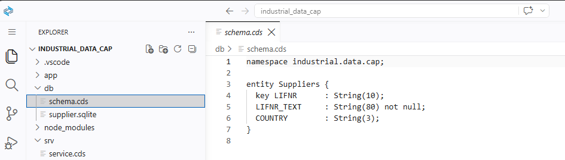
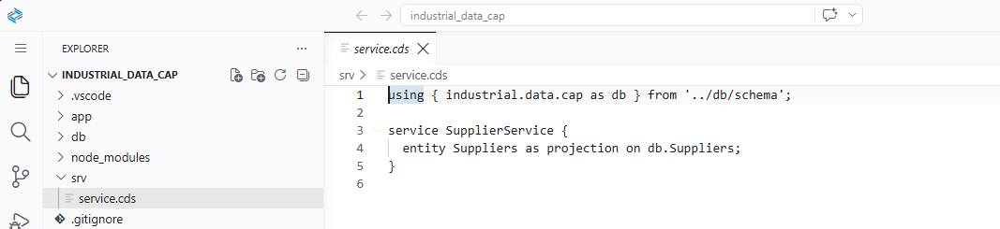
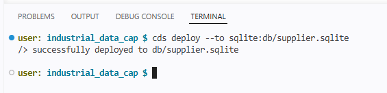
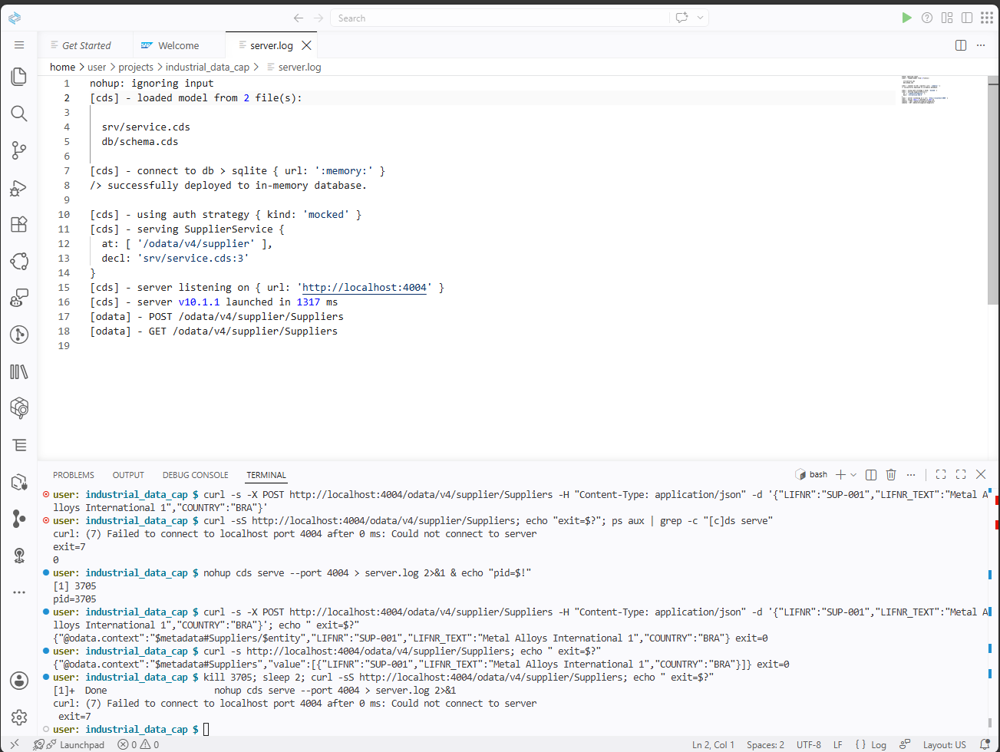

# C11: CAP & CDS Moderno (`@sap/cds-dk`)

**🌐 Idioma / Language:** 🇧🇷 **Português** | [🇺🇸 English](../EN/02-c11-cap-and-modern-cds.en.md)

[⬆️ Voltar ao README](../../../README.md) | [⬅️ Anterior: C1 a C10](./01-c1-c10-ambiente-profissional-e-seguranca-hdi.md)

> **Status:** ✅ Concluído localmente (modelo CDS + SQLite + serviço OData) · ⚪ Deploy no HANA Cloud não testado
> **Ambiente:** SAP Business Application Studio (BAS) · Dev Space `industrial_data_hana` · Node.js 24.17.0 · `@sap/cds-dk` 10.1.0
> **Projeto:** `industrial_data_cap` (separado do projeto HDI `industrial_data_db`, no BAS em `/home/user/projects/`)
> **Classificação:** ambiente de desenvolvimento educacional, dados fictícios

## 🎯 Visão executiva

No C5, o CDS clássico (`.hdbcds`) esbarrou em um plugin que não existe mais no motor de deploy do HANA Cloud. O C11 fecha essa lacuna pelo caminho oficial atual: o **CAP (Cloud Application Programming Model)**, com sua CLI própria (`@sap/cds-dk`), arquivos `.cds` sem o prefixo `hdb` e um serviço que expõe os dados como API OData.

O resultado foi um ciclo completo, validado de ponta a ponta no ambiente local do BAS: **modelo de dados → banco → serviço → API → inserção e leitura de um registro**.

| Etapa | Resultado |
|---|---|
| CLI instalada | ✅ `@sap/cds-dk` 10.1.0 (Node 24.17.0, npm 11.13.0) |
| Projeto CAP criado | ✅ `industrial_data_cap` com `db/`, `srv/`, `app/` |
| Modelo de dados (`db/schema.cds`) | ✅ Entidade `Suppliers` |
| Serviço (`srv/service.cds`) | ✅ `SupplierService` expondo `Suppliers` |
| Banco SQLite local | ✅ `cds deploy --to sqlite:db/supplier.sqlite` |
| Serviço OData no ar | ✅ `/odata/v4/supplier/Suppliers` |
| POST + GET de um registro | ✅ `SUP-001` criado e lido de volta |
| Deploy no HANA Cloud | ⚪ Não testado nesta rodada |

---

## 🧭 Storytelling funcional

### Preparação: sessão e limpeza

Antes de começar, uma pendência do bloco anterior: a service key `my-dev-key-2` (credencial real do HDI Container) ainda existia. A primeira tentativa de apagá-la falhou porque a sessão do Cloud Foundry tinha expirado (`The token expired, was revoked`). Depois do novo login por SSO, a key foi removida e a remoção confirmada com `cf service-keys hdi_db` (retorno: `No service keys for service instance hdi_db`). O `key.json` com a senha em texto puro também foi apagado.

### Instalação e criação do projeto

```bash
npm install -g @sap/cds-dk
cds --version        # @sap/cds-dk 10.1.0 · Node.js 24.17.0
cd /home/user/projects
cds init industrial_data_cap
```

O `cds init` reportou sucesso, mas **não gerou o `package.json`** (só `readme.md`, `.gitignore`, `.vscode/` e as pastas `db/`, `srv/`, `app/`). Sem esse arquivo o projeto não funciona, então foi criado manualmente:

```bash
npm init -y
npm install @sap/cds
```

> [!NOTE]
> Esse comportamento do `cds init` foi observado nesta sessão e não foi investigado a fundo. Se o `package.json` faltar no seu ambiente, `npm init -y` + `npm install @sap/cds` resolve.

### O modelo e o serviço

Duas camadas, cada uma no seu arquivo. Os dados ficam em `db/`, a exposição como API fica em `srv/`:

```cds
// db/schema.cds
namespace industrial.data.cap;

entity Suppliers {
  key LIFNR      : String(10);
  LIFNR_TEXT     : String(80) not null;
  COUNTRY        : String(3);
}
```

```cds
// srv/service.cds
using { industrial.data.cap as db } from '../db/schema';

service SupplierService {
  entity Suppliers as projection on db.Suppliers;
}
```


*C11-EV02 — Modelo de dados: entidade `Suppliers` em `db/schema.cds`. Repare no `supplier.sqlite` já presente em `db/`.*


*C11-EV03 — Serviço `SupplierService` em `srv/service.cds`, projetando a entidade do modelo.*

A entidade reaproveita o desenho de `SUPPLIER` do Bloco A (`LIFNR`, `LIFNR_TEXT`, `COUNTRY`), em versão reduzida de propósito, só para provar o ciclo.

### Banco local: dois obstáculos de configuração

```bash
cds add sqlite
cds deploy
```

O primeiro `cds deploy` falhou com `Please specify a database kind or url`. Com o alvo explícito, falhou de novo, agora com `MODULE_NOT_FOUND`. Apesar do `cds add sqlite` ter reportado `Successfully added features`, o **driver do SQLite não tinha sido instalado**. A correção foi instalá-lo:

```bash
npm install @cap-js/sqlite
cds deploy --to sqlite:db/supplier.sqlite
# /> successfully deployed to db/supplier.sqlite
```


*C11-EV04 — `cds deploy --to sqlite:db/supplier.sqlite` concluído com sucesso.*

### Serviço no ar e prova ponta a ponta

```bash
nohup cds serve --port 4004 > server.log 2>&1 &
curl -s http://localhost:4004/odata/v4/supplier/Suppliers
# {"@odata.context":"$metadata#Suppliers","value":[]}

curl -s -X POST http://localhost:4004/odata/v4/supplier/Suppliers \
  -H "Content-Type: application/json" \
  -d '{"LIFNR":"SUP-001","LIFNR_TEXT":"Metal Alloys International 1","COUNTRY":"BRA"}'

curl -s http://localhost:4004/odata/v4/supplier/Suppliers
# {"value":[{"LIFNR":"SUP-001","LIFNR_TEXT":"Metal Alloys International 1","COUNTRY":"BRA"}]}
```

A lista começou vazia, aceitou o `POST` e devolveu o registro no `GET`. O servidor foi encerrado em seguida, e uma nova chamada falhou com `Failed to connect to localhost port 4004`, confirmando o encerramento.


*C11-EV01 — `server.log` com os dois arquivos CDS carregados e o serviço em `/odata/v4/supplier`, mais o POST, o GET e o encerramento no terminal.*

> [!IMPORTANT]
> O `server.log` mostra `connect to db > sqlite { url: ':memory:' }` e `using auth strategy { kind: 'mocked' }`. Ou seja, o `cds serve` rodou com **banco em memória** (não usou o arquivo `db/supplier.sqlite`) e com **autenticação simulada**. O registro `SUP-001` existe só enquanto o servidor está de pé. É o comportamento padrão do CAP em modo de desenvolvimento, não um defeito, mas é bom ter em mente que isto ainda não é persistência.

---

## ⚖️ HDI nativo (C2–C6) × CAP (C11)

| Aspecto | HDI nativo (Bloco C anterior) | CAP (C11) |
|---|---|---|
| Arquivo de modelo | `.hdbtable` (SQL DDL) | `.cds` (declarativo) |
| Ferramenta de build/deploy | `mbt build` + `cf deploy` | `cds deploy` / `cds serve` |
| Namespace | Prefixo manual `namespace::objeto` | `namespace` declarado no topo do arquivo |
| API | Não existe | Serviço OData gerado a partir do `srv/` |
| Teste local | Não existe (deploy direto na nuvem) | SQLite em memória, ciclo em segundos |
| Obstáculos vividos | Privilégios do HDI, rede | Dependências (`package.json`, driver SQLite) |

---

## 🧱 Estrutura gerada

```text
industrial_data_cap/
├── db/
│   ├── schema.cds          # modelo de dados
│   └── supplier.sqlite     # banco gerado pelo cds deploy
├── srv/
│   └── service.cds         # serviço OData
├── app/                    # vazio (UI não foi usada)
├── .vscode/
├── package.json            # criado manualmente (npm init -y)
└── readme.md
```

> O projeto vive no BAS, não neste repositório. Os arquivos `.cds` estão reproduzidos integralmente acima.

---

## 📸 Evidências

| Evidência | Conteúdo |
|---|---|
| `C11-EV01` | `server.log` + POST/GET/encerramento no terminal |
| `C11-EV02` | `db/schema.cds` com a entidade `Suppliers` |
| `C11-EV03` | `srv/service.cds` com `SupplierService` |
| `C11-EV04` | `cds deploy --to sqlite:db/supplier.sqlite` com sucesso |

Arquivos em [`Evidences/LAB_C/`](../../../Evidences/LAB_C/).

---

## 🔜 O que ficou de fora

- **Deploy no HANA Cloud (`cds deploy --to hana`)**: não foi tentado. Exigiria vincular o projeto CAP a um HDI Container e rodar a partir do BAS, caminho que já mostrou restrições no C6/C7.
- **Persistência real**: rodar o `cds serve` apontando para o `supplier.sqlite` (ou para o HANA) em vez de memória.
- **Autenticação real**: o serviço usou autenticação simulada (`mocked`).
- **Interface (`app/`)**: pasta criada vazia. O consumo por SAP Fiori é tema do Bloco G.

---

[⬆️ Voltar ao README](../../../README.md) | [⬅️ Anterior: C1 a C10](./01-c1-c10-ambiente-profissional-e-seguranca-hdi.md)
