# C1 to C10: Professional SAP HANA Environment and HDI Security

**🌐 Language / Idioma:** 🇺🇸 **English** | [🇧🇷 Português](../BR/01-c1-c10-ambiente-profissional-e-seguranca-hdi.md)

[⬆️ Back to README](../../../README.md) | [➡️ Next: C11 — CAP & Modern CDS](./02-c11-cap-and-modern-cds.en.md)

> **Status:** ✅ Completed (C1, C2, C3, C4, C6, C7, C8) · ⚠️ Blocked by platform limitation, documented (C5, C9) · 🔜 Consolidated through lived experience (C10) · C11 documented separately in [DOC C-02](./02-c11-cap-and-modern-cds.en.md)
> **Environment:** SAP Business Application Studio (BAS) · SAP HANA Cloud Trial · Cloud Foundry (`hdi-shared` plan)
> **Classification:** educational development environment, no production data

## 🎯 Executive overview

After 10 scenarios practicing SQL directly in the console (Block B), this document marks the shift to the **professional SAP HANA development workflow**: a versionable project, HDI Container, automated deployment via Cloud Foundry, and — the most valuable part of this block — a real, extensive investigation into **HDI Container security**, driven not by a lesson plan but by a genuine chain of errors that became the C10 curriculum itself.

Unlike Block A (deterministic data, no surprises) and Block B (pure SQL, always-accessible environment), Block C happened in a **real cloud environment**, with all its imperfections: syntax errors discovered by trial and error, a platform feature that turned out to be deprecated mid-way, and a network limitation that blocked the final validation of one scenario. Every one of these obstacles is documented as it happened — including what was **not** resolved — because that is real engineering learning too.

| Scenario | Objective | Outcome |
|---|---|---|
| C1 | Business Application Studio | ✅ `SAP HANA Native Application` Dev Space created and operational |
| C2 | HANA Database Project | ✅ `industrial_data_db` project created, `db/src` structure generated |
| C3 | HDI Container | ✅ Container bound via `mta.yaml` (`resources.hdi_db`) |
| C4 | Design-Time Artifacts | ✅ `material.hdbtable` created and versioned |
| C5 | CDS Database Artifacts | ⚠️ Blocked — classic CDS (`.hdbcds`) discontinued on HANA Cloud |
| C6 | Deployment | ✅ Build (`mbt build`) + Deploy (`cf deploy`) succeeded |
| C7 | Runtime Objects | ✅ Objects validated via metadata (`SYS.TABLES`, `SYS.TABLE_COLUMNS`) |
| C8 | Synonyms & Cross-Schema Access | ✅ `CREATE SYNONYM` tested and validated with real data (300 rows) |
| C9 | Calculation Views | ⚠️ Partial — concept modeled, real data proven via SQL equivalent; graphical editor blocked by network |
| C10 | Security & Privileges | ✅ Consolidated — lived in practice throughout the whole block |
| C11 | CAP & Modern CDS (`@sap/cds-dk`) | ✅ Completed locally (SQLite + OData) — see [DOC C-02](./02-c11-cap-and-modern-cds.en.md) |

> [!IMPORTANT]
> No real credential remains active after this document. The service key created for testing (`my-dev-key`, `my-dev-key-2`) was removed with `cf delete-service-key`. Passwords that appeared in working logs were never persisted to any file in the repository.

---

## 🧭 Functional storytelling

### C1 — Setting up the professional environment

The first obstacle appeared right at Dev Space creation: the SAP BTP Trial has **two different landscapes** inside the same US10 region — the Cloud Foundry endpoint used by the graphical wizard (`api.cf.us10.hana.ondemand.com`) was not the same as the account's real Org (`api.cf.us10-001.hana.ondemand.com`, visible under **BTP Cockpit → Cloud Foundry Environment**). This mismatch produced the `There is no Org defined for this landscape` error until the endpoint was corrected manually during sign-in.

The Dev Space was created as `SAP HANA Native Application`, whose predefined extensions (SAP HANA Tools, Database Explorer, Calculation View Editor, MTA Tools) already covered the essentials of the roadmap without needing anything extra — only `CDS Graphical Modeler` was added manually.

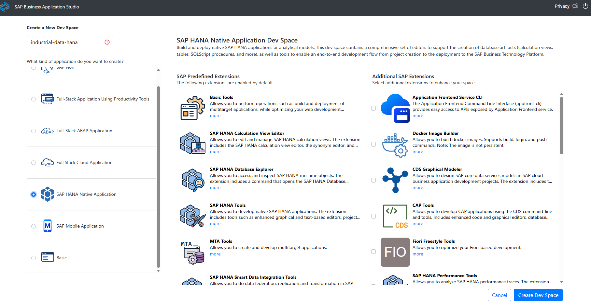
*C1-EV01 — Dev Space creation screen with the `SAP HANA Native Application` type.*

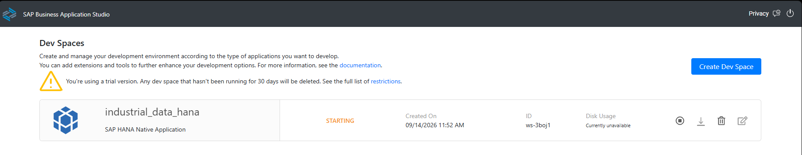
*C1-EV02 — `industrial_data_hana` created, status `STARTING`.*

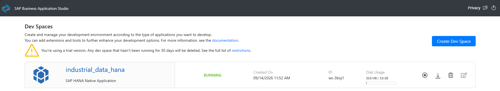
*C1-EV03 — Status `RUNNING`, with active disk usage.*

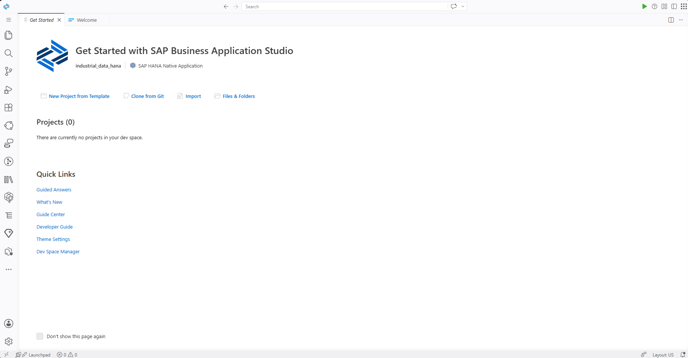
*C1-EV04 — IDE loaded, identifying `industrial_data_hana` · `SAP HANA Native Application`.*

### C2 + C3 — Project and HDI Container

The **"New Project From Template" → "SAP HANA Database Project"** wizard generated the `db/src/` structure with `.hdiconfig` and `.hdinamespace`. The first real blocker: the Dev Space name doesn't accept hyphens (`industrial-data-hana` → `industrial_data_hana`), only letters, numbers and underscore.

The **"Bind to HDI Container Service"** step failed silently on the first attempt (`Cloud Foundry Org and Space are not set`) because the graphical wizard's session expired between steps. The definitive fix was authenticating via **terminal** (`cf login --sso`, `cf target -o ... -s ...`) before reopening the wizard — a persistent CLI session proved more reliable than the graphical step-by-step flow for this kind of binding.

The generated `mta.yaml` confirms the binding:

```yaml
resources:
- name: hdi_db
  type: com.sap.xs.hdi-container
  parameters:
    config:
      schema: INDUSTRIAL_DATA_HDI
  properties:
    hdi-container-name: ${service-name}
```

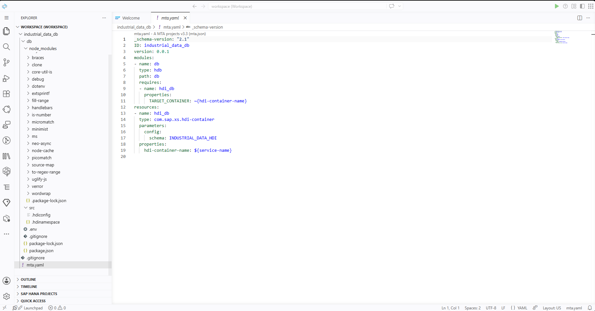
*C2-EV01 — `mta.yaml` with the `hdi_db` resource and the `INDUSTRIAL_DATA_HDI` schema.*

### C4 + C6 — First artifact, first deployment

`material.hdbtable` was written and failed the first deploy with a **namespace** error:

```
Error: com.sap.hana.di.table: "material" has to be prefixed with the namespace "industrial.data.db"
```

Fix: any object inside a project with a declared namespace needs the full prefix in its name, using `::` as separator — `"industrial.data.db::material"`, not `"material"`. After this fix, `mbt build` + `cf deploy` completed successfully, creating the real table in the `INDUSTRIAL_DATA_HDI` schema.

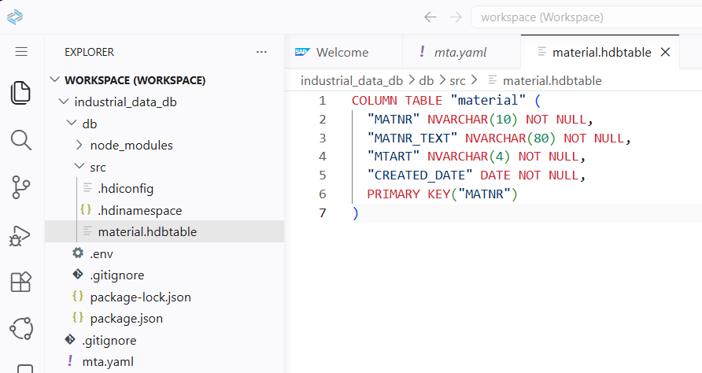
*C4-EV01 — `material.hdbtable` artifact created in `db/src/`.*

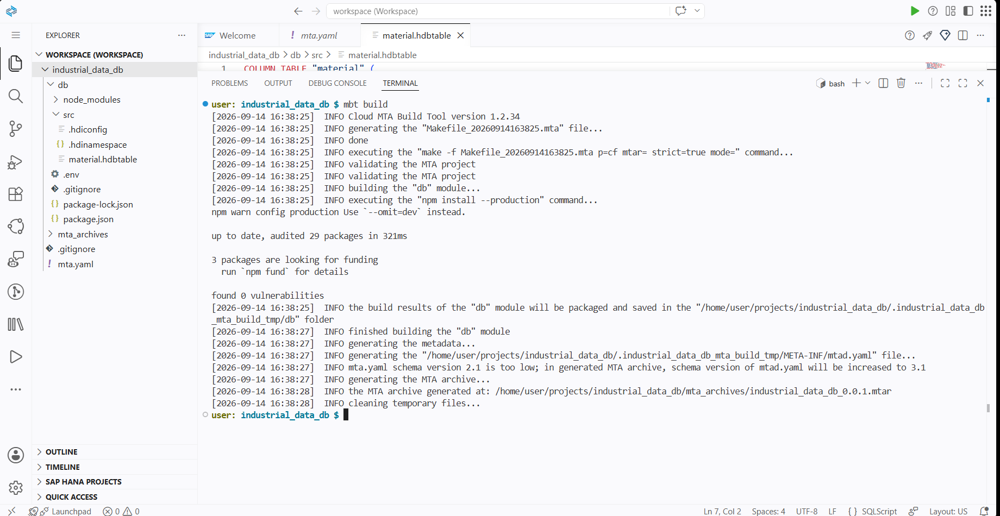
*C6-EV01 — `mbt build` generating the `.mtar`.*

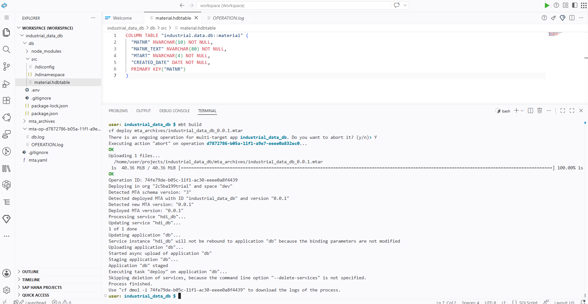
*C6-EV02 — `cf deploy` completed (`Process finished`).*

### C5 — Discovering that classic CDS is discontinued

Attempting to create `supplier.hdbcds` revealed, in cascade, three progressive errors:

1. `.hdiconfig` didn't recognize the `hdbcds` extension — fixed by adding the entry `"hdbcds": { "plugin_name": "com.sap.hana.di.cds" }`.
2. Once fixed, the error changed to `Could not find the "com.sap.hana.di.cds" build plugin` — the **plugin itself doesn't exist** in the current HANA Cloud deploy engine.

**Documented conclusion:** SAP has discontinued support for classic CDS (`.hdbcds`) inside a plain HDI Container on HANA Cloud. The current official path is **CAP** (`@sap/cds-dk`), with a completely different project structure and tooling — which is why this topic was moved to a future dedicated block (**C11**) instead of being forced into C5.

### C6 (continued) → C7 → the security investigation

After a successful deploy, attempting to **read the data** from the `material` table revealed this block's central limitation: neither `DBADMIN` (owner of everything else in the instance), nor the container's technical runtime user (`_RT`), nor the design-time user (`_DT`, the object's real owner) could `SELECT` from the freshly created table.

Eight different approaches were tested, in sequence:

| # | Approach | Result |
|---|---|---|
| 1 | Direct `SELECT` as `DBADMIN` | `insufficient privilege` |
| 2 | `GRANT SELECT ... TO DBADMIN` (self-grant) | `grantor and grantee are identical` |
| 3 | `.hdbgrants` with `"roles": ["object_owner_privilege"]` | `global roles are not supported in case of an HDI container service binding` |
| 4 | `.hdbgrants` with explicit `schema_privileges` | `schema privileges are not supported in case of an HDI container service binding` |
| 5 | `GRANT SELECT ... TO <_RT user>` via `DBADMIN` | `insufficient privilege` |
| 6 | External connection with `_RT` credentials (service key) | No tables visible / unstable authentication |
| 7 | External connection with `_DT` credentials (object owner) | `authentication failed` |
| 8 | Graphical wizard **"Grant HDI container privileges"** | `Socket closed by peer` (network failure, 4 consecutive times) |

**Documented conclusion:** the `hdi-shared` plan on SAP HANA Cloud Trial **does not support** granting schema privileges to the `application_user` via `.hdbgrants` — a platform restriction, not a configuration mistake. The network failures in attempt 8 (same error repeated against different target IPs) also suggest a block on direct connections to the database host from the SAP HANA Project Explorer component in this environment — possibly compounded by the corporate network/VPN used during the session.

C7's structural validation was then done via metadata (a path that **always worked**, since it doesn't depend on `SELECT`ing data, only on reading the catalog):

```sql
SELECT TABLE_NAME FROM SYS.TABLES WHERE SCHEMA_NAME = 'INDUSTRIAL_DATA_HDI';
-- returns: industrial.data.db::material

SELECT COLUMN_NAME, DATA_TYPE_NAME, LENGTH, IS_NULLABLE
FROM SYS.TABLE_COLUMNS
WHERE SCHEMA_NAME = 'INDUSTRIAL_DATA_HDI' AND TABLE_NAME = 'industrial.data.db::material';
-- returns the 4 columns exactly as defined in the .hdbtable
```

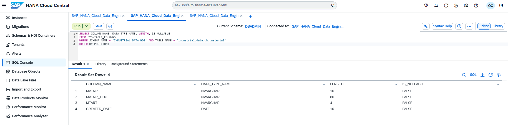
*C6-EV03 — The 4 columns (`MATNR`, `MATNR_TEXT`, `MTART`, `CREATED_DATE`) confirmed in `SYS.TABLE_COLUMNS`.*

### C8 — Synonyms, proof that the concept works when access already exists

To prove `CREATE SYNONYM` with real data, the test moved to the `INDUSTRIAL_DATA` schema (Block A/B), where `DBADMIN` already is the owner:

```sql
CREATE SYNONYM DBADMIN.MAT FOR INDUSTRIAL_DATA.MATERIAL;
SELECT * FROM DBADMIN.MAT;  -- 300 rows, identical to a direct SELECT
```

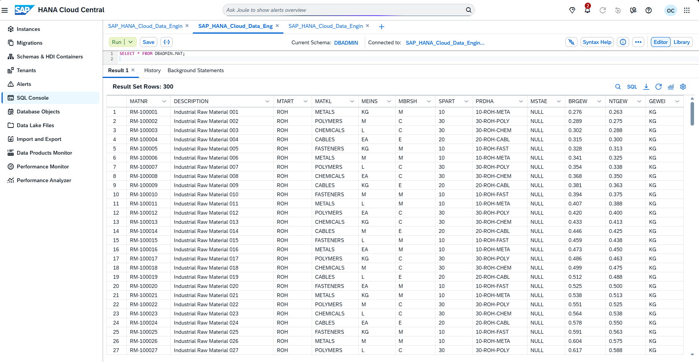
*C8-EV01 — `SELECT * FROM DBADMIN.MAT` returning the 300 rows of `INDUSTRIAL_DATA.MATERIAL`.*

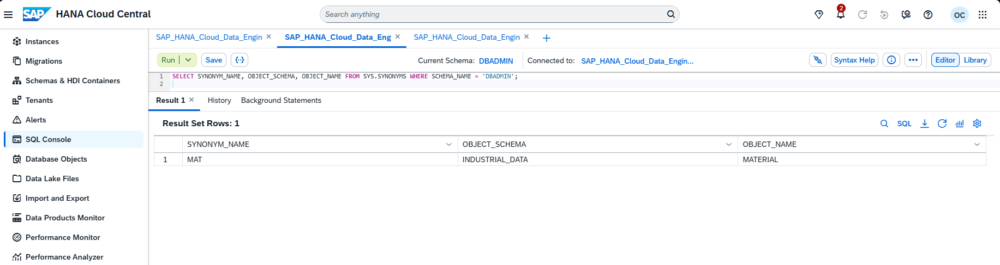
*C8-EV02 — The `MAT` synonym registered in `SYS.SYNONYMS`, pointing to `INDUSTRIAL_DATA.MATERIAL`.*

**Key lesson:** a Synonym is a naming transparency layer, not a security bypass mechanism. It only works when the underlying privilege already exists — confirming, through an independent path, the diagnosis from C6/C7.

### C9 — Calculation View, concept proven without the graphical editor

Searching for data sources inside the Calculation View graphical editor (`Find Data Sources`) returned `No data` even with the "local objects" filter disabled — a symptom of the same limited-access chain. Instead of insisting on the visual editor, the **Aggregation → Semantics** concept (the core structure of a CUBE-type Calculation View) was proven with an equivalent SQL query, run over the Synonym validated in C8:

```sql
SELECT MTART AS MATERIAL_TYPE, MATKL AS MATERIAL_GROUP,
       COUNT(*) AS MATERIAL_COUNT, AVG(BRGEW) AS AVG_GROSS_WEIGHT, SUM(NTGEW) AS TOTAL_NET_WEIGHT
FROM DBADMIN.MAT
GROUP BY MTART, MATKL
ORDER BY MATERIAL_COUNT DESC;
-- 24 rows of real aggregation
```

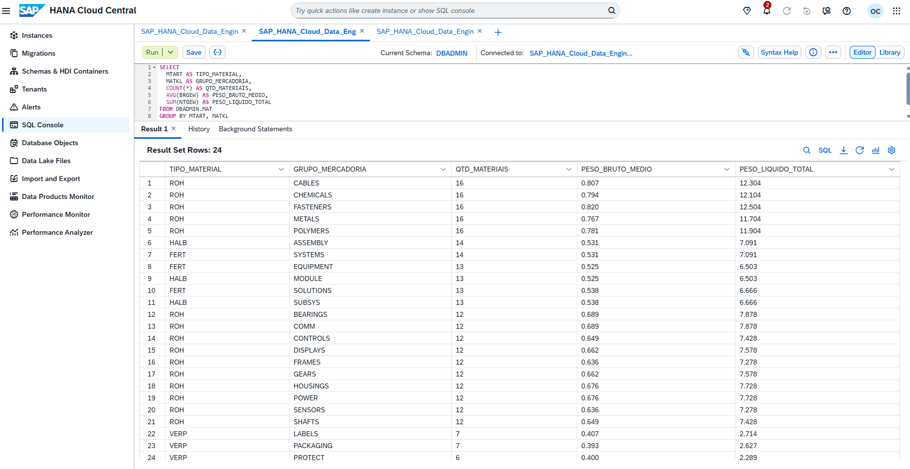
*C9-EV01 — Aggregation by material type and material group: 24 rows, over the `DBADMIN.MAT` Synonym.*

### C10 — Security & Privileges, consolidated through practice

This scenario had no isolated exercise because it was **lived in full** throughout C6 to C9. The core concepts, all empirically proven:

- **Least privilege by default**: an HDI Container is born granting nothing beyond what its own owner (`_DT`) needs — not even the instance's super-user (`DBADMIN`) gets automatic access.
- **HDI technical users**: every container generates a user pair — `_DT` (design-time / object owner, used during deploy) and `_RT` (runtime / application, used by apps consuming the container).
- **`.hdbgrants` has service-plan limits**: `hdi-shared` (Trial) doesn't accept the most common grant forms — this isn't obviously documented, only discovered in practice.
- **A direct `GRANT` requires the grantor to already hold the privilege** — even a broad administrative user like `DBADMIN` can't grant what it doesn't have.
- **A Synonym does not bypass security** — it's a naming layer over access that must already exist.

---

## 🗂️ Generated project structure

```text
industrial_data_db/
├── db/
│   ├── src/
│   │   ├── .hdiconfig              # recognized build plugins (edited: +hdbcds)
│   │   ├── .hdinamespace           # declares the industrial.data.db namespace
│   │   ├── material.hdbtable       # successfully deployed table
│   │   ├── supplier.hdbcds         # blocked (classic CDS discontinued)
│   │   ├── material_summary.hdbcalculationview  # concept modeled, not populated
│   │   └── industrial-data-db.hdbgrants          # grant attempts (unsupported on this plan)
│   └── package.json
└── mta.yaml                        # MTA descriptor + HDI Container binding
```

---

## 📸 Evidence

| Evidence | Scenario | Content |
|---|---|---|
| `C1-EV01` to `C1-EV04` | C1 | Dev Space configuration, `RUNNING` status, IDE loaded |
| `C2-EV01` | C2/C3 | `mta.yaml` with confirmed HDI Container binding |
| `C4-EV01` | C4 | `material.hdbtable` created and saved |
| `C6-EV01` | C6 | `mbt build` completed successfully |
| `C6-EV02` | C6 | `cf deploy` completed successfully (`Process finished`) |
| `C6-EV03` | C6/C7 | 4-column metadata confirmed via `SYS.TABLE_COLUMNS` |
| `C8-EV01`, `C8-EV02` | C8 | `SELECT` through the Synonym (300 rows) and the synonym in `SYS.SYNONYMS` |
| `C9-EV01` | C9 | Real aggregation (24 rows) proving the Calculation View concept via SQL |
| `C11-EV01` to `C11-EV04` | C11 | See [DOC C-02](./02-c11-cap-and-modern-cds.en.md) |

Full files in [`Evidences/LAB_C/`](../../../Evidences/LAB_C/).

---

## 🔜 Next steps

- **Re-validate C9 (graphical Calculation View) and data access (C6/C7)** on a home network, to isolate whether the root cause was the corporate VPN used during this session.

---

[⬆️ Back to README](../../../README.md)
