# D1 a D12: Engenharia de Dados no SAP HANA Cloud

**🌐 Idioma / Language:** 🇧🇷 **Português** | [🇺🇸 English](../EN/01-d1-d12-data-engineering.en.md)

[⬆️ Voltar ao README](../../../README.md)

> **Status:** ✅ Concluído (D1, D2, D3, D5, D6, D7, D8, D10, D11) · ⚠️ Parcial (D4 — definições completas das regras R01–R13 não recuperadas nesta sessão; D9 — conexão validada sem verificação de certificado; D12 — memória medida, `EXPLAIN PLAN` não persistido)
> **Ambiente:** SAP HANA Cloud Trial (Free Tier, região US10, versão 2026.28.10)
> **Origem:** schema `INDUSTRIAL_DATA` (`PURCHASE_ORDER` 40 linhas, `MATERIAL` 300 linhas) · **Destino:** schema `DBADMIN`
> **Classificação:** ambiente educacional, dados fictícios, sem dados de produção

## 🎯 Visão executiva

O Bloco A ensinou a consultar dados e o Bloco B ensinou a modelar a consulta. O Bloco C levou o desenvolvimento para o fluxo profissional, com projeto, HDI Container e deploy. O **Bloco D** responde à pergunta seguinte: **como os dados chegam, são limpos, validados, carregados de forma incremental, deduplicados, rastreados e disponibilizados para consumo** em um pipeline de engenharia de dados.

Diferente do Bloco C, o Bloco D foi executado de forma inteiramente manual, pelo SQL Console do SAP HANA Cloud, sem Data Provisioning Server. Isso é uma limitação real do Free Tier: a replicação gerenciada do SDI não está disponível, então cada padrão de carga (replicação, delta, merge) foi construído com SQL explícito. A contrapartida é que cada etapa ficou visível e auditável.

| Cenário | Objetivo | Resultado |
|---|---|---|
| D1 | Data Ingestion | ✅ Landing de 300 registros reconciliada com a origem |
| D2 | Data Cleansing | ✅ Valores inválidos tratados; validação de 300 linhas com `NA` |
| D3 | Transformation Pipelines | ✅ Camada curated validada (300 linhas), com perfil de pesos e regras de zero |
| D4 | Data Quality | ⚠️ Batch de 13 regras executado e validado; definições completas de R01–R13 não recuperadas |
| D5 | Incremental Loading | ✅ Carga inicial (23) + delta (17) = 40 linhas; reexecução com 0 linhas |
| D6 | Delta Processing (MERGE) | ✅ `MERGE INTO` com `WHEN MATCHED` / `WHEN NOT MATCHED`; resultado de 41 linhas |
| D7 | Deduplication | ✅ 43 registros com duplicidade reduzidos a 41 únicos com `ROW_NUMBER()` |
| D8 | Data Lineage | ✅ Linhagem documentada; catálogo de dependências limitado (ver storytelling) |
| D9 | Remote Sources | ⚠️ Fonte remota `HANA_SELF` criada; validação TLS desabilitada (apenas laboratório) |
| D10 | Virtual Tables | ✅ `VT_PURCHASE_ORDER` consultada remotamente, 40 linhas idênticas à origem |
| D11 | Replication | ✅ Réplica `REP_PURCHASE_ORDER` com 40 linhas, 0 diferenças, reexecução incremental com 0 linhas |
| D12 | Performance & Optimization | ⚠️ Memória por tabela medida (`M_CS_TABLES`); `EXPLAIN PLAN` não persistido |

> [!IMPORTANT]
> A validação de certificado TLS foi **desabilitada** (`sslValidateCertificate=false`) na fonte remota do D9. Isso foi uma decisão de laboratório, porque a Trial não permite gerar o PSE necessário. Em produção, a validação deve ser habilitada com o certificado correto.
>
> A senha do usuário `DBADMIN` foi digitada pelo próprio usuário no SQL Console e não aparece no histórico, pois a interface a oculta como `***`. Nenhuma credencial foi gravada em arquivo do repositório.

---

## 🧭 Storytelling funcional

### D1 — Ingestão: a primeira prova de reconciliação

A ingestão foi tratada como uma pergunta simples: **a landing recebeu todos os registros da origem?** A resposta foi verificada por contagem e reconciliação, antes de qualquer transformação.

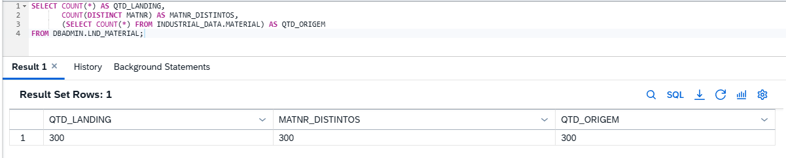
*D1-EV01 — Contagem de origem e landing iguais (300 registros).*

### D2 — Limpeza: NULLs e formatos inválidos

Valores ausentes e formatos inconsistentes foram tratados com `COALESCE`, `TRIM` e `CASE`, sem apagar registros. O critério foi que a limpeza **não pode reduzir a contagem**: o resultado final precisa manter as 300 linhas, agora com valores tratados.

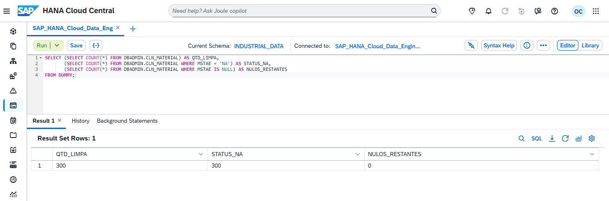
*D2-EV01 — Validação das 300 linhas após a limpeza, com a marcação `NA` nos campos tratados.*

### D3 — Transformação: de RAW para curated

A camada curated foi construída com `CTAS` (`CREATE COLUMN TABLE ... AS (SELECT ...)`) e validada em três aspectos: contagem (300), perfil de pesos e regras de valor zero, e percentual líquido com mínimo e máximo dentro do esperado.

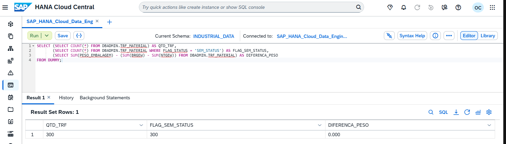
*D3-EV01 — Contagem da camada curated após a transformação.*

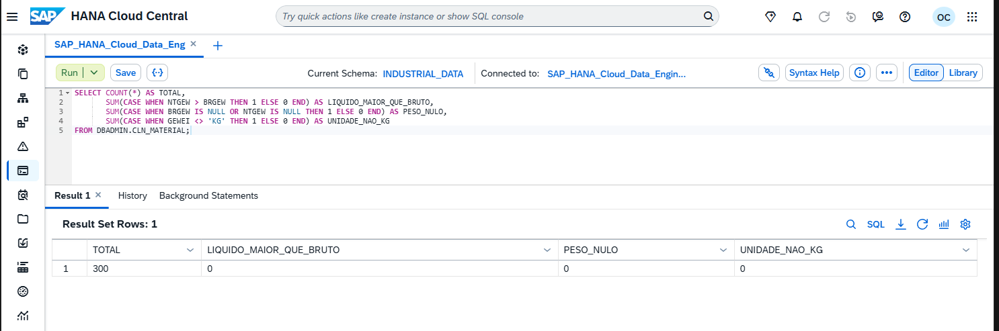
*D3-EV02 — Perfil dos pesos e verificação das regras de valor zero.*

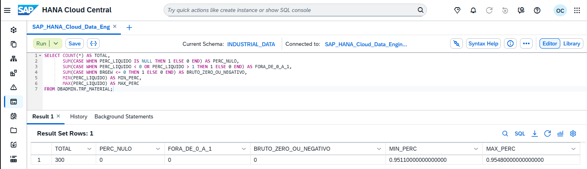
*D3-EV03 — Percentual líquido com os limites mínimo e máximo verificados.*

### D4 — Qualidade: regras técnicas e funcionais

O batch de qualidade executou **13 regras** (R01–R13) sobre a camada curated e gravou o resultado por regra. Durante a execução surgiu um ponto de atenção importante: a regra **R05 tinha um ponto cego**, causado pela injeção de registros de recebimento de mercadoria (GR) que alterou o cenário de validação. Esse achado foi documentado e a regra **R13** foi criada para cobrir a lacuna.

As definições completas de **R01, R04, R06–R10 e R12** não foram recuperadas nesta sessão, porque o histórico do SQL Console não retornou o texto do batch original na busca. Por honestidade técnica, essas regras aparecem abaixo apenas com o status conhecido, e a definição deve ser recuperada do repositório de scripts ou regerada antes de ser usada como referência.

| Regra | Papel conhecido | Situação |
|---|---|---|
| R01 | — | Definição a confirmar |
| R02 | Regra de qualidade do batch | Executada; ver D4-EV01 |
| R03 | Regra de qualidade do batch | Executada; restaurada e validada em D4-EV02 |
| R04 | — | Definição a confirmar |
| R05 | Ponto cego causado pela injeção de GR | Documentada; restaurada em D4-EV02 |
| R06–R10 | — | Definição a confirmar |
| R11 | Regra de qualidade do batch | Executada; ver D4-EV01 |
| R12 | — | Definição a confirmar |
| R13 | Criada para cobrir o ponto cego da R05 | Executada no batch 3 |

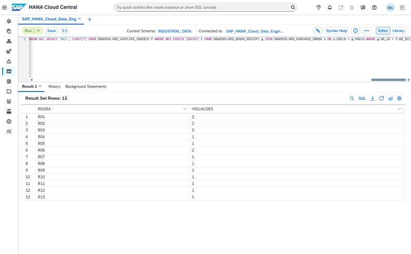
*D4-EV01 — Resultado das 13 regras no batch 3.*

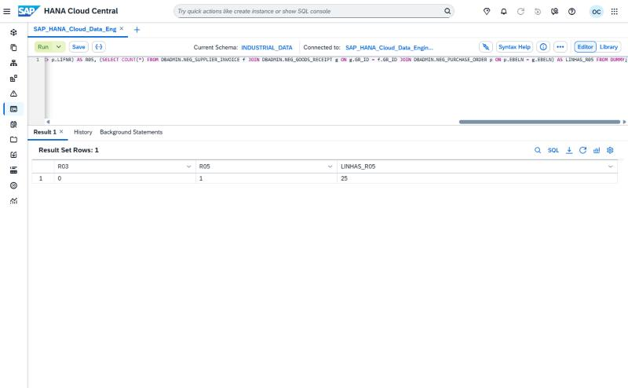
*D4-EV02 — Restauração da R05 e da R03 após o ajuste do cenário.*

### D5 — Carga incremental com marca d'água

A carga incremental usa uma **tabela de controle** (`DBADMIN.ETL_CONTROL`) com a última data processada (`ULTIMA_MARCA`), o horário da carga e o número de linhas carregadas. A primeira carga usa o corte `PO_DATE <= '2026-04-30'`, e as cargas seguintes buscam somente `PO_DATE > ULTIMA_MARCA`.

```sql
CREATE COLUMN TABLE DBADMIN.TGT_PURCHASE_ORDER AS (SELECT * FROM INDUSTRIAL_DATA.PURCHASE_ORDER WHERE 1 = 0) WITH NO DATA;
ALTER TABLE DBADMIN.TGT_PURCHASE_ORDER ADD PRIMARY KEY (EBELN);

CREATE COLUMN TABLE DBADMIN.ETL_CONTROL (
  TABELA NVARCHAR(60) PRIMARY KEY,
  ULTIMA_MARCA DATE,
  ULTIMA_CARGA TIMESTAMP,
  LINHAS_CARREGADAS INTEGER
);

INSERT INTO DBADMIN.TGT_PURCHASE_ORDER
SELECT * FROM INDUSTRIAL_DATA.PURCHASE_ORDER
WHERE PO_DATE <= '2026-04-30';

-- Delta: somente registros posteriores à marca d'água
INSERT INTO DBADMIN.TGT_PURCHASE_ORDER
SELECT * FROM INDUSTRIAL_DATA.PURCHASE_ORDER
WHERE PO_DATE > (SELECT ULTIMA_MARCA FROM DBADMIN.ETL_CONTROL WHERE TABELA = 'PURCHASE_ORDER');
```

Resultado: carga inicial de **23** linhas, delta de **17** linhas, total de **40**, e reexecução do delta com **0** linhas. A reexecução com 0 linhas é a prova de idempotência do processo: rodar de novo não duplica nada.

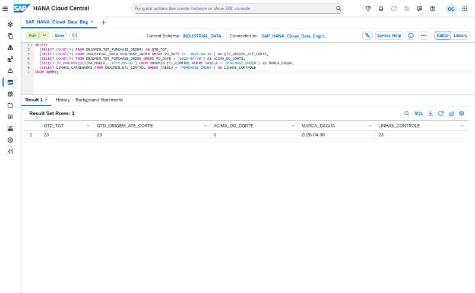
*D5-EV01 — Carga inicial com 23 linhas.*

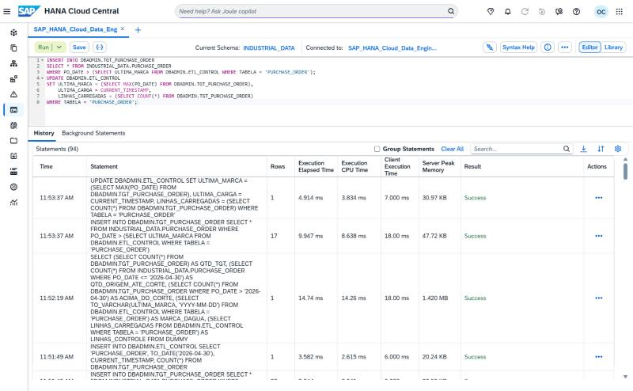
*D5-EV02 — Histórico da carga incremental com 17 linhas.*

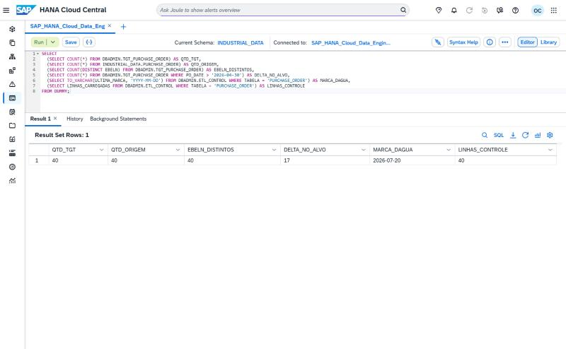
*D5-EV03 — Validação após o delta, com 40 linhas.*

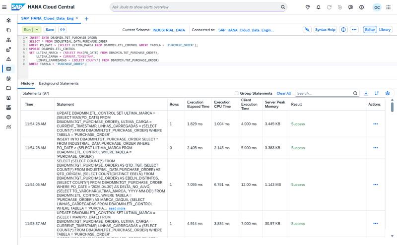
*D5-EV04 — Reexecução do delta retornando 0 linhas.*

### D6 — Delta com MERGE: atualizar e inserir em uma única instrução

O D5 só sabe **inserir** registros novos. Quando um registro existente muda na origem, é preciso **atualizar**. O `MERGE INTO` resolve os dois casos em uma única instrução, comparando a chave `EBELN`:

```sql
MERGE INTO DBADMIN.TGT_PURCHASE_ORDER AS T
USING DBADMIN.STG_PO_DELTA AS S
  ON T.EBELN = S.EBELN
WHEN MATCHED THEN UPDATE SET
  T.LIFNR = S.LIFNR, T.EKORG = S.EKORG, T.DOC_TYPE_CODE = S.DOC_TYPE_CODE,
  T.STATUS_CODE = S.STATUS_CODE, T.CURRENCY = S.CURRENCY,
  T.PO_DATE = S.PO_DATE, T.ITEM_COUNT = S.ITEM_COUNT
WHEN NOT MATCHED THEN INSERT
  (EBELN, LIFNR, EKORG, DOC_TYPE_CODE, STATUS_CODE, CURRENCY, PO_DATE, ITEM_COUNT)
  VALUES (S.EBELN, S.LIFNR, S.EKORG, S.DOC_TYPE_CODE, S.STATUS_CODE, S.CURRENCY, S.PO_DATE, S.ITEM_COUNT);
```

O staging tinha **18** registros. Após o MERGE, o destino ficou com **41** linhas, saindo de 40. A contagem de 41 é a validação do resultado; a separação exata entre atualizações e inserções não foi registrada separadamente no histórico.

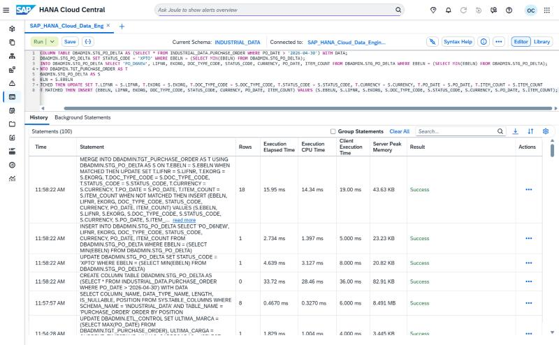
*D6-EV01 — Histórico da instrução MERGE sobre o staging de 18 registros.*

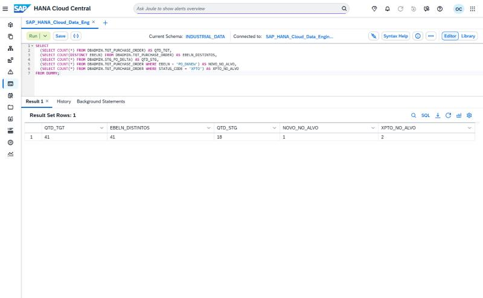
*D6-EV02 — Destino com 41 linhas após o MERGE.*

### D7 — Deduplicação com ROW_NUMBER

A tabela `DUP_PURCHASE_ORDER` tinha **43** registros, com duplicidade de chave. A deduplicação mantém um registro por `EBELN`, escolhendo o de `PO_DATE` mais recente, com `ROW_NUMBER()`:

```sql
CREATE COLUMN TABLE DBADMIN.DDP_PURCHASE_ORDER AS (
  SELECT EBELN, LIFNR, EKORG, DOC_TYPE_CODE, STATUS_CODE, CURRENCY, PO_DATE, ITEM_COUNT
  FROM (
    SELECT d.*,
           ROW_NUMBER() OVER (PARTITION BY EBELN ORDER BY PO_DATE DESC, STATUS_CODE) AS RN
    FROM DBADMIN.DUP_PURCHASE_ORDER d
  )
  WHERE RN = 1
) WITH DATA;
```

Resultado: **41** registros únicos. Os 2 registros removidos são exatamente as duplicatas da chave `EBELN`.

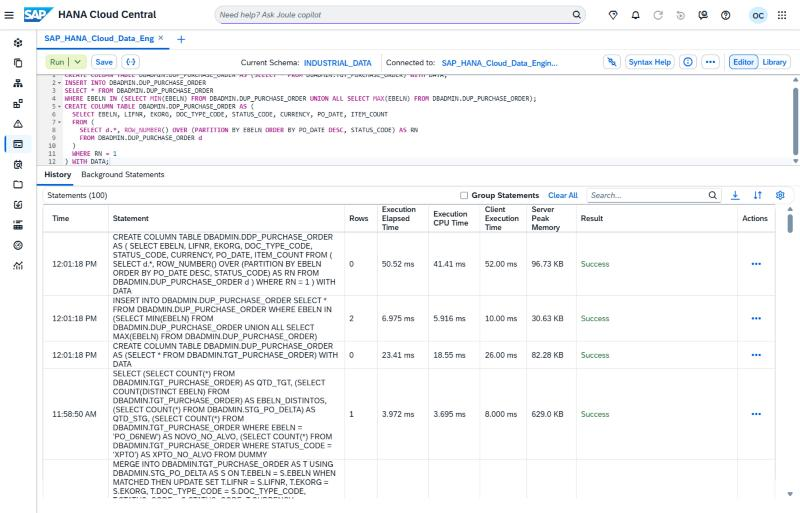
*D7-EV01 — Histórico da deduplicação, de 43 para 41 registros.*

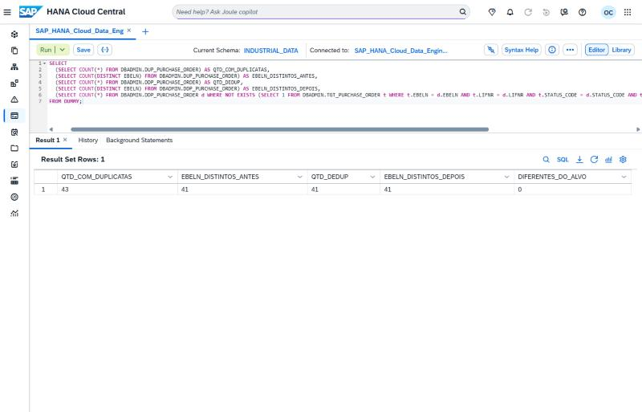
*D7-EV02 — Validação com 41 registros únicos.*

### D8 — Linhagem: o que o catálogo mostra e o que ele não mostra

A linhagem foi investigada com `SYS.OBJECT_DEPENDENCIES`. O catálogo mostrou apenas uma dependência, `DBADMIN.MAT → INDUSTRIAL_DATA.MATERIAL`, criada por sinônimo. As tabelas criadas com `CTAS` **não geram registro de linhagem no catálogo**.

Por isso, a linhagem do bloco foi **documentada a partir das instruções executadas**, e não automaticamente. Esse é um ponto importante para engenharia de dados: o catálogo do banco não substitui uma documentação de linhagem mantida pela equipe.

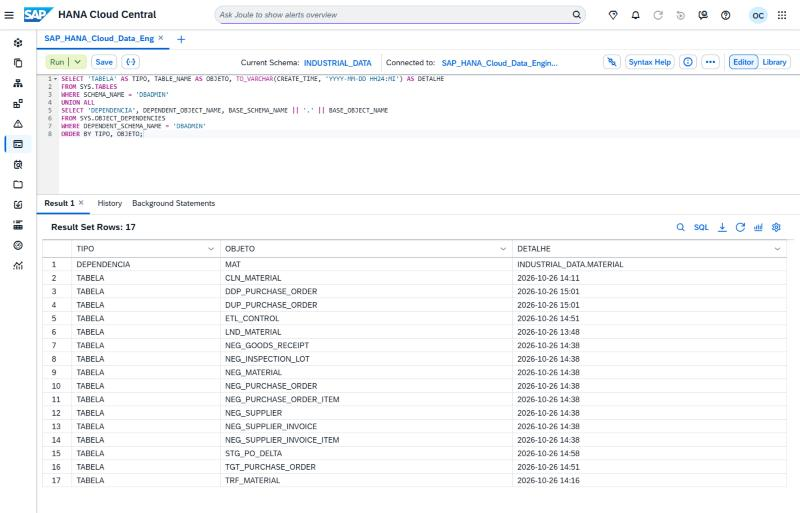
*D8-EV01 — Consulta de dependências, com apenas a relação do sinônimo.*

### D9 — Fontes remotas: do zero ao TLS

Antes do D9, a instância não tinha nenhuma fonte remota (`SYS.REMOTE_SOURCES` vazio), mas o adaptador `hanaodbc` estava disponível. A fonte `HANA_SELF` foi criada apontando para o próprio endpoint da instância, com credencial digitada pelo usuário:

```sql
CREATE REMOTE SOURCE HANA_SELF ADAPTER "hanaodbc"
CONFIGURATION 'Driver=libodbcHDB.so;
  ServerNode=ea686d62-9946-4aac-a0c4-cbbe65a3f818.hna0.prod-us10.hanacloud.ondemand.com:443;
  encrypt=true;sslValidateCertificate=false'
WITH CREDENTIAL TYPE 'PASSWORD'
USING 'user=DBADMIN;password=SUA_SENHA_AQUI';
```

A primeira tentativa, com `sslValidateCertificate=true`, falhou com `Cannot create SSL context ... PSE file does not exist`. O PSE (`/tmp/<instância>/sec/sapcli.pse`) não pode ser gerado na Trial, então a fonte foi recriada com validação desabilitada. Com isso a conexão funcionou. Esse é o ponto de maior risco de segurança do bloco e está registrado como limitação do laboratório.

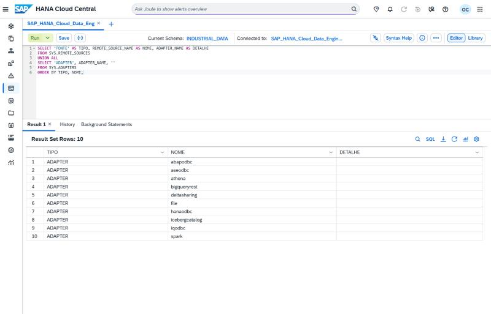
*D9-EV01 — Estado inicial: nenhuma fonte remota criada.*

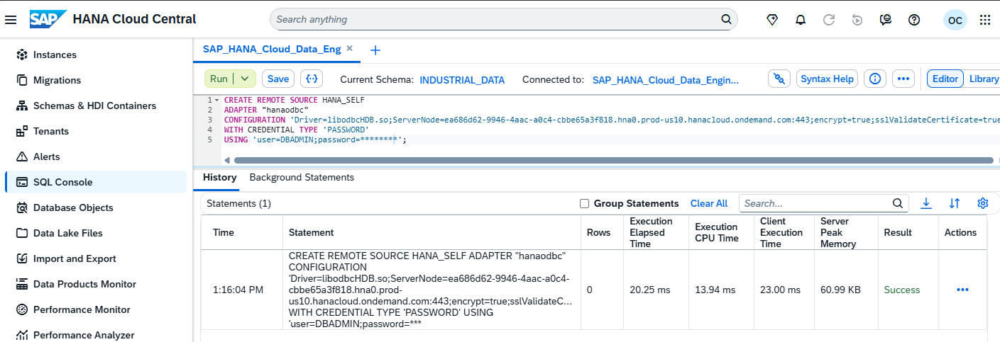
*D9-EV02 — Fonte `HANA_SELF` criada.*

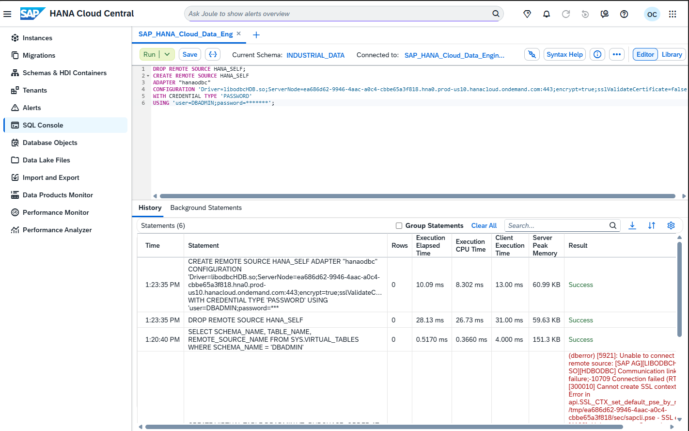
*D9-EV03 — Fonte recriada com `sslValidateCertificate=false`, após o erro de TLS.*

### D10 — Tabela virtual: consultar sem copiar

A tabela virtual `VT_PURCHASE_ORDER` aponta para a origem remota. O caminho precisou de **quatro partes** (`fonte.banco.schema.tabela`); com três partes a instrução foi rejeitada com erro de sintaxe (dberror 257).

```sql
CREATE VIRTUAL TABLE DBADMIN.VT_PURCHASE_ORDER
  AT "HANA_SELF"."HDB"."INDUSTRIAL_DATA"."PURCHASE_ORDER";
```

Resultado: **40** linhas, idênticas à origem.

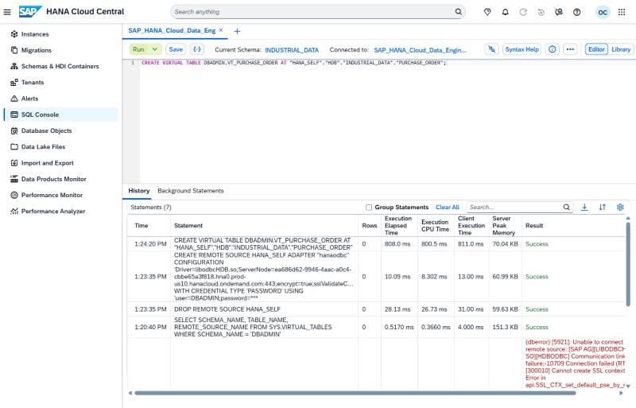
*D10-EV01 — Criação da `VT_PURCHASE_ORDER`.*

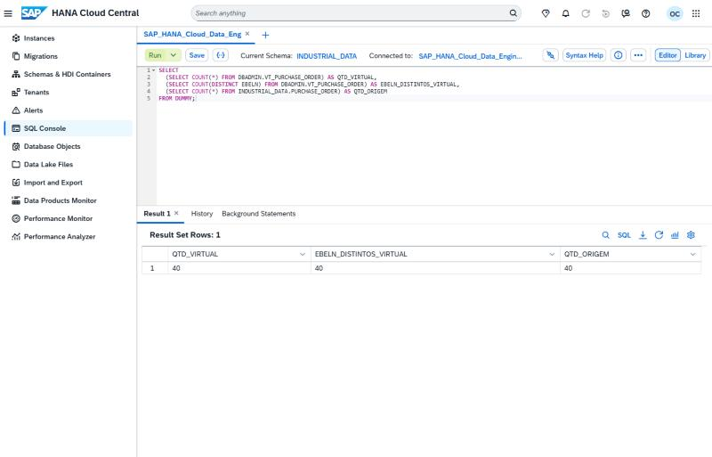
*D10-EV02 — Consulta da tabela virtual, 40 linhas.*

### D11 — Replicação manual: a alternativa ao SDI

Sem o Data Provisioning Server, a replicação foi feita manualmente a partir da tabela virtual, com carga completa e depois incremental:

```sql
CREATE COLUMN TABLE DBADMIN.REP_PURCHASE_ORDER AS (
  SELECT * FROM DBADMIN.VT_PURCHASE_ORDER
) WITH DATA;
```

A réplica ficou com **40** linhas e **0** diferenças em relação à origem. Na reexecução incremental, nenhuma linha nova foi carregada (**0** linhas), mostrando que o processo é seguro de repetir.

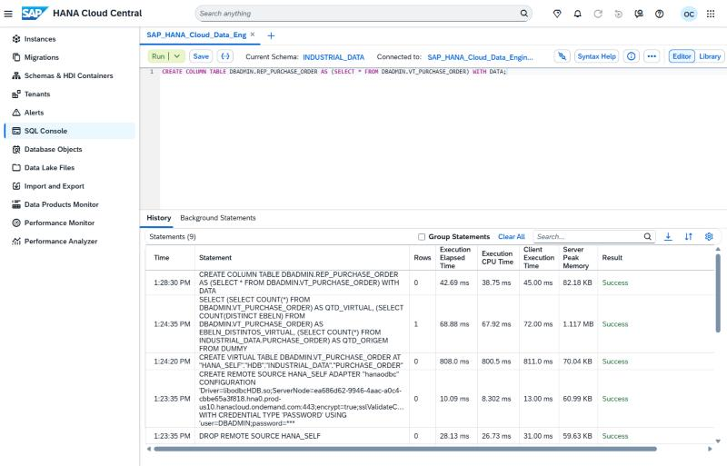
*D11-EV01 — Carga completa da réplica.*

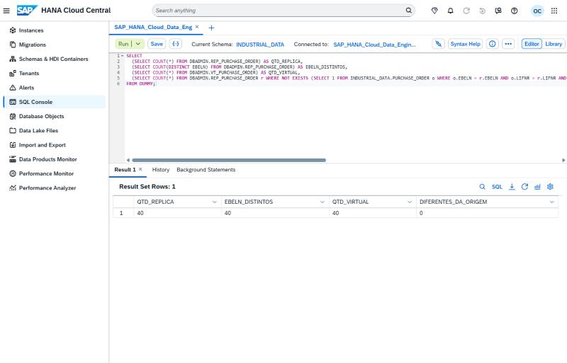
*D11-EV02 — Réplica com 40 linhas e 0 diferenças.*

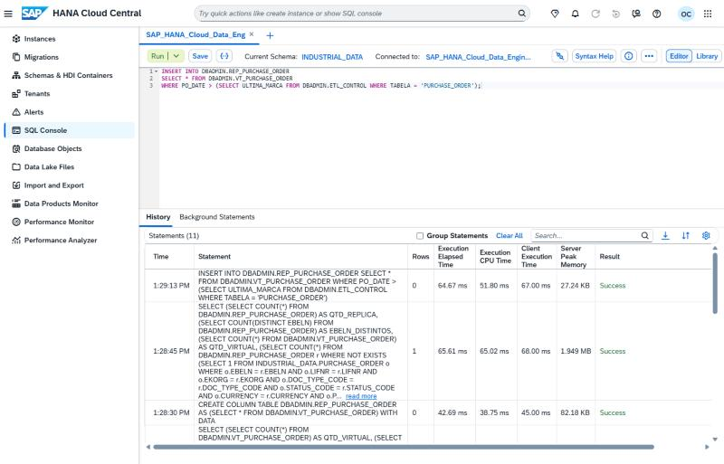
*D11-EV03 — Reexecução incremental retornando 0 linhas.*

### D12 — Performance: medir antes de otimizar

Com 40 a 300 linhas por tabela, não há diferença de performance mensurável entre estratégias. Por isso o foco do D12 foi **medir o consumo** e não otimizar. A memória por tabela foi consultada em `SYS.M_CS_TABLES` (`RECORD_COUNT` e `MEMORY_SIZE_IN_TOTAL`).

Não houve persistência de plano de execução. A tentativa de `EXPLAIN PLAN` gravou a tabela `EXPLAIN_PLAN_TABLE` no schema atual, mas essa tabela **não existia** na instância, e a consulta falhou com dberror 259 em `DBADMIN` e em `INDUSTRIAL_DATA`. Nada foi persistido. Esse item fica como pendência para um ambiente com mais volume.

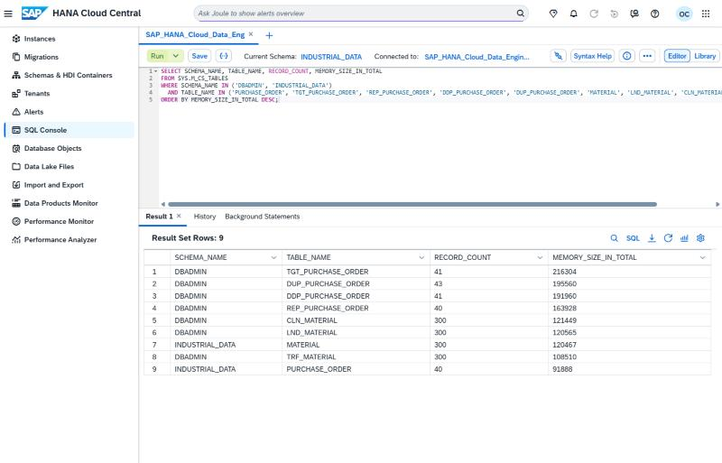
*D12-EV01 — Consumo de memória por tabela, medido em `SYS.M_CS_TABLES`.*

---

## 🗂️ Estrutura do pipeline

```
INDUSTRIAL_DATA.PURCHASE_ORDER (origem, 40 linhas)
        │
        ├─ D5: carga inicial (corte 2026-04-30) + delta (PO_DATE > ULTIMA_MARCA)
        │       └─ DBADMIN.TGT_PURCHASE_ORDER  ←  DBADMIN.ETL_CONTROL (marca d'água)
        │
        ├─ D6: MERGE INTO a partir de DBADMIN.STG_PO_DELTA (staging, 18 registros)
        ├─ D7: ROW_NUMBER sobre DBADMIN.DUP_PURCHASE_ORDER (43 → 41 únicos)
        │
        ├─ D9/D10: HANA_SELF → VT_PURCHASE_ORDER (tabela virtual, 40 linhas)
        └─ D11: REP_PURCHASE_ORDER (réplica por CTAS, 40 linhas, 0 diferenças)

Validação transversal: D1 (reconciliação), D2/D3 (limpeza e transformação), D4 (13 regras de qualidade), D8 (linhagem), D12 (memória)
```

---

## 📊 Evidências

| # | Evidência | Cenário | Arquivo |
|---|---|---|---|
| 1 | Reconciliação da landing (300) | D1 | [D1-EV01](../../../Evidences/LAB_D/D1-EV01-reconciliacao-landing-300.png) |
| 2 | Validação da limpeza (300, NA) | D2 | [D2-EV01](../../../Evidences/LAB_D/D2-EV01-validacao-limpeza-300-na.png) |
| 3 | Validação da transformação (300) | D3 | [D3-EV01](../../../Evidences/LAB_D/D3-EV01-validacao-transformacao-300.png) |
| 4 | Perfil de pesos e regras de zero | D3 | [D3-EV02](../../../Evidences/LAB_D/D3-EV02-perfil-pesos-regras-zero.png) |
| 5 | Percentual líquido, mínimo e máximo | D3 | [D3-EV03](../../../Evidences/LAB_D/D3-EV03-percentual-liquido-min-max.png) |
| 6 | Resultado das 13 regras (batch 3) | D4 | [D4-EV01](../../../Evidences/LAB_D/D4-EV01-regras-13-resultado-batch3.jpg) |
| 7 | R05 e R03 restauradas | D4 | [D4-EV02](../../../Evidences/LAB_D/D4-EV02-r05-r03-restaurado.jpg) |
| 8 | Carga inicial (23) | D5 | [D5-EV01](../../../Evidences/LAB_D/D5-EV01-validacao-carga-inicial-23.jpg) |
| 9 | Histórico do delta (17) | D5 | [D5-EV02](../../../Evidences/LAB_D/D5-EV02-historico-carga-incremental-17.jpg) |
| 10 | Pós-delta (40) | D5 | [D5-EV03](../../../Evidences/LAB_D/D5-EV03-validacao-pos-delta-40.jpg) |
| 11 | Reexecução do delta (0) | D5 | [D5-EV04](../../../Evidences/LAB_D/D5-EV04-reexecucao-delta-0.jpg) |
| 12 | Histórico do MERGE (18) | D6 | [D6-EV01](../../../Evidences/LAB_D/D6-EV01-historico-merge-18.jpg) |
| 13 | Validação pós-MERGE (41) | D6 | [D6-EV02](../../../Evidences/LAB_D/D6-EV02-validacao-merge-41.jpg) |
| 14 | Histórico da deduplicação (43 → 41) | D7 | [D7-EV01](../../../Evidences/LAB_D/D7-EV01-historico-dedup-43-41.jpg) |
| 15 | Validação da deduplicação (41) | D7 | [D7-EV02](../../../Evidences/LAB_D/D7-EV02-validacao-dedup-41.jpg) |
| 16 | Catálogo de dependências | D8 | [D8-EV01](../../../Evidences/LAB_D/D8-EV01-catalogo-dependencias-dbadmin.jpg) |
| 17 | Estado inicial de fontes remotas | D9 | [D9-EV01](../../../Evidences/LAB_D/D9-EV01-fontes-remotas-zero-adapters-10.jpg) |
| 18 | Fonte HANA_SELF criada | D9 | [D9-EV02](../../../Evidences/LAB_D/D9-EV02-criacao-fonte-remota-hana-self-success.png) |
| 19 | Fonte recriada sem validação de certificado | D9 | [D9-EV03](../../../Evidences/LAB_D/D9-EV03-recriacao-fonte-sem-validacao-certificado.png) |
| 20 | Tabela virtual criada | D10 | [D10-EV01](../../../Evidences/LAB_D/D10-EV01-criacao-tabela-virtual-success.jpg) |
| 21 | Tabela virtual (40) | D10 | [D10-EV02](../../../Evidences/LAB_D/D10-EV02-validacao-tabela-virtual-40.jpg) |
| 22 | Carga completa da réplica | D11 | [D11-EV01](../../../Evidences/LAB_D/D11-EV01-historico-replica-carga-completa.jpg) |
| 23 | Réplica (40, 0 diferenças) | D11 | [D11-EV02](../../../Evidences/LAB_D/D11-EV02-validacao-replica-40-0-diferencas.jpg) |
| 24 | Reexecução incremental (0) | D11 | [D11-EV03](../../../Evidences/LAB_D/D11-EV03-reexecucao-incremental-0-linhas.jpg) |
| 25 | Memória por tabela (M_CS_TABLES) | D12 | [D12-EV01](../../../Evidences/LAB_D/D12-EV01-memoria-por-tabela-m-cs-tables.jpg) |

---

## ⚠️ Limitações e pendências

- **D4:** definições completas de R01, R04, R06–R10 e R12 não recuperadas. Recuperar do repositório de scripts antes de reutilizar o batch.
- **D4:** divergência do cenário SHIFT: o handoff indicava 3 registros, o banco mostrou 0. Não resolvida.
- **D4:** hipótese de status do `UD_CODE` (82 / 23 / 11) não confirmada.
- **D9/D10:** validação TLS desabilitada (`sslValidateCertificate=false`). Apenas para laboratório.
- **D8:** `CTAS` não gera linhagem no catálogo. A linhagem é documentada manualmente.
- **D11:** sem Data Provisioning Server no Free Tier, a replicação é manual via tabela virtual.
- **D12:** `EXPLAIN PLAN` não persistido; sem volume suficiente para medir ganho de otimização.

## ➡️ Próximos passos

1. Recuperar o texto do batch de qualidade do D4 e completar a documentação de R01–R13.
2. Habilitar a validação de certificado TLS em um ambiente que permita gerar o PSE.
3. Repetir o D12 com volume maior para medir ganho real de performance.

---

[⬆️ Voltar ao README](../../../README.md)
