# F1 a F9: CAP e APIs de Dados sobre SAP HANA Cloud

**🌐 Idioma / Language:** 🇧🇷 **Português** | [🇺🇸 English](../EN/01-f1-f9-cap-and-data-apis.en.md)

[⬆️ Voltar ao README](../../../README.md)

> **Status:** ✅ Concluído (F1 a F9) · ⚠️ Ressalvas de evidência: F1 sem captura de tela (validado por saída de terminal); F3 sem captura da instância e do deploy (EV01 e EV02 documentados como texto); F8 sem print do 403 sem papel e sem teste de um Viewer isolado
> **Ambiente:** SAP CAP (`@sap/cds` 10.2.1, `@sap/cds-dk` 10.2.0, Node.js 24) · SQLite em memória (F1, F2, F4 a F7, F9) · SAP HANA Cloud Trial (Free Tier, região US10, versão 2026.28.13) via container HDI (F3) · XSUAA no Cloud Foundry (F8)
> **Projeto:** [`industrial-data-cap/`](../../../industrial-data-cap) (na raiz do repositório) · **Serviço:** `ProcurementService` em `/odata/v4/procurement`
> **Dados:** CSV fictícios — 2 pedidos de compra e 3 materiais
> **Classificação:** ambiente educacional, dados fictícios, sem dados de produção

## 🎯 Visão executiva

O Bloco A ensinou a modelar os dados, o Bloco B a consultá-los, o Bloco C a desenvolver no fluxo profissional (projeto, HDI e deploy) e o Bloco D a movê-los em um pipeline de engenharia de dados. O **Bloco F** responde à pergunta seguinte: **como esses dados são expostos, protegidos e consumidos por outras aplicações** através de APIs.

A resposta foi construída com o SAP Cloud Application Programming Model (CAP). Um único modelo CDS gera o serviço OData V4; sobre ele foram acrescentados um endpoint REST próprio, regras de negócio, autenticação real com XSUAA e autorização por papel. O mesmo código roda em dois perfis: o perfil padrão usa SQLite em memória e usuários de teste, e o perfil `hybrid` usa o SAP HANA Cloud e o XSUAA do BTP.

Todos os cenários foram executados no computador do próprio usuário, via PowerShell, com cada comando e cada resposta visíveis na tela. Os cenários F1, F2 e F4 a F7 e F9 foram antes validados em um sandbox; F3 e F8 só puderam ser feitos no ambiente de BTP do usuário.

| Cenário | Objetivo | Resultado |
|---|---|---|
| F1 | CAP Foundation | ✅ Projeto `industrial-data-cap` criado; serviço OData local respondendo, `$metadata` com HTTP 200 |
| F2 | Domain Modeling | ✅ Entidades `PurchaseOrder` e `Material`, projeções de serviço e view CDS `BrlOrders` com nomes de negócio |
| F3 | HANA Persistence | ✅ Deploy no container HDI `hdi_db` (12 arquivos, 3 + 2 registros); `POST` do `MAT-004` persistiu (4 materiais) e sobreviveu a um restart |
| F4 | OData Service | ✅ `$metadata`, `$count`, `$orderby`, `$top`, `$skip` e erro 404 para chave inexistente |
| F5 | REST APIs | ✅ Dois endpoints REST próprios (`/rest/materiais/resumo` e `/rest/materiais/:matnr`), comparados com o OData |
| F6 | Filtering & Paging | ✅ Oito consultas: `or`, `startswith`, `contains`, `and`, `gt`, `ne`, ordenação simples e composta |
| F7 | Business Logic | ✅ Três regras no handler `before`: 1 pedido válido (201) e 3 recusas (400) |
| F8 | Authentication | ✅ XSUAA real: 401 sem token; token com escopos `Buyer` e `Viewer`; 200 com token |
| F9 | Authorization | ✅ `@restrict` por entidade: Viewer lê, Buyer escreve; 401, 403 e 201 conforme o papel |

> [!IMPORTANT]
> Nenhuma credencial foi gravada em arquivo do repositório. `.cdsrc-private.json` (vínculos locais), `default-env.json`, `.env` e `node_modules/` estão no `.gitignore` do projeto, e `gen/` está no `.gitignore` da raiz. As senhas foram digitadas pelo próprio usuário no terminal (campo oculto) e não aparecem nos prints.
>
> Os usuários `alice` e `bob` do `.cdsrc.json` existem **só para desenvolvimento local**, com senhas triviais e papéis fixos. No perfil `hybrid` eles não são usados: a autenticação passa a ser do XSUAA.

---

## 🧭 Storytelling funcional

### F1 — Fundação: do `cds init` ao primeiro serviço

O objetivo do F1 foi criar a aplicação mínima do bloco: guardar dados em um banco e entregá-los por um endereço que outros programas conseguem ler. O CAP faz isso a partir de uma descrição curta dos dados. O projeto foi criado com `cds init`, o runtime Node.js foi adicionado com `cds add nodejs` e o driver `@cap-js/sqlite` foi instalado como banco local de teste.

A estrutura mínima ficou assim:

| Arquivo | Papel |
|---|---|
| `db/schema.cds` | Descreve os dados (entidade `PurchaseOrder`, com `EBELN`, `LIFNR`, `PO_DATE`, `CURRENCY`) |
| `srv/service.cds` | Publica o serviço em `/odata/v4/procurement` |
| `db/data/*.csv` | Dados de exemplo carregados no SQLite ao subir o servidor |
| `package.json` | Dependências do projeto |

```cds
namespace industrial.data;

entity PurchaseOrder {
  key EBELN : String(10);
      LIFNR : String(10);
      PO_DATE : Date;
      CURRENCY : String(5);
}
```

```cds
using industrial.data as db from '../db/schema';

service ProcurementService @(path: '/odata/v4/procurement') {
  entity PurchaseOrders as projection on db.PurchaseOrder;
}
```

O primeiro teste sem o driver de banco retornou `NO_DATABASE_CONNECTION`; com `@cap-js/sqlite` instalado, o serviço respondeu com os 2 pedidos, o filtro `CURRENCY eq 'BRL'` devolveu só o pedido em reais e o `$metadata` retornou HTTP 200.

No computador do usuário foi preciso preparar o ambiente: o Node.js foi instalado a partir do pacote zip e adicionado ao `PATH` do usuário, e os comandos usam `npm.cmd` e `npx.cmd` porque a política de execução do PowerShell bloqueia `npm.ps1`. Os dados desse primeiro cenário ficam só no SQLite em memória, e somem quando o servidor para.

> O F1 não tem captura de tela. Foi validado por saída de terminal, primeiro no sandbox e depois no computador do usuário.

### F2 — Modelagem: duas entidades e uma view CDS

O F2 ampliou o modelo com a entidade `Material` e expôs três recursos no serviço: `PurchaseOrders` e `Materials` como projeções diretas, e `BrlOrders` como uma **view CDS** (`select from ... where`) que só enxerga pedidos em reais e renomeia as colunas para nomes de negócio (`Pedido`, `Fornecedor`, `Data`).

```cds
entity Material {
  key MATNR : String(40);
      MATNR_TEXT : String(100);
      MTART : String(4);
      CREATED_DATE : Date;
}
```

```cds
entity BrlOrders as select from db.PurchaseOrder {
  key EBELN as Pedido,
      LIFNR as Fornecedor,
      PO_DATE as Data
} where CURRENCY = 'BRL';
```

Os dados de exemplo são um subconjunto pequeno e fictício: 2 pedidos (`4500000001` em BRL e `4500000002` em USD) e 3 materiais (`MAT-001` Parafuso M8 `ROH`, `MAT-002` Motor 2CV `FERT`, `MAT-003` Caixa de engrenagem `HALB`).

| Teste | Consulta | Resultado |
|---|---|---|
| 1 | `Materials` | 3 materiais, com todos os campos |
| 2 | `Materials?$filter=MTART eq 'FERT'` | Só `MAT-002` (Motor 2CV) |
| 3 | `BrlOrders` | 1 pedido, com `Pedido`, `Fornecedor` e `Data`; os nomes originais não aparecem |
| 4 | `Materials('MAT-003')` | O registro da Caixa de engrenagem |

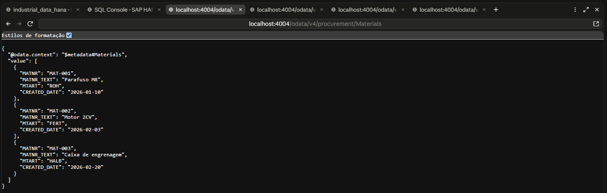
*F2-EV01 — `Materials` retornando os 3 materiais.*

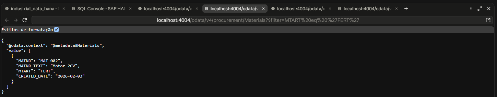
*F2-EV02 — `$filter=MTART eq 'FERT'` retornando só o `MAT-002`.*

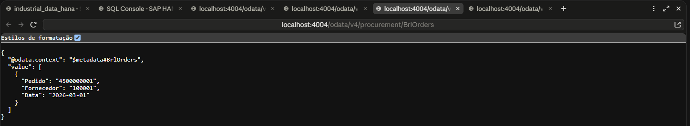
*F2-EV03 — A view `BrlOrders`, com os nomes de negócio.*

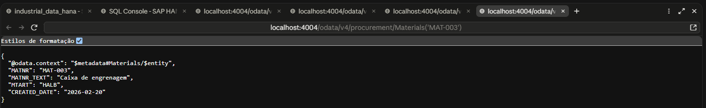
*F2-EV04 — Leitura por chave, `Materials('MAT-003')`.*

Um ponto prático do F2: ao gravar os arquivos novos no computador do usuário, a primeira gravação não substituiu o conteúdo antigo. O log do servidor mostrava só `PurchaseOrder` carregada e `Materials` retornava 404. A causa foi conferida lendo o arquivo no disco (446 bytes na versão nova contra 173 da antiga) e a gravação foi refeita com sobrescrita forçada.

### F3 — Persistência: do SQLite ao SAP HANA Cloud

Até o F2 o banco era o SQLite em memória, e os dados desapareciam quando o servidor parava. No F3 o serviço passou a usar o SAP HANA Cloud, reaproveitando o container HDI `hdi_db` criado no Bloco C. O código do serviço não mudou: a troca é feita na configuração, pelo perfil `hybrid`.

```powershell
npm.cmd install @cap-js/hana
npx.cmd cds bind -2 hdi_db
npx.cmd cds bind --exec --profile hybrid -- npx.cmd cds deploy --profile hybrid --to hana
```

O `cds bind -2 hdi_db` cria a service key do container e grava só a referência do vínculo em `.cdsrc-private.json` (que não vai para o GitHub); as credenciais são resolvidas na hora de executar, com `cds bind --exec`.

**O primeiro deploy falhou.** O deployer não conseguiu conectar ao endpoint do HANA, com a mensagem `Client network socket disconnected before secure TLS connection was established`. O teste de porta (`Test-NetConnection ... -Port 443`) respondeu `True`, então a rede estava aberta e o problema estava na regra de acesso: a instância estava configurada em **Allowed connections = somente IPs do Cloud Foundry da região**, o que bloqueia o computador de desenvolvimento. A correção foi adicionar o IP público do computador, no formato `IP/32`, em **Manage Configuration → Connections → Allow specific IP addresses and IP ranges**, mantendo a opção do Cloud Foundry.

Com o acesso liberado, o deploy terminou com `Make succeeded (0 warnings): 12 files deployed`. O HDI inseriu **3 registros** em `INDUSTRIAL_DATA_MATERIAL` e **2 registros** em `INDUSTRIAL_DATA_PURCHASEORDER`, a partir dos CSVs, e criou também as três views do serviço e a tabela técnica `cds.outbox.Messages`.

A conferência no SQL Console, sobre o schema do container (`INDUSTRIAL_DATA_HDI`):

```sql
SELECT TABLE_NAME, RECORD_COUNT
FROM SYS.M_TABLES
WHERE SCHEMA_NAME = 'INDUSTRIAL_DATA_HDI'
  AND TABLE_NAME LIKE 'INDUSTRIAL_DATA_%';
```

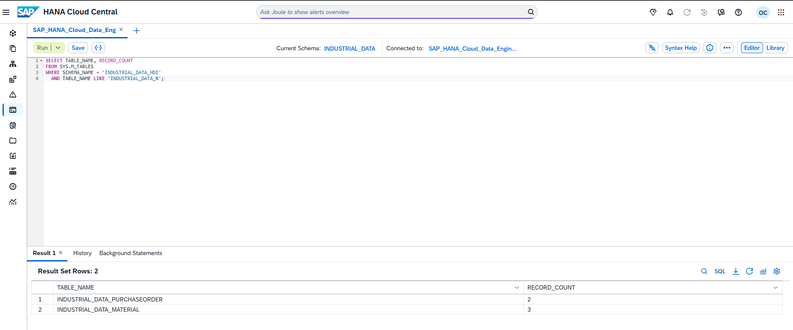
*F3-EV03 — `INDUSTRIAL_DATA_PURCHASEORDER` com 2 registros e `INDUSTRIAL_DATA_MATERIAL` com 3.*

**Teste de persistência.** Com o servidor subindo no perfil `hybrid` (log `connect to db > hana`), foi criado um material novo com o token de Buyer, conferido no banco, e o servidor foi parado e reiniciado:

```powershell
$novo = @{ MATNR = 'MAT-004'; MATNR_TEXT = 'Teste persistencia HANA'; MTART = 'ROH'; CREATED_DATE = '2026-11-03' }
Invoke-RestMethod -Method Post -Uri "http://localhost:4004/odata/v4/procurement/Materials" -Headers @{ Authorization = $token } -ContentType 'application/json' -Body ($novo | ConvertTo-Json)
```

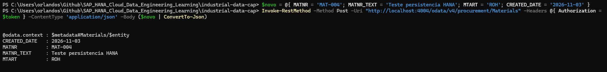
*F3-EV04 — Criação do `MAT-004` pelo serviço.*

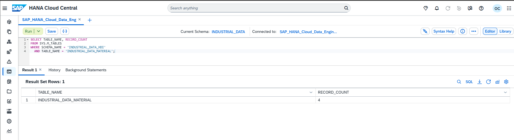
*F3-EV05 — `INDUSTRIAL_DATA_MATERIAL` passou de 3 para 4 registros, direto no banco.*

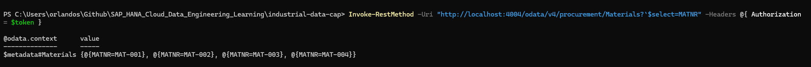
*F3-EV06 — Depois do restart do servidor, `$select=MATNR` lista `MAT-001` a `MAT-004`.*

A leitura depois do restart foi feita com um token do XSUAA, ou seja, o F3 e o F8 foram validados juntos no perfil `hybrid`. O problema de `SELECT` do usuário de runtime observado no C10 **não se repetiu**: a leitura pelo OData funcionou.

Um aviso do deployer vale registro: ele listou três arquivos antigos do Bloco C (`src/.hdiconfig`, `src/.hdinamespace` e `src/material.hdbtable`) como `deleted files not in undeploy.json`. Eles não foram removidos do container.

### F4 — Serviço OData: o contrato do serviço

O F4 explorou o que o CAP publica por padrão em OData V4: a descrição do serviço, contagem, ordenação, paginação e o comportamento para uma chave que não existe. Os testes foram abertos no navegador do computador do usuário, em `localhost:4004`, o que confirma que rodaram localmente.

| # | Endereço | Retorno esperado |
|---|---|---|
| 1 | `$metadata` | XML com as entidades `PurchaseOrders`, `Materials` e `BrlOrders` |
| 2 | `PurchaseOrders?$count=true&$select=EBELN` | `@odata.count: 2`, com os dois números de pedido |
| 3 | `PurchaseOrders?$orderby=PO_DATE desc&$select=EBELN,PO_DATE` | `4500000002` (05/03) antes de `4500000001` (01/03) |
| 4 | `Materials?$top=2&$select=MATNR` | `MAT-001` e `MAT-002` |
| 5 | `Materials?$top=2&$skip=2&$select=MATNR` | Só `MAT-003`, a página seguinte |
| 6 | `Materials('MAT-999')` | HTTP 404, `Not Found`, comportamento esperado |

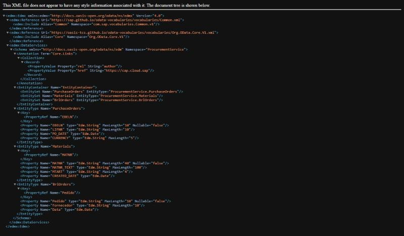
*F4-EV01 — `$metadata` com as três entidades.*

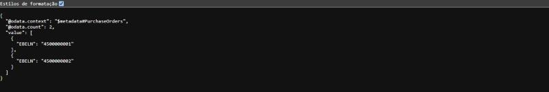
*F4-EV02 — `@odata.count: 2`.*

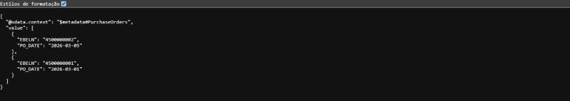
*F4-EV03 — Pedidos do mais recente para o mais antigo.*

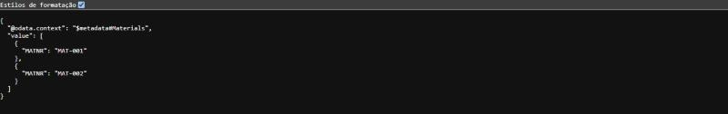
*F4-EV04 — `$top=2`.*

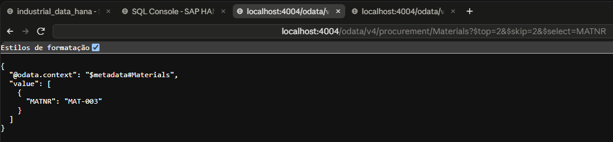
*F4-EV05 — `$top=2&$skip=2`, só o `MAT-003`.*

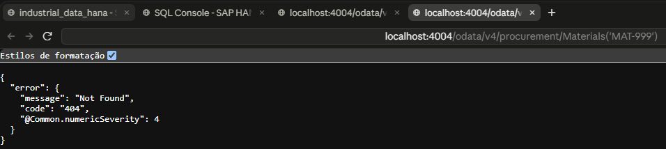
*F4-EV06 — Chave inexistente, HTTP 404.*

### F5 — REST: um endpoint próprio ao lado do OData

O OData já é uma API REST, com formato padrão. O F5 mostrou a diferença criando um endpoint **REST próprio**, com caminhos e nomes de campos escolhidos pelo projeto. O CAP só carrega esse código se ele for registrado por um `server.js` na raiz do projeto, no evento `bootstrap` do servidor Express:

```js
// server.js
const cds = require('@sap/cds')
require('./srv/rest')          // registra os endpoints REST (F5)
module.exports = cds.server
```

```js
// srv/rest.js (trecho)
cds.on('bootstrap', (app) => {
  // GET /rest/materiais/resumo -> total e contagem por tipo de material
  app.get('/rest/materiais/resumo', async (req, res) => { /* ... */ })

  // GET /rest/materiais/:matnr -> um material, em formato REST próprio
  app.get('/rest/materiais/:matnr', async (req, res) => { /* ... */ })
})
```

| Endereço | Retorno |
|---|---|
| `/rest/materiais/resumo` | `total: 3` e `porTipo` com `ROH` 1, `FERT` 1 e `HALB` 1; sem `@odata.context` |
| `/rest/materiais/MAT-003` | `codigo`, `descricao` e `tipo`, com nomes escolhidos pelo projeto |
| `/rest/materiais/MAT-999` | HTTP 404, `{"erro": "material nao encontrado"}` |
| `Materials('MAT-003')` (OData, comparação) | O mesmo material, mas com `@odata.context` e as colunas originais (`MATNR`, `MATNR_TEXT`, `MTART`) |

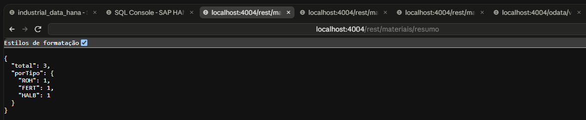
*F5-EV01 — Endpoint REST de resumo.*

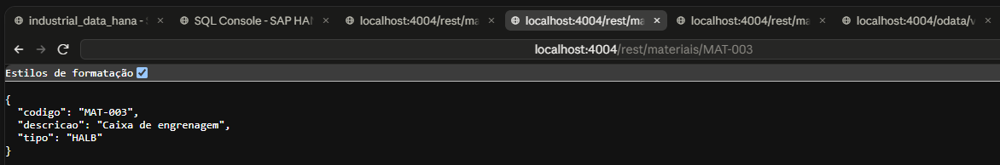
*F5-EV02 — `/rest/materiais/MAT-003`.*

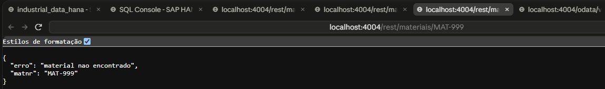
*F5-EV03 — Material inexistente, com mensagem de erro própria.*

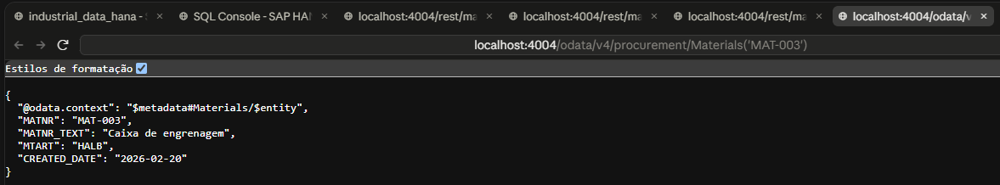
*F5-EV04 — O mesmo material via OData, para comparação.*

O primeiro `server.js`, escrito com `import`, falhou no computador do usuário com `Cannot use import statement outside a module`, porque o `package.json` do projeto lá não tem `"type": "module"`. Os arquivos foram reescritos em CommonJS (`require`), que funciona sem alterar o `package.json`.

### F6 — Filtros e paginação: consultas combinadas

O F6 usou o mesmo serviço, sem arquivos novos, para exercitar filtros e ordenação com URLs reais. Os espaços nas consultas precisam ser enviados como `%20`: uma primeira tentativa de teste que os codificou como `+` foi recusada pelo parser do OData.

| # | Consulta | Retorno |
|---|---|---|
| 1 | `PurchaseOrders?$filter=CURRENCY eq 'BRL' or CURRENCY eq 'USD'` | Os dois pedidos |
| 2 | `Materials?$filter=startswith(MATNR_TEXT,'Motor')` | Só `MAT-002` |
| 3 | `Materials?$filter=contains(MATNR_TEXT,'Caixa')` | Só `MAT-003` |
| 4 | `Materials?$filter=MTART eq 'FERT' and CREATED_DATE ge 2026-02-01` | Só `MAT-002`, criado em 2026-02-03 |
| 5 | `Materials?$orderby=MATNR_TEXT asc` | Caixa de engrenagem, Motor 2CV, Parafuso M8 |
| 6 | `PurchaseOrders?$filter=PO_DATE gt 2026-03-02` | Só `4500000002` (2026-03-05) |
| 7 | `Materials?$orderby=MTART desc,MATNR asc` | `MAT-001` (`ROH`), `MAT-003` (`HALB`), `MAT-002` (`FERT`) |
| 8 | `Materials?$filter=MTART ne 'ROH'&$count=true` | Os materiais que não são `ROH`, com a contagem |

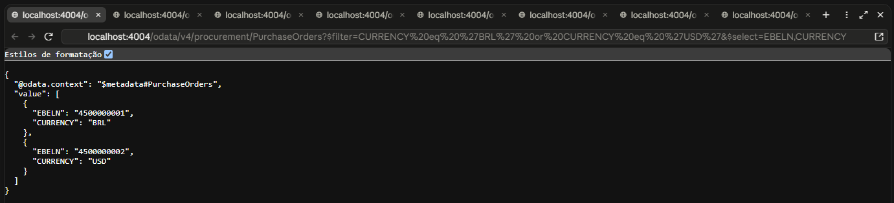
*F6-EV01 — `or` entre moedas.*

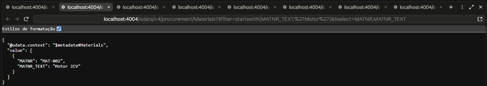
*F6-EV02 — `startswith`.*

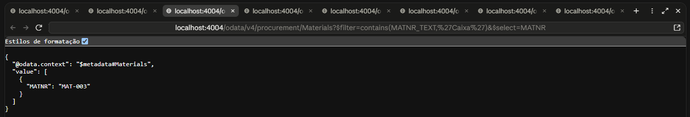
*F6-EV03 — `contains`.*

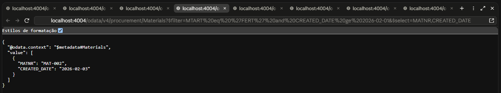
*F6-EV04 — `and` com tipo e data.*

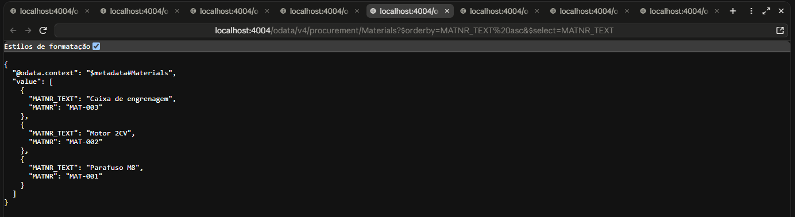
*F6-EV05 — `$orderby` crescente por texto.*

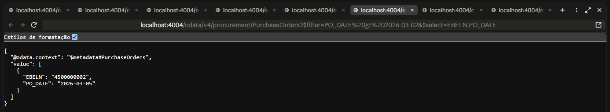
*F6-EV06 — Comparação de data com `gt`.*

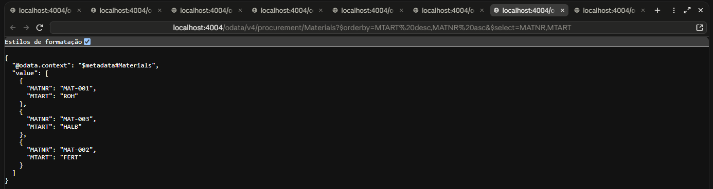
*F6-EV07 — Ordenação por dois campos, em direções diferentes.*

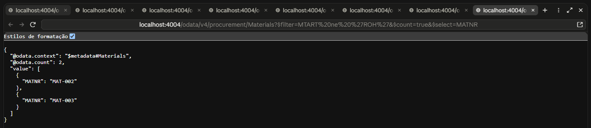
*F6-EV08 — `ne` com `$count`.*

### F7 — Regras de negócio: rejeitar antes de gravar

O F7 acrescentou ao serviço um handler `before` em `srv/service.js`, que valida os dados **antes** de gravar e recusa o pedido com HTTP 400. O CAP carrega esse arquivo por convenção, porque ele tem o mesmo nome do `srv/service.cds`.

```js
class ProcurementService extends cds.ApplicationService {
  init() {
    this.before(['CREATE', 'UPDATE'], 'PurchaseOrders', (req) => {
      const { LIFNR, CURRENCY, PO_DATE } = req.data
      if (!LIFNR) return req.error(400, 'LIFNR (fornecedor) é obrigatório')
      if (!['BRL', 'USD', 'EUR'].includes(CURRENCY)) return req.error(400, `moeda inválida: ${CURRENCY}`)
      if (PO_DATE && new Date(PO_DATE) > new Date()) return req.error(400, 'PO_DATE não pode ser futura')
    })
    return super.init()
  }
}
module.exports = ProcurementService
```

| Teste | Corpo enviado | Retorno |
|---|---|---|
| A | Pedido válido (`EUR`, data passada) | Criado, `EBELN: 4500000003`, HTTP 201 |
| B | `CURRENCY: XYZ` | HTTP 400, `moeda inválida: XYZ` |
| C | Sem `LIFNR` | HTTP 400, `LIFNR (fornecedor) é obrigatório` |
| D | `PO_DATE: 2030-01-01` | HTTP 400, `PO_DATE não pode ser futura` |
| E | Conferência dos gravados | Três pedidos: `4500000001` (BRL), `4500000002` (USD) e `4500000003` (EUR) |

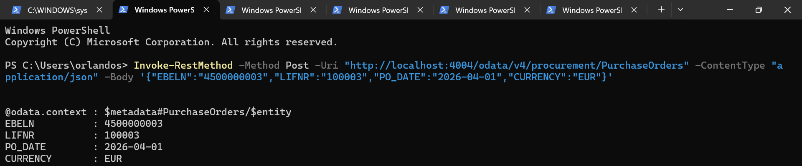
*F7-EV01 — Pedido válido, HTTP 201.*

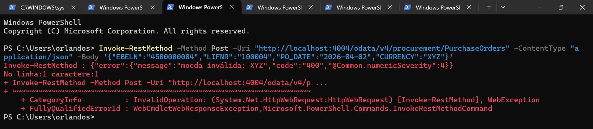
*F7-EV02 — Moeda inválida, HTTP 400.*

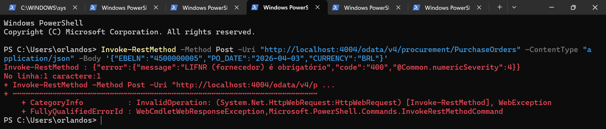
*F7-EV03 — Sem fornecedor, HTTP 400.*

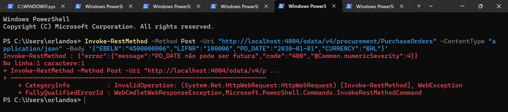
*F7-EV04 — Data futura, HTTP 400.*

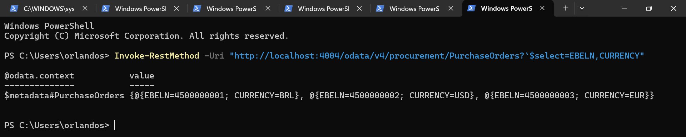
*F7-EV05 — Só os três pedidos válidos estão no banco.*

### F8 — Autenticação: do usuário de teste ao XSUAA

Até o F7 o serviço não pedia login. No F8 a autenticação passou a ser feita pelo **XSUAA**, o serviço de autenticação e autorização do BTP. Os papéis foram declarados em `xs-security.json`: dois escopos (`Viewer` e `Buyer`) e dois role templates, em que o `Buyer` inclui o escopo do `Viewer`.

```json
{
  "xsappname": "industrial-data-cap",
  "tenant-mode": "dedicated",
  "scopes": [
    { "name": "$XSAPPNAME.Viewer", "description": "Leitura dos dados de compras" },
    { "name": "$XSAPPNAME.Buyer",  "description": "Leitura e alteração dos dados de compras" }
  ],
  "role-templates": [
    { "name": "Viewer", "description": "Somente leitura", "scope-references": ["$XSAPPNAME.Viewer"] },
    { "name": "Buyer",  "description": "Leitura e escrita", "scope-references": ["$XSAPPNAME.Viewer", "$XSAPPNAME.Buyer"] }
  ]
}
```

O serviço foi criado no Cloud Foundry (instância `industrial-data-auth`, plano `application`), vinculado ao projeto com `cds bind` e ativado pelo perfil `hybrid` do `.cdsrc.json`:

```powershell
cf8 create-service xsuaa application industrial-data-auth -c xs-security.json
npx.cmd cds bind -2 industrial-data-auth -k xsuaa
npx.cmd cds bind --exec --profile hybrid -- npx.cmd cds serve --profile hybrid --port 4004
```

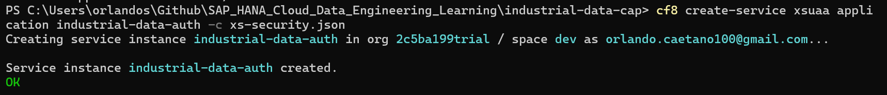
*F8-EV01 — Criação da instância XSUAA no Cloud Foundry.*

**Sem token, o serviço recusa.** Com o servidor no perfil `hybrid` (log `kind: 'xsuaa'`), uma chamada sem cabeçalho de autorização retorna `Unauthorized`.

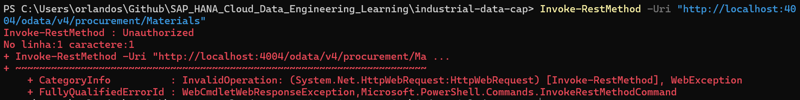
*F8-EV05 — Sem token, HTTP 401.*

**O token foi obtido pelo fluxo de senha (`password grant`)** no endpoint `/oauth/token` do XSUAA, usando o cliente da service key do próprio serviço e a senha do usuário digitada no terminal. Esse fluxo serve apenas para teste de laboratório. Em produção, o caminho correto é o fluxo de autorização por código, com um approuter na frente da aplicação.

**O primeiro token só trazia o escopo `openid`.** Ele foi aceito (não houve 401), mas o serviço respondeu **403 Forbidden**: o usuário existia, porém não tinha nenhum papel do aplicativo. A correção foi feita no BTP Cockpit, em **Security → Role Collections**: foi criada a coleção `Compras Buyer` com o papel `Buyer` do aplicativo `industrial-data-cap`, atribuída ao usuário do BTP (Default identity provider). Como as permissões ficam gravadas no momento em que o token é emitido, foi preciso gerar um token novo.

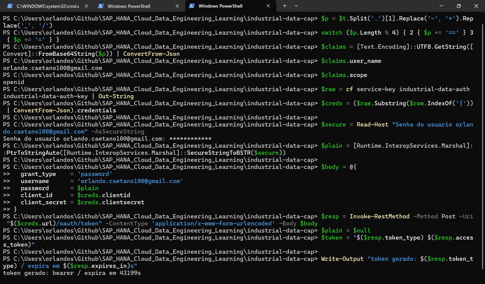
*F8-EV02 — O token antigo tinha só `openid` (estado sem papel); em seguida, a geração do token novo.*

Com o token novo, a decodificação local do payload (sem expor o token) mostra os escopos `industrial-data-cap!t705460.Buyer` e `industrial-data-cap!t705460.Viewer`, e a leitura retorna os materiais com HTTP 200.

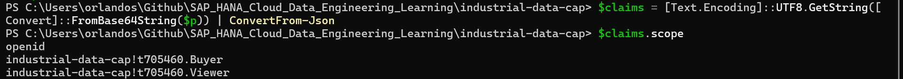
*F8-EV03 — Escopos do token após a atribuição do papel.*

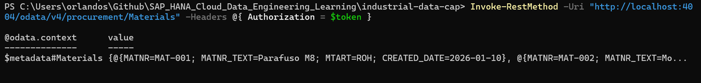
*F8-EV04 — `GET /Materials` com token, HTTP 200.*

O 403 de um usuário sem papel foi observado no terminal, mas **não foi capturado como imagem**; ele está documentado aqui como texto. Também não foi feito o teste de um Viewer isolado, porque o subaccount tem um único usuário, com `Buyer` e `Viewer`.

### F9 — Autorização: o que cada papel pode fazer

O F9 define **quem pode fazer o quê**, com `@restrict` em CDS: o `Viewer` só lê, e o `Buyer` lê, cria, altera e apaga. Os testes usaram os dois usuários de desenvolvimento do `.cdsrc.json` (`alice` com `Buyer` e `bob` com `Viewer`), no perfil padrão.

```cds
service ProcurementService @(path: '/odata/v4/procurement') @(requires: 'authenticated-user') {

  @(restrict: [
    { grant: ['READ'],                       to: ['Viewer', 'Buyer'] },
    { grant: ['CREATE', 'UPDATE', 'DELETE'], to: 'Buyer' }
  ])
  entity PurchaseOrders as projection on db.PurchaseOrder;

  @(restrict: [{ grant: 'READ', to: ['Viewer', 'Buyer'] }])
  entity BrlOrders as select from db.PurchaseOrder { /* ... */ } where CURRENCY = 'BRL';
}
```

| Teste | Quem | Ação | Retorno |
|---|---|---|---|
| A | Sem login | Ler `Materials` | HTTP 401 |
| B | `bob` (Viewer) | Ler `Materials` | HTTP 200, 3 materiais |
| C | `bob` (Viewer) | Criar pedido | HTTP 403 |
| D | `alice` (Buyer) | Criar pedido | HTTP 201, `EBELN: 4500000031` |
| E | `bob` (Viewer) | Apagar pedido | HTTP 403 |

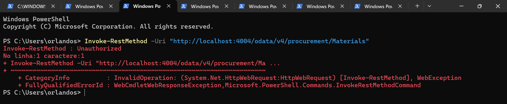
*F9-EV01 — Sem login, HTTP 401.*

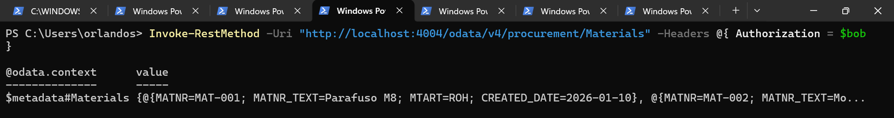
*F9-EV02 — `bob` (Viewer) lendo, HTTP 200.*

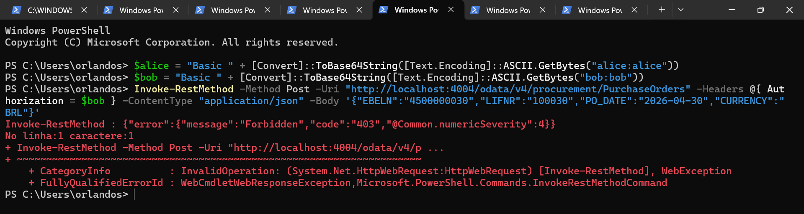
*F9-EV03 — `bob` (Viewer) tentando criar, HTTP 403.*

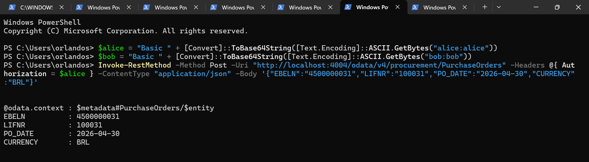
*F9-EV04 — `alice` (Buyer) criando, HTTP 201.*

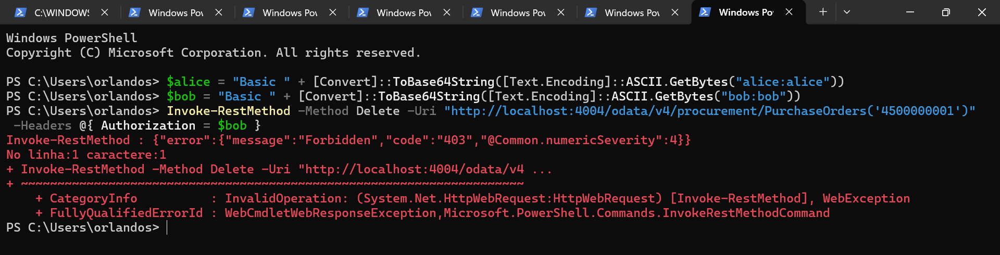
*F9-EV05 — `bob` (Viewer) tentando apagar, HTTP 403.*

**Uma lição do F9.** A primeira versão colocou a regra no nível do serviço, e o Viewer conseguiu criar e apagar (HTTP 201). Um teste isolado mostrou que os papéis chegavam corretos ao CAP, e que com `@requires` por entidade o `bob` recebia 403. A solução foi declarar o `@restrict` **em cada entidade**, como no trecho acima, e repetir os testes.

---

## 🗂️ Estrutura da aplicação

```
db/schema.cds ─────────► srv/service.cds ──────────► OData V4  /odata/v4/procurement
(PurchaseOrder, Material)   (projeções, view BrlOrders,        ├─ PurchaseOrders
                             @restrict por entidade — F9)      ├─ Materials
                                    │                          └─ BrlOrders
                                    ├─ srv/service.js  (F7: regras `before`)
                                    └─ server.js + srv/rest.js (F5: REST /rest/materiais/...)

Perfil padrão  → SQLite em memória + usuários de teste (alice, bob)        F1, F2, F4–F7, F9
Perfil hybrid  → SAP HANA Cloud (HDI hdi_db) + XSUAA (industrial-data-auth) F3, F8
```

---

## 📊 Evidências

| # | Evidência | Cenário | Arquivo |
|---|---|---|---|
| 1 | Lista de materiais (3) | F2 | [F2-EV01](../../../Evidences/LAB_F/F2-EV01-materials-lista-3-linhas.png) |
| 2 | Filtro por tipo `FERT` | F2 | [F2-EV02](../../../Evidences/LAB_F/F2-EV02-materials-filtro-fert.png) |
| 3 | View CDS `BrlOrders` | F2 | [F2-EV03](../../../Evidences/LAB_F/F2-EV03-brlorders-cds-view.png) |
| 4 | Material por chave `MAT-003` | F2 | [F2-EV04](../../../Evidences/LAB_F/F2-EV04-materials-por-chave-mat003.png) |
| 5 | Tabelas no HANA (2 e 3 registros) | F3 | [F3-EV03](../../../Evidences/LAB_F/F3-EV03-tabelas-hana-record-count.png) |
| 6 | `POST` do `MAT-004` | F3 | [F3-EV04](../../../Evidences/LAB_F/F3-EV04-post-mat-004-201.png) |
| 7 | Contagem de 4 registros | F3 | [F3-EV05](../../../Evidences/LAB_F/F3-EV05-record-count-4.png) |
| 8 | Persistência após restart | F3 | [F3-EV06](../../../Evidences/LAB_F/F3-EV06-persistencia-apos-restart.png) |
| 9 | `$metadata` com as entidades | F4 | [F4-EV01](../../../Evidences/LAB_F/F4-EV01-metadata-entidades.jpg) |
| 10 | `$count` (2 pedidos) | F4 | [F4-EV02](../../../Evidences/LAB_F/F4-EV02-count-2-pedidos.jpg) |
| 11 | `$orderby` por `PO_DATE desc` | F4 | [F4-EV03](../../../Evidences/LAB_F/F4-EV03-orderby-po-date-desc.jpg) |
| 12 | `$top=2` | F4 | [F4-EV04](../../../Evidences/LAB_F/F4-EV04-top-2-materiais.jpg) |
| 13 | `$top` + `$skip` | F4 | [F4-EV05](../../../Evidences/LAB_F/F4-EV05-skip-mat-003.png) |
| 14 | 404 para `MAT-999` | F4 | [F4-EV06](../../../Evidences/LAB_F/F4-EV06-404-mat-999.png) |
| 15 | REST: resumo por tipo | F5 | [F5-EV01](../../../Evidences/LAB_F/F5-EV01-rest-resumo.png) |
| 16 | REST: material `MAT-003` | F5 | [F5-EV02](../../../Evidences/LAB_F/F5-EV02-rest-material-mat-003.png) |
| 17 | REST: material inexistente (404) | F5 | [F5-EV03](../../../Evidences/LAB_F/F5-EV03-rest-material-mat-999-404.png) |
| 18 | O mesmo material via OData | F5 | [F5-EV04](../../../Evidences/LAB_F/F5-EV04-odata-mesmo-material.png) |
| 19 | `or` entre moedas | F6 | [F6-EV01](../../../Evidences/LAB_F/F6-EV01-or-moedas-brl-usd.png) |
| 20 | `startswith` | F6 | [F6-EV02](../../../Evidences/LAB_F/F6-EV02-startswith-motor.png) |
| 21 | `contains` | F6 | [F6-EV03](../../../Evidences/LAB_F/F6-EV03-contains-caixa.png) |
| 22 | `and` com tipo e data | F6 | [F6-EV04](../../../Evidences/LAB_F/F6-EV04-and-fert-data.png) |
| 23 | `$orderby` por texto | F6 | [F6-EV05](../../../Evidences/LAB_F/F6-EV05-orderby-texto-asc.png) |
| 24 | Data `gt` | F6 | [F6-EV06](../../../Evidences/LAB_F/F6-EV06-data-gt-2026-03-02.png) |
| 25 | Ordenação composta | F6 | [F6-EV07](../../../Evidences/LAB_F/F6-EV07-orderby-composto.png) |
| 26 | `ne` com `$count` | F6 | [F6-EV08](../../../Evidences/LAB_F/F6-EV08-ne-roh-count.png) |
| 27 | Pedido válido (201) | F7 | [F7-EV01](../../../Evidences/LAB_F/F7-EV01-post-valido-201.png) |
| 28 | Moeda inválida (400) | F7 | [F7-EV02](../../../Evidences/LAB_F/F7-EV02-moeda-invalida-400.png) |
| 29 | Sem fornecedor (400) | F7 | [F7-EV03](../../../Evidences/LAB_F/F7-EV03-sem-fornecedor-400.png) |
| 30 | Data futura (400) | F7 | [F7-EV04](../../../Evidences/LAB_F/F7-EV04-data-futura-400.png) |
| 31 | Pedidos gravados | F7 | [F7-EV05](../../../Evidences/LAB_F/F7-EV05-conferir-gravados.png) |
| 32 | Criação do serviço XSUAA | F8 | [F8-EV01](../../../Evidences/LAB_F/F8-EV01-cf-create-service-xsuaa.png) |
| 33 | Token antigo (`openid`) e token novo | F8 | [F8-EV02](../../../Evidences/LAB_F/F8-EV02-token-gerado-e-scope-buyer.png) |
| 34 | Escopos `Buyer` e `Viewer` | F8 | [F8-EV03](../../../Evidences/LAB_F/F8-EV03-scope-buyer-viewer.png) |
| 35 | Leitura com token (200) | F8 | [F8-EV04](../../../Evidences/LAB_F/F8-EV04-materials-200.png) |
| 36 | Sem token (401) | F8 | [F8-EV05](../../../Evidences/LAB_F/F8-EV05-anonimo-401.png) |
| 37 | Sem login (401) | F9 | [F9-EV01](../../../Evidences/LAB_F/F9-EV01-anonimo-401.png) |
| 38 | Viewer lê (200) | F9 | [F9-EV02](../../../Evidences/LAB_F/F9-EV02-bob-viewer-get-ok.png) |
| 39 | Viewer tenta criar (403) | F9 | [F9-EV03](../../../Evidences/LAB_F/F9-EV03-bob-viewer-post-403.png) |
| 40 | Buyer cria (201) | F9 | [F9-EV04](../../../Evidences/LAB_F/F9-EV04-alice-buyer-post-201.png) |
| 41 | Viewer tenta apagar (403) | F9 | [F9-EV05](../../../Evidences/LAB_F/F9-EV05-bob-viewer-delete-403.png) |

---

## ⚠️ Limitações e pendências

- **F1:** sem capturas de tela; validado por saída de terminal.
- **F3:** a numeração das evidências começa em EV03. A instância ativa (EV01) e o deploy (EV02) foram validados por saída de terminal e não foram capturados como imagem.
- **F3:** o IP público do computador de desenvolvimento foi adicionado à lista **Allowed connections** da instância HANA Cloud. Deve ser removido ao fim do laboratório, se o acesso externo não for mais necessário.
- **F3:** o container `hdi_db` ainda tem três arquivos antigos do Bloco C (`src/.hdiconfig`, `src/.hdinamespace`, `src/material.hdbtable`), que o deployer apontou como não presentes em `undeploy.json`.
- **F3:** os dados do serviço vêm de CSVs pequenos (2 pedidos e 3 materiais), e não das tabelas do schema `INDUSTRIAL_DATA` do Bloco D (40 e 300 linhas).
- **F8:** o 403 de um usuário sem papel está documentado só como texto, e o teste de um Viewer isolado não foi feito.
- **F8:** o `password grant` foi usado apenas para teste; produção exige o fluxo de autorização por código com approuter.
- **F9:** os usuários `alice` e `bob` têm senhas triviais e servem só para desenvolvimento local.
- **Serviço:** as service keys `hdi_db-key` e `industrial-data-auth-key` continuam ativas no Cloud Foundry.
- **npm:** o `npm audit` reporta 2 vulnerabilidades de severidade alta no projeto, ainda não tratadas.

## ➡️ Próximos passos

1. Ligar o serviço CAP às tabelas reais do schema `INDUSTRIAL_DATA` (por sinônimos), no lugar dos CSVs.
2. Tratar as vulnerabilidades do `npm audit` e limpar as service keys e a regra de IP quando não forem mais necessárias.
3. Consumir o `ProcurementService` em uma aplicação SAP Fiori (Bloco G).

---

[⬆️ Voltar ao README](../../../README.md)
