# F1 to F9: CAP and Data APIs on SAP HANA Cloud

**🌐 Idioma / Language:** [🇧🇷 Português](../BR/01-f1-f9-cap-e-apis-de-dados.md) | 🇺🇸 **English**

[⬆️ Back to README](../../../README.en.md)

> **Status:** ✅ Completed (F1 to F9) · ⚠️ Evidence caveats: F1 has no screenshots (validated by terminal output); F3 has no capture of the instance and the deploy (EV01 and EV02 documented as text); F8 has no screenshot of the no-role 403 and no isolated Viewer test
> **Environment:** SAP CAP (`@sap/cds` 10.2.1, `@sap/cds-dk` 10.2.0, Node.js 24) · in-memory SQLite (F1, F2, F4 to F7, F9) · SAP HANA Cloud Trial (Free Tier, US10, version 2026.28.13) through an HDI container (F3) · XSUAA on Cloud Foundry (F8)
> **Project:** [`industrial-data-cap/`](../../../industrial-data-cap) (repository root) · **Service:** `ProcurementService` at `/odata/v4/procurement`
> **Data:** fictitious CSVs — 2 purchase orders and 3 materials
> **Classification:** educational environment, fictitious data, no production data

## 🎯 Executive overview

Block A taught data modeling, Block B querying, Block C the professional development flow (project, HDI and deploy) and Block D moving data through a data engineering pipeline. **Block F** answers the next question: **how is that data exposed, protected and consumed by other applications** through APIs.

The answer was built with the SAP Cloud Application Programming Model (CAP). A single CDS model generates the OData V4 service; on top of it came a custom REST endpoint, business rules, real authentication with XSUAA and role-based authorization. The same code runs under two profiles: the default profile uses in-memory SQLite and test users, and the `hybrid` profile uses SAP HANA Cloud and BTP's XSUAA.

All scenarios ran on the user's own computer, in PowerShell, with every command and response visible on screen. F1, F2, F4 to F7 and F9 were first validated in a sandbox; F3 and F8 could only be done in the user's BTP environment.

| Scenario | Goal | Result |
|---|---|---|
| F1 | CAP Foundation | ✅ `industrial-data-cap` project created; local OData service answering, `$metadata` returned HTTP 200 |
| F2 | Domain Modeling | ✅ `PurchaseOrder` and `Material` entities, service projections and a `BrlOrders` CDS view with business names |
| F3 | HANA Persistence | ✅ Deployed to the `hdi_db` HDI container (12 files, 3 + 2 records); `POST` of `MAT-004` persisted (4 materials) and survived a restart |
| F4 | OData Service | ✅ `$metadata`, `$count`, `$orderby`, `$top`, `$skip` and a 404 for a missing key |
| F5 | REST APIs | ✅ Two custom REST endpoints (`/rest/materiais/resumo` and `/rest/materiais/:matnr`), compared with OData |
| F6 | Filtering & Paging | ✅ Eight queries: `or`, `startswith`, `contains`, `and`, `gt`, `ne`, simple and composite ordering |
| F7 | Business Logic | ✅ Three rules in the `before` handler: 1 valid order (201) and 3 rejections (400) |
| F8 | Authentication | ✅ Real XSUAA: 401 without token; token with `Buyer` and `Viewer` scopes; 200 with token |
| F9 | Authorization | ✅ Per-entity `@restrict`: Viewer reads, Buyer writes; 401, 403 and 201 according to role |

> [!IMPORTANT]
> No credential was written to any repository file. `.cdsrc-private.json` (local bindings), `default-env.json`, `.env` and `node_modules/` are in the project's `.gitignore`, and `gen/` is in the root `.gitignore`. Passwords were typed by the user in the terminal (hidden prompt) and do not appear in the screenshots.
>
> The `alice` and `bob` users in `.cdsrc.json` exist **for local development only**, with trivial passwords and fixed roles. They are not used under the `hybrid` profile: authentication there belongs to XSUAA.

---

## 🧭 Functional storytelling

### F1 — Foundation: from `cds init` to the first service

F1 aimed to build the block's minimal application: store data in a database and serve it at an address other programs can read. CAP does this from a short description of the data. The project was created with `cds init`, the Node.js runtime was added with `cds add nodejs` and the `@cap-js/sqlite` driver was installed as the local test database.

The minimal structure:

| File | Role |
|---|---|
| `db/schema.cds` | Describes the data (`PurchaseOrder` entity with `EBELN`, `LIFNR`, `PO_DATE`, `CURRENCY`) |
| `srv/service.cds` | Publishes the service at `/odata/v4/procurement` |
| `db/data/*.csv` | Sample data loaded into SQLite when the server starts |
| `package.json` | Project dependencies |

```cds
namespace industrial.data;

entity PurchaseOrder {
  key EBELN : String(10);
      LIFNR : String(10);
      PO_DATE : Date;
      CURRENCY : String(5);
}
```

```cds
using industrial.data as db from '../db/schema';

service ProcurementService @(path: '/odata/v4/procurement') {
  entity PurchaseOrders as projection on db.PurchaseOrder;
}
```

The first test without a database driver returned `NO_DATABASE_CONNECTION`; with `@cap-js/sqlite` installed, the service answered with the 2 orders, the `CURRENCY eq 'BRL'` filter returned only the order in reais and `$metadata` returned HTTP 200.

On the user's computer the environment had to be prepared: Node.js was installed from the zip package and added to the user `PATH`, and commands use `npm.cmd` and `npx.cmd` because the PowerShell execution policy blocks `npm.ps1`. This first scenario's data lives only in in-memory SQLite and disappears when the server stops.

> F1 has no screenshots. It was validated by terminal output, first in the sandbox and then on the user's computer.

### F2 — Modeling: two entities and a CDS view

F2 extended the model with the `Material` entity and exposed three resources in the service: `PurchaseOrders` and `Materials` as direct projections, and `BrlOrders` as a **CDS view** (`select from ... where`) that only sees orders in reais and renames the columns to business names (`Pedido`, `Fornecedor`, `Data`).

```cds
entity Material {
  key MATNR : String(40);
      MATNR_TEXT : String(100);
      MTART : String(4);
      CREATED_DATE : Date;
}
```

```cds
entity BrlOrders as select from db.PurchaseOrder {
  key EBELN as Pedido,
      LIFNR as Fornecedor,
      PO_DATE as Data
} where CURRENCY = 'BRL';
```

The sample data is a small fictitious subset: 2 orders (`4500000001` in BRL and `4500000002` in USD) and 3 materials (`MAT-001` Parafuso M8 `ROH`, `MAT-002` Motor 2CV `FERT`, `MAT-003` Caixa de engrenagem `HALB`).

| Test | Query | Result |
|---|---|---|
| 1 | `Materials` | 3 materials, all fields |
| 2 | `Materials?$filter=MTART eq 'FERT'` | Only `MAT-002` (Motor 2CV) |
| 3 | `BrlOrders` | 1 order, with `Pedido`, `Fornecedor` and `Data`; original names do not appear |
| 4 | `Materials('MAT-003')` | The gearbox record |

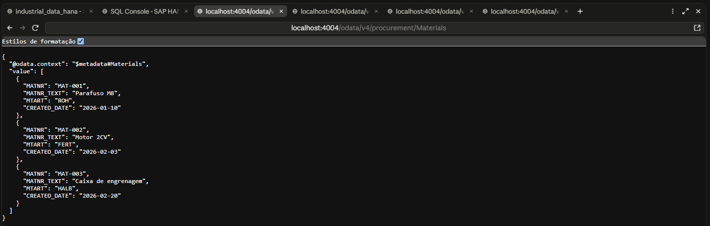
*F2-EV01 — `Materials` returning the 3 materials.*

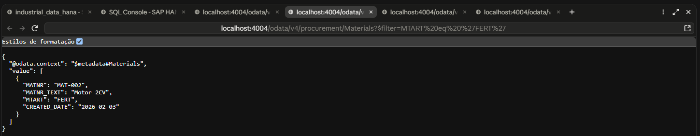
*F2-EV02 — `$filter=MTART eq 'FERT'` returning only `MAT-002`.*

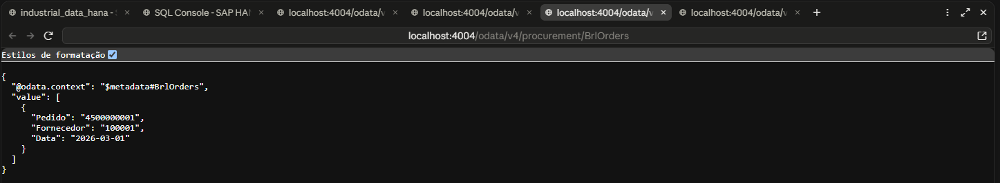
*F2-EV03 — The `BrlOrders` view, with business names.*

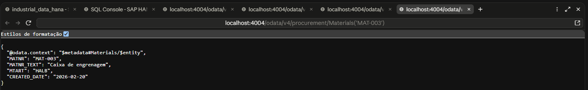
*F2-EV04 — Read by key, `Materials('MAT-003')`.*

A practical point from F2: when writing the new files on the user's computer, the first write did not replace the old content. The server log showed only `PurchaseOrder` loaded and `Materials` returned 404. The cause was confirmed by reading the file on disk (446 bytes in the new version versus 173 in the old one) and the write was redone with forced overwrite.

### F3 — Persistence: from SQLite to SAP HANA Cloud

Up to F2 the database was in-memory SQLite, and data vanished when the server stopped. In F3 the service moved to SAP HANA Cloud, reusing the `hdi_db` HDI container created in Block C. The service code did not change: the switch happens in configuration, through the `hybrid` profile.

```powershell
npm.cmd install @cap-js/hana
npx.cmd cds bind -2 hdi_db
npx.cmd cds bind --exec --profile hybrid -- npx.cmd cds deploy --profile hybrid --to hana
```

`cds bind -2 hdi_db` creates the container's service key and writes only the binding reference to `.cdsrc-private.json` (which does not go to GitHub); credentials are resolved at run time with `cds bind --exec`.

**The first deploy failed.** The deployer could not connect to the HANA endpoint, with `Client network socket disconnected before secure TLS connection was established`. The port test (`Test-NetConnection ... -Port 443`) answered `True`, so the network was open and the problem was in the access rule: the instance was set to **Allowed connections = Cloud Foundry IPs of the region only**, which blocks the development computer. The fix was to add the computer's public IP, as `IP/32`, under **Manage Configuration → Connections → Allow specific IP addresses and IP ranges**, keeping the Cloud Foundry option.

With access open, the deploy finished with `Make succeeded (0 warnings): 12 files deployed`. HDI inserted **3 records** into `INDUSTRIAL_DATA_MATERIAL` and **2 records** into `INDUSTRIAL_DATA_PURCHASEORDER` from the CSVs, and also created the three service views and the technical table `cds.outbox.Messages`.

Verification in the SQL Console, on the container schema (`INDUSTRIAL_DATA_HDI`):

```sql
SELECT TABLE_NAME, RECORD_COUNT
FROM SYS.M_TABLES
WHERE SCHEMA_NAME = 'INDUSTRIAL_DATA_HDI'
  AND TABLE_NAME LIKE 'INDUSTRIAL_DATA_%';
```

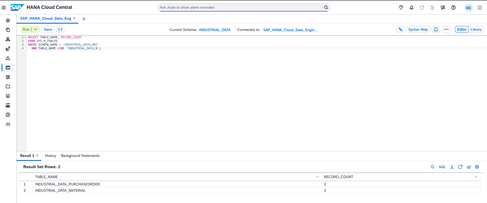
*F3-EV03 — `INDUSTRIAL_DATA_PURCHASEORDER` with 2 records and `INDUSTRIAL_DATA_MATERIAL` with 3.*

**Persistence test.** With the server running under the `hybrid` profile (log `connect to db > hana`), a new material was created with the Buyer token, checked in the database, and the server was stopped and restarted:

```powershell
$novo = @{ MATNR = 'MAT-004'; MATNR_TEXT = 'Teste persistencia HANA'; MTART = 'ROH'; CREATED_DATE = '2026-11-03' }
Invoke-RestMethod -Method Post -Uri "http://localhost:4004/odata/v4/procurement/Materials" -Headers @{ Authorization = $token } -ContentType 'application/json' -Body ($novo | ConvertTo-Json)
```

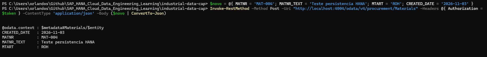
*F3-EV04 — `MAT-004` created through the service.*

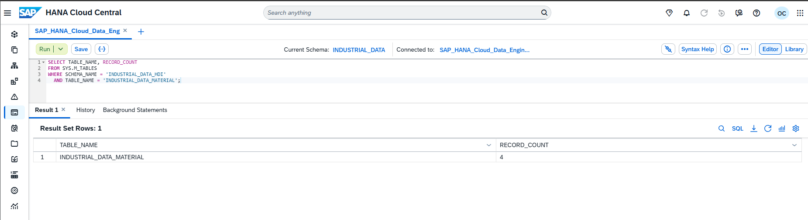
*F3-EV05 — `INDUSTRIAL_DATA_MATERIAL` went from 3 to 4 records, straight in the database.*

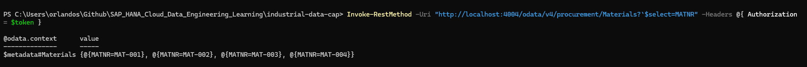
*F3-EV06 — After the server restart, `$select=MATNR` lists `MAT-001` to `MAT-004`.*

The read after the restart used an XSUAA token, so F3 and F8 were validated together under the `hybrid` profile. The runtime-user `SELECT` problem seen in C10 **did not recur**: the OData read worked.

One deployer warning is worth recording: it listed three old Block C files (`src/.hdiconfig`, `src/.hdinamespace` and `src/material.hdbtable`) as `deleted files not in undeploy.json`. They were not removed from the container.

### F4 — OData service: the service contract

F4 explored what CAP publishes by default in OData V4: the service description, count, ordering, paging and the behavior for a key that does not exist. The tests were opened in the browser on the user's computer, at `localhost:4004`, confirming they ran locally.

| # | Address | Expected result |
|---|---|---|
| 1 | `$metadata` | XML with the `PurchaseOrders`, `Materials` and `BrlOrders` entities |
| 2 | `PurchaseOrders?$count=true&$select=EBELN` | `@odata.count: 2`, with both order numbers |
| 3 | `PurchaseOrders?$orderby=PO_DATE desc&$select=EBELN,PO_DATE` | `4500000002` (05/03) before `4500000001` (01/03) |
| 4 | `Materials?$top=2&$select=MATNR` | `MAT-001` and `MAT-002` |
| 5 | `Materials?$top=2&$skip=2&$select=MATNR` | Only `MAT-003`, the next page |
| 6 | `Materials('MAT-999')` | HTTP 404, `Not Found`, expected behavior |

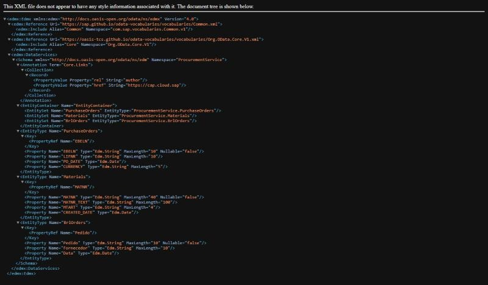
*F4-EV01 — `$metadata` with the three entities.*

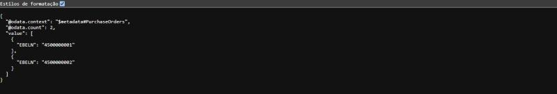
*F4-EV02 — `@odata.count: 2`.*

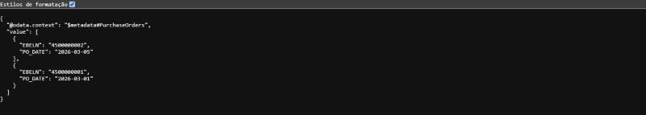
*F4-EV03 — Orders from newest to oldest.*

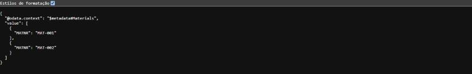
*F4-EV04 — `$top=2`.*

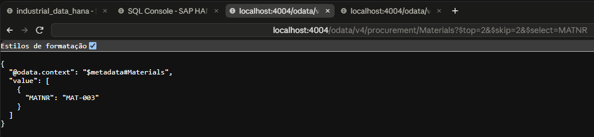
*F4-EV05 — `$top=2&$skip=2`, only `MAT-003`.*

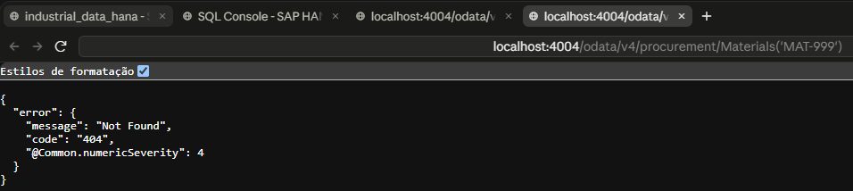
*F4-EV06 — Missing key, HTTP 404.*

### F5 — REST: a custom endpoint next to OData

OData is already a REST API, with a standard format. F5 showed the difference by creating a **custom REST endpoint**, with paths and field names chosen by the project. CAP only loads this code if it is registered by a `server.js` at the project root, on the `bootstrap` event of the Express server:

```js
// server.js
const cds = require('@sap/cds')
require('./srv/rest')          // registers the REST endpoints (F5)
module.exports = cds.server
```

```js
// srv/rest.js (excerpt)
cds.on('bootstrap', (app) => {
  // GET /rest/materiais/resumo -> total and count per material type
  app.get('/rest/materiais/resumo', async (req, res) => { /* ... */ })

  // GET /rest/materiais/:matnr -> one material, in the project's own REST format
  app.get('/rest/materiais/:matnr', async (req, res) => { /* ... */ })
})
```

| Address | Result |
|---|---|
| `/rest/materiais/resumo` | `total: 3` and `porTipo` with `ROH` 1, `FERT` 1 and `HALB` 1; no `@odata.context` |
| `/rest/materiais/MAT-003` | `codigo`, `descricao` and `tipo`, with names chosen by the project |
| `/rest/materiais/MAT-999` | HTTP 404, `{"erro": "material nao encontrado"}` |
| `Materials('MAT-003')` (OData, for comparison) | The same material, but with `@odata.context` and the original columns (`MATNR`, `MATNR_TEXT`, `MTART`) |

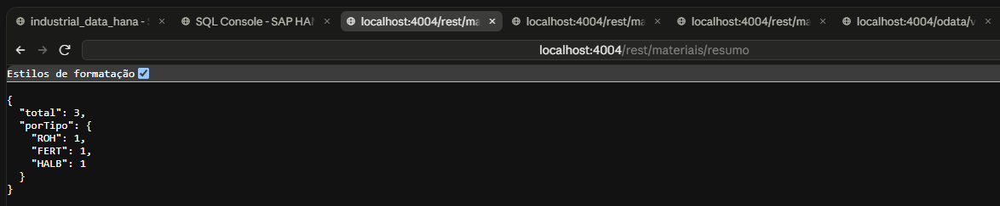
*F5-EV01 — REST summary endpoint.*

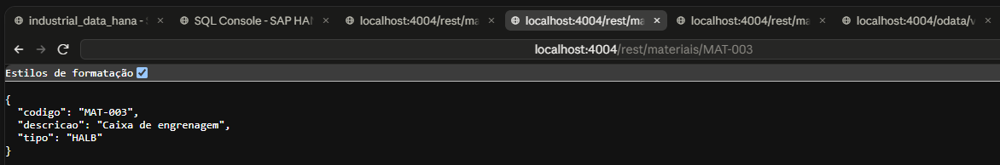
*F5-EV02 — `/rest/materiais/MAT-003`.*

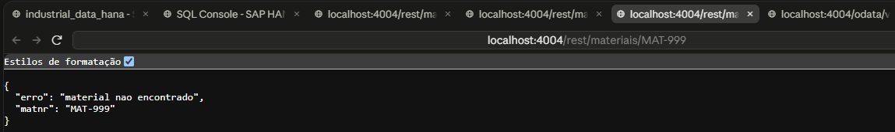
*F5-EV03 — Missing material, with a custom error message.*

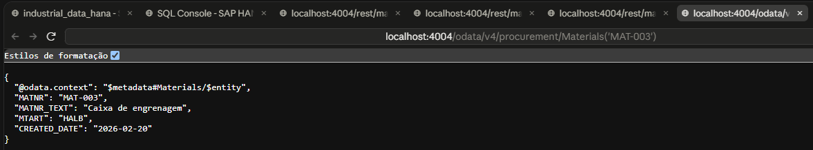
*F5-EV04 — The same material through OData, for comparison.*

The first `server.js`, written with `import`, failed on the user's computer with `Cannot use import statement outside a module`, because the project's `package.json` there has no `"type": "module"`. The files were rewritten in CommonJS (`require`), which works without changing `package.json`.

### F6 — Filtering and paging: combined queries

F6 used the same service, with no new files, to exercise filters and ordering with real URLs. Spaces in the queries must be sent as `%20`: an earlier test attempt that encoded them as `+` was rejected by the OData parser.

| # | Query | Result |
|---|---|---|
| 1 | `PurchaseOrders?$filter=CURRENCY eq 'BRL' or CURRENCY eq 'USD'` | Both orders |
| 2 | `Materials?$filter=startswith(MATNR_TEXT,'Motor')` | Only `MAT-002` |
| 3 | `Materials?$filter=contains(MATNR_TEXT,'Caixa')` | Only `MAT-003` |
| 4 | `Materials?$filter=MTART eq 'FERT' and CREATED_DATE ge 2026-02-01` | Only `MAT-002`, created 2026-02-03 |
| 5 | `Materials?$orderby=MATNR_TEXT asc` | Caixa de engrenagem, Motor 2CV, Parafuso M8 |
| 6 | `PurchaseOrders?$filter=PO_DATE gt 2026-03-02` | Only `4500000002` (2026-03-05) |
| 7 | `Materials?$orderby=MTART desc,MATNR asc` | `MAT-001` (`ROH`), `MAT-003` (`HALB`), `MAT-002` (`FERT`) |
| 8 | `Materials?$filter=MTART ne 'ROH'&$count=true` | The materials that are not `ROH`, with the count |

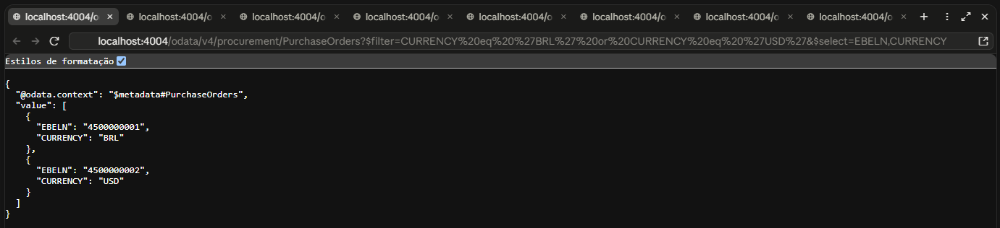
*F6-EV01 — `or` between currencies.*

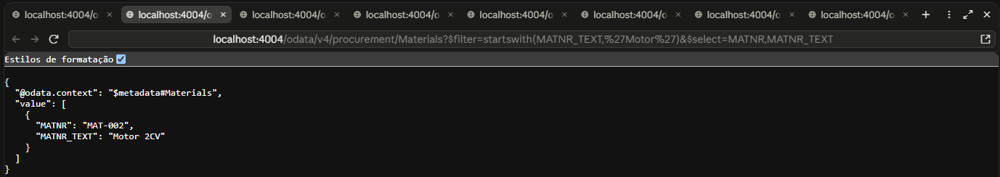
*F6-EV02 — `startswith`.*

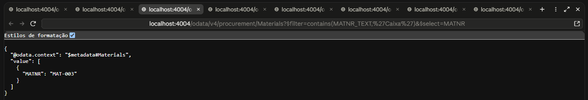
*F6-EV03 — `contains`.*

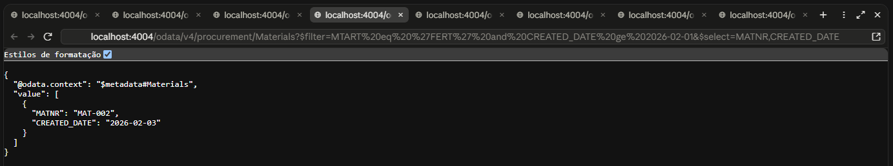
*F6-EV04 — `and` with type and date.*

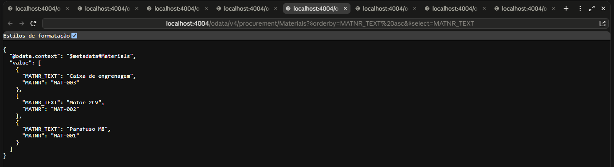
*F6-EV05 — Ascending `$orderby` on text.*

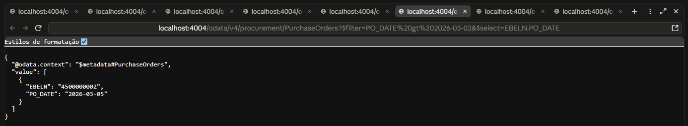
*F6-EV06 — Date comparison with `gt`.*

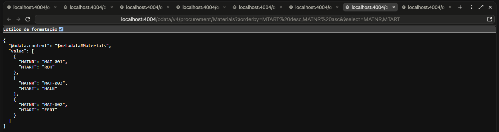
*F6-EV07 — Ordering by two fields in different directions.*

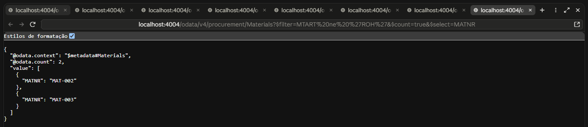
*F6-EV08 — `ne` with `$count`.*

### F7 — Business rules: reject before saving

F7 added a `before` handler to `srv/service.js` that validates data **before** saving and rejects the request with HTTP 400. CAP loads this file by convention, because it has the same name as `srv/service.cds`.

```js
class ProcurementService extends cds.ApplicationService {
  init() {
    this.before(['CREATE', 'UPDATE'], 'PurchaseOrders', (req) => {
      const { LIFNR, CURRENCY, PO_DATE } = req.data
      if (!LIFNR) return req.error(400, 'LIFNR (fornecedor) é obrigatório')
      if (!['BRL', 'USD', 'EUR'].includes(CURRENCY)) return req.error(400, `moeda inválida: ${CURRENCY}`)
      if (PO_DATE && new Date(PO_DATE) > new Date()) return req.error(400, 'PO_DATE não pode ser futura')
    })
    return super.init()
  }
}
module.exports = ProcurementService
```

| Test | Body sent | Result |
|---|---|---|
| A | Valid order (`EUR`, past date) | Created, `EBELN: 4500000003`, HTTP 201 |
| B | `CURRENCY: XYZ` | HTTP 400, `moeda inválida: XYZ` |
| C | No `LIFNR` | HTTP 400, `LIFNR (fornecedor) é obrigatório` |
| D | `PO_DATE: 2030-01-01` | HTTP 400, `PO_DATE não pode ser futura` |
| E | Check of saved records | Three orders: `4500000001` (BRL), `4500000002` (USD) and `4500000003` (EUR) |

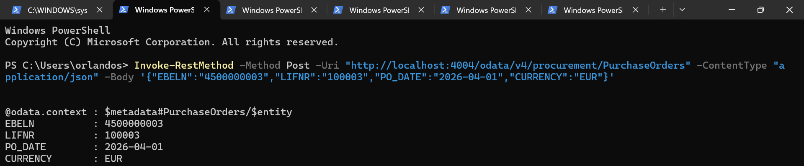
*F7-EV01 — Valid order, HTTP 201.*

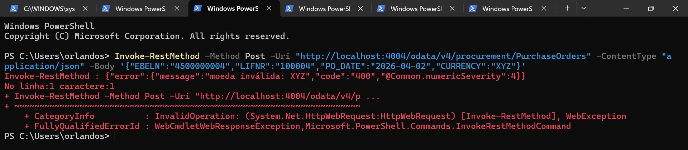
*F7-EV02 — Invalid currency, HTTP 400.*

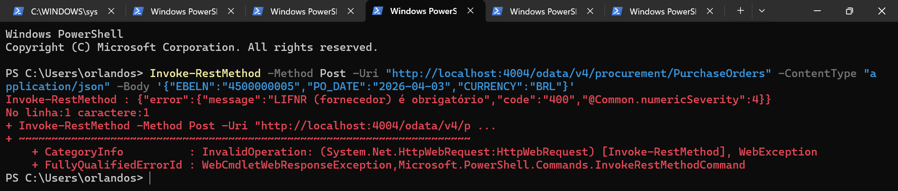
*F7-EV03 — No supplier, HTTP 400.*

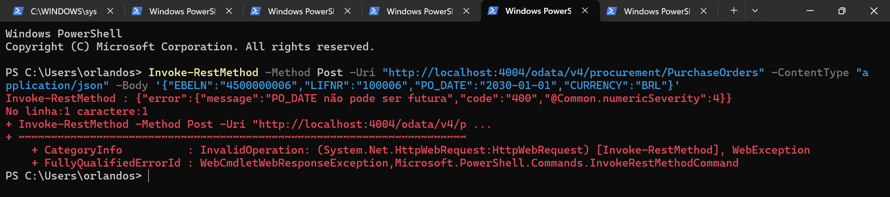
*F7-EV04 — Future date, HTTP 400.*

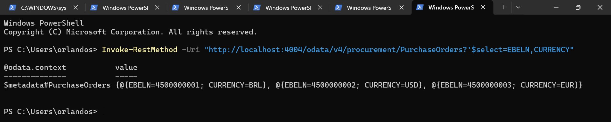
*F7-EV05 — Only the three valid orders are in the database.*

### F8 — Authentication: from a test user to XSUAA

Up to F7 the service asked for no login. In F8 authentication moved to **XSUAA**, BTP's authentication and authorization service. Roles were declared in `xs-security.json`: two scopes (`Viewer` and `Buyer`) and two role templates, where `Buyer` includes the `Viewer` scope.

```json
{
  "xsappname": "industrial-data-cap",
  "tenant-mode": "dedicated",
  "scopes": [
    { "name": "$XSAPPNAME.Viewer", "description": "Leitura dos dados de compras" },
    { "name": "$XSAPPNAME.Buyer",  "description": "Leitura e alteração dos dados de compras" }
  ],
  "role-templates": [
    { "name": "Viewer", "description": "Somente leitura", "scope-references": ["$XSAPPNAME.Viewer"] },
    { "name": "Buyer",  "description": "Leitura e escrita", "scope-references": ["$XSAPPNAME.Viewer", "$XSAPPNAME.Buyer"] }
  ]
}
```

The service was created on Cloud Foundry (instance `industrial-data-auth`, plan `application`), bound to the project with `cds bind` and activated by the `hybrid` profile in `.cdsrc.json`:

```powershell
cf8 create-service xsuaa application industrial-data-auth -c xs-security.json
npx.cmd cds bind -2 industrial-data-auth -k xsuaa
npx.cmd cds bind --exec --profile hybrid -- npx.cmd cds serve --profile hybrid --port 4004
```

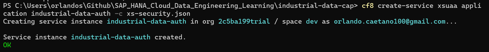
*F8-EV01 — XSUAA instance created on Cloud Foundry.*

**Without a token, the service refuses.** With the server under the `hybrid` profile (log `kind: 'xsuaa'`), a call without an authorization header returns `Unauthorized`.

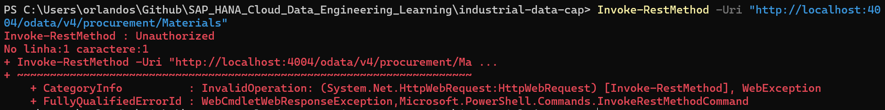
*F8-EV05 — No token, HTTP 401.*

**The token was obtained through the password grant** on XSUAA's `/oauth/token` endpoint, using the client from the service's own service key and the user's password typed in the terminal. This flow is for lab testing only. In production, the correct path is the authorization code flow with an approuter in front of the application.

**The first token carried only the `openid` scope.** It was accepted (no 401), but the service answered **403 Forbidden**: the user existed but had no application role. The fix was made in the BTP Cockpit, under **Security → Role Collections**: the `Compras Buyer` collection was created with the `Buyer` role of the `industrial-data-cap` application and assigned to the BTP user (Default identity provider). Since permissions are fixed when the token is issued, a new token had to be generated.

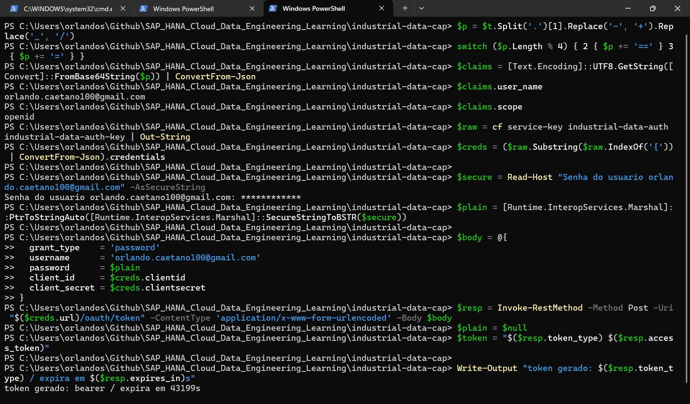
*F8-EV02 — The old token had only `openid` (no-role state); then the new token was generated.*

With the new token, local decoding of the payload (without exposing the token) shows the scopes `industrial-data-cap!t705460.Buyer` and `industrial-data-cap!t705460.Viewer`, and the read returns the materials with HTTP 200.

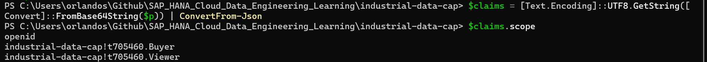
*F8-EV03 — Token scopes after the role assignment.*

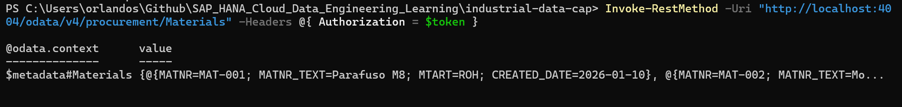
*F8-EV04 — `GET /Materials` with token, HTTP 200.*

The 403 for a user without a role was observed in the terminal but **not captured as an image**; it is documented here as text. An isolated Viewer test was also not done, because the subaccount has a single user, holding both `Buyer` and `Viewer`.

### F9 — Authorization: what each role may do

F9 defines **who may do what**, with `@restrict` in CDS: `Viewer` only reads, and `Buyer` reads, creates, updates and deletes. The tests used the two development users in `.cdsrc.json` (`alice` with `Buyer` and `bob` with `Viewer`), under the default profile.

```cds
service ProcurementService @(path: '/odata/v4/procurement') @(requires: 'authenticated-user') {

  @(restrict: [
    { grant: ['READ'],                       to: ['Viewer', 'Buyer'] },
    { grant: ['CREATE', 'UPDATE', 'DELETE'], to: 'Buyer' }
  ])
  entity PurchaseOrders as projection on db.PurchaseOrder;

  @(restrict: [{ grant: 'READ', to: ['Viewer', 'Buyer'] }])
  entity BrlOrders as select from db.PurchaseOrder { /* ... */ } where CURRENCY = 'BRL';
}
```

| Test | Who | Action | Result |
|---|---|---|---|
| A | No login | Read `Materials` | HTTP 401 |
| B | `bob` (Viewer) | Read `Materials` | HTTP 200, 3 materials |
| C | `bob` (Viewer) | Create order | HTTP 403 |
| D | `alice` (Buyer) | Create order | HTTP 201, `EBELN: 4500000031` |
| E | `bob` (Viewer) | Delete order | HTTP 403 |

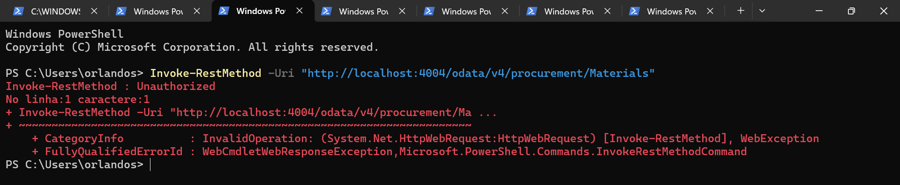
*F9-EV01 — No login, HTTP 401.*

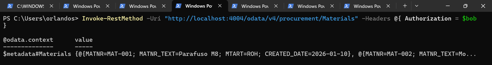
*F9-EV02 — `bob` (Viewer) reading, HTTP 200.*

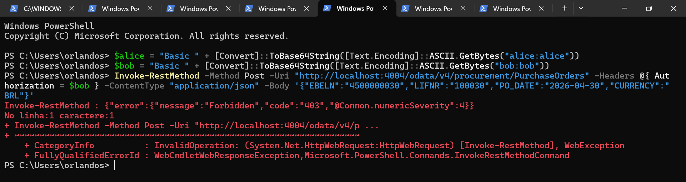
*F9-EV03 — `bob` (Viewer) trying to create, HTTP 403.*

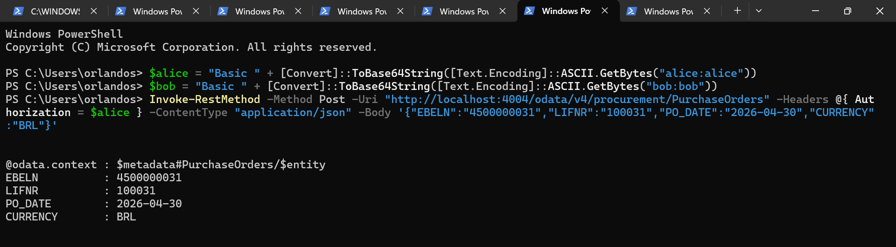
*F9-EV04 — `alice` (Buyer) creating, HTTP 201.*

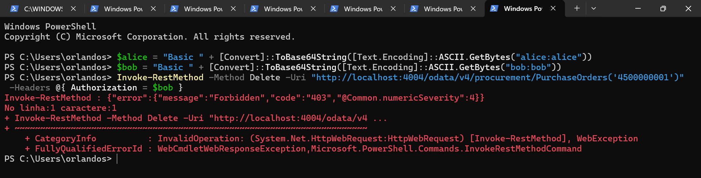
*F9-EV05 — `bob` (Viewer) trying to delete, HTTP 403.*

**A lesson from F9.** The first version put the rule at service level, and the Viewer could create and delete (HTTP 201). An isolated test showed that roles reached CAP correctly, and that with per-entity `@requires` `bob` received 403. The solution was to declare `@restrict` **on each entity**, as in the excerpt above, and repeat the tests.

---

## 🗂️ Application structure

```
db/schema.cds ─────────► srv/service.cds ──────────► OData V4  /odata/v4/procurement
(PurchaseOrder, Material)   (projections, BrlOrders view,      ├─ PurchaseOrders
                             per-entity @restrict — F9)        ├─ Materials
                                    │                          └─ BrlOrders
                                    ├─ srv/service.js  (F7: `before` rules)
                                    └─ server.js + srv/rest.js (F5: REST /rest/materiais/...)

Default profile → in-memory SQLite + test users (alice, bob)               F1, F2, F4–F7, F9
Hybrid profile  → SAP HANA Cloud (HDI hdi_db) + XSUAA (industrial-data-auth) F3, F8
```

---

## 📊 Evidence

| # | Evidence | Scenario | File |
|---|---|---|---|
| 1 | Materials list (3) | F2 | [F2-EV01](../../../Evidences/LAB_F/F2-EV01-materials-lista-3-linhas.png) |
| 2 | Filter by type `FERT` | F2 | [F2-EV02](../../../Evidences/LAB_F/F2-EV02-materials-filtro-fert.png) |
| 3 | `BrlOrders` CDS view | F2 | [F2-EV03](../../../Evidences/LAB_F/F2-EV03-brlorders-cds-view.png) |
| 4 | Material by key `MAT-003` | F2 | [F2-EV04](../../../Evidences/LAB_F/F2-EV04-materials-por-chave-mat003.png) |
| 5 | HANA tables (2 and 3 records) | F3 | [F3-EV03](../../../Evidences/LAB_F/F3-EV03-tabelas-hana-record-count.png) |
| 6 | `POST` of `MAT-004` | F3 | [F3-EV04](../../../Evidences/LAB_F/F3-EV04-post-mat-004-201.png) |
| 7 | Count of 4 records | F3 | [F3-EV05](../../../Evidences/LAB_F/F3-EV05-record-count-4.png) |
| 8 | Persistence after restart | F3 | [F3-EV06](../../../Evidences/LAB_F/F3-EV06-persistencia-apos-restart.png) |
| 9 | `$metadata` with entities | F4 | [F4-EV01](../../../Evidences/LAB_F/F4-EV01-metadata-entidades.jpg) |
| 10 | `$count` (2 orders) | F4 | [F4-EV02](../../../Evidences/LAB_F/F4-EV02-count-2-pedidos.jpg) |
| 11 | `$orderby` by `PO_DATE desc` | F4 | [F4-EV03](../../../Evidences/LAB_F/F4-EV03-orderby-po-date-desc.jpg) |
| 12 | `$top=2` | F4 | [F4-EV04](../../../Evidences/LAB_F/F4-EV04-top-2-materiais.jpg) |
| 13 | `$top` + `$skip` | F4 | [F4-EV05](../../../Evidences/LAB_F/F4-EV05-skip-mat-003.png) |
| 14 | 404 for `MAT-999` | F4 | [F4-EV06](../../../Evidences/LAB_F/F4-EV06-404-mat-999.png) |
| 15 | REST: summary by type | F5 | [F5-EV01](../../../Evidences/LAB_F/F5-EV01-rest-resumo.png) |
| 16 | REST: material `MAT-003` | F5 | [F5-EV02](../../../Evidences/LAB_F/F5-EV02-rest-material-mat-003.png) |
| 17 | REST: missing material (404) | F5 | [F5-EV03](../../../Evidences/LAB_F/F5-EV03-rest-material-mat-999-404.png) |
| 18 | Same material through OData | F5 | [F5-EV04](../../../Evidences/LAB_F/F5-EV04-odata-mesmo-material.png) |
| 19 | `or` between currencies | F6 | [F6-EV01](../../../Evidences/LAB_F/F6-EV01-or-moedas-brl-usd.png) |
| 20 | `startswith` | F6 | [F6-EV02](../../../Evidences/LAB_F/F6-EV02-startswith-motor.png) |
| 21 | `contains` | F6 | [F6-EV03](../../../Evidences/LAB_F/F6-EV03-contains-caixa.png) |
| 22 | `and` with type and date | F6 | [F6-EV04](../../../Evidences/LAB_F/F6-EV04-and-fert-data.png) |
| 23 | `$orderby` on text | F6 | [F6-EV05](../../../Evidences/LAB_F/F6-EV05-orderby-texto-asc.png) |
| 24 | Date `gt` | F6 | [F6-EV06](../../../Evidences/LAB_F/F6-EV06-data-gt-2026-03-02.png) |
| 25 | Composite ordering | F6 | [F6-EV07](../../../Evidences/LAB_F/F6-EV07-orderby-composto.png) |
| 26 | `ne` with `$count` | F6 | [F6-EV08](../../../Evidences/LAB_F/F6-EV08-ne-roh-count.png) |
| 27 | Valid order (201) | F7 | [F7-EV01](../../../Evidences/LAB_F/F7-EV01-post-valido-201.png) |
| 28 | Invalid currency (400) | F7 | [F7-EV02](../../../Evidences/LAB_F/F7-EV02-moeda-invalida-400.png) |
| 29 | No supplier (400) | F7 | [F7-EV03](../../../Evidences/LAB_F/F7-EV03-sem-fornecedor-400.png) |
| 30 | Future date (400) | F7 | [F7-EV04](../../../Evidences/LAB_F/F7-EV04-data-futura-400.png) |
| 31 | Saved orders | F7 | [F7-EV05](../../../Evidences/LAB_F/F7-EV05-conferir-gravados.png) |
| 32 | XSUAA service creation | F8 | [F8-EV01](../../../Evidences/LAB_F/F8-EV01-cf-create-service-xsuaa.png) |
| 33 | Old token (`openid`) and new token | F8 | [F8-EV02](../../../Evidences/LAB_F/F8-EV02-token-gerado-e-scope-buyer.png) |
| 34 | `Buyer` and `Viewer` scopes | F8 | [F8-EV03](../../../Evidences/LAB_F/F8-EV03-scope-buyer-viewer.png) |
| 35 | Read with token (200) | F8 | [F8-EV04](../../../Evidences/LAB_F/F8-EV04-materials-200.png) |
| 36 | No token (401) | F8 | [F8-EV05](../../../Evidences/LAB_F/F8-EV05-anonimo-401.png) |
| 37 | No login (401) | F9 | [F9-EV01](../../../Evidences/LAB_F/F9-EV01-anonimo-401.png) |
| 38 | Viewer reads (200) | F9 | [F9-EV02](../../../Evidences/LAB_F/F9-EV02-bob-viewer-get-ok.png) |
| 39 | Viewer tries to create (403) | F9 | [F9-EV03](../../../Evidences/LAB_F/F9-EV03-bob-viewer-post-403.png) |
| 40 | Buyer creates (201) | F9 | [F9-EV04](../../../Evidences/LAB_F/F9-EV04-alice-buyer-post-201.png) |
| 41 | Viewer tries to delete (403) | F9 | [F9-EV05](../../../Evidences/LAB_F/F9-EV05-bob-viewer-delete-403.png) |

---

## ⚠️ Limitations and open items

- **F1:** no screenshots; validated by terminal output.
- **F3:** evidence numbering starts at EV03. The active instance (EV01) and the deploy (EV02) were validated by terminal output and not captured as images.
- **F3:** the development computer's public IP was added to the HANA Cloud instance's **Allowed connections** list. It should be removed at the end of the lab if external access is no longer needed.
- **F3:** the `hdi_db` container still holds three old Block C files (`src/.hdiconfig`, `src/.hdinamespace`, `src/material.hdbtable`), which the deployer flagged as not present in `undeploy.json`.
- **F3:** the service data comes from small CSVs (2 orders and 3 materials), not from the `INDUSTRIAL_DATA` schema tables from Block D (40 and 300 rows).
- **F8:** the no-role 403 is documented only as text, and the isolated Viewer test was not done.
- **F8:** the password grant was used for testing only; production requires the authorization code flow with an approuter.
- **F9:** `alice` and `bob` have trivial passwords and are for local development only.
- **Service:** the `hdi_db-key` and `industrial-data-auth-key` service keys remain active on Cloud Foundry.
- **npm:** `npm audit` reports 2 high-severity vulnerabilities in the project, not yet addressed.

## ➡️ Next steps

1. Connect the CAP service to the real `INDUSTRIAL_DATA` schema tables (through synonyms) instead of CSVs.
2. Address the `npm audit` vulnerabilities and clean up service keys and the IP rule when no longer needed.
3. Consume `ProcurementService` in an SAP Fiori application (Block G).

---

[⬆️ Back to README](../../../README.en.md)
