# G1: Material Master Explorer com SAP Fiori Elements

**🌐 Idioma / Language:** 🇧🇷 **Português** | [🇺🇸 English](../EN/01-g1-material-master-explorer.en.md)

[⬆️ Voltar ao README](../../../README.md)

> **Status:** ✅ G1 concluído e publicado no SAP BTP (Cloud Foundry + HANA Cloud), com tile no Launchpad (Work Zone) e acesso pelo celular · ⚠️ Ressalvas: o app foi cadastrado manualmente no Work Zone (a descoberta automática do HTML5 Apps não funcionou); o tile abriu em branco uma vez no desktop (causa não diagnosticada); no celular só aparecem as colunas de maior importância; a hipótese de licenciamento não foi validada; o terminal do `cds watch` e a saída do `curl.exe` não foram capturados como imagem (documentados como texto)
> **Ambiente:** SAP CAP (`@sap/cds` 10.2.x, `cds-serve` 10.2.2) · SAP Fiori tools (Application Generator `@sap/generator-fiori` template `lrop` 1.34.0, `@sap/ux-ui5-tooling` 1.34.0) · SAPUI5 1.154.0 (tema SAP Horizon) · Node.js 24 · PowerShell · VS Code · SAP BTP trial (Cloud Foundry, SAP HANA Cloud `hana-free`, XSUAA, HTML5 Application Repository, SAP Build Work Zone standard, SAP Cloud Identity Services) · MBT 1.2.53 · plugin multiapps 3.12.0
> **Projeto:** [`procurement-p2p-cap/`](../../../procurement-p2p-cap) (na raiz do repositório) · **Serviço:** `ProcurementService` em `/odata/v4/p2p` · **App:** `p2p.materials` (List Report + Object Page)
> **Dados:** CSV fictícios — 12 materiais, 10 fornecedores, 30 info records de compras (PIR), 26 info records de qualidade (QIR), 30 pedidos com 59 itens
> **Classificação:** ambiente educacional, dados fictícios, sem dados de produção

## 🎯 Visão executiva

O Bloco F entregou um serviço OData protegido. O **Bloco G** responde à pergunta seguinte: **como uma pessoa de negócio usa esses dados**, sem escrever consultas. A resposta é uma aplicação SAP Fiori Elements, gerada a partir do próprio modelo CDS.

O Bloco G foi desenhado como uma **extensão Purchase-to-Pay (P2P) construída no SAP BTP, sem alterar o núcleo do ERP**: a aplicação consulta cadastros, cria pedidos de compra, aprova por alçada e só então integra o pedido ao ERP. O **G1** é o primeiro passo desse caminho e responde a uma pergunta simples de compras: **para este material, quais fornecedores podem receber um pedido hoje?**

A resposta combina quatro fontes, todas visíveis em uma única tela do material: o cadastro do material, o **PIR** (info record de compras: preço, prazo, validade), o **QIR** (info record de qualidade: liberação e certificado) e o status do fornecedor.

Este documento mostra o G1 do começo ao fim, incluindo os tropeços. O app foi gerado com as ferramentas oficiais (SAP Fiori tools), configurado no Page Editor, ganhou uma identidade visual própria por CSS e foi preparado para dois idiomas (inglês como padrão e português como tradução). Por fim, foi publicado no SAP BTP (Cloud Foundry e HANA Cloud), ganhou um tile no Launchpad e foi aberto no celular.

| Etapa | Objetivo | Resultado |
|---|---|---|
| G1.0 | Contexto e decisões | ✅ Extensão P2P no BTP sem impactar o núcleo; elegibilidade por PIR + QIR; plano G1 a G8 |
| G1.1 | Modelo e serviço CAP | ✅ Projeto `procurement-p2p-cap`, tabelas, views de elegibilidade, papéis e seed; validado no sandbox |
| G1.2 | Ferramentas | ✅ SAP Fiori tools (Extension Pack) instaladas no VS Code |
| G1.3 | Geração do app | ✅ Application Generator: List Report sobre `Materials`, app `p2p.materials` |
| G1.4 | Primeira execução | ✅ App no ar após resolver o 401 no `$metadata` |
| G1.5 | Page Map e Page Editor | ✅ Filtros, coluna `QM ativo` e rótulos legíveis na lista |
| G1.6 | Identidade visual | ✅ Tema comparado e cabeçalho azul escuro por CSS próprio |
| G1.7 | Object Page | ✅ Título, descrição e seção "Dados do material" |
| G1.8 | Fornecedores elegíveis | ✅ Tabela na Object Page com situação colorida (PIR + QIR + status) |
| G1.9 | Internacionalização | ✅ Textos das telas e do banco em inglês (padrão) e português |
| G1.10 | Publicação no BTP | ✅ MTA no Cloud Foundry + HANA Cloud, tile no Launchpad (Work Zone) e acesso pelo celular (navegador e Joule Work); elegibilidade validada no HANA |

> [!IMPORTANT]
> Nenhuma credencial foi gravada em arquivo do repositório. `node_modules/`, `gen/`, `default-env.json`, `.cdsrc-private.json` e `.env` estão no `.gitignore`.
>
> Os usuários `alice`, `bob`, `carol` e `dave` do `.cdsrc.json` existem **só para desenvolvimento local**, com senhas triviais e papéis fixos. No perfil `hybrid` eles não são usados: a autenticação passa a ser do XSUAA (como no F8).

---

## 🧭 Storytelling funcional

### G1.0 — Contexto: uma extensão P2P no BTP, sem impactar o núcleo

O plano original do Bloco G era uma lista de cockpits. Durante o G1 ele foi reorganizado em torno de um processo conhecido: **Purchase-to-Pay**. A ideia é mostrar o potencial do BTP ao estender o ERP com uma aplicação externa, sem mexer no núcleo.

As decisões de desenho, tomadas antes da implementação:

| Tema | Decisão |
|---|---|
| Onde nasce o pedido | Na aplicação Fiori (BTP). O ERP só recebe o pedido **depois de aprovado** |
| Aprovação | Uma só, no app, por **alçada** (tabela `ApprovalRule`: tipo de documento, moeda e faixa de valor). Recusa exige motivo; há log de auditoria |
| Tipos de documento | `ZF`, `ZR` e `ZK` nascem no app e entram no ERP já liberados; `NB`, `FO` e `ZC` seguem o fluxo normal do ERP |
| Criação no ERP | Só por um usuário técnico de integração; o ERP fica somente leitura para esses tipos |
| Elegibilidade do fornecedor | Só recebe pedido quem tem **PIR válido**, fornecedor **ativo**, **QIR liberado** e **certificado de qualidade válido** (para materiais com controle QM) |
| QIR | O app **só lê** o QIR; a manutenção continua no ERP/qualidade |
| Integração | CPI (Integration Suite) como middleware, em modo síncrono, com chave de idempotência (`EXTERNAL_REF`). Como não há ERP real, o S/4HANA será simulado por um serviço CAP |
| Desenvolvimento | Local no VS Code (serviço em `localhost`); publicação no BTP (MTA, Cloud Foundry, HDI, XSUAA) em etapa própria |

O roteiro do bloco ficou assim:

| # | Cenário | Situação |
|---|---|---|
| G1 | Material Master Explorer (este documento) | ✅ |
| G2 | Supplier Eligibility Explorer (app próprio de elegibilidade) | ⏳ |
| G3 | Purchase Order (pedido com itens, rascunho, preço do PIR, fornecedor elegível) | ⏳ |
| G4 | Approval Cockpit (aprovação em massa por alçada, motivo de recusa, auditoria) | ⏳ |
| G5 | Integração síncrona com o ERP (CPI + S/4HANA simulado) | ⏳ |
| G6 | Recebimento e fatura com conferência de três vias | ⏳ |
| G7 | Acompanhamento de pagamento | ⏳ |
| G8 | Dashboard de pedidos (Analytical List Page, CDS views de agregação) | ⏳ |

### G1.1 — O modelo e o serviço: o que o app vai mostrar

Antes de gerar a tela foi preciso ter **dados e regras**. O G1 usa um projeto CAP novo, `procurement-p2p-cap`, separado do `industrial-data-cap` do Bloco F, para que as evidências do F continuem reproduzíveis. Os códigos de material e fornecedor seguem o `INDUSTRIAL_DATA` (`EC-200001`, `RM-100001`, `SUP-001`...), e a estrutura de tabelas foi levantada a partir de um extrato do schema real.

```
procurement-p2p-cap/
├─ db/schema.cds           namespace p2p: materiais, fornecedores, PIR, QIR, pedidos, regras de aprovação
├─ db/data/*.csv           seed fictício (carregado no SQLite ao subir o servidor)
├─ srv/service.cds         ProcurementService em /odata/v4/p2p, views de elegibilidade, papéis
├─ .cdsrc.json             usuários de teste (alice, bob, carol, dave)
├─ xs-security.json        escopos e papéis para o XSUAA (Viewer, Buyer, Approver, ApproverSenior)
└─ app/                    aplicações Fiori (criadas a partir do G1.3)
```

As entidades centrais do G1 (nomes de campo no padrão SAP, associações com condição explícita):

```cds
entity Material {
  key MATNR      : String(40);
      MATNR_TEXT : String(100);
      MTART      : String(4);
      MATKL      : String(9);
      MEINS      : String(3);
      QM_ACTIVE  : Boolean;       // true = controle de aquisição por QM (exige QIR)
      type       : Association to MaterialType on type.MTART = MTART;
}

entity PurchasingInfoRecord {       // PIR: preço, prazo e vigência por material e fornecedor
  key INFO_RECORD_ID : Integer;
      MATNR, LIFNR, EKORG, NET_PRICE, PRICE_UNIT, CURRENCY,
      VALID_FROM, VALID_TO, LEAD_TIME_DAYS, MIN_QTY ...
}

entity QualityInfoRecord {          // QIR: liberação de qualidade e certificado
  key QIR_ID : Integer;
      MATNR, LIFNR,
      QIR_STATUS   : String(10);    // RELEASED | BLOCKED
      BLOCK_REASON, CERT_TYPE, CERT_NO, CERT_VALID_FROM, CERT_VALID_TO ...
}
```

**A regra de elegibilidade** está em uma view CDS, `EligibilityBase`, que junta PIR, QIR, fornecedor e material e calcula um único código de motivo. A ordem das condições importa: a primeira que for verdadeira vence.

```cds
case
  when s.LIFNR_STATUS <> 'ACTIVE'                 then 'SUPPLIER_NOT_ACTIVE'
  when p.VALID_TO   < cast($now as Date)          then 'PIR_EXPIRED'
  when p.VALID_FROM > cast($now as Date)          then 'PIR_NOT_YET_VALID'
  when m.QM_ACTIVE = true and q.QIR_ID is null    then 'QIR_MISSING'
  when q.QIR_STATUS = 'BLOCKED'                   then 'QIR_BLOCKED'
  when q.CERT_VALID_TO < cast($now as Date)       then 'CERT_EXPIRED'
  else 'ELIGIBLE'
end as REASON
```

Uma segunda view, `SupplierEligibility`, acrescenta o texto e a criticidade do motivo (verde, amarelo ou vermelho) e a criticidade do vencimento do certificado (vencido, vence em até 90 dias, em dia). O `Materials` expõe a ligação `eligibility` para essa view, e é por ela que a Object Page do material mostra os fornecedores.

**Segurança desde o início.** O serviço exige usuário autenticado (`@requires: 'authenticated-user'`), e cada entidade tem seu papel. A lição do F9 foi aplicada: a regra vai **em cada entidade**, não no serviço.

**Validação no sandbox.** Antes de gerar a tela, o serviço foi subido em um ambiente de teste e consultado:

| Verificação | Resultado |
|---|---|
| Chamada sem login | HTTP 401 |
| `bob` (Viewer) lê materiais | HTTP 200; ao tentar criar um pedido, HTTP 403 |
| Elegibilidade agrupada por motivo (30 info records) | `ELIGIBLE` 19 · `SUPPLIER_NOT_ACTIVE` 4 · `QIR_BLOCKED` 2 · `CERT_EXPIRED` 2 · `PIR_EXPIRED` 1 · `PIR_NOT_YET_VALID` 1 · `QIR_MISSING` 1 |
| `EC-200002` | `SUP-001` elegível (certificado vence em 2026-12-05); `SUP-006` com QIR bloqueado; `SUP-003` com fornecedor inativo |
| Itens × total dos pedidos | A soma dos itens (`AMOUNT`) bate com `TOTAL_AMOUNT` em todos os 30 pedidos |

> [!NOTE]
> Um erro de seed ensinou algo útil: os booleanos do CSV foram gravados como `True/False` (Python), e `m.QM_ACTIVE = true` nunca era verdadeiro. O caso `QIR_MISSING` não aparecia e a contagem de elegíveis saiu 20 em vez de 19. No CSV do CAP o booleano precisa ser `true/false` em minúsculas.

No computador do usuário, o projeto sobe com:

```powershell
cd C:\Users\orlandos\Github\SAP_HANA_Cloud_Data_Engineering_Learning\procurement-p2p-cap
npm.cmd install
npx.cmd cds watch
```

O retorno esperado é `server listening on { url: 'http://localhost:4004' }` e a lista de serviços, com `ProcurementService` em `/odata/v4/p2p`. O `npm.cmd` e o `npx.cmd` aparecem de novo porque a política de execução do PowerShell bloqueia o `npm.ps1` (veja o troubleshooting).

> O G1.1 não tem captura de tela. Foi validado por saída de terminal, no sandbox e depois no computador do usuário.

### G1.2 — As ferramentas: SAP Fiori tools no VS Code

A intenção do G1 nunca foi só "ver os dados na tela": foi **entender o processo de construir um app Fiori Elements**. Por isso o app não foi escrito à mão. Uma primeira versão manual (anotações e `manifest.json` escritos diretamente) foi montada para validar o modelo, mas a decisão foi usar o caminho oficial: o **SAP Fiori tools**, no VS Code.

O que cada ferramenta faz:

| Ferramenta | Papel |
|---|---|
| **Application Generator** | Cria o app a partir de um template, ligado a um projeto CAP local |
| **Page Map** | Mostra as páginas do app (List Report, Object Page) e suas propriedades |
| **Page Editor** | Edita filtros, colunas, seções e rótulos, e grava as anotações no arquivo do app |
| **Application Info** | Resume o app e oferece os atalhos (Preview, Deploy, Page Map) |
| **XML Annotation Language Server** | Completa e valida anotações |
| **Guided Development** | Tutoriais passo a passo dentro do VS Code |

A instalação foi do pacote **SAP Fiori Tools - Extension Pack**, que traz todas as extensões de uma vez.

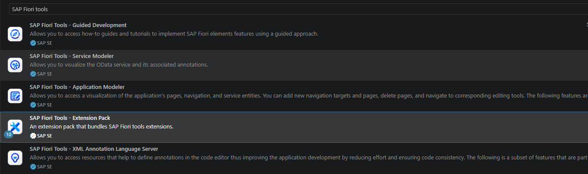
*G1-EV01 — As extensões do SAP Fiori tools instaladas no VS Code.*

> [!NOTE]
> No caminho houve uma confusão. A busca por "Generators" no VS Code abriu a página **Explore and Install Generators**, do Yeoman, que é outra coisa. O gerador do Fiori é aberto pela paleta de comandos (`Ctrl + Shift + P`) com **Fiori: Open Application Generator**.

### G1.3 — Gerando o app: o Application Generator, tela a tela

O gerador tem quatro etapas, e cada uma é uma decisão.

**1. Template Selection.** O gerador oferece vários templates. O escolhido foi **List Report Page**, que cria duas páginas ligadas: uma lista com filtros e, ao clicar em uma linha, uma página de detalhe (Object Page). É o padrão para consultar e abrir objetos de negócio.

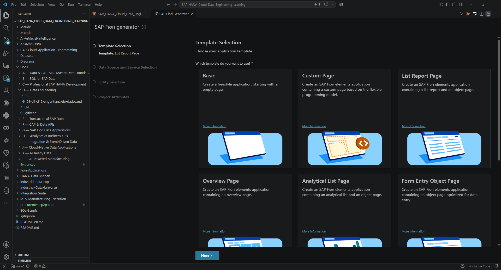
*G1-EV03 — Template List Report Page selecionado.*

**2. Data Source and Service Selection.** A fonte de dados é **Use a Local CAP Project**, que aponta para a pasta `procurement-p2p-cap`. O gerador lê o projeto e lista os serviços: foi escolhido o `ProcurementService (Node.js)`. Esse é o ponto em que o app se liga ao modelo, sem digitar URL.

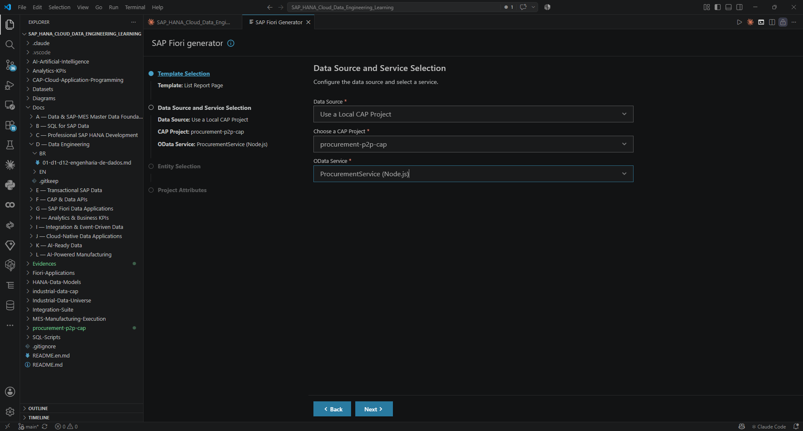
*G1-EV04 — Projeto CAP `procurement-p2p-cap` e serviço `ProcurementService (Node.js)`.*

**3. Entity Selection.** Aqui se escolhe a **entidade principal** da lista. O gerador mostra todas as entidades que o serviço expõe, e a entidade selecionada por padrão era `PurchaseOrders`.

A escolha foi **`Materials`**. Em **Navigation Entity** ficou `None`, porque a tabela de fornecedores seria montada depois, no Page Editor. A opção de **adicionar colunas e uma seção automaticamente** ficou em Yes, e o **tipo de tabela** em Responsive (adequado enquanto a lista tem menos de 200 itens).

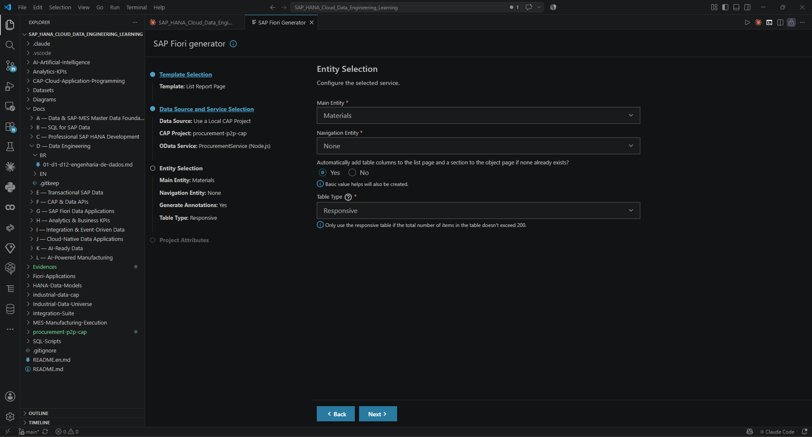
*G1-EV06 — `Materials` como entidade principal, sem entidade de navegação, anotações geradas.*

> [!NOTE]
> Antes de gerar, os apps feitos à mão da primeira tentativa foram movidos para `_referencia/`. Se ficassem em `app/`, as anotações deles seriam carregadas junto com as do gerador e entrariam em conflito. A pasta `_referencia/` fica no repositório só como comparação didática e **não é carregada** pelo serviço.

**4. Project Attributes.** Os dados do app:

| Campo | Valor | Para que serve |
|---|---|---|
| Module Name | `materials` | Nome da pasta em `app/` |
| Application Title | `Material Master Explorer` | Título do app (vai para o `i18n`) |
| Application Namespace | `p2p` | Prefixo do ID: o app vira `p2p.materials` |
| Description | `Material lookup and eligible suppliers (PIR + QIR)` | Descrição do app |
| Minimum SAPUI5 Version | `1.154.0` | Versão mínima exigida, gravada no `manifest.json` |
| TypeScript | No | O app é só XML e anotações |
| SAP Fiori Launchpad Configuration | No | Fica para a etapa de deploy |
| Virtual Endpoints for Local Preview | Yes | As bibliotecas do UI5 são servidas por endpoints virtuais, sem copiar arquivos para o projeto |
| Advanced Options | No | Padrão |

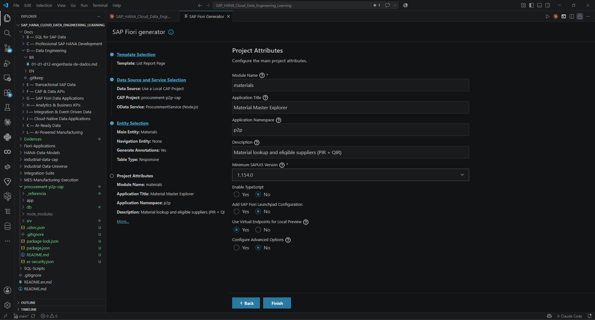
*G1-EV07 — Atributos do projeto preenchidos, antes do Finish.*

Ao clicar em **Finish**, o gerador criou o app em `app/materials` e abriu a tela **Application Info**.

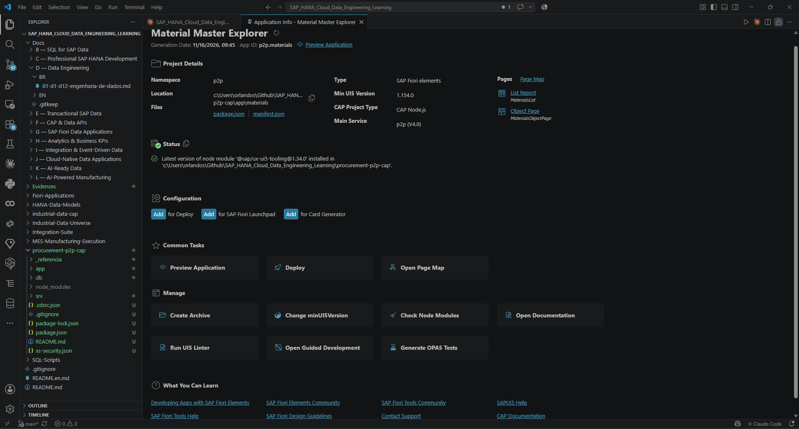
*G1-EV08 — Application Info: app `p2p.materials`, tipo SAP Fiori elements, SAPUI5 mínimo 1.154.0, serviço OData V4, páginas `MaterialsList` (List Report) e `MaterialsObjectPage` (Object Page).*

O que o gerador escreveu:

| Arquivo | Papel |
|---|---|
| `app/materials/webapp/manifest.json` | Descritor do app: serviço, modelo OData, rotas entre as páginas |
| `app/materials/webapp/Component.js` | Componente mínimo, que herda de `sap/fe/core/AppComponent` |
| `app/materials/webapp/index.html` | Página usada só no preview local; carrega o UI5 1.154.0 e o tema `sap_horizon` |
| `app/materials/webapp/i18n/i18n.properties` | Textos do app (`appTitle`, `appDescription`) |
| `app/materials/annotations.cds` | Anotações de interface (`UI.LineItem`, `UI.Facets` e outras) |
| `app/services.cds` | Liga as anotações ao serviço (`using from './materials/annotations'`) |
| `package.json` do projeto | Passa a ter `workspaces: ["app/*"]`, `cds-plugin-ui5` e o script `watch-materials` |

O `cds-plugin-ui5` faz o próprio servidor do CAP servir o app em `/p2p.materials/index.html`. É por isso que o mesmo processo (`cds watch`) entrega o serviço e a tela.

### G1.4 — A primeira execução: o app em branco e o 401

O app é aberto com o script que o gerador criou:

```powershell
npm.cmd run watch-materials
```

O retorno esperado é `server listening on { url: 'http://localhost:4004' }`, seguido de vários avisos `manifestEnhancer ... fallback locale 'en'`, que são inofensivos e foram resolvidos no G1.9. O navegador abre `http://localhost:4004/p2p.materials/index.html`.

**O primeiro resultado foi uma página em branco**, com o título "Material Master Explorer" na aba. O `index.html` carregou, mas o UI5 não montou o app. O console do navegador explicou o motivo.

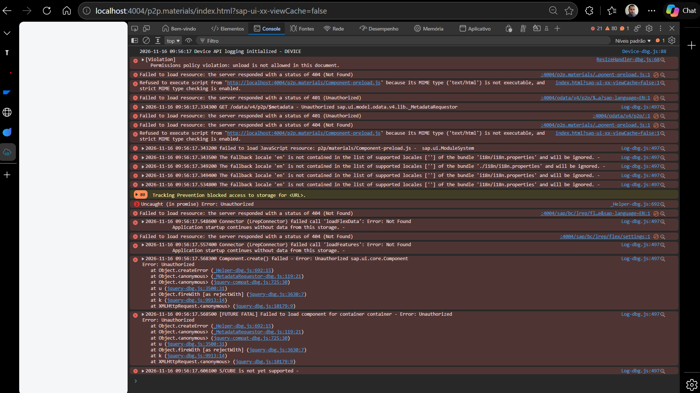
*G1-EV09 — O console: `GET /odata/v4/p2p/$metadata` retornou 401 Unauthorized, e depois `Component.create() failed - Error: Unauthorized`.*

**O diagnóstico.** O Fiori Elements só monta a tela depois de ler o `$metadata`. O serviço exige usuário autenticado, e a requisição do app não levou credenciais, porque o navegador não abriu o popup de login. Os outros erros do console (404 de `Component-preload.js` e de `sap/bc/lrep/...`) são normais em desenvolvimento local.

Para separar problema do servidor de problema do navegador, o serviço foi chamado **sem navegador**, em um segundo terminal:

```powershell
curl.exe -i -u alice:alice 'http://localhost:4004/odata/v4/p2p/Materials?$top=1'
```

O retorno foi `HTTP/1.1 200 OK` e o material `EC-200001` em JSON. Logo, o servidor aceitava o `alice`, e a falha estava no navegador (o Edge, naquela janela, não mostrou o popup de login básico, nem aceitou as credenciais embutidas na URL). A solução foi abrir o endereço do OData em outro navegador (Chrome), fazer o login com `alice` (a senha é digitada pela própria pessoa) e só então abrir o app, na mesma janela.

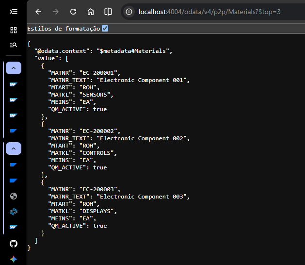
*G1-EV10 — Após o login, o serviço devolve os materiais em JSON.*

Com a credencial guardada pelo navegador, o app carregou.

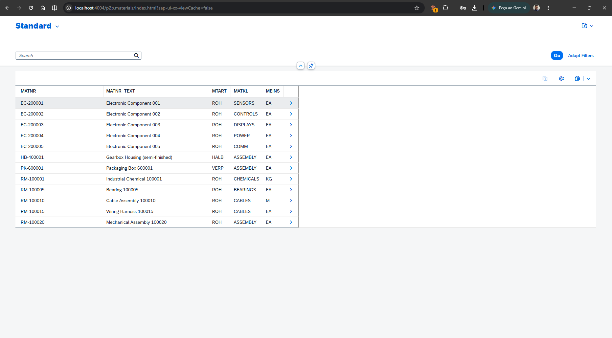
*G1-EV11 — O List Report como o gerador entregou: 12 materiais, colunas `MATNR`, `MATNR_TEXT`, `MTART`, `MATKL` e `MEINS`, só o campo de busca como filtro.*

Sem escrever código de tela, o gerador montou a lista a partir do modelo. Ela ainda tem fragilidades visíveis: cabeçalhos com o nome técnico, nenhum filtro por campo, `QM_ACTIVE` ausente e uma Object Page sem conteúdo útil. O resto do G1 corrige isso.

### G1.5 — Page Map e Page Editor: filtros, colunas e rótulos

O **Page Map** mostra o app como um mapa de páginas. `MaterialsList` (List Report) aponta para `MaterialsObjectPage` (Object Page), as duas sobre `/Materials`. No painel lateral ficam as propriedades gerais gravadas no `manifest.json` (título, descrição, layout de colunas).

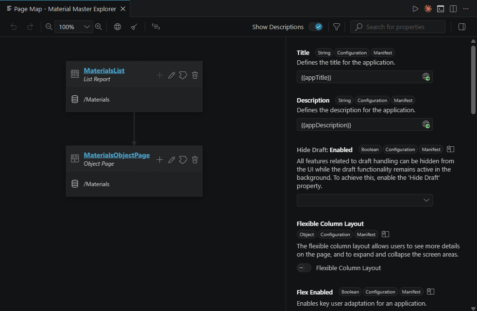
*G1-EV12 — Page Map do app: duas páginas ligadas, com as propriedades globais à direita.*

O lápis do cartão `MaterialsList` abre o **Page Editor**, que mostra a árvore da página: **Header**, **Filter Bar** (com os Filter Fields, vazios) e **Table** (com as Columns geradas).

Foram feitos três ajustes:

1. **Filtros.** Em Filter Fields foram adicionados `MATNR`, `MTART`, `MATKL` e `QM_ACTIVE`. O editor chegou a oferecer `type/MTART`, que é a chave da entidade associada `MaterialTypes`; funciona, mas obriga um join desnecessário, já que o `Materials` tem o próprio `MTART`. Foi trocado por `MTART`.
2. **Coluna `QM_ACTIVE`** adicionada à tabela.
3. **Rótulos.** Os cabeçalhos técnicos foram trocados por rótulos legíveis.

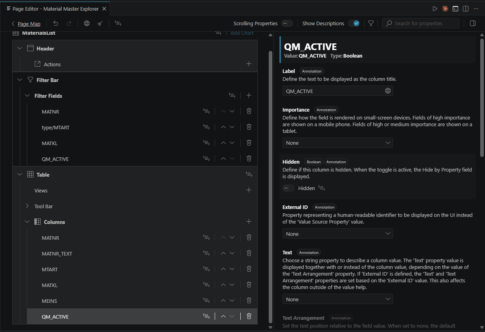
*G1-EV14 — Quatro filtros e a coluna `QM_ACTIVE` na árvore; no painel, o Label do item selecionado.*

O painel de propriedades revelou como o rótulo funciona. A nota do próprio editor diz que o **Label** de um campo vale para **toda ocorrência da propriedade** (filtro, coluna, seção da Object Page), salvo se outro rótulo for definido no local. Essa distinção reapareceu na Object Page (G1.7).

| Campo do painel | O que faz |
|---|---|
| **Label** | O texto exibido (filtro, coluna ou campo) |
| **External ID** | Propriedade que identifica o valor em linguagem humana |
| **Text** | Texto descritivo junto ou no lugar do código (`@Common.Text`) |
| **Text Arrangement** | Posição do texto em relação ao código; só habilita depois de escolher o Text |
| **Display Type** | Como o campo aparece (por exemplo, com ajuda de valores) |

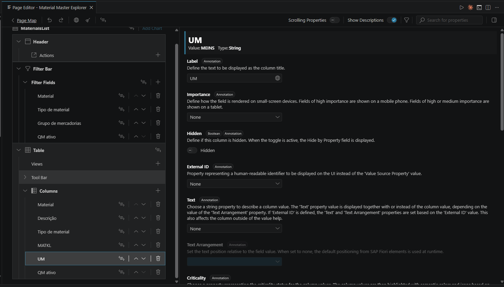
*G1-EV16 — Os rótulos aplicados: Material, Tipo de material, Grupo de mercadorias, QM ativo, Descrição e UM.*

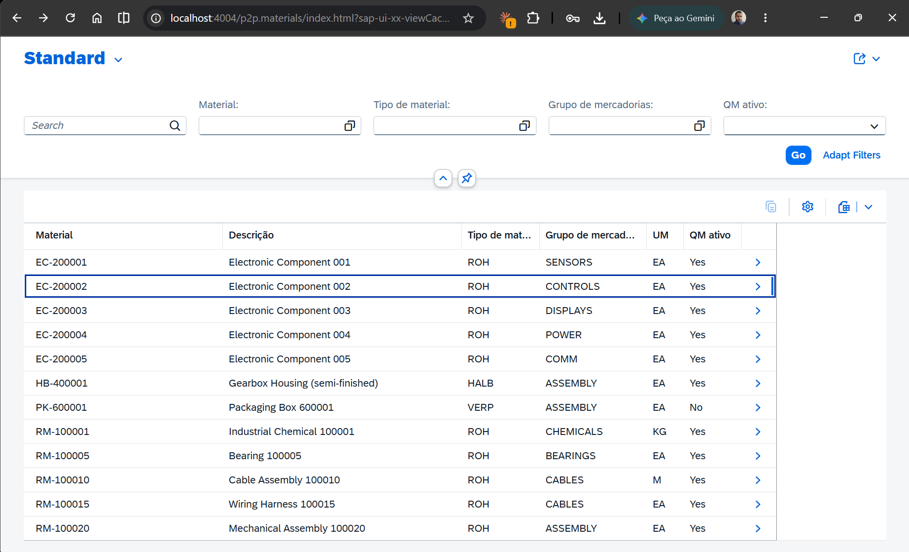
*G1-EV17 — O resultado no navegador: a barra de filtros com os quatro campos, a tabela com `QM ativo` no fim e cabeçalhos legíveis.*

**O que o Page Editor escreveu.** Tudo ficou no `app/materials/annotations.cds`. As partes relevantes:

```cds
UI.SelectionFields : [ MATNR, MTART, MATKL, QM_ACTIVE ],   // os filtros

UI.LineItem : [                                            // as colunas da tabela
    { $Type : 'UI.DataField', Label : 'Material',             Value : MATNR },
    { $Type : 'UI.DataField', Label : 'Descrição',            Value : MATNR_TEXT },
    { $Type : 'UI.DataField', Label : 'Tipo de material',     Value : MTART },
    { $Type : 'UI.DataField', Label : 'Grupo de mercadorias', Value : MATKL },
    { $Type : 'UI.DataField', Label : 'UM',                   Value : MEINS },
    { $Type : 'UI.DataField',                                  Value : QM_ACTIVE },
],

annotate service.Materials with { MATNR @Common.Label : 'Material' };   // rótulo da propriedade
```

> [!NOTE]
> Ao trocar `type/MTART` por `MTART`, sobrou uma anotação órfã: `annotate service.MaterialTypes with { MTART @Common.Label : 'type/MTART' }`. Ela dava ao campo `MTART` da entidade `MaterialTypes` um rótulo errado. Foi removida manualmente. Vale conferir o arquivo depois de mexer no editor.

### G1.6 — Identidade visual: tema e CSS próprio

A lista estava toda branca. O motivo é que o tema padrão do Fiori Elements, o **SAP Horizon**, é claro por definição, e a faixa azul que se lembra do Fiori clássico vem da **barra do Launchpad**, que a página solta (`index.html`) não carrega. O único azul da tela é o de acento (botão **Go**, links, título "Standard").

Dois caminhos foram testados. O primeiro foi trocar o tema só para comparar, com um parâmetro na URL (`&sap-ui-theme=sap_fiori_3`):

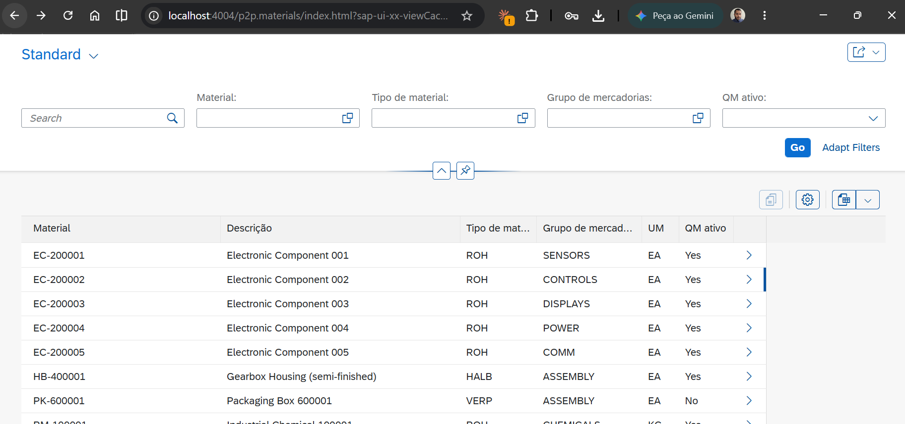
*G1-EV19 — O tema `sap_fiori_3`: botões e caixas retos, cabeçalho de tabela cinza. A faixa azul continua ausente, porque ela não é do tema.*

O segundo foi uma **customização de CSS do próprio app**. O app carrega um arquivo de estilo declarado no `manifest.json` (`sap.ui5.resources.css`, que o gerador deixa vazio):

```json
"resources": { "css": [ { "uri": "css/style.css" } ] }
```

Uma primeira versão pintou a faixa de azul claro (`#d1e7fa`), mantendo as letras.

A versão final usa azul escuro e texto branco. **O ponto do exercício foi aprender a achar o seletor certo**: no navegador, botão direito no elemento, **Inspecionar**, e ler as classes no painel (`sapFDynamicPageTitle`, `sapFDynamicPageHeader`, `sapMLabel`). O arquivo é `app/materials/webapp/css/style.css`:

```css
/* Faixa do cabeçalho: fundo azul escuro e texto branco */
.sapFDynamicPageTitle,
.sapFDynamicPageHeader,
.sapFDynamicPageTitleWrapper {
    background-color: #0a4a82 !important;
}

/* Tudo o que é texto ou ícone dentro do título ("Standard", "No filters active") */
.sapFDynamicPageTitle * {
    color: #ffffff !important;
}

/* Rótulos dos filtros (Material:, Tipo de material:...) quando a barra está aberta */
.sapFDynamicPageHeader .sapMLabel {
    color: #ffffff !important;
}

/* Botões de texto da barra de filtros (Adapt Filters) e ações do título */
.sapFDynamicPageHeader .sapMBtnTransparent .sapMBtnContent,
.sapFDynamicPageTitle .sapMBtnTransparent .sapMBtnContent,
.sapFDynamicPageTitle .sapMBtnIcon {
    color: #ffffff !important;
}
```

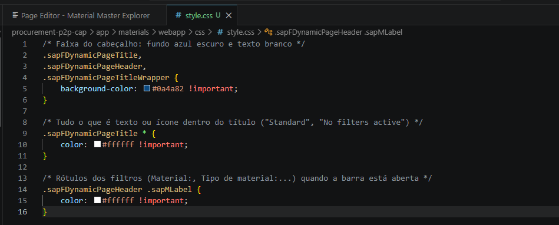
*G1-EV21 — O `style.css` final no VS Code.*

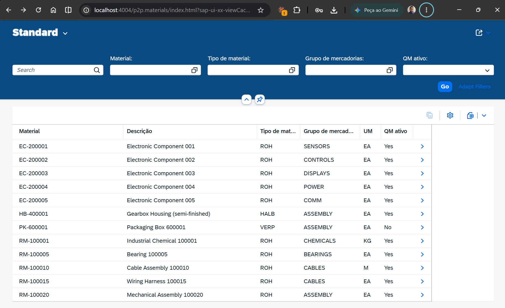
*G1-EV22 — O resultado: faixa azul escura, "Standard" e rótulos em branco, "Adapt Filters" legível.*

Duas observações. O `!important` é necessário para o CSS do app vencer o do tema. E a regra `.sapFDynamicPageTitle *` é ampla de propósito: se algum componente do título ficar estranho, o caminho é inspecionar e acrescentar uma regra mais específica. Como o mesmo componente (`Dynamic Page`) forma o cabeçalho das duas páginas, a Object Page herdou a cor sem mais nada.

### G1.7 — Object Page: do código ao objeto de negócio

Ao clicar em um material, a Object Page abre com o que o gerador montou: o título mostra só o código e os campos têm rótulos técnicos (`MATNR:`, `MTART:`...), como no FieldGroup gerado.

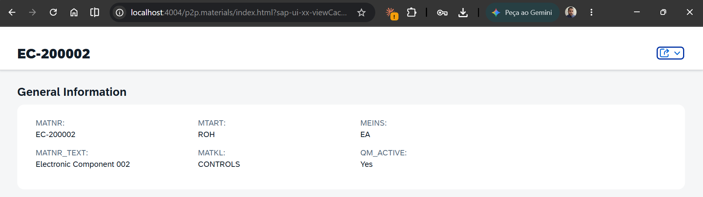
*G1-EV18 — A Object Page "antes": título só com o código, seção "General Information" e rótulos técnicos.*

Esses rótulos aparecem porque o gerador escreveu `Label : 'MATNR'` **dentro** do grupo de campos, e o rótulo local se sobrepõe ao rótulo da propriedade definido no List Report. A correção é no **Page Editor da `MaterialsObjectPage`**.

Os rótulos dos campos foram trocados (Material, Descrição, Tipo de material, Grupo de mercadorias, Unidade de medida, QM ativo) e a seção virou **"Dados do material"**.

O título do cabeçalho, porém, **não é exposto de forma óbvia no Page Editor**. Foi acrescentado direto no `annotations.cds`, em um bloco `UI.HeaderInfo`:

```cds
UI.HeaderInfo : {
    $Type          : 'UI.HeaderInfoType',
    TypeName       : 'Material',
    TypeNamePlural : 'Materiais',
    Title          : { $Type : 'UI.DataField', Value : MATNR_TEXT },   // nome do material
    Description    : { $Type : 'UI.DataField', Value : MATNR },        // código abaixo do nome
},
```

`TypeNamePlural` também alimenta o título da tabela ("Materiais (12)").

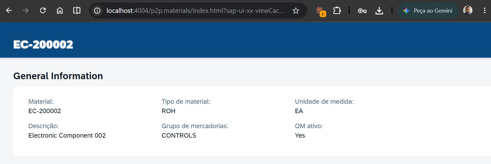
*G1-EV24 — Rótulos legíveis, mas o título ainda só com o código.*

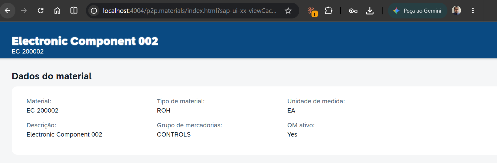
*G1-EV25 — Título "Electronic Component 002", código `EC-200002` abaixo e a seção "Dados do material".*

> [!NOTE]
> Uma alteração feita no editor pode parecer "não pegar". A seção continuou como "General Information" na tela mesmo com o arquivo já gravado. O Fiori lê as anotações do `$metadata`, e o servidor só as entrega novas depois de recarregar. Conferir o arquivo e dar **Ctrl + F5** (ou reiniciar o `cds watch`) resolve.

### G1.8 — Fornecedores elegíveis: PIR + QIR na Object Page

Este é o ponto central do G1. A Object Page do material precisa mostrar **quem pode receber um pedido**. Isso é uma tabela de outra entidade (`SupplierEligibility`), filtrada pelo material aberto, e ela depende de duas peças.

**Peça 1: as anotações da tabela.** Em um arquivo próprio, `app/materials/annotations-eligibility.cds` (separado do `annotations.cds`, para o Page Editor e o código não se sobrescreverem), foram definidos os títulos dos campos, o formato monetário do preço e uma lista de colunas com **qualificador** `ByMaterial`:

```cds
annotate service.SupplierEligibility with {
  NET_PRICE @title: 'Preço líquido'  @Measures.ISOCurrency: CURRENCY;   // preço formatado com a moeda
  // ... demais títulos
};

annotate service.SupplierEligibility with @(
  UI.LineItem #ByMaterial : [
    { $Type: 'UI.DataField', Value: LIFNR },
    { $Type: 'UI.DataField', Value: LIFNR_TEXT },
    { $Type: 'UI.DataField', Value: REASON_TEXT, Criticality: REASON_CRIT, CriticalityRepresentation: #WithIcon },
    { $Type: 'UI.DataField', Value: NET_PRICE },
    { $Type: 'UI.DataField', Value: LEAD_TIME_DAYS },
    { $Type: 'UI.DataField', Value: CERT_VALID_TO, Criticality: CERT_CRIT },
    { $Type: 'UI.DataField', Value: BLOCK_REASON }
  ]
);
```

O qualificador (`#ByMaterial`) é um nome que diferencia essa lista de outras listas do mesmo tipo, e é ele que o editor mostra na hora de escolher. `REASON_CRIT` pinta a situação (verde, amarelo ou vermelho, com ícone), e `CERT_CRIT` pinta o vencimento do certificado.

**Peça 2: a seção, criada no Page Editor.** Em **Sections**, o botão **+** abriu **Add Table Section**:

| Campo | Valor | Significado |
|---|---|---|
| Label | `Fornecedores elegíveis` | Título da seção |
| Use Existing Table | selecionado | Usa uma lista já anotada no modelo |
| Value Source | `eligibility` | A ligação do `Materials` com a view de elegibilidade |
| Annotation | `LineItem#ByMaterial` | As colunas definidas na Peça 1 |
| Table Type | `ResponsiveTable` | Tabela adaptável; poucos fornecedores por material |

O editor reconheceu a ligação `eligibility` e o qualificador, o que confirma que o modelo e a tela estão alinhados. Ele registrou a seção como uma nova faceta (`UI.ReferenceFacet` com alvo `eligibility/@UI.LineItem#ByMaterial`), e a Object Page ganhou duas seções na barra de navegação.

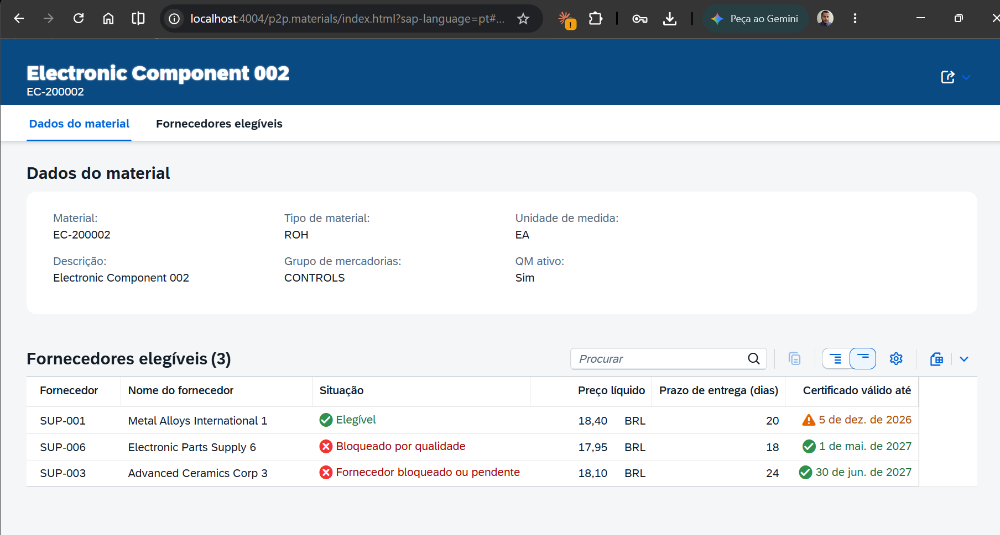
*G1-EV28 — A mesma seção com a coluna "Certificado válido até" visível. Esta é a evidência principal do G1.*

Como ler a tabela do material `EC-200002`:

| Fornecedor | Situação | Certificado | Por quê |
|---|---|---|---|
| `SUP-001` | ✅ Elegível | ⚠️ 5 de dez. de 2026 | PIR válido, QIR liberado. Atenção: o certificado vence em menos de 90 dias |
| `SUP-006` | ❌ Bloqueado por qualidade | ✅ 1 de mai. de 2027 | O certificado está válido, mas o **QIR está bloqueado** |
| `SUP-003` | ❌ Fornecedor bloqueado ou pendente | ✅ 30 de jun. de 2027 | O certificado está válido, mas o **fornecedor está inativo** |

O caso do `SUP-006` mostra por que o QIR é uma verificação separada: um certificado em dia não basta quando a qualidade bloqueou a combinação material e fornecedor. O texto da situação e a sua cor vêm da tabela `EligibilityReason` do banco, e o preço sai formatado com a moeda por causa do `@Measures.ISOCurrency`. A coluna "Motivo do bloqueio" não aparece nessas capturas porque a tabela responsiva esconde as colunas de menor prioridade em telas estreitas.

### G1.9 — Internacionalização: inglês como padrão, português como tradução

A tela estava misturada: os textos padrão do UI5 (`Search`, `Go`, `Adapt Filters`) seguem o idioma do navegador, mas os rótulos que foram digitados estavam fixos em português. A pergunta que a mistura levanta é: **qual idioma é o padrão** e como o app muda de idioma. A decisão foi **inglês como padrão**, com tradução para português, o costume em apps SAP e em repositórios públicos.

**O "antes".** Com `?sap-language=pt` na URL, os textos do próprio UI5 mudaram (`Standard` virou `Padrão`, `Search` virou `Procurar`, `Go` virou `Iniciar`, `Adapt Filters` virou `Ajustar filtros`, e `Yes/No` virou `Sim/Não`). Os nossos textos e os dados ficaram como estavam.

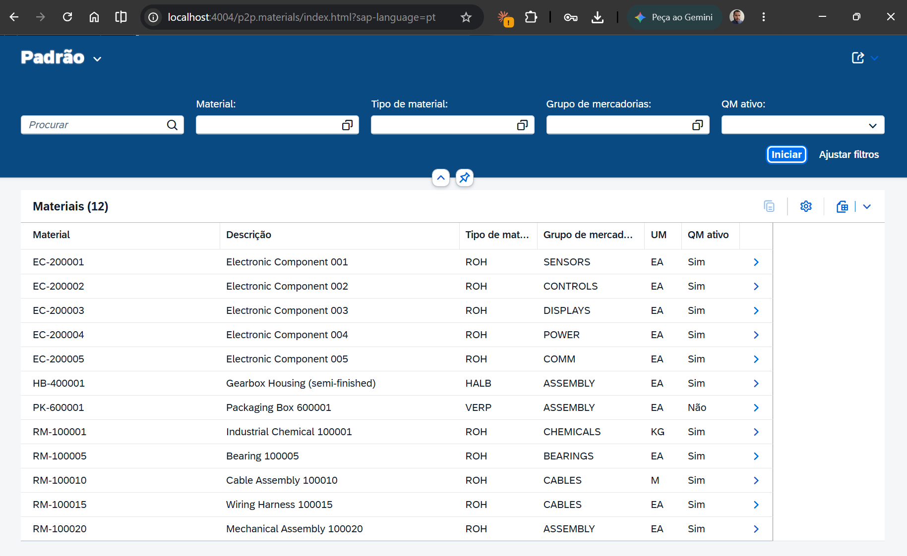
*G1-I18N-01 — O "antes": só os textos do UI5 traduzem; os rótulos digitados ficam fixos.*

A solução tem **três camadas**, cada uma com um mecanismo:

| Camada | Onde fica | Como funciona |
|---|---|---|
| Textos padrão do UI5 | Bibliotecas do UI5 | Seguem o idioma automaticamente (`?sap-language=`) |
| Textos das telas (rótulos, títulos, seção) | `app/materials/_i18n/i18n.properties` (EN) e `i18n_pt.properties` (PT) | As anotações usam **chaves** como `'{i18n>materialType}'`; o CAP resolve o texto pelo idioma ao servir o `$metadata` |
| Textos que vêm do banco (a "Situação" do fornecedor) | `db/data/p2p-EligibilityReason.csv` (EN) e `p2p-EligibilityReason.texts.csv` (PT) | A coluna é `localized`; o português fica em uma tabela de textos |
| Título e descrição do app (manifest) | `app/materials/webapp/i18n/i18n.properties`, `i18n_en` e `i18n_pt` | Resolvidos pelo próprio UI5 |

**Camada 2: chaves nas anotações.** Os arquivos de i18n ficam em uma pasta `_i18n` ao lado do modelo, que é onde o CAP procura por padrão:

```properties
# i18n.properties (padrão: inglês)           # i18n_pt.properties (português)
materialType=Material Type                    materialType=Tipo de material
eligibleSuppliers=Eligible Suppliers          eligibleSuppliers=Fornecedores elegíveis
status=Status                                 status=Situação
```

```cds
Label : '{i18n>materialType}',       // no lugar de 'Tipo de material'
```

**Camada 3: dados traduzíveis.** A coluna `TEXT` de `EligibilityReason` virou `localized String(80)`, e o CAP criou a tabela de textos `EligibilityReason.texts` (`locale`, `CODE`, `TEXT`). A view `SupplierEligibility` escolhe o texto no idioma do usuário e, se não houver tradução, cai no padrão:

```cds
left join db.EligibilityReason       as r on r.CODE = e.REASON
left join db.EligibilityReason.texts as t on t.CODE = e.REASON and t.locale = $user.locale
...
coalesce(t.TEXT, r.TEXT) as REASON_TEXT : String(80),     // idioma do usuário, senão o padrão
```

No sandbox, a mesma consulta devolveu "Eligible" com `Accept-Language: en`, "Elegível" com `pt`, e voltou ao inglês com `de` (sem tradução).

> [!NOTE]
> Três caminhos mais curtos foram tentados e não funcionaram: referenciar `localized.p2p.EligibilityReason` em uma view (erro "can't be referred to without a using declaration"), usar uma associação com caminho (`reason.TEXT`, que não localiza) e `$expand` da associação (erro SQLite). A junção com a tabela `.texts` e `$user.locale` foi a que funcionou.

**O "depois".** As mesmas telas, em inglês e em português, com a URL `?sap-language=en` e `?sap-language=pt`:

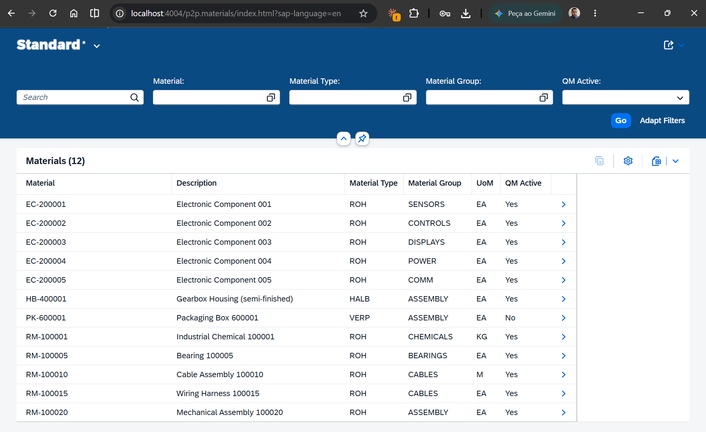
*G1-I18N-02 — List Report em inglês: "Material Type", "Material Group", "QM Active", "Materials (12)".*

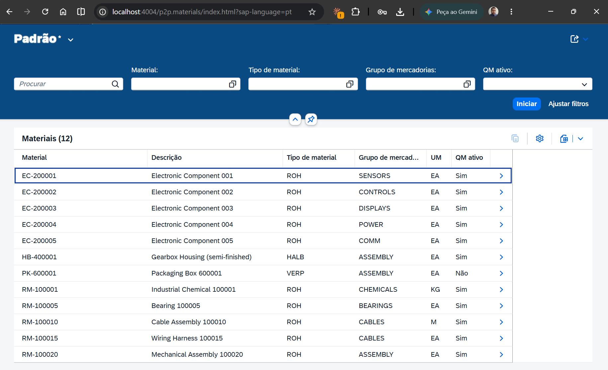
*G1-I18N-03 — O mesmo List Report em português: "Tipo de material", "Grupo de mercadorias", "QM ativo", "Materiais (12)".*

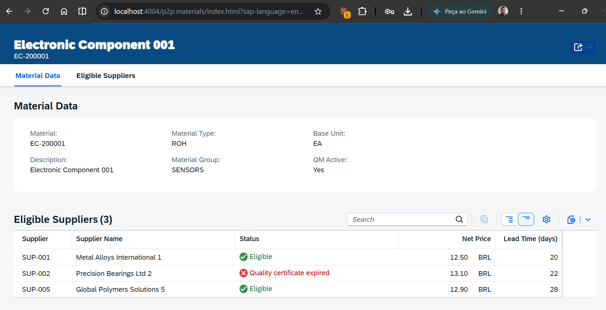
*G1-I18N-04 — Object Page em inglês: "Material Data", "Eligible Suppliers", "Status" e a situação "Quality certificate expired".*

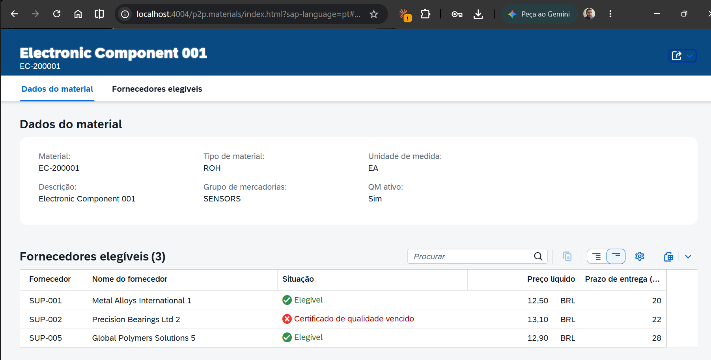
*G1-I18N-05 — Object Page em português: "Dados do material", "Fornecedores elegíveis", "Situação" e "Certificado de qualidade vencido".*

Os rótulos, o título da seção e a situação do fornecedor mudaram juntos. O preço e a data também mudam de formato (separador decimal e datas por extenso), porque o UI5 formata números e datas conforme o idioma.

**Como o idioma chega ao serviço.** No teste com `curl` no sandbox, o CAP escolheu o idioma pelo parâmetro `sap-locale`, pelo cabeçalho `x-sap-request-language` ou pelo `Accept-Language`, e **não** pelo parâmetro `sap-language`. No navegador, entretanto, `?sap-language=pt` funcionou de ponta a ponta: o UI5 repassou o idioma ao serviço. O que se confirma na prática é o resultado das capturas acima.

**E a descrição do material e o nome do fornecedor?** A descrição do material **também pode ser traduzida**, e é o padrão SAP: ela depende de idioma (tabela `MAKT`, com uma linha por idioma). Bastaria aplicar o mesmo mecanismo, com a descrição em uma tabela de textos e o retorno ao texto padrão quando não houver tradução. Isso só funciona se o cadastro estiver atualizado, isto é, se o material tiver descrição em cada idioma. O seed atual tem só o inglês (`Electronic Component 001`), por isso não muda na tela. O **nome do fornecedor**, por outro lado, normalmente **não** depende de idioma: o nome legal (`NAME1` em `LFA1`) é um só. Só têm tradução os textos de apoio, como condição de pagamento. Essa melhoria fica para quando a aplicação ler os cadastros reais do `INDUSTRIAL_DATA`.

### G1.10 — Publicando no SAP BTP: Cloud Foundry, HANA Cloud, Launchpad e celular

Até o G1.9 o app rodava só na máquina, com SQLite em memória. Para **não perder o trabalho** e provar a história "extensão no BTP", o app foi publicado no SAP BTP (trial, subaccount `trial`, espaço `dev`) como **um único MTA**: serviço CAP, banco HANA Cloud (HDI), autenticação XSUAA, approuter e o app Fiori no HTML5 Application Repository. Depois, ele ganhou um **tile no Launchpad** (SAP Build Work Zone) e foi aberto no celular.

#### G1.10.1 — Preparar o projeto para o BTP

Um comando adicionou os artefatos de deploy:

```powershell
cds add hana,xsuaa,mta,approuter,html5-repo
```

O que isso criou ou alterou:

| Artefato | Papel |
|---|---|
| `mta.yaml` | Descritor de deploy: módulos (`srv`, `db-deployer`, approuter, `app-deployer`, o app `materials` e o conteúdo de destinations) e recursos (HANA HDI, XSUAA, HTML5 repo host e runtime, Destination) |
| `xs-security.json` | Escopos e papéis: `Viewer`, `Buyer`, `Approver`, `ApproverSenior` |
| Approuter (pasta gerada `.deploy/app-router`) | Ponto de entrada com login, que encaminha `/odata/...` ao serviço e o resto ao HTML5 repo |
| `package.json` | `@sap/xssec` e `cds.requires.[production].auth = xsuaa` (no BTP o login deixa de ser o `alice:alice`) |

Quatro ajustes manuais foram necessários:

1. **`xs-security.json` duplicado.** O `cds add xsuaa` repetiu os escopos que já existiam. O arquivo original (4 escopos, 4 templates de papel) foi restaurado.
2. **Navegação do Launchpad.** O `manifest.json` do app ganhou uma entrada em `sap.app.crossNavigation`, que é o que permite um tile apontar para o app (objeto semântico `Materials`, ação `display`, ícone `sap-icon://product`). O bloco `sap.cloud` (`service: procurementp2pcap.service`) já estava presente.
3. **Memória do `srv` e do banco.** `srv` com 512 MB e `db-deployer` com 256 MB, suficientes para o trial.
4. **`.gitignore`.** Entraram `.deploy/`, `mta_archives/`, `*.mtar`, `mta-op-*/`, `.procurement-p2p-cap_mta_build_tmp/` e `Makefile_*.mta`. O arquivo `xs-security.backup.json` também não vai para o GitHub.

#### G1.10.2 — Build e deploy

Ferramentas necessárias na máquina (uma vez):

```powershell
npm.cmd install -g mbt --allow-scripts=mbt
```

```powershell
winget install ezwinports.make
```

```powershell
cf install-plugin multiapps -f
```

Depois do `make`, o PATH da sessão do PowerShell precisou ser atualizado (ou abrir um terminal novo). Então:

```powershell
npm.cmd install
```

```powershell
mbt.cmd build
```

O esperado é o `mbt` gerar `mta_archives/procurement-p2p-cap_1.0.0.mtar`. O login e o deploy:

```powershell
cf login -a https://api.cf.us10-001.hana.ondemand.com
```

```powershell
cf deploy mta_archives\procurement-p2p-cap_1.0.0.mtar
```

O esperado é `Process finished.` ao final. O deploy cria a instância HANA (HDI), roda o `db-deployer` (que cria as tabelas, as views e carrega os CSV), sobe `srv` e approuter e publica o app no HTML5 repo.

> [!NOTE]
> O `cf deploy` avisou sobre a migração de stack (`cflinuxfs5`). É só aviso, o deploy concluiu. Registrado em Limitações.

Depois do deploy, o XSUAA gera as **role collections** `Viewer`, `Buyer`, `Approver` e `ApproverSenior`, no formato `Viewer (procurement-p2p-cap <org>-<espaço>)`. Elas não são atribuídas sozinhas: sem elas, o OData devolve 403. A atribuição foi feita no cockpit (Security → Users → o usuário → Assign Role Collection).

#### G1.10.3 — O app no BTP, com os dados no SAP HANA Cloud

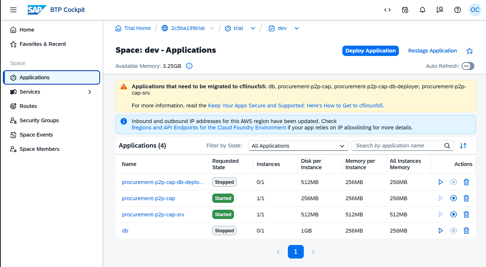
*G1-BTP-06 — Cockpit, espaço `dev`: `procurement-p2p-cap` (approuter) e `procurement-p2p-cap-srv` (serviço CAP) iniciados. O `procurement-p2p-cap-db-deployer` fica parado, porque só roda durante o deploy e termina; o `db` parado é sobra do Bloco C. O aviso amarelo é a migração para `cflinuxfs5`.*

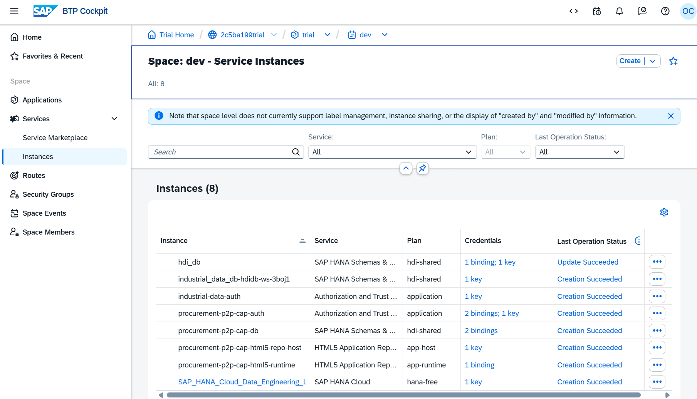
*G1-BTP-07 — As instâncias criadas pelo MTA: XSUAA (`procurement-p2p-cap-auth`), HDI (`procurement-p2p-cap-db`) e HTML5 repo (host e runtime). As demais são de outros blocos. A instância de Destination foi criada em um segundo deploy, depois desta captura.*

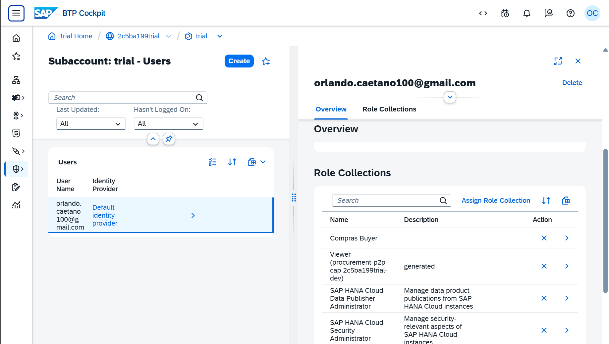
*G1-BTP-02 — O usuário com a role collection `Viewer`: é ela que libera a leitura do OData.*

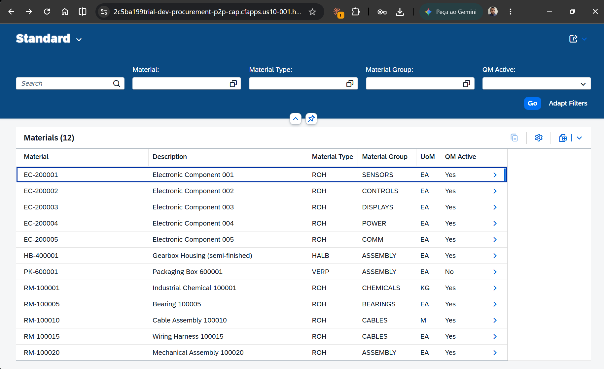
*G1-BTP-03 — O List Report aberto pela URL do approuter, com login do BTP.*

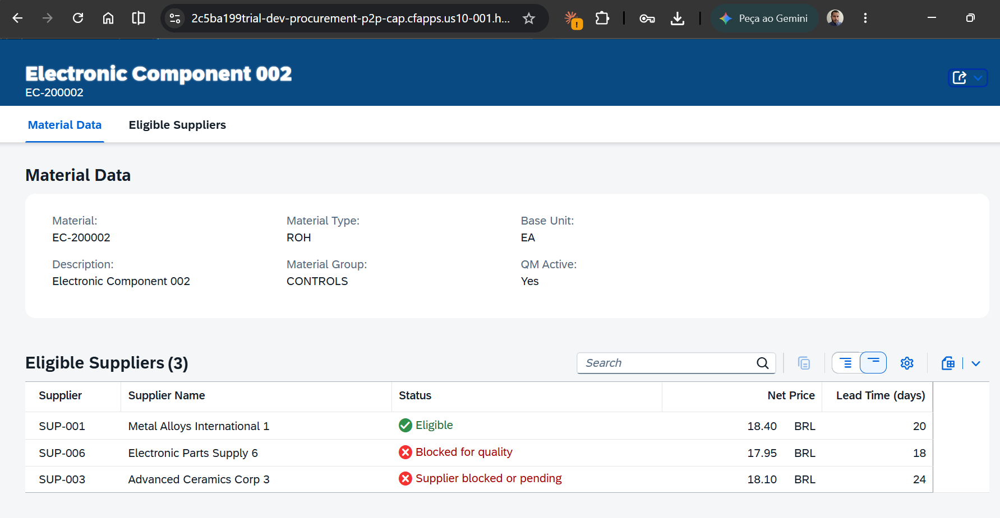
*G1-BTP-09 — A Object Page com os fornecedores elegíveis, agora lendo do SAP HANA Cloud.*

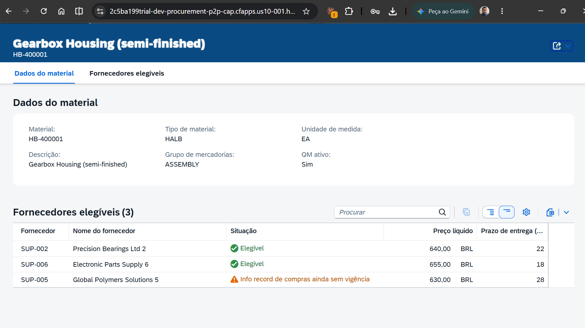
*G1-BTP-11 — Em português, com a situação traduzida pela tabela de textos no HANA.*

Isso fecha uma pendência do G1.9: as views com `$now`, `days_between` e `$user.locale`, antes validadas só em SQLite, **funcionam no SAP HANA Cloud** (elegibilidade calculada e situação traduzida conforme o idioma).

A URL do serviço (`...-srv.cfapps...`) abre com `Cannot GET /`. É o esperado: o CAP em produção não tem página inicial, e o acesso do usuário é pelo approuter.

#### G1.10.4 — O tile no Launchpad (SAP Build Work Zone)

Para o app aparecer como ícone, a escolha foi o **Launchpad do SAP Build Work Zone, standard edition**. A assinatura do Work Zone não funcionou de primeira, e o caminho até ela foi longo:

1. **Erro 422 `OIDC trust missing`.** O Work Zone exige que o subaccount tenha um provedor de identidade confiável.

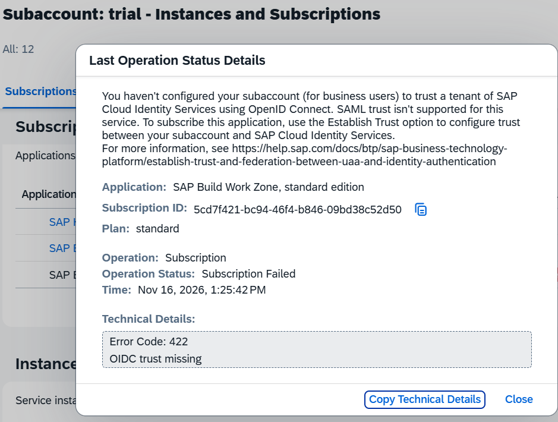
*G1-BTP-18 — A assinatura recusada: `422 OIDC trust missing`.*

2. **`No tenants available`.** Ao tentar estabelecer a confiança (Security → Trust Configuration → Establish Trust), não havia tenant do IAS (SAP Cloud Identity Services) para escolher.

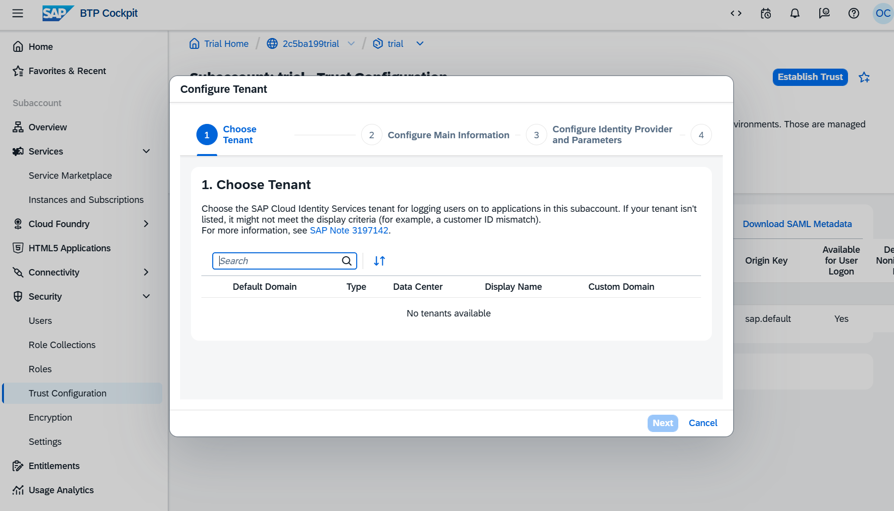
*G1-BTP-19 — Sem tenant do IAS, não há com quem estabelecer confiança.*

3. **Assinar o Cloud Identity Services** (plano `default`, tipo de serviço `TEST`) e ativar a conta pelo e-mail recebido.

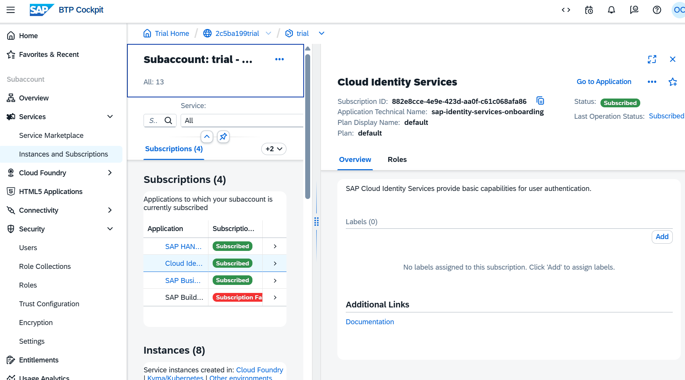
*G1-BTP-23 — O Cloud Identity Services com status Subscribed.*

4. **Estabelecer a confiança** com o tenant do IAS (origem `sap.custom`).

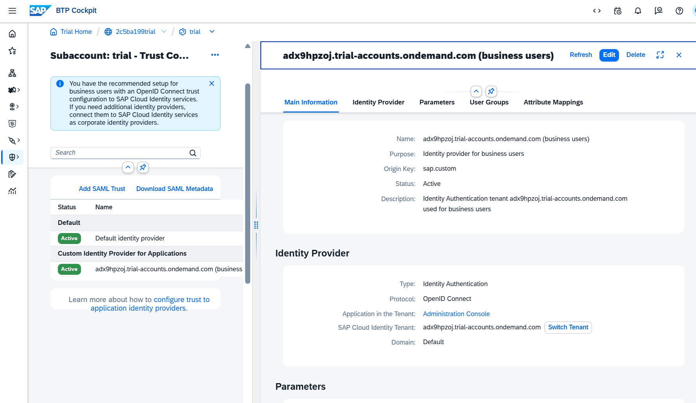
*G1-BTP-29 — A trust configuration do IAS ativa no subaccount.*

5. **Assinar o Work Zone** de novo, agora com sucesso.

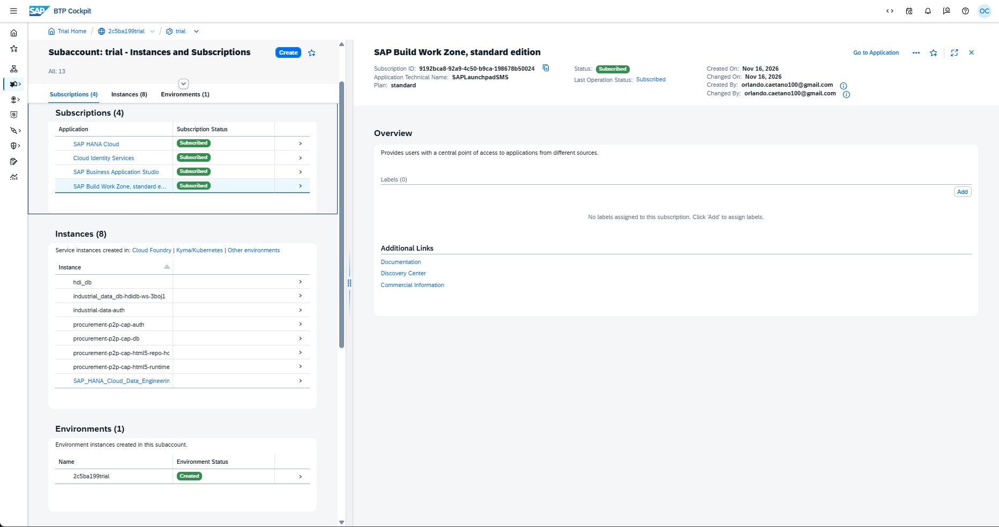
*G1-BTP-31 — SAP Build Work Zone, standard edition, Subscribed.*

> [!NOTE]
> Duas armadilhas no meio do caminho. Ao criar o Work Zone com **Runtime Environment = Other**, o BTP pediu um nome de instância: isso cria uma instância fora do Cloud Foundry, e não a assinatura que o Launchpad precisa. O diálogo correto da assinatura só tem **Service** e **Plan**. A outra foi o cockpit não listar o provedor de identidade novo na tela de role collections: foi cache, resolvido com **Ctrl + F5**.

**Usuário do IAS e papéis.** O login passa a ser pelo IAS, e o BTP cria um usuário "sombra" no primeiro acesso, **sem nenhuma role collection**. Com ele, o Work Zone abriu com o erro "Sorry, we couldn't find the site". A solução foi atribuir as role collections diretamente a esse usuário (Security → Users → o usuário do IAS):

| Role collection | Para quê |
|---|---|
| `Launchpad_Admin` | Administrar o Work Zone (Site Directory, Content Manager) |
| `Work_Zone_STD_Channel_Update_Admin` | Atualizar o conteúdo dos provedores (Channel Manager) |
| `Viewer`, `Buyer`, `Approver`, `ApproverSenior` (`procurement-p2p-cap ...`) | Papéis do app, para os próximos blocos |

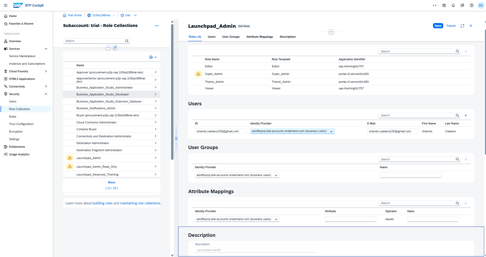
*G1-BTP-37 — A role collection `Launchpad_Admin` atribuída ao usuário do provedor IAS.*

Depois de atribuir, foi preciso sair e entrar de novo (em uma janela anônima) para o token trazer os papéis. Com isso o Work Zone abriu no **Site Directory**.

**O app não foi descoberto automaticamente.** O provedor **HTML5 Apps** do Channel Manager atualizou com sucesso, mas o Content Explorer ficou com `HTML5 Apps (0)`, mesmo com o app publicado (`cf html5-list` listou `p2pmaterials`, versão `0.0.1`, visibilidade `public`). A causa não foi identificada.

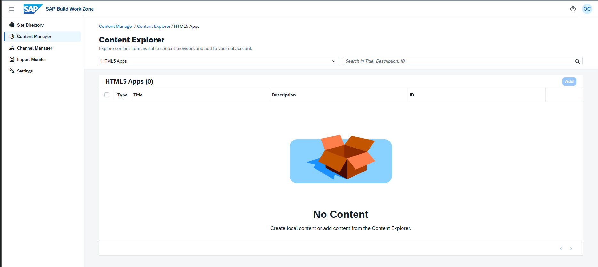
*G1-BTP-38 — `HTML5 Apps (0)` no Content Explorer, apesar do app estar no HTML5 repo.*

O contorno foi **criar o app manualmente** no Content Manager, apontando para o approuter:

| Campo | Valor |
|---|---|
| Title / Description | `Material Master Explorer` / `Materiais e fornecedores elegíveis (PIR + QIR)` |
| Open App | In a new tab (o approuter não deve rodar dentro de iframe) |
| App UI Technology / URL | `URL` / `https://<rota-do-approuter>/p2pmaterials/index.html` |
| Navigation | Semantic Object `Materials`, Action `display` |
| Visualization | Static Tile, subtítulo `Procurement P2P`, ícone `sap-icon://product` |

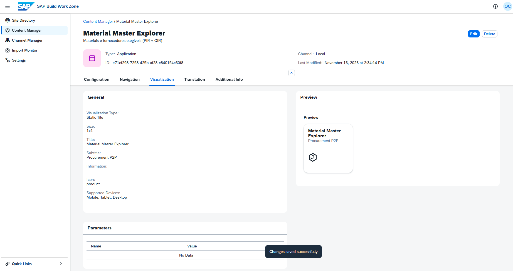
*G1-BTP-39 — O app salvo, com a prévia do tile.*

Em seguida: um **Group** `Compras` com o app, o app atribuído à role **Everyone** e um **site** `Compras P2P` (a role Everyone já vem atribuída ao site).

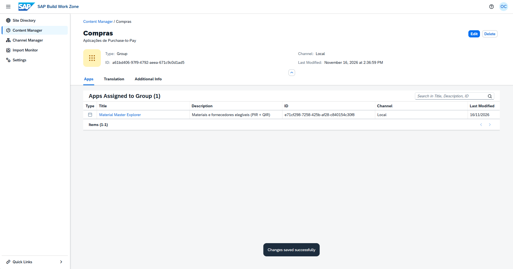
*G1-BTP-40 — O group `Compras` com o app atribuído.*

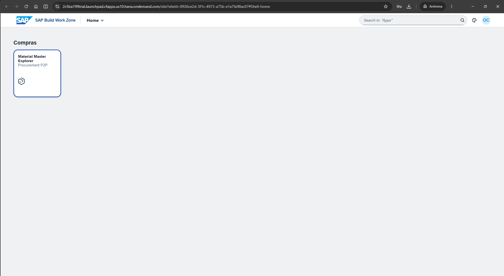
*G1-BTP-41 — O Launchpad do site `Compras P2P`: o tile **Material Master Explorer**, no group `Compras`. Esta é a evidência principal do G1.10.*

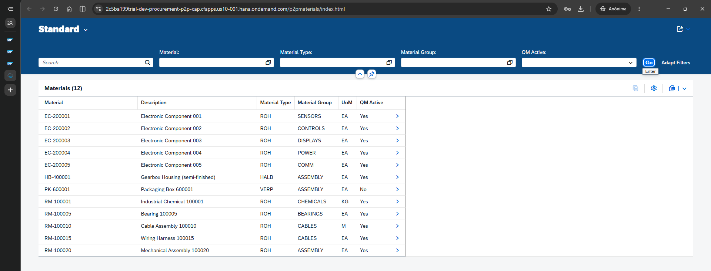
*G1-BTP-42 — O app aberto pela URL do approuter no desktop: 12 materiais, todas as colunas.*

> [!WARNING]
> No desktop, o primeiro clique no tile abriu uma aba **em branco**, com a hash `#Materials-display?...` na URL. Abrir a URL do approuter diretamente funcionou, e no celular o caminho completo (Launchpad, tile, app) funcionou. A causa no desktop não foi diagnosticada (hipóteses: a hash de navegação que o tile acrescenta, que o roteador do app não reconhece, ou cache e cookies da janela anônima). Fica como pendência, em Limitações.

#### G1.10.5 — Acesso pelo celular

O app abriu no celular **sem instalar nada**: bastou o navegador do aparelho, com o mesmo login do IAS.

<table>
<tr>
<td align="center" valign="top">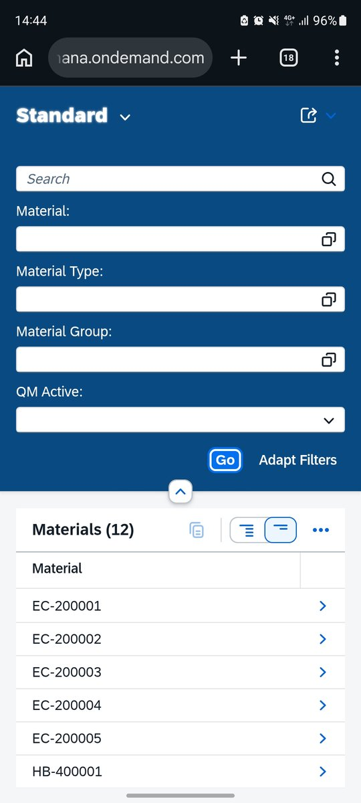<br/><sub><i>G1-BTP-43 — O List Report no celular: filtros empilhados e a lista de materiais.</i></sub></td>
<td align="center" valign="top">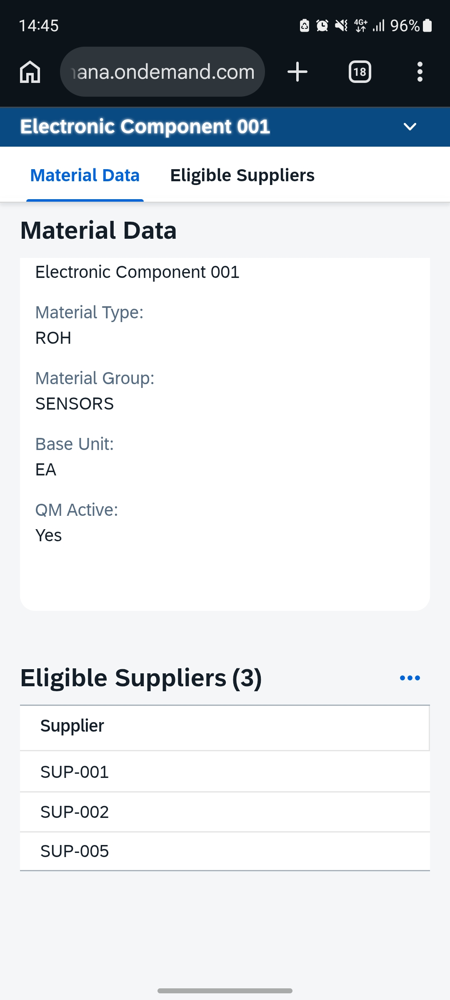<br/><sub><i>G1-BTP-44 — A Object Page do `EC-200001` com os três fornecedores elegíveis (SUP-001, SUP-002 e SUP-005).</i></sub></td>
</tr>
</table>

No celular só aparecem **Material** (lista) e **Supplier** (elegíveis). Não é erro: em tela pequena, o Fiori Elements mostra só as colunas de maior importância. A correção é marcar as colunas relevantes com `@UI.Importance: #High` nas anotações (`LineItem` e `LineItem#ByMaterial`) e publicar de novo. Fica como melhoria.

As três formas de levar o app ao celular:

| # | Opção | Situação |
|---|---|---|
| 1 | **Tile no Launchpad** (Work Zone) | ✅ Feito (G1.10.4) |
| 2 | **Web responsiva**: abrir a URL do Launchpad no navegador do celular, com atalho na tela inicial (menu do Chrome, "Adicionar à tela inicial") | ✅ Funcionou no navegador; o atalho não foi capturado |
| 3 | **App nativo**: o **Joule Work** (nome atual do SAP Mobile Start), via SAP Mobile Services | ✅ Funcionou no Android (veja abaixo). O MDK não foi testado |

**Opção 3 na prática: Joule Work.** O app nativo da SAP para o conteúdo do Work Zone (antes chamado SAP Mobile Start, por isso não aparece com esse nome na Play Store) funcionou com o site do trial. O SAP Mobile Services já vem incluído na assinatura do Work Zone standard. O onboarding é por **QR code**, gerado no próprio site:

1. Nas configurações do site (Site Settings → Edit), o flag do SAP Mobile Start precisa estar em **Yes**, conforme a documentação da SAP.
2. No Launchpad, avatar do usuário → Settings → aba do SAP Mobile Start → **Register QR code**.
3. No Joule Work, tocar em **Scan** e escanear o QR **dentro do app** (a câmera do aparelho não serve). O app mostrou "Scan Succeeded" e redirecionou para o endereço móvel do site (o mesmo host do Launchpad, com um `m` depois do subdomínio do tenant).
4. Login pelo IAS e criação de um passcode.

O tile aparece na tela **Start** (em App Suggestions), e o app abre dentro do Joule Work.

<table>
<tr>
<td align="center" valign="top">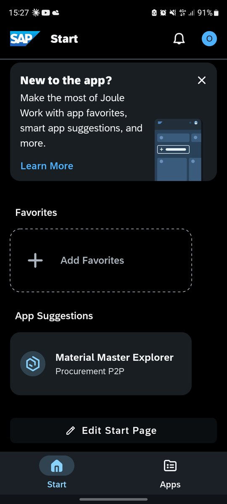<br/><sub><i>G1-BTP-45 — A tela Start do Joule Work, com o Material Master Explorer em App Suggestions.</i></sub></td>
<td align="center" valign="top">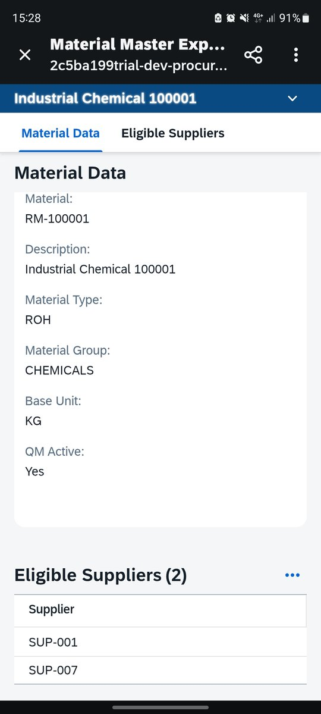<br/><sub><i>G1-BTP-46 — A Object Page do `RM-100001` dentro do Joule Work, com os fornecedores elegíveis (SUP-001 e SUP-007).</i></sub></td>
</tr>
</table>

O app é o mesmo Fiori, então a limitação das colunas no celular continua. O QR code serve para registrar o aparelho no site e **não deve ser compartilhado nem versionado**.

#### G1.10.6 — Licenciamento: uma hipótese a validar

Uma ideia que surgiu durante o trabalho: **o usuário que acessa a aplicação pelo BTP, e não pelo S/4HANA, poderia reduzir o consumo de licenças do ERP**. Isso é uma **hipótese**, não uma conclusão, e **não foi validada com a SAP**. No G1 ela nem se aplica: o app só lê dados fictícios do próprio BTP, sem nenhum usuário de ERP envolvido. Ela passa a importar a partir do G5, quando o pedido for integrado ao ERP.

| Ponto | Observação |
|---|---|
| O que pode mudar a favor | Usuários de negócio que só consultam e aprovam no app BTP (login pelo IAS) poderiam não precisar de um usuário nomeado no S/4HANA para essas tarefas |
| O que pode pesar contra | O pedido gravado no ERP por um usuário técnico de integração pode ser tratado como **acesso digital/indireto** pelas regras de licenciamento da SAP |
| Custo novo | O próprio BTP tem consumo (HANA Cloud, Cloud Foundry, Work Zone, IAS e a integração) |
| Como validar | Com o contrato SAP da empresa e o gestor de licenças ou o executivo de contas, antes de assumir qualquer economia |

> [!IMPORTANT]
> Este bloco não é orientação de licenciamento. A forma como a SAP conta usuários e acessos depende do contrato de cada cliente.

---

## 🛠️ Troubleshooting

| # | Sintoma | Causa | Solução |
|---|---|---|---|
| 1 | `npm : O arquivo npm.ps1 não está assinado digitalmente` | A política de execução do PowerShell bloqueia scripts `.ps1` | Usar `npm.cmd` e `npx.cmd` (por exemplo, `npm.cmd run watch-materials`) |
| 2 | A busca por "Generators" abriu a página do Yeoman | O Yeoman é outro catálogo de geradores | Abrir o gerador pelo `Ctrl + Shift + P`, **Fiori: Open Application Generator** |
| 3 | App em branco; no console, 401 em `$metadata` e `Component.create() failed` | O serviço exige login e o app não levou credenciais | Entrar no OData pelo navegador primeiro (G1.4, EV09) |
| 4 | O Edge não abriu o popup de login nem aceitou `alice:alice@` na URL | Comportamento da janela do Edge usada | Provar o serviço com `curl.exe -u alice:alice ...` (200) e usar o Chrome |
| 5 | Erros 404 de `Component-preload.js` e `sap/bc/lrep/...` no console | Esperado em desenvolvimento local (sem preload nem camada de adaptação) | Ignorar |
| 6 | Avisos `fallback locale 'en'` do `manifestEnhancer` no terminal | Faltava `i18n_en.properties` | Criar `i18n_en.properties` e `i18n_pt.properties` (G1.9) |
| 7 | O rótulo do filtro apareceu como `type/MTART` e sobrou uma anotação em `MaterialTypes` | O editor ofereceu a chave da entidade associada | Usar `MTART` e remover a anotação órfã (G1.5) |
| 8 | O título do cabeçalho da Object Page só mostrou o código | O Page Editor não expõe o título de forma óbvia | Acrescentar `UI.HeaderInfo` no `annotations.cds` (G1.7) |
| 9 | O Page Editor gravou a seção nova no arquivo de elegibilidade, com `UI.Facets` duplicado | O editor grava onde está a anotação referenciada | Juntar as duas facetas no `annotations.cds` |
| 10 | A mudança está no arquivo, mas a tela continua igual | O Fiori lê as anotações do `$metadata` | Conferir o arquivo, reiniciar o `cds watch` se preciso e **Ctrl + F5** |
| 11 | `QIR_MISSING` nunca aparecia (20 elegíveis em vez de 19) | Booleanos do CSV como `True/False` | Gravar `true/false` em minúsculas |
| 12 | Os apps manuais atrapalhavam o gerador | Anotações duplicadas em `app/` | Mover para `_referencia/` antes de gerar |
| 13 | `mbt` não é reconhecido; depois, `mbt.ps1` bloqueado | O script de instalação do pacote não rodou; e a política do PowerShell (como no item 1) | `npm.cmd install -g mbt --allow-scripts=mbt` e usar `mbt.cmd` (G1.10.2) |
| 14 | `make` não encontrado no `mbt.cmd build` | O MTA Build Tool precisa do `make` | `winget install ezwinports.make` e atualizar o PATH da sessão (ou abrir outro terminal) |
| 15 | `cf deploy` não existe; `cf plugins` vazio | Falta o plugin multiapps | `cf install-plugin multiapps -f` |
| 16 | `cf services` falhou por token expirado | A sessão do Cloud Foundry expirou | `cf login -a https://api.cf.us10-001.hana.ondemand.com` |
| 17 | O `cds add xsuaa` duplicou escopos no `xs-security.json` | O arquivo já existia | Restaurar o original (4 escopos, 4 templates) (G1.10.1) |
| 18 | `Cannot GET /` na URL do `srv` | Esperado: o CAP em produção não tem página inicial | Acessar pela URL do approuter |
| 19 | Assinatura do Work Zone: `422 OIDC trust missing` | O subaccount não tem provedor de identidade confiável | Assinar o Cloud Identity Services e estabelecer a confiança (G1.10.4) |
| 20 | Establish Trust: `No tenants available` | Não existe tenant do IAS no subaccount | Assinar o Cloud Identity Services (plano `default`) e ativar a conta |
| 21 | Work Zone criado com Runtime Environment = Other pediu nome de instância | Isso cria uma instância fora do Cloud Foundry, e não a assinatura | Usar a **assinatura** do Work Zone (só Service e Plan) |
| 22 | Create User só lista o Default identity provider; o IdP do IAS não aparece nas role collections | Cache do cockpit; o usuário do IAS só nasce no primeiro login | **Ctrl + F5** no cockpit; depois do primeiro login, atribuir as role collections ao usuário do IAS |
| 23 | Work Zone: "Sorry, we couldn't find the site" | O usuário sombra do IAS não tinha role collection | Atribuir `Launchpad_Admin` e as demais; sair e entrar de novo em janela anônima |
| 24 | Content Explorer com `HTML5 Apps (0)` mesmo com o app no HTML5 repo | A descoberta automática do provedor não encontrou o app (causa não identificada) | Criar o app manualmente no Content Manager, com a URL do approuter (G1.10.4) |
| 25 | `cf dmol` criou a pasta `mta-op-*` dentro do projeto | Log de operação do deploy | Incluir `mta-op-*/` no `.gitignore` |
| 26 | O tile abriu uma aba em branco no desktop | Não diagnosticado (hash de navegação, cache ou janela anônima) | Abrir a URL do approuter diretamente; olhar o Console (F12). Pendente |
| 27 | "SAP Mobile Start" não existe na Play Store | O app foi renomeado para **Joule Work** | Procurar por Joule Work (G1.10.5) |
| 28 | O Joule Work pede a leitura de um QR code | O onboarding é por QR, gerado no site do Work Zone | Ativar o flag do SAP Mobile Start no site, gerar o **Register QR code** nas configurações do usuário e escanear dentro do app |

---

## 🗂️ Estrutura da aplicação

```
db/schema.cds ───────► srv/service.cds ─────────► OData V4  /odata/v4/p2p
(Material, Supplier,    (Materials + eligibility,   ├─ Materials ──┐  (mixin: eligibility)
 PIR, QIR, pedidos)      EligibilityBase,            ├─ SupplierEligibility ◄┘
                         SupplierEligibility,        ├─ MaterialTypes, Suppliers, ...
                         @restrict/@requires)        └─ PurchaseOrders (draft), PurchaseOrderItems

app/services.cds ──► app/materials/annotations.cds              (List Report + Object Page: Page Editor)
                 └─► app/materials/annotations-eligibility.cds  (tabela de fornecedores elegíveis)
                     app/materials/_i18n/*.properties           (textos das anotações, EN + PT)
                     app/materials/webapp/{manifest.json, Component.js, index.html, css/style.css, i18n/*}

Servido por:  cds watch (+ cds-plugin-ui5)  →  http://localhost:4004/p2p.materials/index.html
Perfil padrão → SQLite em memória + usuários de teste (alice, bob, carol, dave)
Perfil hybrid → SAP HANA Cloud (HDI) + XSUAA (veja o G1.10 para o deploy completo)
```

No BTP (G1.10), o `mta.yaml` publica:

```
procurement-p2p-cap-srv          (CAP, Node.js)          ─► procurement-p2p-cap-db (HANA HDI)
procurement-p2p-cap-db-deployer  (hdb)                   ─► cria tabelas e views e carrega os CSV
procurement-p2p-cap              (approuter)             ─► login XSUAA; /odata → srv; o resto → HTML5 repo
app-deployer + p2pmaterials      (HTML5 repo)            ─► Work Zone: tile e site "Compras P2P"
```

---

## 📊 Evidências

| # | Evidência | Etapa | Arquivo |
|---|---|---|---|
| 1 | Extensões SAP Fiori tools | G1.2 | [G1-EV01](../../../Evidences/LAB_G/G1-EV01-extensoes-sap-fiori-tools.png) |
| 2 | List Report Page selecionado | G1.3 | [G1-EV03](../../../Evidences/LAB_G/G1-EV03-template-list-report-selecionado.png) |
| 3 | Fonte de dados CAP | G1.3 | [G1-EV04](../../../Evidences/LAB_G/G1-EV04-data-source-cap-procurement-p2p.png) |
| 4 | Entidade `Materials` (configuração final) | G1.3 | [G1-EV06](../../../Evidences/LAB_G/G1-EV06-entity-selection-materials-configuracao-final.png) |
| 5 | Atributos do projeto | G1.3 | [G1-EV07](../../../Evidences/LAB_G/G1-EV07-project-attributes-materials.png) |
| 6 | Application Info do app gerado | G1.3 | [G1-EV08](../../../Evidences/LAB_G/G1-EV08-application-info-app-gerado.png) |
| 7 | Erro 401 no `$metadata` | G1.4 | [G1-EV09](../../../Evidences/LAB_G/G1-EV09-erro-401-metadata-sem-login.png) |
| 8 | OData autenticado (JSON) | G1.4 | [G1-EV10](../../../Evidences/LAB_G/G1-EV10-odata-materials-json-autenticado.png) |
| 9 | List Report como gerado | G1.4 | [G1-EV11](../../../Evidences/LAB_G/G1-EV11-list-report-gerado-padrao.png) |
| 10 | Page Map | G1.5 | [G1-EV12](../../../Evidences/LAB_G/G1-EV12-page-map-materials.png) |
| 11 | Filtros e coluna `QM_ACTIVE` | G1.5 | [G1-EV14](../../../Evidences/LAB_G/G1-EV14-page-editor-filtros-e-coluna-qm-active.png) |
| 12 | Rótulos aplicados | G1.5 | [G1-EV16](../../../Evidences/LAB_G/G1-EV16-page-editor-rotulos-aplicados.png) |
| 13 | List Report com filtros e rótulos | G1.5 | [G1-EV17](../../../Evidences/LAB_G/G1-EV17-list-report-filtros-e-rotulos.png) |
| 14 | Object Page com rótulos técnicos | G1.7 | [G1-EV18](../../../Evidences/LAB_G/G1-EV18-object-page-rotulos-tecnicos.png) |
| 15 | Tema `sap_fiori_3` | G1.6 | [G1-EV19](../../../Evidences/LAB_G/G1-EV19-list-report-tema-sap-fiori-3.png) |
| 16 | `style.css` final | G1.6 | [G1-EV21](../../../Evidences/LAB_G/G1-EV21-style-css-cabecalho-azul-escuro.png) |
| 17 | Cabeçalho azul escuro | G1.6 | [G1-EV22](../../../Evidences/LAB_G/G1-EV22-list-report-cabecalho-azul-escuro.png) |
| 18 | Object Page com rótulos legíveis | G1.7 | [G1-EV24](../../../Evidences/LAB_G/G1-EV24-object-page-rotulos-legiveis.png) |
| 19 | Título, descrição e seção | G1.7 | [G1-EV25](../../../Evidences/LAB_G/G1-EV25-object-page-titulo-e-secao.png) |
| 20 | Fornecedores elegíveis com certificado | G1.8 | [G1-EV28](../../../Evidences/LAB_G/G1-EV28-object-page-fornecedores-com-certificado.png) |
| 21 | i18n: textos padrão do UI5 em português | G1.9 | [G1-I18N-01](../../../Evidences/LAB_G/G1-I18N-01-sap-language-pt-textos-padrao-traduzidos.png) |
| 22 | i18n: List Report em inglês | G1.9 | [G1-I18N-02](../../../Evidences/LAB_G/G1-I18N-02-list-report-en.png) |
| 23 | i18n: List Report em português | G1.9 | [G1-I18N-03](../../../Evidences/LAB_G/G1-I18N-03-list-report-pt.png) |
| 24 | i18n: Object Page em inglês | G1.9 | [G1-I18N-04](../../../Evidences/LAB_G/G1-I18N-04-object-page-en.png) |
| 25 | i18n: Object Page em português | G1.9 | [G1-I18N-05](../../../Evidences/LAB_G/G1-I18N-05-object-page-pt.png) |
| 26 | Cockpit: aplicações no espaço `dev` | G1.10 | [G1-BTP-06](../../../Evidences/LAB_G/G1-BTP-06-cockpit-aplicacoes-space-dev.png) |
| 27 | Cockpit: instâncias de serviço | G1.10 | [G1-BTP-07](../../../Evidences/LAB_G/G1-BTP-07-cockpit-instancias-de-servico.png) |
| 28 | Usuário com a role collection `Viewer` | G1.10 | [G1-BTP-02](../../../Evidences/LAB_G/G1-BTP-02-usuario-com-role-collection-viewer.png) |
| 29 | List Report no BTP (approuter) | G1.10 | [G1-BTP-03](../../../Evidences/LAB_G/G1-BTP-03-list-report-no-btp-approuter.png) |
| 30 | Object Page com elegibilidade no HANA | G1.10 | [G1-BTP-09](../../../Evidences/LAB_G/G1-BTP-09-object-page-elegibilidade-no-hana.png) |
| 31 | Object Page em português no HANA | G1.10 | [G1-BTP-11](../../../Evidences/LAB_G/G1-BTP-11-object-page-pt-hana-situacao-traduzida.png) |
| 32 | Work Zone: erro 422 `OIDC trust missing` | G1.10 | [G1-BTP-18](../../../Evidences/LAB_G/G1-BTP-18-work-zone-erro-422-oidc-trust-missing.png) |
| 33 | Establish Trust: nenhum tenant disponível | G1.10 | [G1-BTP-19](../../../Evidences/LAB_G/G1-BTP-19-establish-trust-no-tenants-available.png) |
| 34 | Cloud Identity Services assinado | G1.10 | [G1-BTP-23](../../../Evidences/LAB_G/G1-BTP-23-cloud-identity-services-subscribed.png) |
| 35 | Confiança com o IAS ativa | G1.10 | [G1-BTP-29](../../../Evidences/LAB_G/G1-BTP-29-trust-ias-ativa-main-information.png) |
| 36 | Work Zone assinado | G1.10 | [G1-BTP-31](../../../Evidences/LAB_G/G1-BTP-31-work-zone-subscribed.png) |
| 37 | `Launchpad_Admin` no usuário do IAS | G1.10 | [G1-BTP-37](../../../Evidences/LAB_G/G1-BTP-37-launchpad-admin-usuario-idp-ias.png) |
| 38 | Content Explorer com `HTML5 Apps (0)` | G1.10 | [G1-BTP-38](../../../Evidences/LAB_G/G1-BTP-38-content-explorer-html5-apps-vazio.png) |
| 39 | App criado no Content Manager | G1.10 | [G1-BTP-39](../../../Evidences/LAB_G/G1-BTP-39-content-manager-app-criado.png) |
| 40 | Group `Compras` | G1.10 | [G1-BTP-40](../../../Evidences/LAB_G/G1-BTP-40-content-manager-group-compras.png) |
| 41 | Tile no Launchpad (principal do G1.10) | G1.10 | [G1-BTP-41](../../../Evidences/LAB_G/G1-BTP-41-launchpad-tile-material-master-explorer.png) |
| 42 | App aberto no desktop | G1.10 | [G1-BTP-42](../../../Evidences/LAB_G/G1-BTP-42-app-aberto-via-approuter-desktop.png) |
| 43 | List Report no celular | G1.10 | [G1-BTP-43](../../../Evidences/LAB_G/G1-BTP-43-mobile-list-report.jpg) |
| 44 | Object Page no celular | G1.10 | [G1-BTP-44](../../../Evidences/LAB_G/G1-BTP-44-mobile-object-page-elegiveis.jpg) |
| 45 | Joule Work: tela Start com o app | G1.10 | [G1-BTP-45](../../../Evidences/LAB_G/G1-BTP-45-joule-work-start-tile.jpg) |
| 46 | Joule Work: Object Page | G1.10 | [G1-BTP-46](../../../Evidences/LAB_G/G1-BTP-46-joule-work-object-page.jpg) |

---

## ⚠️ Limitações e pendências

- **Tile em branco no desktop.** O primeiro clique no tile abriu uma aba em branco; abrir a URL do approuter diretamente funcionou, e no celular o fluxo completo funcionou. A causa não foi diagnosticada e o tile precisa ser revalidado no desktop (G1.10.4).
- **App cadastrado manualmente.** O provedor HTML5 Apps do Work Zone não descobriu o app (`HTML5 Apps (0)`), então ele foi criado no Content Manager com a URL do approuter. Se a org ou o espaço mudar, a URL precisa ser atualizada.
- **Colunas no celular.** Só aparecem as colunas de maior importância. A melhoria é marcar as colunas relevantes com `@UI.Importance: #High` e publicar de novo.
- **App nativo.** O Joule Work (antigo SAP Mobile Start) funcionou no Android, mas mostra o mesmo layout do navegador. Um app nativo próprio (MDK ou SAP Build Apps) não foi testado.
- **Licenciamento.** A ideia de que acessar pelo BTP reduz o consumo de licenças do ERP é uma hipótese, não validada com a SAP (G1.10.6).
- **Ambiente trial.** As instâncias do trial (HANA Cloud, por exemplo) podem ser paradas pela SAP. Se o app deixar de responder, confira primeiro se a instância HANA está iniciada.
- **`cflinuxfs5`.** O cockpit avisa que `db`, `procurement-p2p-cap`, `procurement-p2p-cap-db-deployer` e `procurement-p2p-cap-srv` precisam migrar de stack. É só aviso por enquanto.
- **Sobras no espaço.** O app `db` e a instância `hdi_db` são do Bloco C. Também ficam para limpar o IP liberado no HANA Cloud, as service keys antigas e as vulnerabilidades do `npm audit` (34).
- **Capturas.** Só as capturas que agregam estão no repositório. O G1.1 e a saída do `cds watch` não têm imagem, o `curl.exe` do troubleshooting foi registrado como texto, e passos intermediários de assistentes (como as telas do Cloud Identity Services) foram descritos em texto.
- **Dados pequenos.** São 12 materiais e 10 fornecedores, montados para exercitar cada regra. O `INDUSTRIAL_DATA` real tem bem mais.
- **Descrição só em inglês.** A descrição do material e o nome do fornecedor não estão traduzidos (veja G1.9).
- **Login local.** O `alice:alice` e os outros usuários do `.cdsrc.json` servem só para desenvolvimento local. No BTP o login é pelo XSUAA e pelo IAS.
- **`_referencia/`.** A pasta guarda os apps feitos à mão da primeira tentativa, só como comparação didática.
- **Page Editor e arquivos.** O editor grava onde está a anotação referenciada, e isso pode espalhar anotações duplicadas. O `annotations.cds` deve ser relido depois de mexer no editor.

## ➡️ Próximos passos

1. **Melhorias do G1:** marcar as colunas com `@UI.Importance` para o celular, diagnosticar o tile no desktop e validar a hipótese de licenciamento com a SAP.
2. **G2:** transformar a elegibilidade em um app próprio (Supplier Eligibility Explorer), com filtros por fornecedor e motivo.
3. **G3:** pedido de compra com itens e rascunho, com preço vindo do PIR e fornecedor elegível.
4. **G4:** Approval Cockpit, com aprovação em massa respeitando a alçada de cada usuário.
5. **G5:** integração síncrona com o ERP (CPI e S/4HANA simulado por um serviço CAP).

---

[⬆️ Voltar ao README](../../../README.md)
