# G2: Supplier Eligibility Explorer com SAP Fiori Elements

**🌐 Idioma / Language:** 🇧🇷 **Português** | [🇺🇸 English](../EN/02-g2-supplier-eligibility-explorer.en.md)

[⬆️ Voltar ao README](../../../README.md)

> **Status:** ✅ G2 concluído e publicado no SAP BTP, com segundo tile no Launchpad (Work Zone), navegação G1 ↔ G2 funcionando e acesso pelo celular · ⚠️ Ressalvas: o app foi cadastrado manualmente no Work Zone (o provedor HTML5 Apps continuou vazio); os dados do G2 são os mesmos CSV fictícios do G1; o Joule Work e os links entre apps foram validados mas não têm captura de tela; o `@UI.Importance` do G1 foi validado no celular só na Object Page do material
> **Ambiente:** o mesmo do [G1](./01-g1-material-master-explorer.md) (SAP CAP `@sap/cds` 10.2.x, Fiori Elements V4, SAPUI5 1.154.0, SAP BTP trial com Cloud Foundry, HANA Cloud, XSUAA, HTML5 Application Repository e SAP Build Work Zone)
> **Projeto:** [`procurement-p2p-cap/`](../../../procurement-p2p-cap) · **Serviço:** `ProcurementService` em `/odata/v4/p2p` · **App:** `p2p.eligibility` (List Report + Object Page) · **Entidade principal:** `Suppliers`
> **Classificação:** ambiente educacional, dados fictícios, sem dados de produção

## 🎯 Visão executiva

O G1 responde "para este **material**, quais fornecedores podem receber um pedido hoje?". O **G2** responde à pergunta inversa, que o comprador também faz todo dia: **"para este fornecedor, o que ele pode fornecer hoje, e por que alguns itens estão bloqueados?"**

O app é um segundo Fiori Elements dentro do mesmo projeto CAP, do mesmo MTA e do mesmo site do Work Zone. Ele reaproveita a view `SupplierEligibility` do G1 e acrescenta o que faltava: uma entidade `Suppliers` com **contadores** (materiais com info record, elegíveis e bloqueados) e a associação com a elegibilidade. A lista mostra os fornecedores com mais bloqueios primeiro. A Object Page abre o fornecedor com a tabela de materiais, a situação de cada um (colorida) e o motivo do bloqueio.

O G2 também fechou três pendências do G1: **colunas no celular** (`@UI.Importance`), **navegação entre apps** (G1 ↔ G2 pelo Launchpad) e o **segundo tile** no Work Zone.

| Etapa | Objetivo | Resultado |
|---|---|---|
| G2.0 | Escopo e decisões | ✅ Lista por fornecedor + Object Page por fornecedor; filtros por fornecedor, status, país, material e situação |
| G2.1 | Serviço: contadores e associação | ✅ `Suppliers` com `ITEMS_TOTAL/ELIGIBLE/BLOCKED` e `eligibility`; testado no OData local |
| G2.2 | O app `p2p.eligibility` | ✅ Anotações, i18n EN/PT, manifest, rotas, `@UI.Importance` |
| G2.3 | Primeira execução local | ✅ Lista e Object Page; cabeçalho da Object Page corrigido por CSS |
| G2.4 | Publicação no BTP | ✅ Segundo módulo HTML5 no MTA; `mbt build` e `cf deploy` |
| G2.5 | Tile no Launchpad | ✅ App criado à mão no Content Manager; dois tiles no grupo Compras |
| G2.6 | Navegação entre apps | ✅ Fornecedor (G1) abre o G2; material (G2) abre o G1 |
| G2.7 | Celular | ✅ Lista em cartões e Object Page legíveis; G1 também melhorou |

## 🧭 Storytelling funcional

### G2.0 — Escopo e decisões

| Decisão | Escolha | Motivo |
|---|---|---|
| Entidade da lista | `Suppliers` (uma linha por fornecedor) | A pergunta é por fornecedor; uma lista sobre `SupplierEligibility` repetiria o fornecedor em cada material |
| Object Page | Por **fornecedor** (e não por par material + fornecedor) | A tabela de materiais com a situação de cada um responde à pergunta de uma vez |
| Filtros | Fornecedor, status do fornecedor, país, **material** e **situação** de elegibilidade | Material e situação vêm da associação `eligibility` (filtro em tabela filha) |
| Cores | Situação por criticidade (`REASON_CRIT`), contadores e status do fornecedor | Bloqueios devem saltar aos olhos |
| Celular | `@UI.Importance` (`#High`, `#Medium`, `#Low`) em todas as colunas | O Fiori Elements só mostra as de maior importância no celular |
| Hospedagem | Mesmo MTA, mesmo site do Work Zone, segundo tile no grupo Compras | Reaproveita XSUAA, approuter, HANA e o site |
| Fora do escopo | Criar pedidos (G3) e dados reais do `INDUSTRIAL_DATA` | O G2 continua com o CSV fictício do G1 |

### G2.1 — Serviço: contadores e associação

A view `SupplierEligibility` já trazia tudo por par material + fornecedor. Faltava um nível acima, o do fornecedor. O `Suppliers` deixou de ser uma projeção simples e passou a ser um `select` com uma **associação** para a elegibilidade e três **subconsultas** de contagem, mais duas colunas de criticidade:

```cds
entity Suppliers as select from db.Supplier as s
  mixin { eligibility : Association to many SupplierEligibility
            on eligibility.LIFNR = $projection.LIFNR; }
  into  {
    key s.LIFNR, s.LIFNR_TEXT, s.LIFNR_STATUS, s.COUNTRY, s.CURRENCY,
    s.PAYMENT_TERMS, s.QUALITY_CERTIFIED, s.status, eligibility,
    (select count(*) from SupplierEligibility as x where x.LIFNR = s.LIFNR)                           as ITEMS_TOTAL    : Integer,
    (select count(*) from SupplierEligibility as x where x.LIFNR = s.LIFNR and x.REASON =  'ELIGIBLE') as ITEMS_ELIGIBLE : Integer,
    (select count(*) from SupplierEligibility as x where x.LIFNR = s.LIFNR and x.REASON <> 'ELIGIBLE') as ITEMS_BLOCKED  : Integer,
    case when s.LIFNR_STATUS = 'ACTIVE' then 3 else 1 end                                              as STATUS_CRIT   : Integer,
    case when exists (select 1 from SupplierEligibility as x
                      where x.LIFNR = s.LIFNR and x.REASON <> 'ELIGIBLE') then 1 else 3 end            as BLOCKED_CRIT  : Integer
  };
```

Antes de mexer em tela, a consulta foi validada no OData (SQLite local):

| Consulta | Resultado |
|---|---|
| `Suppliers?$select=LIFNR,ITEMS_TOTAL,ITEMS_ELIGIBLE,ITEMS_BLOCKED` | `SUP-001`: 5 / 5 / 0 · `SUP-002`: 4 / 3 / 1 · `SUP-003`: 1 / 0 / 1 |
| `Suppliers?$orderby=ITEMS_BLOCKED desc` | `SUP-005` (3 bloqueios) e `SUP-004` (2) no topo |
| `Suppliers?$filter=eligibility/any(e:e/REASON eq 'CERT_EXPIRED')` | 2 fornecedores (filtro por tabela filha funciona) |
| `Suppliers('SUP-001')?$expand=eligibility(...)` | Materiais do fornecedor com `REASON_TEXT` e `REASON_CRIT` |

> [!NOTE]
> Os testes precisaram de um usuário com papel. O `alice` padrão do CAP não tem `Viewer`, e o serviço respondeu `403`. No projeto real os usuários locais vêm do `.cdsrc.json` (`bob` = `Viewer`, `alice` = `Buyer`).

### G2.2 — O app `p2p.eligibility`

O app foi escrito direto nos arquivos (sem o Application Generator), copiando a estrutura do G1:

```
app/eligibility/
├─ annotations.cds                 # lista, Object Page, filtros, value helps, tabela #BySupplier
├─ _i18n/i18n.properties           # textos das anotações (EN) e i18n_pt.properties (PT)
├─ ui5.yaml · package.json · xs-app.json
└─ webapp/{manifest.json, Component.js, index.html, css/style.css, i18n/i18n.properties}
```

| Peça | O que faz |
|---|---|
| `UI.SelectionFields` | `LIFNR`, `LIFNR_STATUS`, `COUNTRY`, `eligibility.MATNR`, `eligibility.REASON` (os dois últimos são filtros por tabela filha) |
| `Common.ValueList` | Ajuda de valores para fornecedor, status (fixa), material e situação (fixa, com o texto traduzido) |
| `UI.LineItem` | Fornecedor, nome, status (com cor), materiais bloqueados (com cor), elegíveis, com info record, país, condição de pagamento |
| `UI.PresentationVariant` | Ordena por `ITEMS_BLOCKED` decrescente |
| `UI.HeaderFacets` + `DataPoint` | Status do fornecedor, materiais elegíveis e bloqueados no cabeçalho |
| `UI.LineItem #BySupplier` | Tabela da Object Page: material (link para o G1), descrição, situação com ícone, preço, prazo, validade, certificado, motivo do bloqueio |
| `@UI.Importance` | `#High`: código, nome, status e bloqueados; `#Medium`: elegíveis, total, preço, validade do certificado; `#Low`: o resto |
| `manifest.json` | Rotas `SuppliersList` e `SuppliersObjectPage`, `initialLoad: Enabled`, tabelas `ResponsiveTable`, entrada de navegação `Suppliers-display` |

Os textos novos ficam em `app/eligibility/_i18n/`. O CAP junta as pastas `_i18n` do projeto, então o G2 só precisa das chaves novas e reaproveita as do G1 (`supplier`, `material`, `netPrice`...). O `$metadata` foi conferido em EN e PT: nenhuma chave `{i18n>...}` ficou sem tradução.

No G1, o `UI.LineItem` e o `#ByMaterial` ganharam `@UI.Importance`, e o código do fornecedor passou a ser `DataFieldWithIntentBasedNavigation` para `Suppliers-display`.

### G2.3 — Primeira execução local

Os arquivos do `package.json` raiz mudaram (workspace novo e script `watch-eligibility`), então o `package-lock.json` precisou ser atualizado antes do build:

```powershell
npm.cmd install
npm.cmd run watch-eligibility
```

Três tropeços:

1. **Porta 4004 ocupada.** O `cds watch` do G1 ainda rodava em outra aba. O `cds-plugin-ui5` já monta **os dois apps** no mesmo servidor (`/p2p.eligibility` e `/p2p.materials`), então basta um processo.
2. **Pede login.** O navegador abriu o login simulado do CAP. Usuário e senha `bob` / `bob` (papel `Viewer`, do `.cdsrc.json`).
3. **Cabeçalho da Object Page ilegível.** O CSS do G1 pinta o cabeçalho de azul escuro; o verde e o vermelho dos indicadores (Active, 3, 3) ficaram sem contraste.

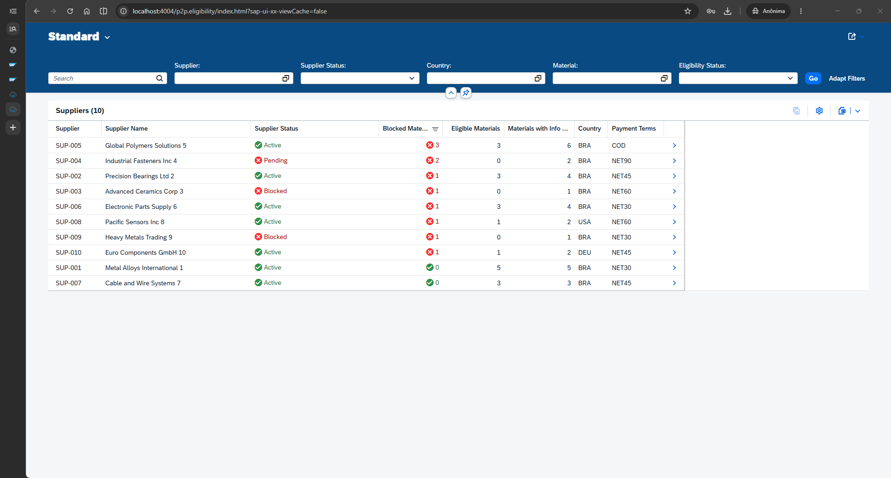
*G2-EV01 — A lista local: 10 fornecedores, filtros, ícones de cor e os mais bloqueados no topo.*

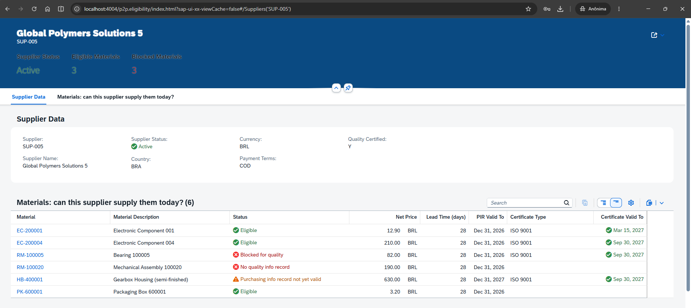
*G2-EV02 — O problema: indicadores com cor semântica sobre o azul escuro do cabeçalho.*

A correção é um bloco no fim de `app/eligibility/webapp/css/style.css`, **só para a Object Page**, deixando o corpo do cabeçalho claro e a faixa do título azul:

```css
.sapUxAPObjectPageLayout .sapFDynamicPageHeader,
.sapUxAPObjectPageLayout .sapUxAPObjectPageHeaderContent { background-color: #ffffff !important; }
.sapUxAPObjectPageLayout .sapFDynamicPageHeader .sapMLabel,
.sapUxAPObjectPageLayout .sapFDynamicPageHeader .sapMText { color: #32363a !important; }
```

A primeira tentativa não surtiu efeito: o arquivo aberto no VS Code tinha só as 22 linhas do G1, sem o bloco. O seletor foi confirmado pelo DevTools (`F12` → selecionar o elemento) e o bloco foi colado à mão. Depois de **Ctrl + Shift + R**, o cabeçalho ficou legível.

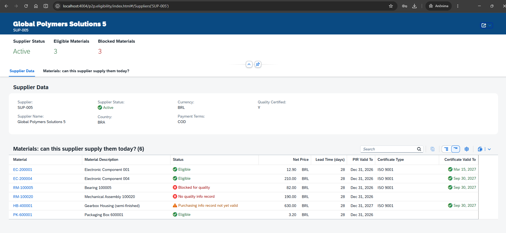
*G2-EV03 — Depois do ajuste: "Active" verde e os contadores legíveis; a faixa do título continua azul.*

### G2.4 — Publicando no BTP

No `mta.yaml`, o segundo app é um módulo HTML5 como o do G1, com o artefato `eligibility.zip` no `app-deployer`:

```yaml
  - name: procurementp2pcapeligibility
    type: html5
    path: app/eligibility
    build-parameters: { build-result: dist, builder: custom, commands: [ npm run build ], supported-platforms: [] }
```

O `ui5.yaml` do app define `archiveName: eligibility` (o zip gerado). O `sap.cloud.service` do manifesto é o mesmo do G1, para os dois apps usarem o mesmo destino.

```powershell
mbt.cmd build
cf deploy mta_archives\procurement-p2p-cap_1.0.0.mtar
```

O servidor local foi parado antes (o `npm ci` do build apaga o `node_modules`, e o Windows trava arquivos em uso). O deploy terminou com `Process finished.` O `cf html5-list` mostrou os dois apps no mesmo repositório:

```
name             version   app-host-id        service instance                      visibility
p2peligibility   0.0.1     5ddf3dcb-...       procurement-p2p-cap-html5-repo-host   public
p2pmaterials     0.0.1     5ddf3dcb-...       procurement-p2p-cap-html5-repo-host   public
```

O G2 abre em `https://<approuter>/p2peligibility/index.html`, com login do XSUAA e os dados vindos do HANA Cloud.

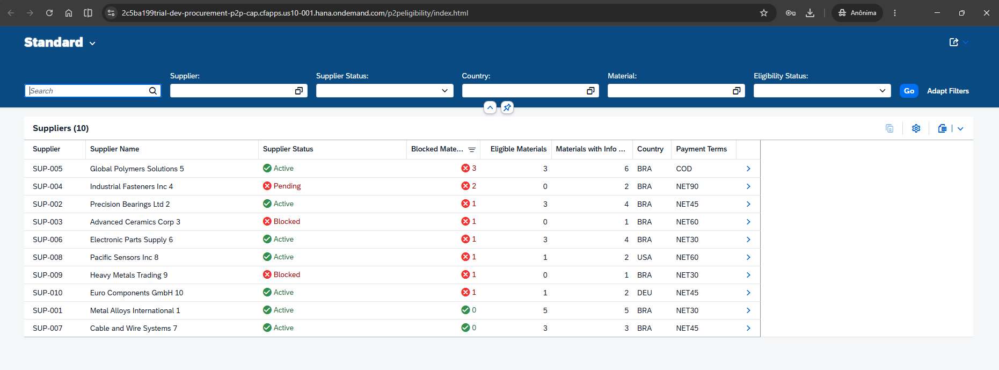
*G2-BTP-01 — A lista publicada, lendo do HANA Cloud pelo approuter.*

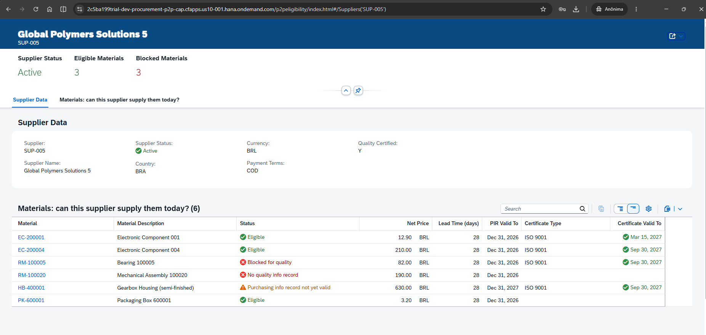
*G2-BTP-02 — A Object Page do `SUP-005`: 3 materiais elegíveis e 3 bloqueados (qualidade, falta de QIR, PIR ainda não válido).*

### G2.5 — O segundo tile no Launchpad

O provedor **HTML5 Apps** do Work Zone continuou com `HTML5 Apps (0)`, mesmo depois do deploy e de atualizar o canal. Repetiu-se o caminho manual do G1.

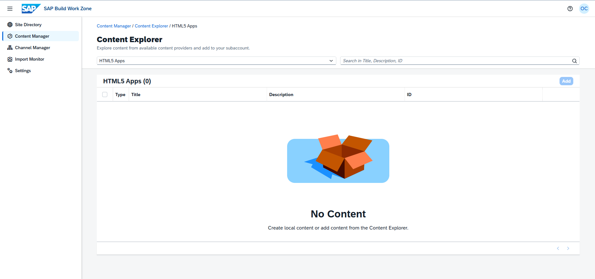
*G2-BTP-03 — O Content Explorer sem nenhum app HTML5, de novo.*

No **Content Manager → Create → App**:

| Aba | Campo | Valor |
|---|---|---|
| Cabeçalho | Application Title | `Supplier Eligibility Explorer` |
| Cabeçalho | Description | `Elegibilidade de fornecedores por material` |
| Configuration | Open App | **In a new tab** |
| Configuration | System / App UI Technology | `No System` / `URL` |
| Configuration | URL | `https://<approuter>/p2peligibility/index.html` |
| Navigation | Semantic Object / Action | `Suppliers` / `display` |
| Navigation | Allow additional parameters | marcado |

Dois ajustes antes de salvar: o **Open App** vinha como `In place` (o G1 usa nova aba) e a descrição vinha com um texto provisório.

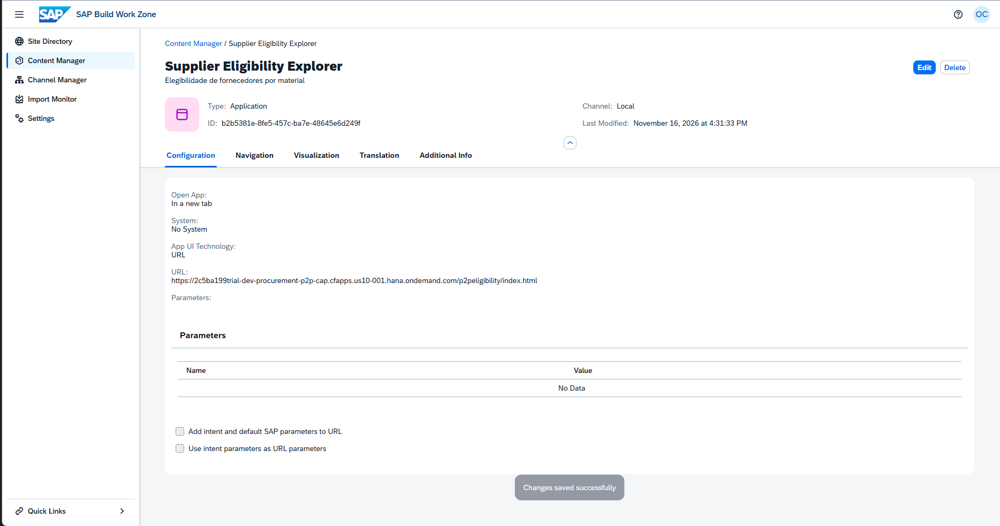
*G2-BTP-04 — O app salvo ("Changes saved successfully"), aberto em nova aba.*

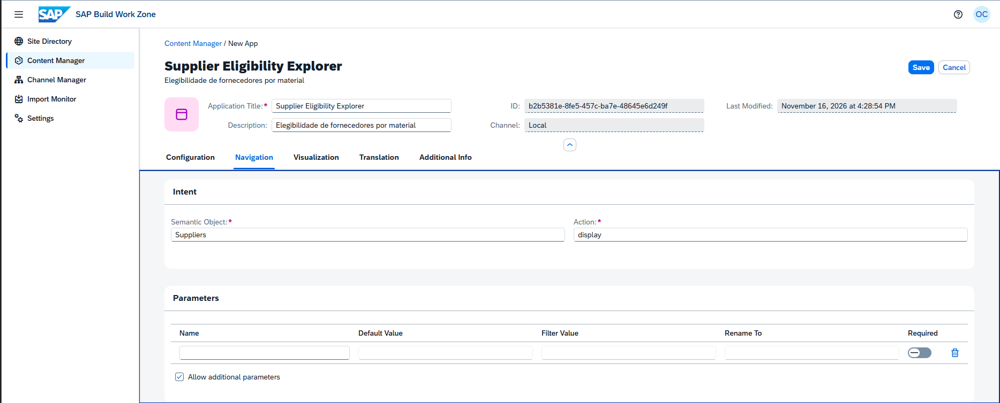
*G2-BTP-05 — A aba Navigation com `Suppliers` / `display` e parâmetros adicionais permitidos.*

Depois, o app foi adicionado ao grupo **Compras** (Assignment Status ligado) e à role **Everyone**. Na role, o **Save** ficou azul até ser clicado: a atribuição só vale depois de salvar.

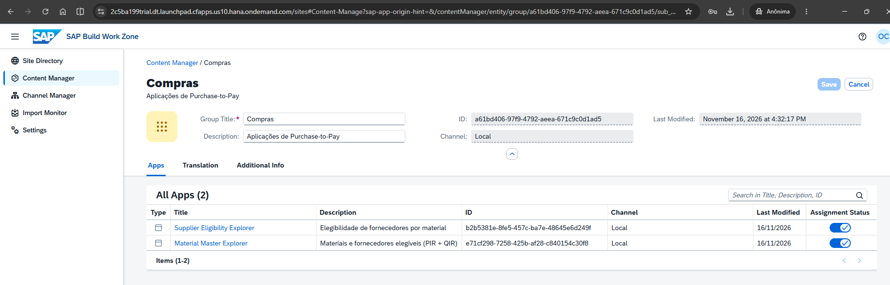
*G2-BTP-06 — O grupo Compras com os dois apps atribuídos.*

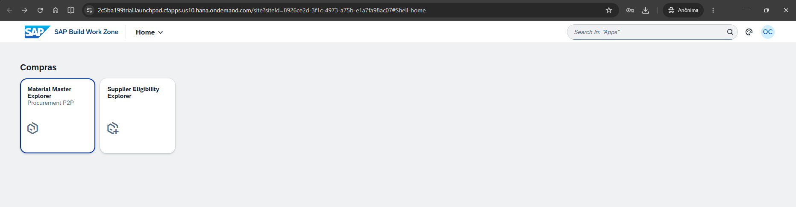
*G2-BTP-07 — O Launchpad do site Compras P2P com o Material Master Explorer e o Supplier Eligibility Explorer.*

### G2.6 — Navegação entre apps (G1 ↔ G2)

A navegação usa os **semantic objects**: `Materials-display` (G1) e `Suppliers-display` (G2). Como o conteúdo está atribuído ao mesmo site, o Launchpad resolve o destino.

| Origem | Clique | Resultado |
|---|---|---|
| G1, Object Page do material | Código do fornecedor (link azul) | ✅ Abriu o G2 |
| G2, Object Page do fornecedor | Código do material (link azul) | ✅ Abriu o G1 direto na Object Page do material |

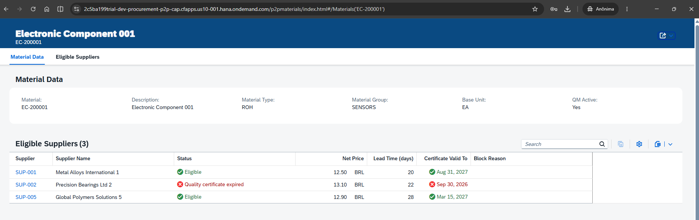
*G2-BTP-11 — Depois do clique no código do material no G2, o G1 abriu direto na Object Page do `EC-200001`, com os fornecedores elegíveis e o `SUP-002` em "Quality certificate expired".*

> [!NOTE]
> Fora do Launchpad (por exemplo, no `cds watch` local) os links aparecem como texto: quem resolve a navegação é o shell do Launchpad. A navegação do G1 para o G2 foi testada pelo usuário e funcionou, mas não há captura de tela dela.

### G2.7 — Celular

O mesmo Fiori no navegador do celular e no Joule Work. Com `@UI.Importance`, a tabela vira **cartões** com as colunas importantes. No G1 antigo só aparecia uma coluna.

<table>
<tr>
<td align="center" valign="top">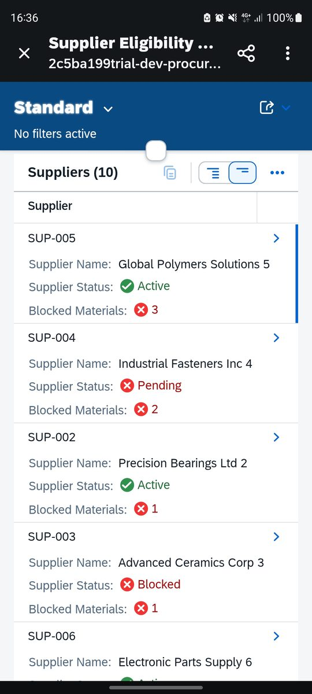<br/><sub><i>G2-BTP-08 — A lista no celular: fornecedor, nome, status e bloqueados em cada cartão.</i></sub></td>
<td align="center" valign="top">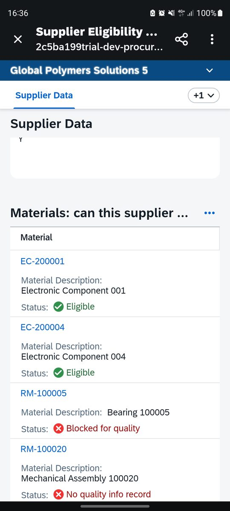<br/><sub><i>G2-BTP-09 — A Object Page do `SUP-005`: material, descrição e situação de cada item.</i></sub></td>
<td align="center" valign="top">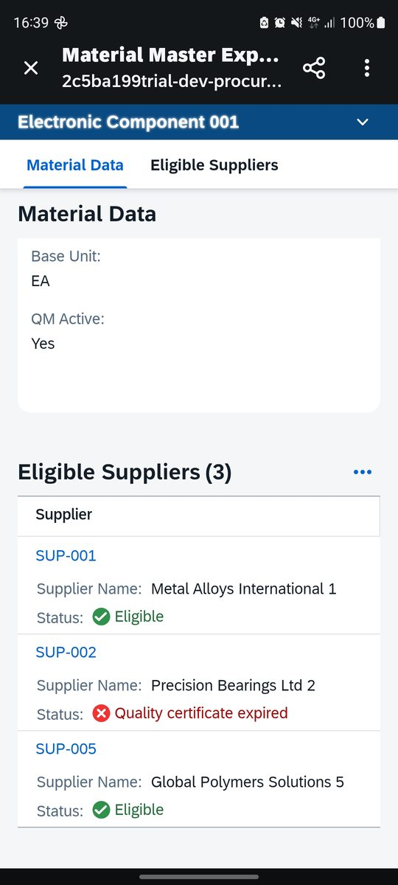<br/><sub><i>G2-BTP-10 — O G1 depois do `@UI.Importance`: fornecedor, nome e situação em cada cartão.</i></sub></td>
</tr>
</table>

O G2 também apareceu no **Joule Work** (o app nativo da SAP para o Work Zone), na mesma conta do G1. Isso foi confirmado pelo usuário, sem captura de tela.

### G2.8 — Aprendizado paralelo: um S/4HANA para integrar (G4)

Durante o G2 surgiu a pergunta de como seria ver dados de um S/4HANA de verdade. O que foi levantado, sem decisão tomada:

| Opção | O que é | Observação |
|---|---|---|
| S/4HANA Cloud Public Edition, trial | Tenant compartilhado, dados de exemplo, a SAP anuncia 14 dias, renováveis | A página do trial lista como excluídos customização, dados mestres e **integração com a BTP**; não menciona API |
| S/4HANA Advanced Trial (SAP Cloud Appliance Library) | Sistema dedicado com acesso de administrador, 30 dias | Roda na **conta do usuário** num provedor de nuvem (o CAL pede chaves da AWS, Azure ou GCP) e a hospedagem tem custo |
| SAP Business Accelerator Hub (sandbox de API) | APIs OData com dados de exemplo, sem sistema próprio | Não foi verificado nesta etapa; é o ponto de partida natural para o G4 |

Um S/4 on-premise exige ainda o **Cloud Connector** entre a BTP e a rede da empresa. O trial do S/4 Public Edition foi solicitado (a SAP confirmou o "advanced trial"), mas o appliance no CAL **não foi criado**: pedia credenciais de nuvem e gera custo.

## 🛠️ Troubleshooting

| # | Sintoma | Causa | Solução |
|---|---|---|---|
| 1 | `Suppliers` respondeu `403` no teste local do OData | O usuário `alice` padrão do CAP não tem papel; o serviço exige `Viewer` ou `Buyer` | Usar os usuários do `.cdsrc.json` (`bob`/`bob` é `Viewer`) |
| 2 | `[EADDRINUSE] port 4004 is already in use` | O `cds watch` do G1 ainda rodava em outra aba | Parar o antigo com `Ctrl + C`: um único `cds watch` serve os dois apps |
| 3 | Janela de login ao abrir `localhost:4004/p2p.eligibility/...` | Login simulado do CAP em desenvolvimento | `bob` / `bob` |
| 4 | Cabeçalho da Object Page ilegível (verde e vermelho sobre azul escuro) | O CSS copiado do G1 pinta o cabeçalho de azul para todas as páginas | Bloco CSS escopado em `.sapUxAPObjectPageLayout` (G2.3) |
| 5 | O CSS novo não surtiu efeito | O arquivo aberto no editor não tinha o bloco | Colar o bloco, salvar (`Ctrl + S`) e recarregar sem cache (`Ctrl + Shift + R`) |
| 6 | `npm ci` do build falharia com o workspace novo | O `package-lock.json` não conhecia `app/eligibility` | `npm.cmd install` na raiz do projeto antes do `mbt.cmd build` |
| 7 | `HTML5 Apps (0)` no Content Explorer, mesmo após o deploy | Descoberta automática do Work Zone não funcionou (já visto no G1) | Criar o app à mão no Content Manager (G2.5) |
| 8 | O app novo veio com **Open App = In place** e descrição provisória | Valores padrão do formulário | Trocar para **In a new tab** e ajustar a descrição |
| 9 | Atribuição à role Everyone não valeu | O botão **Save** ficava azul: faltava salvar | Clicar em **Save** e esperar "Changes saved successfully" |
| 10 | Tela do Content Manager mostrou **Create Site** | É a lista do Site Directory | Não criar site novo; o app entra no site **Compras P2P** existente pelo grupo e pela role |

## 🗂️ Estrutura

```
db/schema.cds ──► srv/service.cds ──► OData V4  /odata/v4/p2p
                  (Suppliers + eligibility + contadores,   ├─ Suppliers ──┐ (mixin: eligibility)
                   SupplierEligibility)                    ├─ SupplierEligibility ◄┘
                                                           └─ Materials (G1), ...

app/services.cds ──► app/materials/annotations*.cds     (G1; agora com @UI.Importance e link para o G2)
                 └─► app/eligibility/annotations.cds    (G2: lista, Object Page, filtros, #BySupplier)
                     app/eligibility/_i18n/*.properties (textos EN + PT)
                     app/eligibility/webapp/{manifest.json, Component.js, index.html, css/style.css, i18n/*}

No BTP (mta.yaml):  procurementp2pcapmaterials + procurementp2pcapeligibility ─► HTML5 repo ─► Work Zone (grupo Compras)
Local:              npm.cmd run watch-eligibility  →  http://localhost:4004/p2p.eligibility/index.html
```

## 📊 Evidências

| # | Evidência | Etapa | Arquivo |
|---|---|---|---|
| 1 | Lista local | G2.3 | [G2-EV01](../../../Evidences/LAB_G/G2-EV01-list-report-local.png) |
| 2 | Cabeçalho com pouco contraste | G2.3 | [G2-EV02](../../../Evidences/LAB_G/G2-EV02-object-page-cabecalho-azul-baixo-contraste.png) |
| 3 | Cabeçalho claro | G2.3 | [G2-EV03](../../../Evidences/LAB_G/G2-EV03-object-page-cabecalho-claro.png) |
| 4 | Lista no BTP | G2.4 | [G2-BTP-01](../../../Evidences/LAB_G/G2-BTP-01-list-report-no-btp.png) |
| 5 | Object Page no BTP | G2.4 | [G2-BTP-02](../../../Evidences/LAB_G/G2-BTP-02-object-page-no-btp.png) |
| 6 | Content Explorer vazio | G2.5 | [G2-BTP-03](../../../Evidences/LAB_G/G2-BTP-03-content-explorer-html5-apps-vazio.png) |
| 7 | App criado no Content Manager | G2.5 | [G2-BTP-04](../../../Evidences/LAB_G/G2-BTP-04-content-manager-app-criado.png) |
| 8 | Navegação `Suppliers` / `display` | G2.5 | [G2-BTP-05](../../../Evidences/LAB_G/G2-BTP-05-content-manager-navegacao-suppliers-display.png) |
| 9 | Grupo Compras com dois apps | G2.5 | [G2-BTP-06](../../../Evidences/LAB_G/G2-BTP-06-content-manager-group-compras-dois-apps.png) |
| 10 | Launchpad com dois tiles | G2.5 | [G2-BTP-07](../../../Evidences/LAB_G/G2-BTP-07-launchpad-dois-tiles.png) |
| 11 | Lista no celular | G2.7 | [G2-BTP-08](../../../Evidences/LAB_G/G2-BTP-08-mobile-list-report.jpg) |
| 12 | Object Page no celular | G2.7 | [G2-BTP-09](../../../Evidences/LAB_G/G2-BTP-09-mobile-object-page-materiais.jpg) |
| 13 | G1 no celular com `@UI.Importance` | G2.7 | [G2-BTP-10](../../../Evidences/LAB_G/G2-BTP-10-mobile-g1-object-page-importance.jpg) |
| 14 | G1 aberto a partir do G2 | G2.6 | [G2-BTP-11](../../../Evidences/LAB_G/G2-BTP-11-navegacao-g2-para-g1-material-aberto.png) |

## ⚠️ Limitações e pendências

- **App cadastrado manualmente.** O provedor HTML5 Apps do Work Zone continuou vazio. Se a org ou o espaço mudar, a URL do approuter precisa ser atualizada nos dois apps.
- **Sem captura de tela** de: navegação G1 → G2, G2 no Joule Work, `npm install` e `cf deploy` (registrados em texto).
- **Dados fictícios.** O G2 usa os mesmos 10 fornecedores e 30 info records do G1. Os contadores são recalculados a cada consulta (subconsultas); com volume real, convém avaliar o custo ou materializar.
- **Filtro por tabela filha.** Material e situação filtram pela associação `eligibility`. Os dois filtros foram validados no OData (`eligibility/any(...)`), mas não foram exercitados na tela.
- **Colunas no celular.** O `@UI.Importance` foi validado na lista e na Object Page do G2 e na Object Page do material (G1). A lista do G1 no celular não foi reavaliada.
- **CSS compartilhado.** O CSS do G2 é uma cópia do G1 com o ajuste da Object Page. Se o visual mudar, convém centralizar.
- **Tile sem subtítulo e ícone padrão.** O tile do G2 está com o ícone padrão e sem subtítulo (aba Visualization do app).
- **Ambiente S/4HANA.** As opções estão levantadas (G2.8), mas nenhuma foi adotada; o appliance no CAL gera custo e exige conta de nuvem.
- **Pendências herdadas do G1**: tile em branco no desktop (retestar), licenciamento (hipótese), limpeza (IP do HANA, service keys antigas, `npm audit`, migração `cflinuxfs5`).

## ➡️ Próximos passos

1. **G3:** pedido de compra com itens e rascunho, com o preço vindo do PIR e fornecedor elegível.
2. **G4:** Approval Cockpit, com aprovação em massa respeitando a alçada.
3. **G5:** integração síncrona com o ERP (CPI e S/4HANA simulado por um serviço CAP).
4. **Consumo de API:** trocar uma fonte (materiais) de CSV por uma API OData, começando pelo sandbox do SAP Business Accelerator Hub.

---

[⬆️ Voltar ao README](../../../README.md)
