# G1: Material Master Explorer with SAP Fiori Elements

**🌐 Language / Idioma:** [🇧🇷 Português](../BR/01-g1-material-master-explorer.md) | 🇺🇸 **English**

[⬆️ Back to README](../../../README.en.md)

> **Status:** ✅ G1 completed locally (VS Code + in-memory SQLite) · ⚠️ Caveats: the app is not yet deployed to BTP; the views using `$now`, `days_between` and `$user.locale` were tested on SQLite only; the app opens through `index.html`, without the Launchpad; the `cds watch` terminal and the `curl.exe` output were not captured as images (documented as text)
> **Environment:** SAP CAP (`@sap/cds` 10.2.x, `cds-serve` 10.2.2) · SAP Fiori tools (Application Generator `@sap/generator-fiori`, `lrop` template 1.34.0, `@sap/ux-ui5-tooling` 1.34.0) · SAPUI5 1.154.0 (SAP Horizon theme) · Node.js 24 · PowerShell · VS Code
> **Project:** [`procurement-p2p-cap/`](../../../procurement-p2p-cap) (repository root) · **Service:** `ProcurementService` at `/odata/v4/p2p` · **App:** `p2p.materials` (List Report + Object Page)
> **Data:** fictitious CSV — 12 materials, 10 suppliers, 30 purchasing info records (PIR), 26 quality info records (QIR), 30 purchase orders with 59 items
> **Classification:** educational environment, fictitious data, no production data

## 🎯 Executive summary

Block F delivered a protected OData service. **Block G** answers the next question: **how does a business user consume that data** without writing queries? The answer is an SAP Fiori Elements application generated from the CDS model itself.

Block G is designed as a **Purchase-to-Pay (P2P) extension built on SAP BTP, without touching the ERP core**: the application reads master data, creates purchase orders, approves them by approval limit, and only then integrates the order into the ERP. **G1** is the first step and answers a simple purchasing question: **for this material, which suppliers can receive an order today?**

The answer combines four sources, all visible on one screen of the material: the material master, the **PIR** (purchasing info record: price, lead time, validity), the **QIR** (quality info record: release and certificate) and the supplier status.

This document walks through G1 end to end, including the stumbles. The app was generated with the official tools (SAP Fiori tools), configured in the Page Editor, given its own visual identity through CSS and prepared for two languages (English as default, Portuguese as translation).

| Step | Goal | Result |
|---|---|---|
| G1.0 | Context and decisions | ✅ P2P extension on BTP without impacting the core; eligibility by PIR + QIR; G1–G8 plan |
| G1.1 | CAP model and service | ✅ `procurement-p2p-cap` project, tables, eligibility views, roles and seed; validated in a sandbox |
| G1.2 | Tooling | ✅ SAP Fiori tools (Extension Pack) installed in VS Code |
| G1.3 | App generation | ✅ Application Generator: List Report on `Materials`, app `p2p.materials` |
| G1.4 | First run | ✅ App up after fixing the 401 on `$metadata` |
| G1.5 | Page Map and Page Editor | ✅ Filters, `QM Active` column and readable labels in the list |
| G1.6 | Visual identity | ✅ Theme compared and dark blue header through custom CSS |
| G1.7 | Object Page | ✅ Title, description and "Material data" section |
| G1.8 | Eligible suppliers | ✅ Table on the Object Page with colored status (PIR + QIR + supplier status) |
| G1.9 | Internationalization | ✅ Screen and database texts in English (default) and Portuguese |

> [!IMPORTANT]
> No credentials were written to any repository file. `node_modules/`, `gen/`, `default-env.json`, `.cdsrc-private.json` and `.env` are in `.gitignore`.
>
> The users `alice`, `bob`, `carol` and `dave` in `.cdsrc.json` exist **for local development only**, with trivial passwords and fixed roles. Under the `hybrid` profile they are not used: authentication is handled by XSUAA (as in F8).

---

## 🧭 Functional storytelling

### G1.0 — Context: a P2P extension on BTP, without impacting the core

The original plan for Block G was a list of cockpits. During G1 it was reorganized around a well-known process: **Purchase-to-Pay**. The idea is to show the potential of BTP by extending the ERP with an external application, without touching the core.

Design decisions, taken before implementation:

| Topic | Decision |
|---|---|
| Where the order is born | In the Fiori app (BTP). The ERP receives the order only **after approval** |
| Approval | A single one, in the app, by **approval limit** (`ApprovalRule` table: document type, currency and value range). Rejection requires a reason; there is an audit log |
| Document types | `ZF`, `ZR` and `ZK` are born in the app and enter the ERP already released; `NB`, `FO` and `ZC` follow the normal ERP flow |
| Creation in the ERP | Only through a technical integration user; the ERP stays read-only for these types |
| Supplier eligibility | Only a supplier with a **valid PIR**, **active** status, **released QIR** and **valid quality certificate** (for QM-controlled materials) can receive an order |
| QIR | The app **only reads** the QIR; maintenance stays in the ERP/quality |
| Integration | CPI (Integration Suite) as middleware, synchronous, with an idempotency key (`EXTERNAL_REF`). With no real ERP, S/4HANA will be simulated by a CAP service |
| Development | Local in VS Code (service on `localhost`); BTP deployment (MTA, Cloud Foundry, HDI, XSUAA) in its own step |

The block roadmap:

| # | Scenario | Status |
|---|---|---|
| G1 | Material Master Explorer (this document) | ✅ |
| G2 | Supplier Eligibility Explorer (dedicated eligibility app) | ⏳ |
| G3 | Purchase Order (order with items, draft, PIR price, eligible supplier) | ⏳ |
| G4 | Approval Cockpit (mass approval by limit, rejection reason, audit) | ⏳ |
| G5 | Synchronous ERP integration (CPI + simulated S/4HANA) | ⏳ |
| G6 | Goods receipt and invoice with three-way match | ⏳ |
| G7 | Payment tracking | ⏳ |
| G8 | Order dashboard (Analytical List Page, aggregation CDS views) | ⏳ |

### G1.1 — The model and the service: what the app will show

Before generating a screen we needed **data and rules**. G1 uses a new CAP project, `procurement-p2p-cap`, separate from Block F's `industrial-data-cap`, so the F evidence stays reproducible. Material and supplier codes follow `INDUSTRIAL_DATA` (`EC-200001`, `RM-100001`, `SUP-001`...), and the table structure was derived from an extract of the real schema.

```
procurement-p2p-cap/
├─ db/schema.cds           namespace p2p: materials, suppliers, PIR, QIR, orders, approval rules
├─ db/data/*.csv           fictitious seed (loaded into SQLite when the server starts)
├─ srv/service.cds         ProcurementService at /odata/v4/p2p, eligibility views, roles
├─ .cdsrc.json             test users (alice, bob, carol, dave)
├─ xs-security.json        scopes and roles for XSUAA (Viewer, Buyer, Approver, ApproverSenior)
└─ app/                    Fiori applications (created from G1.3 on)
```

The core entities of G1 (SAP-style field names, explicit association conditions):

```cds
entity Material {
  key MATNR      : String(40);
      MATNR_TEXT : String(100);
      MTART      : String(4);
      MATKL      : String(9);
      MEINS      : String(3);
      QM_ACTIVE  : Boolean;       // true = procurement controlled by QM (requires a QIR)
      type       : Association to MaterialType on type.MTART = MTART;
}

entity PurchasingInfoRecord {       // PIR: price, lead time and validity per material and supplier
  key INFO_RECORD_ID : Integer;
      MATNR, LIFNR, EKORG, NET_PRICE, PRICE_UNIT, CURRENCY,
      VALID_FROM, VALID_TO, LEAD_TIME_DAYS, MIN_QTY ...
}

entity QualityInfoRecord {          // QIR: quality release and certificate
  key QIR_ID : Integer;
      MATNR, LIFNR,
      QIR_STATUS   : String(10);    // RELEASED | BLOCKED
      BLOCK_REASON, CERT_TYPE, CERT_NO, CERT_VALID_FROM, CERT_VALID_TO ...
}
```

**The eligibility rule** lives in a CDS view, `EligibilityBase`, which joins PIR, QIR, supplier and material and computes a single reason code. The order of the conditions matters: the first true one wins.

```cds
case
  when s.LIFNR_STATUS <> 'ACTIVE'                 then 'SUPPLIER_NOT_ACTIVE'
  when p.VALID_TO   < cast($now as Date)          then 'PIR_EXPIRED'
  when p.VALID_FROM > cast($now as Date)          then 'PIR_NOT_YET_VALID'
  when m.QM_ACTIVE = true and q.QIR_ID is null    then 'QIR_MISSING'
  when q.QIR_STATUS = 'BLOCKED'                   then 'QIR_BLOCKED'
  when q.CERT_VALID_TO < cast($now as Date)       then 'CERT_EXPIRED'
  else 'ELIGIBLE'
end as REASON
```

A second view, `SupplierEligibility`, adds the reason text and criticality (green, yellow or red) and the certificate expiry criticality (expired, expires within 90 days, valid). `Materials` exposes the `eligibility` link to that view, and that is how the material's Object Page lists suppliers.

**Security from the start.** The service requires an authenticated user (`@requires: 'authenticated-user'`) and each entity has its own role. The F9 lesson was applied: the rule goes **on each entity**, not just on the service.

**Sandbox validation.** Before generating the UI the service was started in a test environment and queried:

| Check | Result |
|---|---|
| Call without login | HTTP 401 |
| `bob` (Viewer) reads materials | HTTP 200; trying to create an order, HTTP 403 |
| Eligibility grouped by reason (30 info records) | `ELIGIBLE` 19 · `SUPPLIER_NOT_ACTIVE` 4 · `QIR_BLOCKED` 2 · `CERT_EXPIRED` 2 · `PIR_EXPIRED` 1 · `PIR_NOT_YET_VALID` 1 · `QIR_MISSING` 1 |
| `EC-200002` | `SUP-001` eligible (certificate expires 2026-12-05); `SUP-006` with blocked QIR; `SUP-003` with inactive supplier |
| Items × order totals | The sum of the items (`AMOUNT`) matches `TOTAL_AMOUNT` in all 30 orders |

> [!NOTE]
> A seed error taught something useful: the CSV booleans were written as `True/False` (Python style), so `m.QM_ACTIVE = true` was never true. The `QIR_MISSING` case did not appear and the eligible count came out as 20 instead of 19. In CAP CSV files booleans must be lowercase `true/false`.

On the user's computer the project starts with:

```powershell
cd C:\Users\orlandos\Github\SAP_HANA_Cloud_Data_Engineering_Learning\procurement-p2p-cap
npm.cmd install
npx.cmd cds watch
```

The expected output is `server listening on { url: 'http://localhost:4004' }` and the list of services, with `ProcurementService` at `/odata/v4/p2p`. `npm.cmd` and `npx.cmd` appear again because the PowerShell execution policy blocks `npm.ps1` (see troubleshooting).

> G1.1 has no screenshot. It was validated through terminal output, in the sandbox and then on the user's computer.

### G1.2 — The tooling: SAP Fiori tools in VS Code

The goal of G1 was never just "see the data on screen": it was to **understand the process of building a Fiori Elements app**. So the app was not written by hand. A first manual version (annotations and `manifest.json` written directly) was put together to validate the model, but the decision was to take the official path: **SAP Fiori tools** in VS Code.

What each tool does:

| Tool | Role |
|---|---|
| **Application Generator** | Creates the app from a template, linked to a local CAP project |
| **Page Map** | Shows the app's pages (List Report, Object Page) and their properties |
| **Page Editor** | Edits filters, columns, sections and labels, and writes the annotations to the app file |
| **Application Info** | Summarizes the app and offers shortcuts (Preview, Deploy, Page Map) |
| **XML Annotation Language Server** | Completion and validation of annotations |
| **Guided Development** | Step-by-step tutorials inside VS Code |

Installation was the **SAP Fiori Tools - Extension Pack**, which brings all extensions at once.

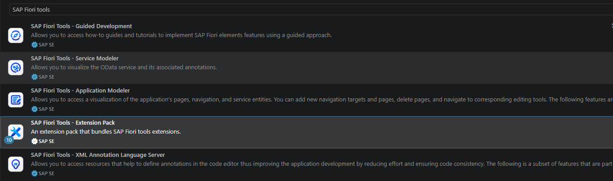
*G1-EV01 — The SAP Fiori tools extensions installed in VS Code.*

> [!NOTE]
> Along the way there was a mix-up. Searching for "Generators" in VS Code opened the **Explore and Install Generators** page, which belongs to Yeoman and is a different thing. The Fiori generator is opened from the command palette (`Ctrl + Shift + P`) with **Fiori: Open Application Generator**.

### G1.3 — Generating the app: the Application Generator, screen by screen

The generator has four steps, and each one is a decision.

**1. Template Selection.** The generator offers several templates. The chosen one was **List Report Page**, which creates two linked pages: a list with filters and, when a row is clicked, a detail page (Object Page). It is the standard for browsing and opening business objects.

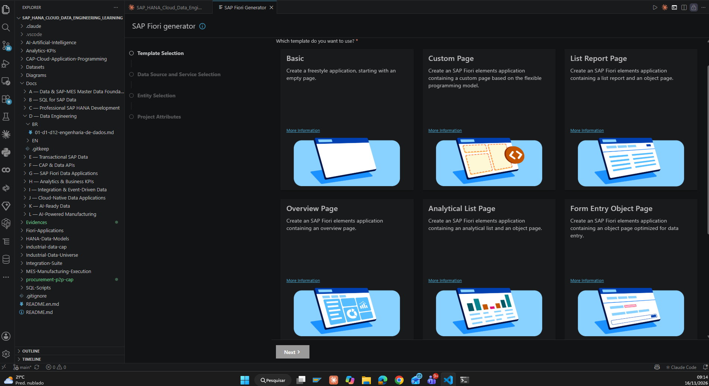
*G1-EV02 — The template selection screen, with nothing selected yet (the field is mandatory).*

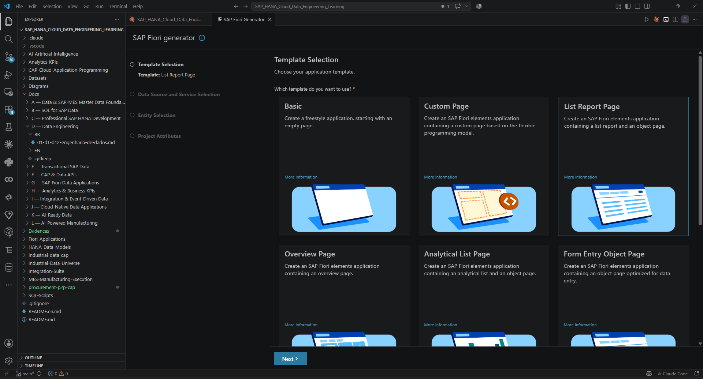
*G1-EV03 — List Report Page template selected.*

**2. Data Source and Service Selection.** The data source is **Use a Local CAP Project**, pointing at the `procurement-p2p-cap` folder. The generator reads the project and lists the services: `ProcurementService (Node.js)` was chosen. This is where the app connects to the model, without typing a URL.

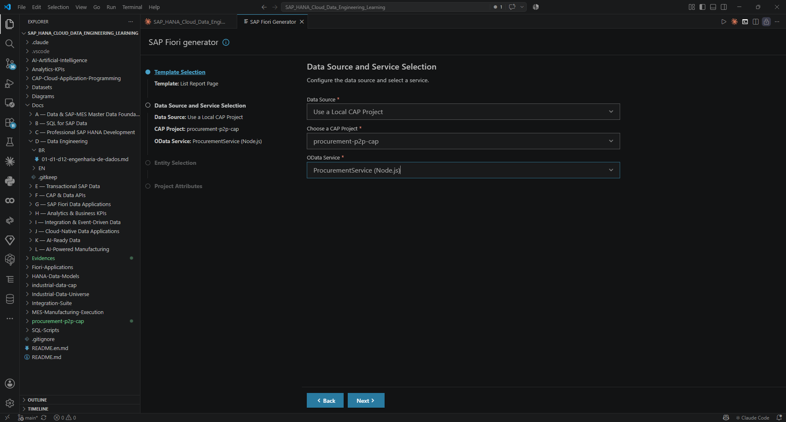
*G1-EV04 — CAP project `procurement-p2p-cap` and service `ProcurementService (Node.js)`.*

**3. Entity Selection.** Here you choose the list's **main entity**. The generator shows every entity the service exposes, and the entity selected by default was `PurchaseOrders`.

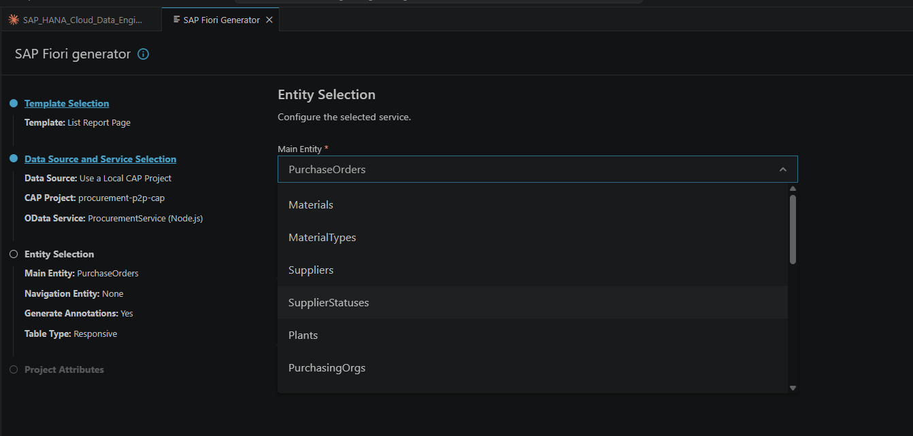
*G1-EV05 — The `ProcurementService` entity list.*

The choice was **`Materials`**. **Navigation Entity** stayed `None`, because the suppliers table would be built later in the Page Editor. The option to **add columns and a section automatically** stayed Yes, and the **table type** Responsive (suitable while the list has fewer than 200 items).

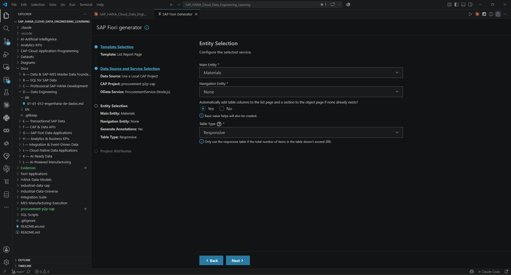
*G1-EV06 — `Materials` as the main entity, no navigation entity, annotations generated.*

> [!NOTE]
> Before generating, the hand-made apps from the first attempt were moved to `_referencia/`. Had they stayed in `app/`, their annotations would be loaded together with the generator's and conflict. The `_referencia/` folder stays in the repository only as a didactic comparison and is **not loaded** by the service.

**4. Project Attributes.** The app's data:

| Field | Value | Purpose |
|---|---|---|
| Module Name | `materials` | Folder name under `app/` |
| Application Title | `Material Master Explorer` | App title (goes to `i18n`) |
| Application Namespace | `p2p` | ID prefix: the app becomes `p2p.materials` |
| Description | `Material lookup and eligible suppliers (PIR + QIR)` | App description |
| Minimum SAPUI5 Version | `1.154.0` | Minimum required version, written to `manifest.json` |
| TypeScript | No | The app is XML and annotations only |
| SAP Fiori Launchpad Configuration | No | Left for the deployment step |
| Virtual Endpoints for Local Preview | Yes | UI5 libraries are served through virtual endpoints, without copying files into the project |
| Advanced Options | No | Default |

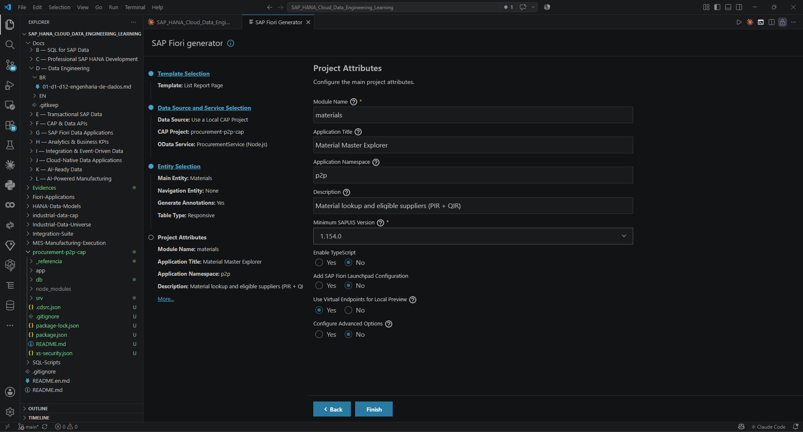
*G1-EV07 — Project attributes filled in, before Finish.*

Clicking **Finish** created the app in `app/materials` and opened the **Application Info** screen.

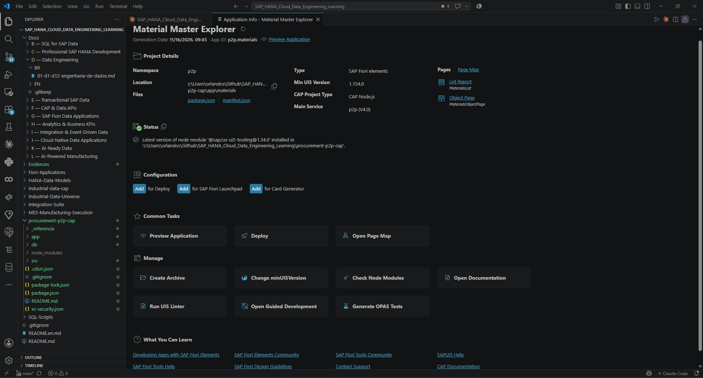
*G1-EV08 — Application Info: app `p2p.materials`, type SAP Fiori elements, minimum SAPUI5 1.154.0, OData V4 service, pages `MaterialsList` (List Report) and `MaterialsObjectPage` (Object Page).*

What the generator wrote:

| File | Role |
|---|---|
| `app/materials/webapp/manifest.json` | App descriptor: service, OData model, routes between pages |
| `app/materials/webapp/Component.js` | Minimal component inheriting from `sap/fe/core/AppComponent` |
| `app/materials/webapp/index.html` | Page used only for local preview; loads UI5 1.154.0 and the `sap_horizon` theme |
| `app/materials/webapp/i18n/i18n.properties` | App texts (`appTitle`, `appDescription`) |
| `app/materials/annotations.cds` | UI annotations (`UI.LineItem`, `UI.Facets` and others) |
| `app/services.cds` | Links the annotations to the service (`using from './materials/annotations'`) |
| Project `package.json` | Gains `workspaces: ["app/*"]`, `cds-plugin-ui5` and the `watch-materials` script |

`cds-plugin-ui5` makes the CAP server itself serve the app at `/p2p.materials/index.html`. That is why a single process (`cds watch`) delivers both the service and the screen.

### G1.4 — First run: the blank app and the 401

The app is opened with the script the generator created:

```powershell
npm.cmd run watch-materials
```

The expected output is `server listening on { url: 'http://localhost:4004' }`, followed by several harmless `manifestEnhancer ... fallback locale 'en'` warnings, fixed in G1.9. The browser opens `http://localhost:4004/p2p.materials/index.html`.

**The first result was a blank page**, with "Material Master Explorer" in the tab title. `index.html` loaded, but UI5 did not mount the app. The browser console explained why.

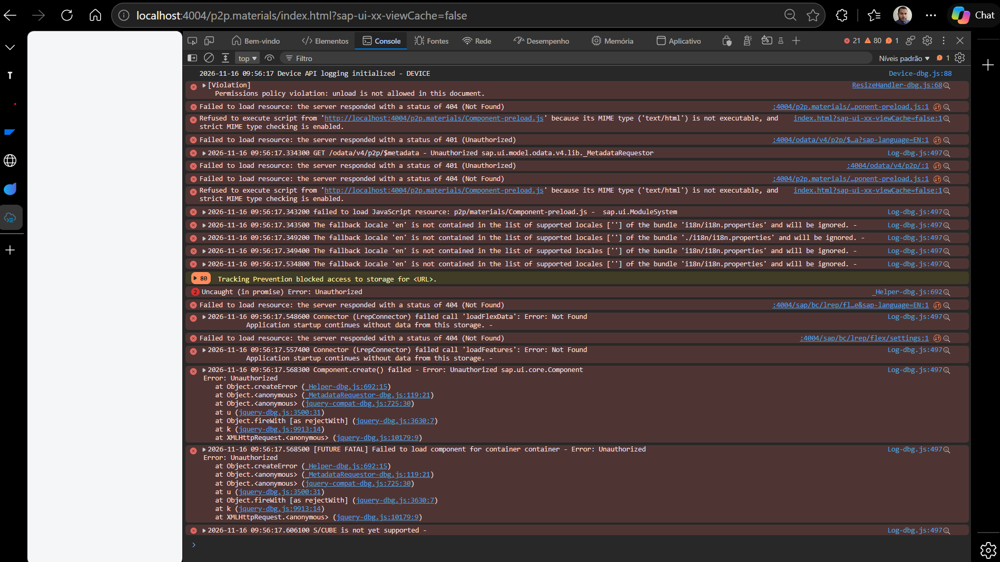
*G1-EV09 — The console: `GET /odata/v4/p2p/$metadata` returned 401 Unauthorized, then `Component.create() failed - Error: Unauthorized`.*

**The diagnosis.** Fiori Elements only builds the screen after reading `$metadata`. The service requires an authenticated user, and the app's request carried no credentials because the browser did not show the login popup. The other console errors (404 for `Component-preload.js` and `sap/bc/lrep/...`) are normal in local development.

To separate a server problem from a browser problem, the service was called **without a browser**, in a second terminal:

```powershell
curl.exe -i -u alice:alice 'http://localhost:4004/odata/v4/p2p/Materials?$top=1'
```

The output was `HTTP/1.1 200 OK` and the `EC-200001` material in JSON. So the server accepted `alice`, and the failure was in the browser (Edge, in that window, showed no basic-auth popup and did not accept credentials embedded in the URL). The fix was to open the OData address in another browser (Chrome), log in as `alice` (the password is typed by the person themselves) and only then open the app, in the same window.

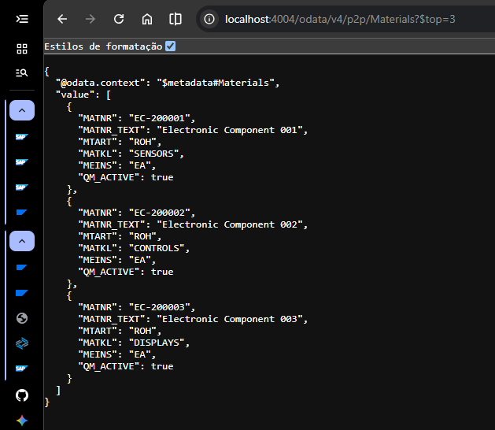
*G1-EV10 — After login, the service returns the materials as JSON.*

With the credential kept by the browser, the app loaded.

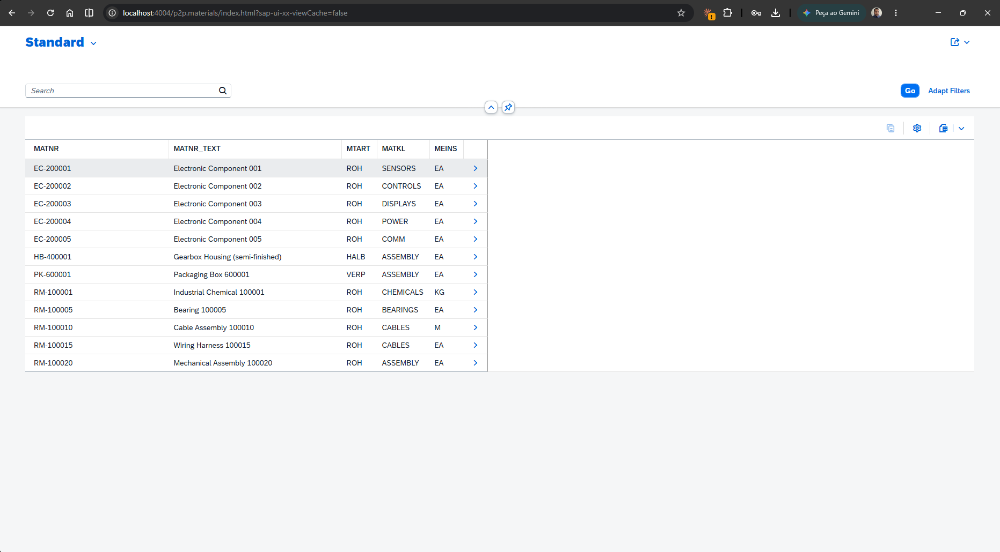
*G1-EV11 — The List Report as the generator delivered it: 12 materials, columns `MATNR`, `MATNR_TEXT`, `MTART`, `MATKL` and `MEINS`, only the search field as a filter.*

Without writing screen code, the generator built the list from the model. It still has visible weaknesses: technical column headers, no per-field filters, no `QM_ACTIVE`, and an Object Page without useful content. The rest of G1 fixes these.

### G1.5 — Page Map and Page Editor: filters, columns and labels

The **Page Map** shows the app as a map of pages. `MaterialsList` (List Report) points to `MaterialsObjectPage` (Object Page), both on `/Materials`. The side panel holds the general properties written to `manifest.json` (title, description, column layout).

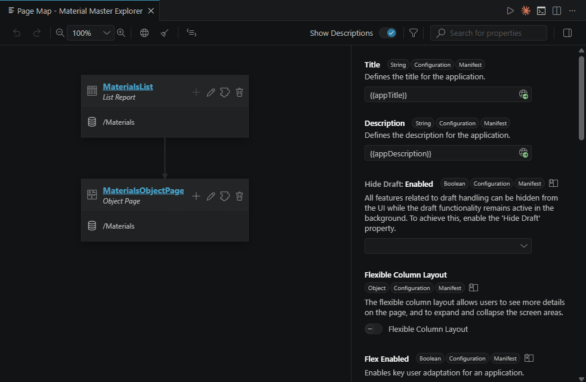
*G1-EV12 — The app's Page Map: two linked pages, with global properties on the right.*

The pencil on the `MaterialsList` card opens the **Page Editor**, which shows the page tree: **Header**, **Filter Bar** (with Filter Fields, empty) and **Table** (with the generated Columns).

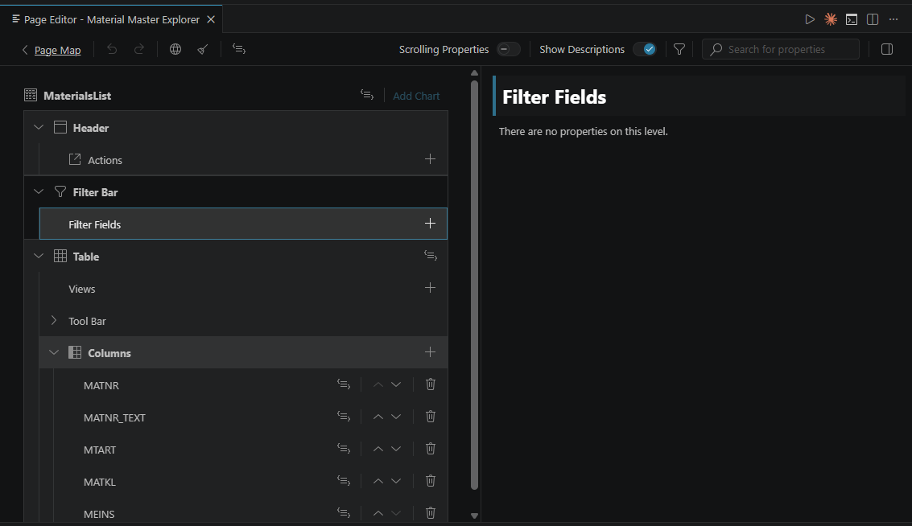
*G1-EV13 — The List Report Page Editor. The tree on the left is what the app has; the panel on the right edits the selected item.*

Three adjustments were made:

1. **Filters.** `MATNR`, `MTART`, `MATKL` and `QM_ACTIVE` were added to Filter Fields. The editor offered `type/MTART`, the key of the associated entity `MaterialTypes`; it works, but forces an unnecessary join, since `Materials` has its own `MTART`. It was replaced by `MTART`.
2. **`QM_ACTIVE` column** added to the table.
3. **Labels.** Technical headers were replaced by readable labels.

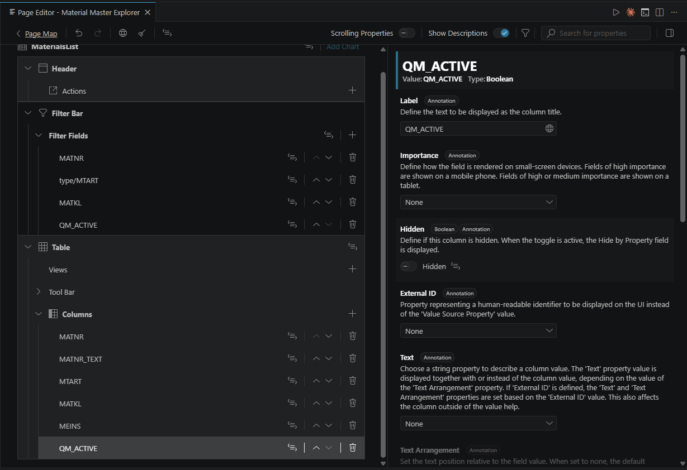
*G1-EV14 — Four filters and the `QM_ACTIVE` column in the tree; the panel shows the Label of the selected item.*

The properties panel revealed how labels work. The editor's own note says a field's **Label** applies to **every occurrence of the property** (filter, column, Object Page section), unless another label is defined locally. This distinction came back on the Object Page (G1.7).

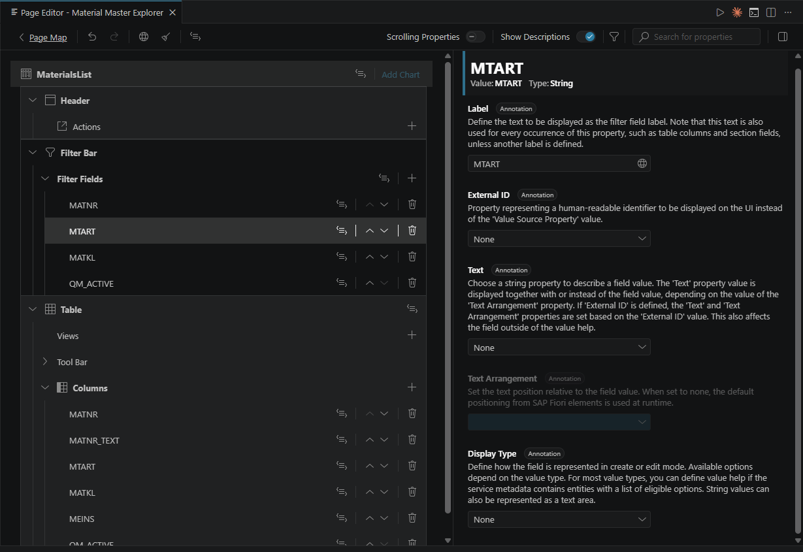
*G1-EV15 — Properties of the `MTART` filter: Label, External ID, Text, Text Arrangement and Display Type.*

| Panel field | What it does |
|---|---|
| **Label** | The displayed text (filter, column or field) |
| **External ID** | Property that identifies the value in human language |
| **Text** | Descriptive text next to or instead of the code (`@Common.Text`) |
| **Text Arrangement** | Position of the text relative to the code; only enabled after choosing a Text |
| **Display Type** | How the field appears (for example, with value help) |

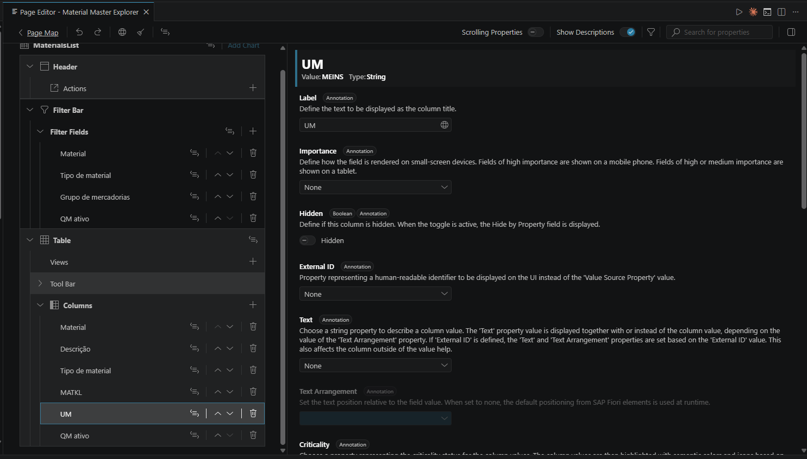
*G1-EV16 — The labels applied: Material, Material type, Material group, QM active, Description and UoM.*

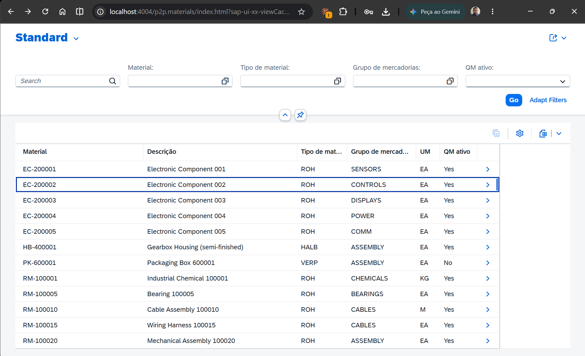
*G1-EV17 — The result in the browser: the filter bar with four fields, the table with `QM active` at the end and readable headers.*

**What the Page Editor wrote.** Everything went into `app/materials/annotations.cds`. The relevant parts:

```cds
UI.SelectionFields : [ MATNR, MTART, MATKL, QM_ACTIVE ],   // the filters

UI.LineItem : [                                            // the table columns
    { $Type : 'UI.DataField', Label : 'Material',        Value : MATNR },
    { $Type : 'UI.DataField', Label : 'Description',     Value : MATNR_TEXT },
    { $Type : 'UI.DataField', Label : 'Material type',   Value : MTART },
    { $Type : 'UI.DataField', Label : 'Material group',  Value : MATKL },
    { $Type : 'UI.DataField', Label : 'UoM',             Value : MEINS },
    { $Type : 'UI.DataField',                             Value : QM_ACTIVE },
],

annotate service.Materials with { MATNR @Common.Label : 'Material' };   // property label
```

> [!NOTE]
> When `type/MTART` was replaced by `MTART`, an orphan annotation remained: `annotate service.MaterialTypes with { MTART @Common.Label : 'type/MTART' }`. It gave the `MTART` field of `MaterialTypes` a wrong label. It was removed manually. Worth checking the file after using the editor.

### G1.6 — Visual identity: theme and custom CSS

The list was all white. The reason is that the default Fiori Elements theme, **SAP Horizon**, is light by definition, and the blue band you remember from classic Fiori comes from the **Launchpad shell bar**, which the standalone page (`index.html`) does not load. The only blue on screen is the accent blue (the **Go** button, links, the "Standard" title).

Two paths were tested. The first was switching the theme just to compare, with a URL parameter (`&sap-ui-theme=sap_fiori_3`):

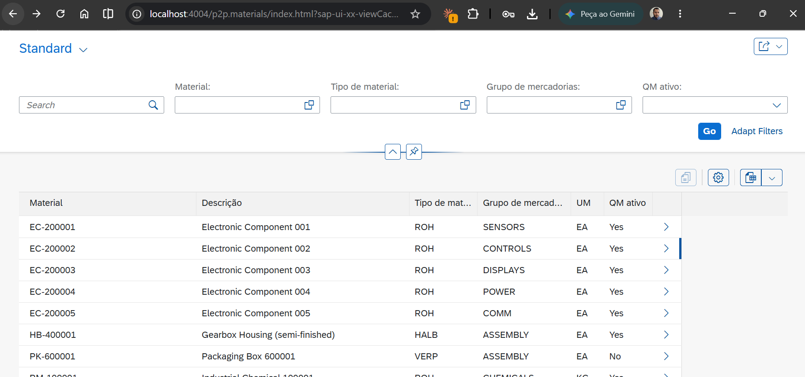
*G1-EV19 — The `sap_fiori_3` theme: square buttons and boxes, grey table header. The blue band is still absent, because it does not belong to the theme.*

The second was **the app's own CSS customization**. The app loads a style file declared in `manifest.json` (`sap.ui5.resources.css`, which the generator leaves empty):

```json
"resources": { "css": [ { "uri": "css/style.css" } ] }
```

A first version painted the band light blue (`#d1e7fa`), keeping the text.

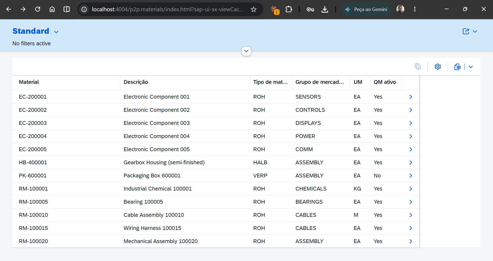
*G1-EV20 — The first version: light blue header, text as it was.*

The final version uses dark blue and white text. **The point of the exercise was learning to find the right selector**: in the browser, right-click the element, **Inspect**, and read the classes in the panel (`sapFDynamicPageTitle`, `sapFDynamicPageHeader`, `sapMLabel`). The file is `app/materials/webapp/css/style.css`:

```css
/* Header band: dark blue background and white text */
.sapFDynamicPageTitle,
.sapFDynamicPageHeader,
.sapFDynamicPageTitleWrapper {
    background-color: #0a4a82 !important;
}

/* All text and icons inside the title ("Standard", "No filters active") */
.sapFDynamicPageTitle * {
    color: #ffffff !important;
}

/* Filter labels (Material:, Material type:...) when the bar is expanded */
.sapFDynamicPageHeader .sapMLabel {
    color: #ffffff !important;
}

/* Text buttons in the filter bar (Adapt Filters) and title actions */
.sapFDynamicPageHeader .sapMBtnTransparent .sapMBtnContent,
.sapFDynamicPageTitle .sapMBtnTransparent .sapMBtnContent,
.sapFDynamicPageTitle .sapMBtnIcon {
    color: #ffffff !important;
}
```

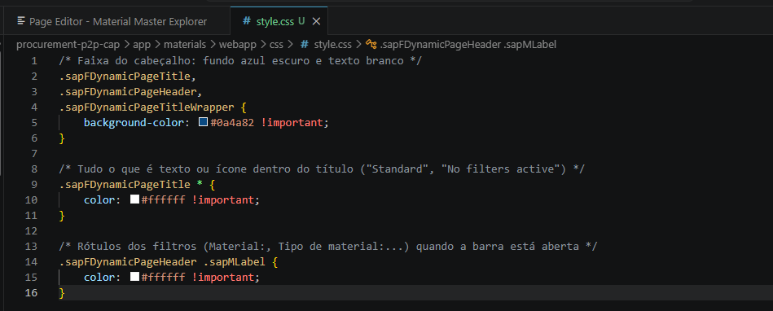
*G1-EV21 — The final `style.css` in VS Code.*

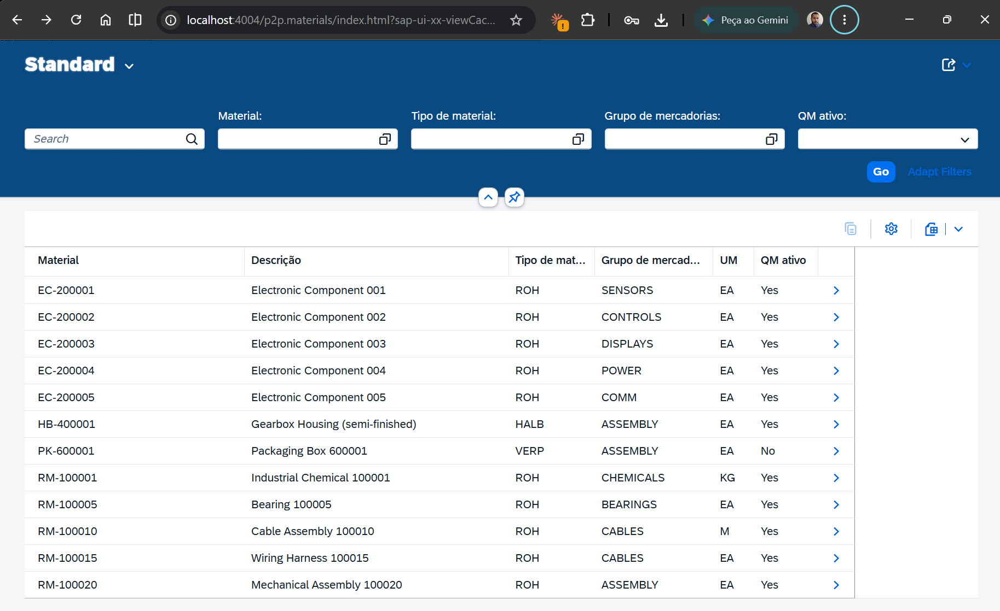
*G1-EV22 — The result: dark blue band, "Standard" and labels in white, "Adapt Filters" readable.*

Two remarks. `!important` is needed for the app's CSS to beat the theme's. And the `.sapFDynamicPageTitle *` rule is broad on purpose: if some title component looks off, the way forward is to inspect it and add a more specific rule. Since the same component (`Dynamic Page`) forms the header of both pages, the Object Page inherited the color with nothing more.

### G1.7 — Object Page: from code to business object

Clicking a material opens the Object Page with what the generator built: the title shows only the code and the fields have technical labels (`MATNR:`, `MTART:`...), as in the generated FieldGroup.

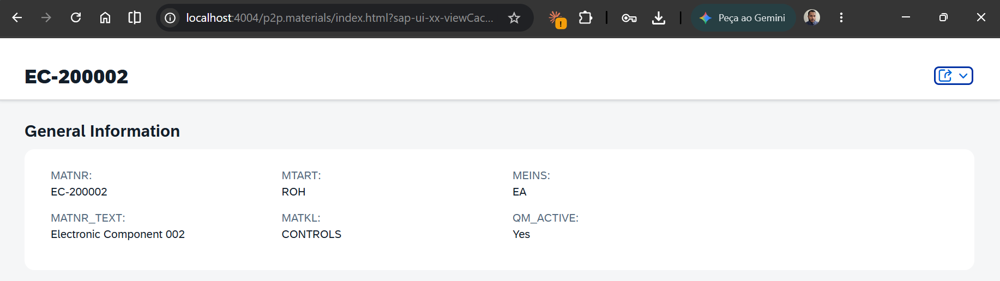
*G1-EV18 — The Object Page "before": title with the code only, "General Information" section and technical labels.*

These labels appear because the generator wrote `Label : 'MATNR'` **inside** the field group, and the local label overrides the property label defined in the List Report. The fix is in the **`MaterialsObjectPage` Page Editor**.

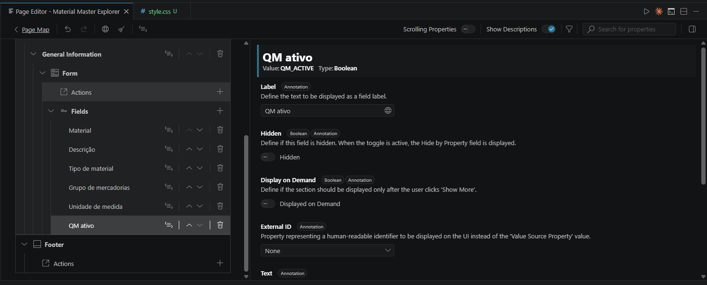
*G1-EV23 — The Object Page tree: Header, Sections (General Information, with Form and Fields) and Footer. Each field gets a readable Label.*

The field labels were changed (Material, Description, Material type, Material group, Unit of measure, QM active) and the section became **"Material data"**.

The header title, however, is **not obviously exposed in the Page Editor**. It was added directly in `annotations.cds`, in a `UI.HeaderInfo` block:

```cds
UI.HeaderInfo : {
    $Type          : 'UI.HeaderInfoType',
    TypeName       : 'Material',
    TypeNamePlural : 'Materials',
    Title          : { $Type : 'UI.DataField', Value : MATNR_TEXT },   // material name
    Description    : { $Type : 'UI.DataField', Value : MATNR },        // code below the name
},
```

`TypeNamePlural` also feeds the table title ("Materials (12)").

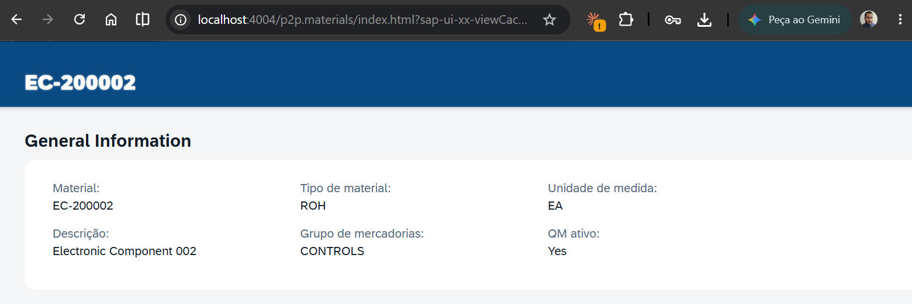
*G1-EV24 — Readable labels, but the title still shows only the code.*

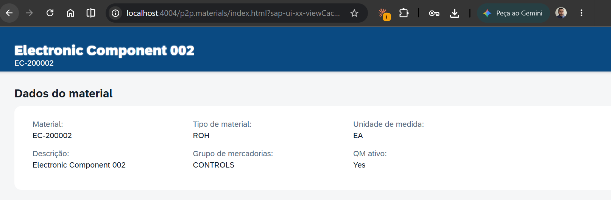
*G1-EV25 — Title "Electronic Component 002", code `EC-200002` below it, and the "Material data" section.*

> [!NOTE]
> A change made in the editor can seem not to "stick". The section still read "General Information" on screen even though the file was already saved. Fiori reads annotations from `$metadata`, and the server only serves the new ones after reloading. Checking the file and pressing **Ctrl + F5** (or restarting `cds watch`) fixes it.

### G1.8 — Eligible suppliers: PIR + QIR on the Object Page

This is the heart of G1. The material's Object Page must show **who can receive an order**. That is a table from another entity (`SupplierEligibility`), filtered by the open material, and it depends on two pieces.

**Piece 1: the table annotations.** In a dedicated file, `app/materials/annotations-eligibility.cds` (separate from `annotations.cds`, so the Page Editor and the code do not overwrite each other), the field titles, the price's currency format and a column list with the **qualifier** `ByMaterial` were defined:

```cds
annotate service.SupplierEligibility with {
  NET_PRICE @title: 'Net price'  @Measures.ISOCurrency: CURRENCY;   // price formatted with currency
  // ... remaining titles
};

annotate service.SupplierEligibility with @(
  UI.LineItem #ByMaterial : [
    { $Type: 'UI.DataField', Value: LIFNR },
    { $Type: 'UI.DataField', Value: LIFNR_TEXT },
    { $Type: 'UI.DataField', Value: REASON_TEXT, Criticality: REASON_CRIT, CriticalityRepresentation: #WithIcon },
    { $Type: 'UI.DataField', Value: NET_PRICE },
    { $Type: 'UI.DataField', Value: LEAD_TIME_DAYS },
    { $Type: 'UI.DataField', Value: CERT_VALID_TO, Criticality: CERT_CRIT },
    { $Type: 'UI.DataField', Value: BLOCK_REASON }
  ]
);
```

The qualifier (`#ByMaterial`) is a name that tells this list apart from other lists of the same kind, and it is what the editor shows when you pick one. `REASON_CRIT` colors the status (green, yellow or red, with an icon), and `CERT_CRIT` colors the certificate expiry.

**Piece 2: the section, created in the Page Editor.** Under **Sections**, the **+** button opened **Add Table Section**:

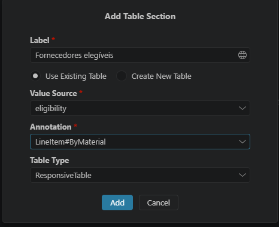
*G1-EV26 — The Add Table Section dialog, with the existing table, `eligibility` as the source and `LineItem#ByMaterial`.*

| Field | Value | Meaning |
|---|---|---|
| Label | `Eligible suppliers` | Section title |
| Use Existing Table | selected | Uses a list already annotated in the model |
| Value Source | `eligibility` | The link from `Materials` to the eligibility view |
| Annotation | `LineItem#ByMaterial` | The columns defined in Piece 1 |
| Table Type | `ResponsiveTable` | Adaptive table; few suppliers per material |

The editor recognized the `eligibility` link and the qualifier, which confirms that model and screen are aligned. It registered the section as a new facet (`UI.ReferenceFacet` with target `eligibility/@UI.LineItem#ByMaterial`), and the Object Page gained two sections in the navigation bar.

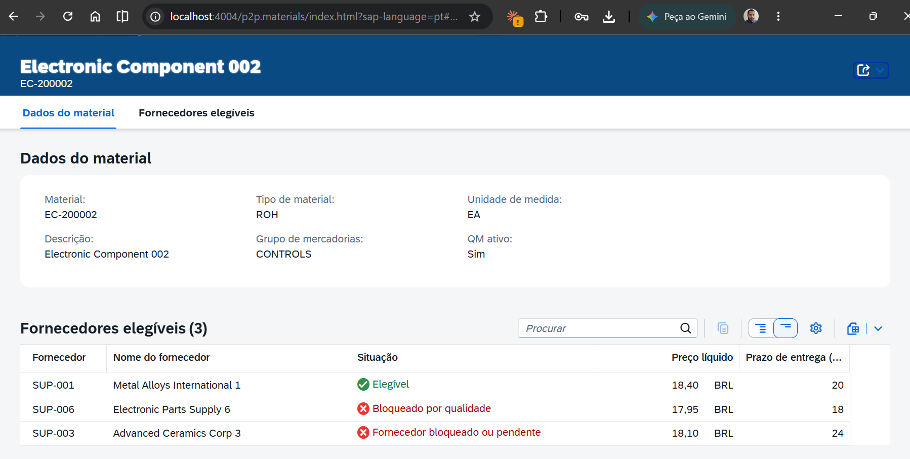
*G1-EV27 — The "Eligible suppliers (3)" section of `EC-200002`. The table is cut off on the right in this capture.*

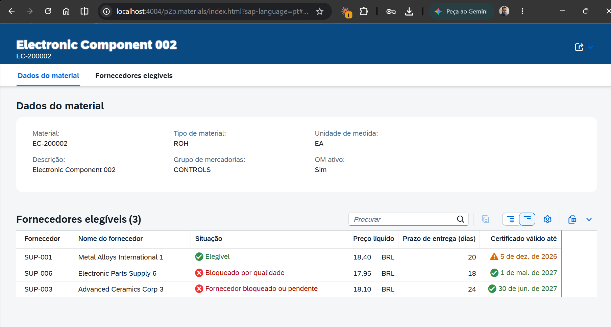
*G1-EV28 — The same section with the "Certificate valid until" column visible. This is the main evidence of G1.*

How to read the table for material `EC-200002`:

| Supplier | Status | Certificate | Why |
|---|---|---|---|
| `SUP-001` | ✅ Eligible | ⚠️ Dec 5, 2026 | Valid PIR, released QIR. Attention: the certificate expires in under 90 days |
| `SUP-006` | ❌ Blocked for quality | ✅ May 1, 2027 | The certificate is valid, but the **QIR is blocked** |
| `SUP-003` | ❌ Supplier blocked or pending | ✅ Jun 30, 2027 | The certificate is valid, but the **supplier is inactive** |

The `SUP-006` case shows why the QIR is a separate check: a valid certificate is not enough when quality has blocked the material and supplier combination. The status text and its color come from the `EligibilityReason` database table, and the price is formatted with its currency thanks to `@Measures.ISOCurrency`. The "Block reason" column does not appear in these captures because the responsive table hides lower-priority columns on narrow screens.

### G1.9 — Internationalization: English as default, Portuguese as translation

The screen was mixed: UI5's standard texts (`Search`, `Go`, `Adapt Filters`) follow the browser language, but the labels we typed were fixed in Portuguese. The question this mix raises is: **which language is the default**, and how does the app switch language. The decision was **English as default**, with Portuguese translation, the SAP convention and the habit of public repositories.

**The "before".** With `?sap-language=pt` in the URL, UI5's own texts changed (`Standard` became `Padrão`, `Search` became `Procurar`, `Go` became `Iniciar`, `Adapt Filters` became `Ajustar filtros`, `Yes/No` became `Sim/Não`). Our texts and the data stayed as they were.

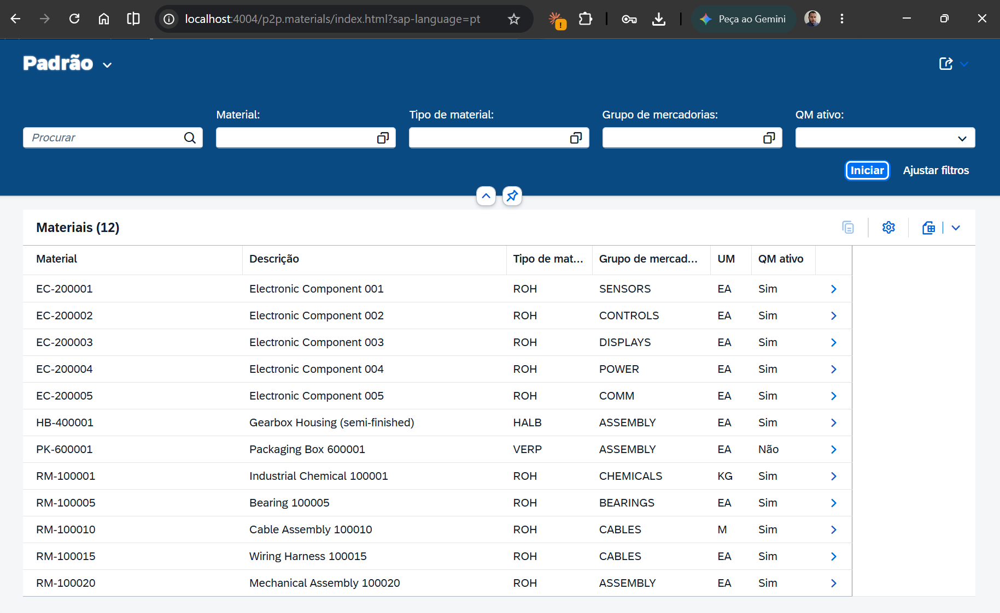
*G1-I18N-01 — The "before": only UI5's texts translate; the typed labels stay fixed.*

The solution has **three layers**, each with its own mechanism:

| Layer | Where it lives | How it works |
|---|---|---|
| UI5 standard texts | UI5 libraries | Follow the language automatically (`?sap-language=`) |
| Screen texts (labels, titles, section) | `app/materials/_i18n/i18n.properties` (EN) and `i18n_pt.properties` (PT) | Annotations use **keys** such as `'{i18n>materialType}'`; CAP resolves the text by language when serving `$metadata` |
| Texts coming from the database (supplier "Status") | `db/data/p2p-EligibilityReason.csv` (EN) and `p2p-EligibilityReason.texts.csv` (PT) | The column is `localized`; Portuguese lives in a texts table |
| App title and description (manifest) | `app/materials/webapp/i18n/i18n.properties`, `i18n_en` and `i18n_pt` | Resolved by UI5 itself |

**Layer 2: keys in annotations.** The i18n files live in an `_i18n` folder next to the model, which is where CAP looks by default:

```properties
# i18n.properties (default: English)          # i18n_pt.properties (Portuguese)
materialType=Material Type                     materialType=Tipo de material
eligibleSuppliers=Eligible Suppliers           eligibleSuppliers=Fornecedores elegíveis
status=Status                                  status=Situação
```

```cds
Label : '{i18n>materialType}',       // instead of a hard-coded 'Material type'
```

**Layer 3: translatable data.** The `TEXT` column of `EligibilityReason` became `localized String(80)`, and CAP created the texts table `EligibilityReason.texts` (`locale`, `CODE`, `TEXT`). The `SupplierEligibility` view picks the text in the user's language and, if there is no translation, falls back to the default:

```cds
left join db.EligibilityReason       as r on r.CODE = e.REASON
left join db.EligibilityReason.texts as t on t.CODE = e.REASON and t.locale = $user.locale
...
coalesce(t.TEXT, r.TEXT) as REASON_TEXT : String(80),     // user's language, otherwise the default
```

In the sandbox, the same query returned "Eligible" with `Accept-Language: en`, "Elegível" with `pt`, and fell back to English with `de` (no translation).

> [!NOTE]
> Three shorter paths were tried and did not work: referencing `localized.p2p.EligibilityReason` in a view (error "can't be referred to without a using declaration"), using an association with a path (`reason.TEXT`, which does not localize) and `$expand` of the association (SQLite error). The join with the `.texts` table and `$user.locale` was the one that worked.

**The "after".** The same screens, in English and Portuguese, with `?sap-language=en` and `?sap-language=pt`:

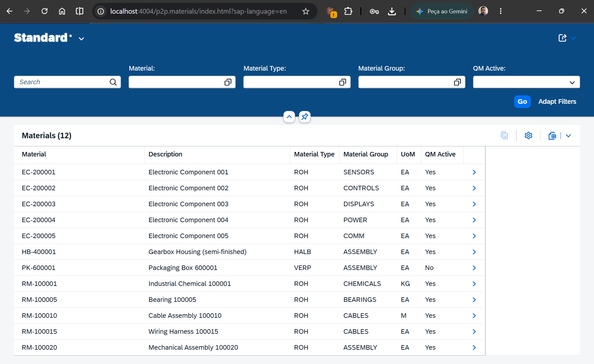
*G1-I18N-02 — List Report in English: "Material Type", "Material Group", "QM Active", "Materials (12)".*

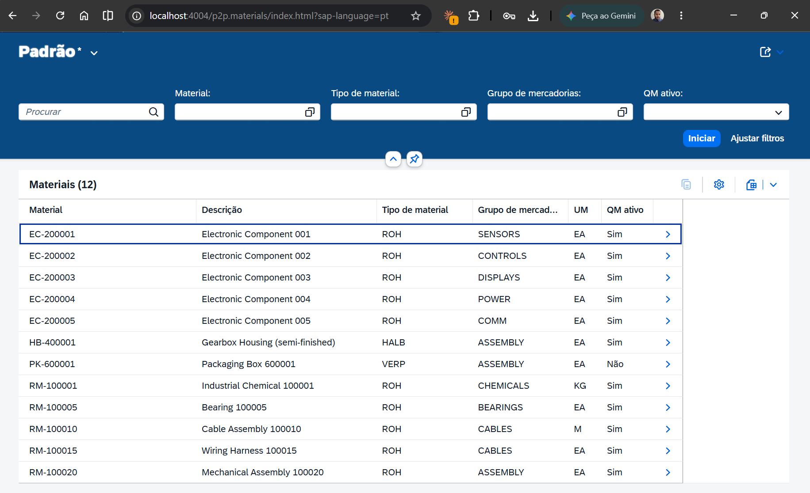
*G1-I18N-03 — The same List Report in Portuguese: "Tipo de material", "Grupo de mercadorias", "QM ativo", "Materiais (12)".*

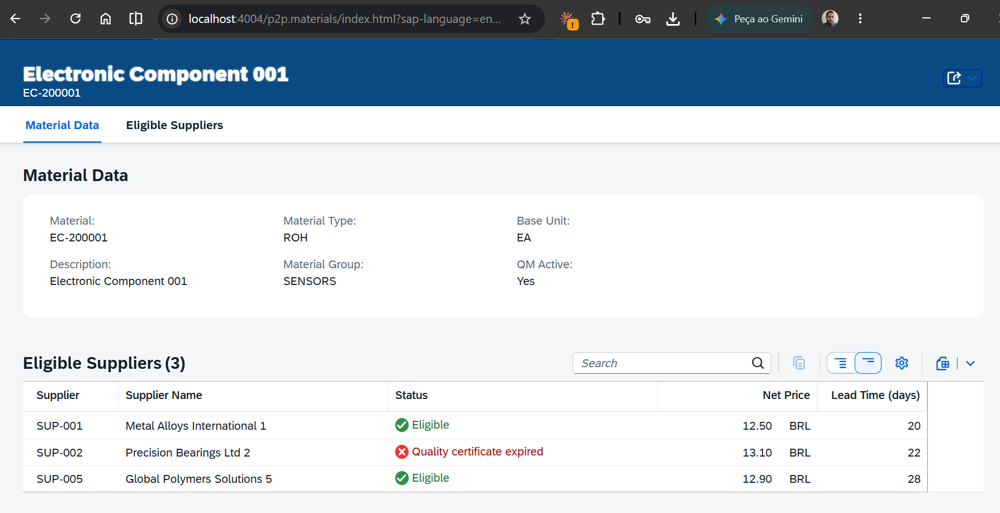
*G1-I18N-04 — Object Page in English: "Material Data", "Eligible Suppliers", "Status" and the status "Quality certificate expired".*

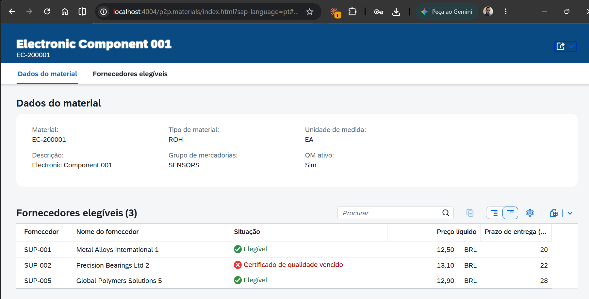
*G1-I18N-05 — Object Page in Portuguese: "Dados do material", "Fornecedores elegíveis", "Situação" and "Certificado de qualidade vencido".*

Labels, section title and supplier status changed together. Numbers and dates also change format, because UI5 formats them according to the language.

**How the language reaches the service.** In the `curl` test in the sandbox, CAP chose the language from the `sap-locale` parameter, the `x-sap-request-language` header or `Accept-Language`, and **not** from the `sap-language` parameter. In the browser, however, `?sap-language=pt` worked end to end: UI5 passed the language on to the service. What is confirmed in practice is the result in the captures above.

**What about the material description and the supplier name?** The material description **can also be translated**, and that is the SAP standard: it is language-dependent (table `MAKT`, one row per language). It would be enough to apply the same mechanism, with the description in a texts table and a fallback to the default text when there is no translation. This only works if the master data is up to date, that is, if the material has a description in each language. The current seed has English only (`Electronic Component 001`), so it does not change on screen. The **supplier name**, on the other hand, normally **does not** depend on language: the legal name (`NAME1` in `LFA1`) is a single one. Only supporting texts, such as payment terms, are translated. This improvement is left for when the application reads the real `INDUSTRIAL_DATA` master data.

---

## 🛠️ Troubleshooting

| # | Symptom | Cause | Fix |
|---|---|---|---|
| 1 | `npm : File npm.ps1 cannot be loaded ... not digitally signed` | The PowerShell execution policy blocks `.ps1` scripts | Use `npm.cmd` and `npx.cmd` (for example, `npm.cmd run watch-materials`) |
| 2 | Searching "Generators" opened the Yeoman page | Yeoman is a different generator catalog | Open the generator with `Ctrl + Shift + P`, **Fiori: Open Application Generator** |
| 3 | Blank app; console shows 401 on `$metadata` and `Component.create() failed` | The service requires login and the app sent no credentials | Log in to OData in the browser first (G1.4, EV09) |
| 4 | Edge showed no login popup nor accepted `alice:alice@` in the URL | Behavior of the Edge window used | Prove the service with `curl.exe -u alice:alice ...` (200) and use Chrome |
| 5 | 404 errors for `Component-preload.js` and `sap/bc/lrep/...` in the console | Expected in local development (no preload or adaptation layer) | Ignore |
| 6 | `fallback locale 'en'` warnings from `manifestEnhancer` in the terminal | `i18n_en.properties` was missing | Create `i18n_en.properties` and `i18n_pt.properties` (G1.9) |
| 7 | Filter label showed `type/MTART` and an annotation was left on `MaterialTypes` | The editor offered the associated entity's key | Use `MTART` and remove the orphan annotation (G1.5) |
| 8 | Object Page header title showed only the code | The Page Editor does not obviously expose the title | Add `UI.HeaderInfo` in `annotations.cds` (G1.7) |
| 9 | The Page Editor wrote the new section to the eligibility file, creating a duplicate `UI.Facets` | The editor writes where the referenced annotation lives | Merge both facets into `annotations.cds` |
| 10 | The change is in the file, but the screen is unchanged | Fiori reads annotations from `$metadata` | Check the file, restart `cds watch` if needed and press **Ctrl + F5** |
| 11 | `QIR_MISSING` never appeared (20 eligible instead of 19) | CSV booleans written as `True/False` | Write lowercase `true/false` |
| 12 | The manual apps interfered with the generator | Duplicate annotations in `app/` | Move them to `_referencia/` before generating |

---

## 🗂️ Application structure

```
db/schema.cds ───────► srv/service.cds ─────────► OData V4  /odata/v4/p2p
(Material, Supplier,    (Materials + eligibility,   ├─ Materials ──┐  (mixin: eligibility)
 PIR, QIR, orders)       EligibilityBase,            ├─ SupplierEligibility ◄┘
                         SupplierEligibility,        ├─ MaterialTypes, Suppliers, ...
                         @restrict/@requires)        └─ PurchaseOrders (draft), PurchaseOrderItems

app/services.cds ──► app/materials/annotations.cds              (List Report + Object Page: Page Editor)
                 └─► app/materials/annotations-eligibility.cds  (eligible suppliers table)
                     app/materials/_i18n/*.properties           (annotation texts, EN + PT)
                     app/materials/webapp/{manifest.json, Component.js, index.html, css/style.css, i18n/*}

Served by:  cds watch (+ cds-plugin-ui5)  →  http://localhost:4004/p2p.materials/index.html
Default profile → in-memory SQLite + test users (alice, bob, carol, dave)
Hybrid profile  → SAP HANA Cloud (HDI) + XSUAA (deployment step, not done yet)
```

---

## 📊 Evidence

| # | Evidence | Step | File |
|---|---|---|---|
| 1 | SAP Fiori tools extensions | G1.2 | [G1-EV01](../../../Evidences/LAB_G/G1-EV01-extensoes-sap-fiori-tools.png) |
| 2 | Template selection | G1.3 | [G1-EV02](../../../Evidences/LAB_G/G1-EV02-fiori-generator-template-selection.png) |
| 3 | List Report Page selected | G1.3 | [G1-EV03](../../../Evidences/LAB_G/G1-EV03-template-list-report-selecionado.png) |
| 4 | CAP data source | G1.3 | [G1-EV04](../../../Evidences/LAB_G/G1-EV04-data-source-cap-procurement-p2p.png) |
| 5 | Service entities | G1.3 | [G1-EV05](../../../Evidences/LAB_G/G1-EV05-entity-selection-lista-de-entidades.png) |
| 6 | `Materials` entity (final configuration) | G1.3 | [G1-EV06](../../../Evidences/LAB_G/G1-EV06-entity-selection-materials-configuracao-final.png) |
| 7 | Project attributes | G1.3 | [G1-EV07](../../../Evidences/LAB_G/G1-EV07-project-attributes-materials.png) |
| 8 | Application Info of the generated app | G1.3 | [G1-EV08](../../../Evidences/LAB_G/G1-EV08-application-info-app-gerado.png) |
| 9 | 401 error on `$metadata` | G1.4 | [G1-EV09](../../../Evidences/LAB_G/G1-EV09-erro-401-metadata-sem-login.png) |
| 10 | Authenticated OData (JSON) | G1.4 | [G1-EV10](../../../Evidences/LAB_G/G1-EV10-odata-materials-json-autenticado.png) |
| 11 | List Report as generated | G1.4 | [G1-EV11](../../../Evidences/LAB_G/G1-EV11-list-report-gerado-padrao.png) |
| 12 | Page Map | G1.5 | [G1-EV12](../../../Evidences/LAB_G/G1-EV12-page-map-materials.png) |
| 13 | List Report Page Editor | G1.5 | [G1-EV13](../../../Evidences/LAB_G/G1-EV13-page-editor-list-report.png) |
| 14 | Filters and `QM_ACTIVE` column | G1.5 | [G1-EV14](../../../Evidences/LAB_G/G1-EV14-page-editor-filtros-e-coluna-qm-active.png) |
| 15 | `MTART` filter properties | G1.5 | [G1-EV15](../../../Evidences/LAB_G/G1-EV15-page-editor-propriedades-do-filtro-mtart.png) |
| 16 | Labels applied | G1.5 | [G1-EV16](../../../Evidences/LAB_G/G1-EV16-page-editor-rotulos-aplicados.png) |
| 17 | List Report with filters and labels | G1.5 | [G1-EV17](../../../Evidences/LAB_G/G1-EV17-list-report-filtros-e-rotulos.png) |
| 18 | Object Page with technical labels | G1.7 | [G1-EV18](../../../Evidences/LAB_G/G1-EV18-object-page-rotulos-tecnicos.png) |
| 19 | `sap_fiori_3` theme | G1.6 | [G1-EV19](../../../Evidences/LAB_G/G1-EV19-list-report-tema-sap-fiori-3.png) |
| 20 | Light blue header | G1.6 | [G1-EV20](../../../Evidences/LAB_G/G1-EV20-list-report-cabecalho-azul-claro.png) |
| 21 | Final `style.css` | G1.6 | [G1-EV21](../../../Evidences/LAB_G/G1-EV21-style-css-cabecalho-azul-escuro.png) |
| 22 | Dark blue header | G1.6 | [G1-EV22](../../../Evidences/LAB_G/G1-EV22-list-report-cabecalho-azul-escuro.png) |
| 23 | Object Page Page Editor | G1.7 | [G1-EV23](../../../Evidences/LAB_G/G1-EV23-page-editor-object-page-rotulos.png) |
| 24 | Object Page with readable labels | G1.7 | [G1-EV24](../../../Evidences/LAB_G/G1-EV24-object-page-rotulos-legiveis.png) |
| 25 | Title, description and section | G1.7 | [G1-EV25](../../../Evidences/LAB_G/G1-EV25-object-page-titulo-e-secao.png) |
| 26 | Add Table Section | G1.8 | [G1-EV26](../../../Evidences/LAB_G/G1-EV26-add-table-section-fornecedores-elegiveis.png) |
| 27 | Eligible suppliers (table cut off) | G1.8 | [G1-EV27](../../../Evidences/LAB_G/G1-EV27-object-page-fornecedores-elegiveis.png) |
| 28 | Eligible suppliers with certificate | G1.8 | [G1-EV28](../../../Evidences/LAB_G/G1-EV28-object-page-fornecedores-com-certificado.png) |
| 29 | i18n: UI5 standard texts in Portuguese | G1.9 | [G1-I18N-01](../../../Evidences/LAB_G/G1-I18N-01-sap-language-pt-textos-padrao-traduzidos.png) |
| 30 | i18n: List Report in English | G1.9 | [G1-I18N-02](../../../Evidences/LAB_G/G1-I18N-02-list-report-en.png) |
| 31 | i18n: List Report in Portuguese | G1.9 | [G1-I18N-03](../../../Evidences/LAB_G/G1-I18N-03-list-report-pt.png) |
| 32 | i18n: Object Page in English | G1.9 | [G1-I18N-04](../../../Evidences/LAB_G/G1-I18N-04-object-page-en.png) |
| 33 | i18n: Object Page in Portuguese | G1.9 | [G1-I18N-05](../../../Evidences/LAB_G/G1-I18N-05-object-page-pt.png) |

---

## ⚠️ Limitations and pending items

- **No deployment.** The app runs locally only (in-memory SQLite). Publishing to BTP (MTA, Cloud Foundry, HDI, XSUAA, approuter, role collections) is a separate step.
- **HANA not tested.** The views use `$now`, `days_between` and `$user.locale`, validated on SQLite only. Behavior on SAP HANA Cloud must be confirmed at deployment.
- **No Launchpad.** The app opens through `index.html`, without the shell bar. The blue band was done with custom CSS; the standard path is publishing to the Launchpad (Work Zone).
- **Missing captures.** G1.1 and the `cds watch` output have no image, and the troubleshooting `curl.exe` was recorded as text. The creation of `UI.HeaderInfo` was not captured.
- **Small data.** 12 materials and 10 suppliers, assembled to exercise each rule. The real `INDUSTRIAL_DATA` has far more.
- **English-only descriptions.** The material description and supplier name are not translated (see G1.9).
- **Local login.** `alice:alice` and the other `.cdsrc.json` users are for local development only. The browser keeps the credential for `localhost:4004`.
- **`_referencia/`.** The folder holds the hand-made apps from the first attempt, only as a didactic comparison.
- **Page Editor and files.** The editor writes where the referenced annotation lives, which can scatter duplicate annotations. Re-read `annotations.cds` after using the editor.
- **npm.** The `npm audit` vulnerability warnings from Block F are still untreated.

## ➡️ Next steps

1. **G2:** turn eligibility into its own app (Supplier Eligibility Explorer), with filters by supplier and reason.
2. **G3:** purchase order with items and draft, with price from the PIR and eligible supplier.
3. **G4:** Approval Cockpit, with mass approval respecting each user's approval limit.
4. **G5:** synchronous ERP integration (CPI and S/4HANA simulated by a CAP service).
5. Deploy to BTP and validate the views on SAP HANA Cloud.

---

[⬆️ Back to README](../../../README.en.md)
