# G2: Supplier Eligibility Explorer with SAP Fiori Elements

**🌐 Language / Idioma:** [🇧🇷 Português](../BR/02-g2-supplier-eligibility-explorer.md) | 🇺🇸 **English**

[⬆️ Back to README](../../../README.en.md)

> **Status:** ✅ G2 completed and deployed to SAP BTP, with a second Launchpad tile (Work Zone), working G1 ↔ G2 navigation and phone access · ⚠️ Caveats: the app was registered manually in Work Zone (the HTML5 Apps provider stayed empty); G2 uses the same fictitious CSV data as G1; the Joule Work and cross-app link checks were confirmed but have no screenshot; G1's `@UI.Importance` was checked on a phone only on the material Object Page
> **Environment:** same as [G1](./01-g1-material-master-explorer.en.md) (SAP CAP `@sap/cds` 10.2.x, Fiori Elements V4, SAPUI5 1.154.0, SAP BTP trial with Cloud Foundry, HANA Cloud, XSUAA, HTML5 Application Repository and SAP Build Work Zone)
> **Project:** [`procurement-p2p-cap/`](../../../procurement-p2p-cap) · **Service:** `ProcurementService` at `/odata/v4/p2p` · **App:** `p2p.eligibility` (List Report + Object Page) · **Main entity:** `Suppliers`
> **Classification:** educational environment, fictitious data, no production data

## 🎯 Executive summary

G1 answers "for this **material**, which suppliers can receive an order today?". **G2** answers the opposite question, which buyers also ask every day: **"for this supplier, what can it supply today, and why are some items blocked?"**

The app is a second Fiori Elements app in the same CAP project, the same MTA and the same Work Zone site. It reuses G1's `SupplierEligibility` view and adds what was missing: a `Suppliers` entity with **counters** (materials with an info record, eligible and blocked) and the association to eligibility. The list shows suppliers with the most blocks first. The Object Page opens the supplier with the materials table, each item's status (colored) and the block reason.

G2 also closed three G1 loose ends: **phone columns** (`@UI.Importance`), **cross-app navigation** (G1 ↔ G2 through the Launchpad) and the **second tile** in Work Zone.

| Step | Goal | Result |
|---|---|---|
| G2.0 | Scope and decisions | ✅ Supplier list + supplier Object Page; filters by supplier, status, country, material and eligibility status |
| G2.1 | Service: counters and association | ✅ `Suppliers` with `ITEMS_TOTAL/ELIGIBLE/BLOCKED` and `eligibility`; tested on the local OData |
| G2.2 | The `p2p.eligibility` app | ✅ Annotations, EN/PT i18n, manifest, routes, `@UI.Importance` |
| G2.3 | First local run | ✅ List and Object Page; Object Page header fixed with CSS |
| G2.4 | Deploying to BTP | ✅ Second HTML5 module in the MTA; `mbt build` and `cf deploy` |
| G2.5 | Launchpad tile | ✅ App created by hand in Content Manager; two tiles in the Compras group |
| G2.6 | Cross-app navigation | ✅ Supplier (G1) opens G2; material (G2) opens G1 |
| G2.7 | Phone | ✅ Card list and Object Page readable; G1 improved too |

## 🧭 Functional storytelling

### G2.0 — Scope and decisions

| Decision | Choice | Reason |
|---|---|---|
| List entity | `Suppliers` (one row per supplier) | The question is per supplier; a list on `SupplierEligibility` would repeat the supplier for every material |
| Object Page | Per **supplier** (not per material + supplier pair) | The materials table with each item's status answers the question at once |
| Filters | Supplier, supplier status, country, **material** and eligibility **status** | Material and status come from the `eligibility` association (filter on a child table) |
| Colors | Status by criticality (`REASON_CRIT`), counters and supplier status | Blocks should stand out |
| Phone | `@UI.Importance` (`#High`, `#Medium`, `#Low`) on every column | Fiori Elements only shows the most important ones on a phone |
| Hosting | Same MTA, same Work Zone site, second tile in the Compras group | Reuses XSUAA, approuter, HANA and the site |
| Out of scope | Creating orders (G3) and real `INDUSTRIAL_DATA` | G2 keeps G1's fictitious CSV |

### G2.1 — Service: counters and association

The `SupplierEligibility` view already carried everything per material + supplier pair. What was missing was one level up, the supplier. `Suppliers` stopped being a plain projection and became a `select` with an **association** to eligibility, three counting **subqueries** and two criticality columns:

```cds
entity Suppliers as select from db.Supplier as s
  mixin { eligibility : Association to many SupplierEligibility
            on eligibility.LIFNR = $projection.LIFNR; }
  into  {
    key s.LIFNR, s.LIFNR_TEXT, s.LIFNR_STATUS, s.COUNTRY, s.CURRENCY,
    s.PAYMENT_TERMS, s.QUALITY_CERTIFIED, s.status, eligibility,
    (select count(*) from SupplierEligibility as x where x.LIFNR = s.LIFNR)                           as ITEMS_TOTAL    : Integer,
    (select count(*) from SupplierEligibility as x where x.LIFNR = s.LIFNR and x.REASON =  'ELIGIBLE') as ITEMS_ELIGIBLE : Integer,
    (select count(*) from SupplierEligibility as x where x.LIFNR = s.LIFNR and x.REASON <> 'ELIGIBLE') as ITEMS_BLOCKED  : Integer,
    case when s.LIFNR_STATUS = 'ACTIVE' then 3 else 1 end                                              as STATUS_CRIT   : Integer,
    case when exists (select 1 from SupplierEligibility as x
                      where x.LIFNR = s.LIFNR and x.REASON <> 'ELIGIBLE') then 1 else 3 end            as BLOCKED_CRIT  : Integer
  };
```

Before touching any screen, the query was validated on the OData service (local SQLite):

| Query | Result |
|---|---|
| `Suppliers?$select=LIFNR,ITEMS_TOTAL,ITEMS_ELIGIBLE,ITEMS_BLOCKED` | `SUP-001`: 5 / 5 / 0 · `SUP-002`: 4 / 3 / 1 · `SUP-003`: 1 / 0 / 1 |
| `Suppliers?$orderby=ITEMS_BLOCKED desc` | `SUP-005` (3 blocks) and `SUP-004` (2) on top |
| `Suppliers?$filter=eligibility/any(e:e/REASON eq 'CERT_EXPIRED')` | 2 suppliers (child-table filter works) |
| `Suppliers('SUP-001')?$expand=eligibility(...)` | The supplier's materials with `REASON_TEXT` and `REASON_CRIT` |

> [!NOTE]
> The tests needed a user with a role. CAP's default `alice` has no `Viewer` role and the service answered `403`. In the real project the local users come from `.cdsrc.json` (`bob` = `Viewer`, `alice` = `Buyer`).

### G2.2 — The `p2p.eligibility` app

The app was written directly as files (no Application Generator), copying G1's structure:

```
app/eligibility/
├─ annotations.cds                 # list, Object Page, filters, value helps, #BySupplier table
├─ _i18n/i18n.properties           # annotation texts (EN) and i18n_pt.properties (PT)
├─ ui5.yaml · package.json · xs-app.json
└─ webapp/{manifest.json, Component.js, index.html, css/style.css, i18n/i18n.properties}
```

| Piece | What it does |
|---|---|
| `UI.SelectionFields` | `LIFNR`, `LIFNR_STATUS`, `COUNTRY`, `eligibility.MATNR`, `eligibility.REASON` (the last two are child-table filters) |
| `Common.ValueList` | Value help for supplier, status (fixed), material and status (fixed, with the translated text) |
| `UI.LineItem` | Supplier, name, status (colored), blocked materials (colored), eligible, with info record, country, payment terms |
| `UI.PresentationVariant` | Sorts by `ITEMS_BLOCKED` descending |
| `UI.HeaderFacets` + `DataPoint` | Supplier status, eligible and blocked materials in the header |
| `UI.LineItem #BySupplier` | Object Page table: material (link to G1), description, status with icon, price, lead time, validity, certificate, block reason |
| `@UI.Importance` | `#High`: code, name, status and blocked; `#Medium`: eligible, total, price, certificate validity; `#Low`: the rest |
| `manifest.json` | `SuppliersList` and `SuppliersObjectPage` routes, `initialLoad: Enabled`, `ResponsiveTable` tables, `Suppliers-display` navigation entry |

The new texts live in `app/eligibility/_i18n/`. CAP merges the project's `_i18n` folders, so G2 only needs the new keys and reuses G1's (`supplier`, `material`, `netPrice`...). `$metadata` was checked in EN and PT: no `{i18n>...}` key was left untranslated.

In G1, `UI.LineItem` and `#ByMaterial` gained `@UI.Importance`, and the supplier code became a `DataFieldWithIntentBasedNavigation` to `Suppliers-display`.

### G2.3 — First local run

The root `package.json` changed (new workspace and a `watch-eligibility` script), so `package-lock.json` had to be updated before the build:

```powershell
npm.cmd install
npm.cmd run watch-eligibility
```

Three snags:

1. **Port 4004 in use.** G1's `cds watch` was still running in another tab. `cds-plugin-ui5` already mounts **both apps** on the same server (`/p2p.eligibility` and `/p2p.materials`), so one process is enough.
2. **Login prompt.** The browser opened CAP's mock login. Username and password `bob` / `bob` (`Viewer` role, from `.cdsrc.json`).
3. **Unreadable Object Page header.** G1's CSS paints the header dark blue; the green and red of the indicators (Active, 3, 3) lost contrast.

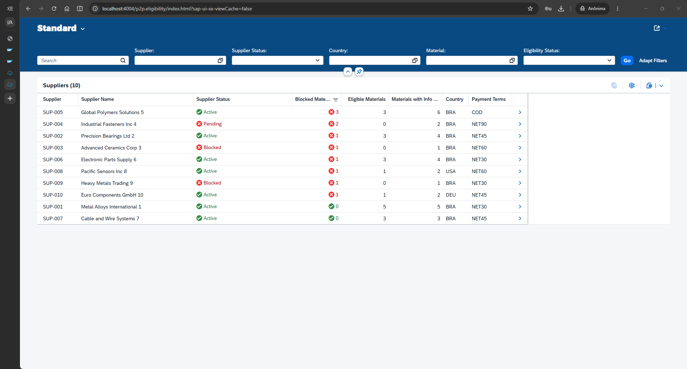
*G2-EV01 — The local list: 10 suppliers, filters, color icons and the most blocked on top.*

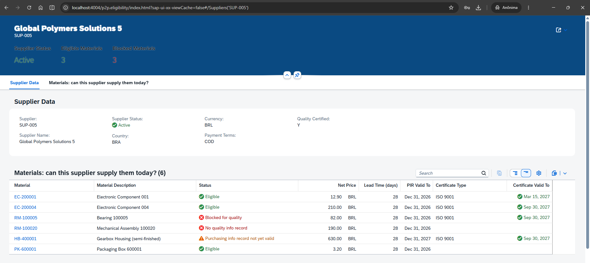
*G2-EV02 — The problem: semantic-color indicators over the dark blue header.*

The fix is a block at the end of `app/eligibility/webapp/css/style.css`, **for the Object Page only**, making the header body light and keeping the title strip blue:

```css
.sapUxAPObjectPageLayout .sapFDynamicPageHeader,
.sapUxAPObjectPageLayout .sapUxAPObjectPageHeaderContent { background-color: #ffffff !important; }
.sapUxAPObjectPageLayout .sapFDynamicPageHeader .sapMLabel,
.sapUxAPObjectPageLayout .sapFDynamicPageHeader .sapMText { color: #32363a !important; }
```

The first attempt had no effect: the file open in VS Code only had G1's 22 lines, without the block. The selector was confirmed with DevTools (`F12` → select the element) and the block was pasted by hand. After **Ctrl + Shift + R** the header became readable.

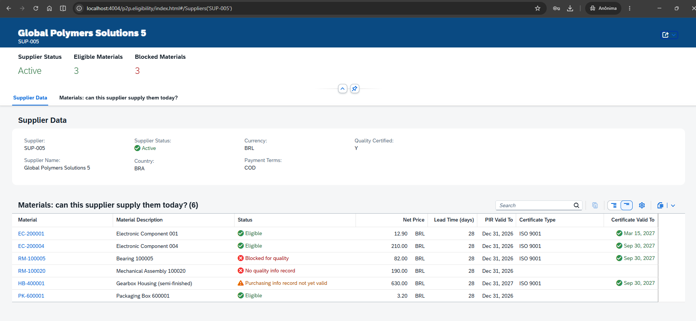
*G2-EV03 — After the fix: green "Active" and readable counters; the title strip stays blue.*

### G2.4 — Deploying to BTP

In `mta.yaml`, the second app is an HTML5 module like G1's, with the `eligibility.zip` artifact in the `app-deployer`:

```yaml
  - name: procurementp2pcapeligibility
    type: html5
    path: app/eligibility
    build-parameters: { build-result: dist, builder: custom, commands: [ npm run build ], supported-platforms: [] }
```

The app's `ui5.yaml` sets `archiveName: eligibility` (the generated zip). The manifest's `sap.cloud.service` is the same as G1's, so both apps use the same destination.

```powershell
mbt.cmd build
cf deploy mta_archives\procurement-p2p-cap_1.0.0.mtar
```

The local server was stopped first (the build's `npm ci` deletes `node_modules`, and Windows locks files in use). The deploy ended with `Process finished.` `cf html5-list` showed both apps in the same repository:

```
name             version   app-host-id        service instance                      visibility
p2peligibility   0.0.1     5ddf3dcb-...       procurement-p2p-cap-html5-repo-host   public
p2pmaterials     0.0.1     5ddf3dcb-...       procurement-p2p-cap-html5-repo-host   public
```

G2 opens at `https://<approuter>/p2peligibility/index.html`, with XSUAA login and data coming from HANA Cloud.

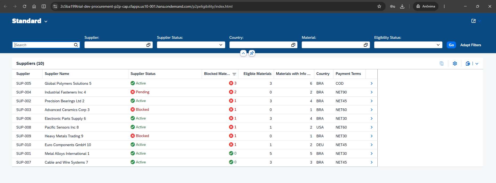
*G2-BTP-01 — The deployed list, reading from HANA Cloud through the approuter.*

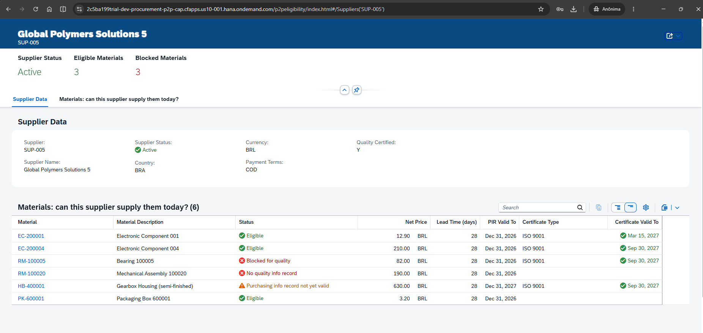
*G2-BTP-02 — The `SUP-005` Object Page: 3 eligible and 3 blocked materials (quality, missing QIR, PIR not yet valid).*

### G2.5 — The second Launchpad tile

Work Zone's **HTML5 Apps** provider stayed at `HTML5 Apps (0)`, even after the deploy and a channel refresh. G1's manual path was repeated.

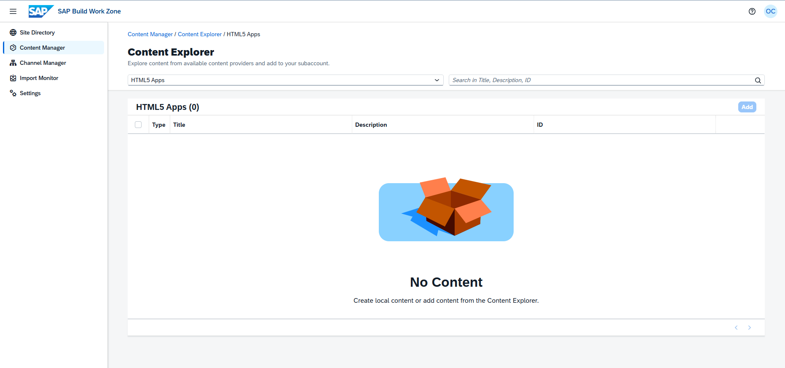
*G2-BTP-03 — The Content Explorer with no HTML5 apps, again.*

In **Content Manager → Create → App**:

| Tab | Field | Value |
|---|---|---|
| Header | Application Title | `Supplier Eligibility Explorer` |
| Header | Description | `Supplier eligibility by material` (the saved app uses the Portuguese text `Elegibilidade de fornecedores por material`) |
| Configuration | Open App | **In a new tab** |
| Configuration | System / App UI Technology | `No System` / `URL` |
| Configuration | URL | `https://<approuter>/p2peligibility/index.html` |
| Navigation | Semantic Object / Action | `Suppliers` / `display` |
| Navigation | Allow additional parameters | checked |

Two adjustments before saving: **Open App** defaulted to `In place` (G1 uses a new tab) and the description had a placeholder text.

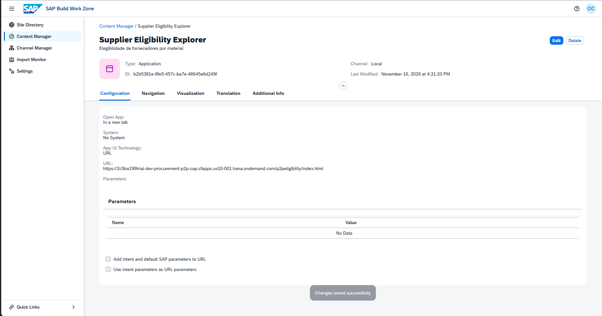
*G2-BTP-04 — The saved app ("Changes saved successfully"), opening in a new tab.*

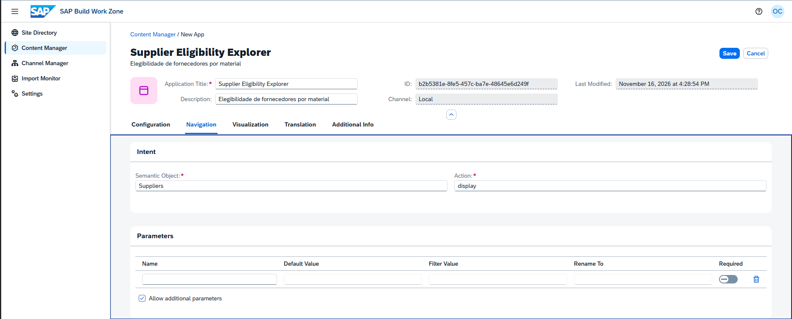
*G2-BTP-05 — The Navigation tab with `Suppliers` / `display` and additional parameters allowed.*

The app was then added to the **Compras** group (Assignment Status on) and to the **Everyone** role. On the role, **Save** stayed blue until clicked: the assignment only counts once saved.

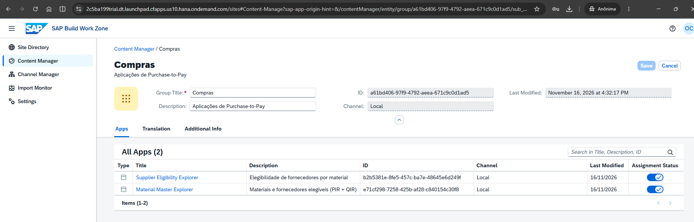
*G2-BTP-06 — The Compras group with both apps assigned.*

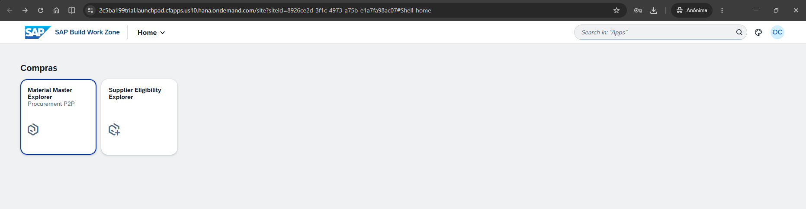
*G2-BTP-07 — The Compras P2P Launchpad with Material Master Explorer and Supplier Eligibility Explorer.*

### G2.6 — Cross-app navigation (G1 ↔ G2)

Navigation uses **semantic objects**: `Materials-display` (G1) and `Suppliers-display` (G2). Since the content is assigned to the same site, the Launchpad resolves the target.

| From | Click | Result |
|---|---|---|
| G1, material Object Page | Supplier code (blue link) | ✅ Opened G2 |
| G2, supplier Object Page | Material code (blue link) | ✅ Opened G1 directly on the material Object Page |

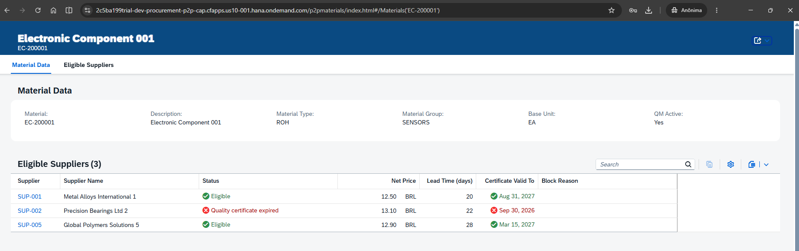
*G2-BTP-11 — After clicking the material code in G2, G1 opened straight on the `EC-200001` Object Page, with the eligible suppliers and `SUP-002` showing "Quality certificate expired".*

> [!NOTE]
> Outside the Launchpad (for example on the local `cds watch`) the links appear as plain text: the Launchpad shell resolves the navigation. The G1 → G2 navigation was tested by the user and worked, but there is no screenshot of it.

### G2.7 — Phone

The same Fiori app, in the phone browser and in Joule Work. With `@UI.Importance`, the table becomes **cards** with the important columns. The old G1 only showed one column.

<table>
<tr>
<td align="center" valign="top">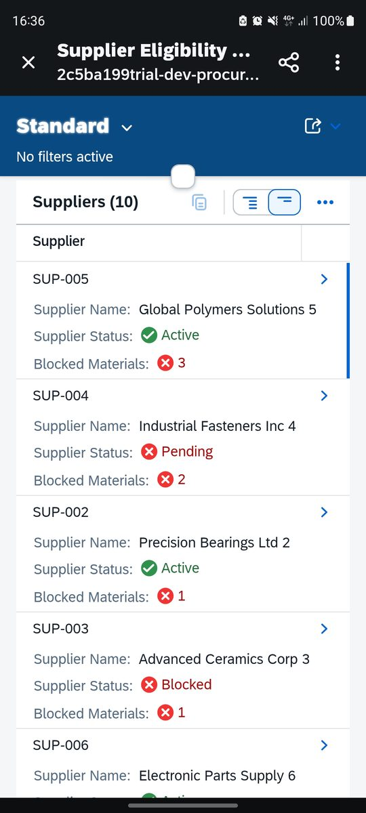<br/><sub><i>G2-BTP-08 — The list on a phone: supplier, name, status and blocked count on each card.</i></sub></td>
<td align="center" valign="top">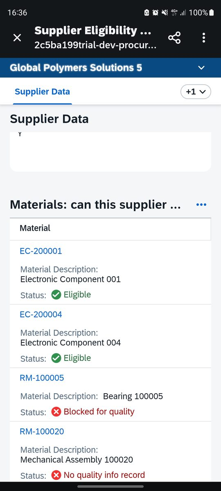<br/><sub><i>G2-BTP-09 — The `SUP-005` Object Page: material, description and status of each item.</i></sub></td>
<td align="center" valign="top">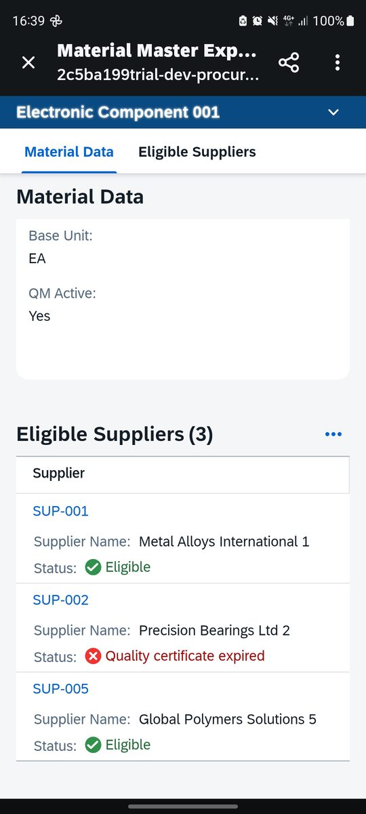<br/><sub><i>G2-BTP-10 — G1 after `@UI.Importance`: supplier, name and status on each card.</i></sub></td>
</tr>
</table>

G2 also showed up in **Joule Work** (SAP's native app for Work Zone), on the same account as G1. This was confirmed by the user, without a screenshot.

### G2.8 — Side learning: an S/4HANA to integrate with (G4)

During G2 the question came up of how it would be to see data from a real S/4HANA. What was found, with no decision made:

| Option | What it is | Note |
|---|---|---|
| S/4HANA Cloud Public Edition, trial | Shared tenant, sample data, SAP advertises 14 days, renewable | The trial page lists customization, master data and **SAP BTP integration** as excluded; it does not mention APIs |
| S/4HANA Advanced Trial (SAP Cloud Appliance Library) | Dedicated system with admin access, 30 days | Runs in the **user's own** cloud account (CAL asks for AWS, Azure or GCP keys) and hosting has a cost |
| SAP Business Accelerator Hub (API sandbox) | OData APIs with sample data, no system of your own | Not verified in this step; the natural starting point for G4 |

An on-premise S/4 would also need the **Cloud Connector** between BTP and the company network. The S/4 Public Edition trial was requested (SAP confirmed the "advanced trial"), but the appliance in CAL was **not created**: it asked for cloud credentials and has a cost.

## 🛠️ Troubleshooting

| # | Symptom | Cause | Fix |
|---|---|---|---|
| 1 | `Suppliers` answered `403` in the local OData test | CAP's default `alice` has no role; the service requires `Viewer` or `Buyer` | Use the `.cdsrc.json` users (`bob`/`bob` is `Viewer`) |
| 2 | `[EADDRINUSE] port 4004 is already in use` | G1's `cds watch` was still running in another tab | Stop the old one with `Ctrl + C`: a single `cds watch` serves both apps |
| 3 | Login window when opening `localhost:4004/p2p.eligibility/...` | CAP's mock login in development | `bob` / `bob` |
| 4 | Unreadable Object Page header (green and red over dark blue) | The CSS copied from G1 paints the header blue on every page | CSS block scoped to `.sapUxAPObjectPageLayout` (G2.3) |
| 5 | The new CSS had no effect | The file open in the editor did not have the block | Paste the block, save (`Ctrl + S`) and reload without cache (`Ctrl + Shift + R`) |
| 6 | The build's `npm ci` would fail with the new workspace | `package-lock.json` did not know `app/eligibility` | `npm.cmd install` at the project root before `mbt.cmd build` |
| 7 | `HTML5 Apps (0)` in Content Explorer, even after the deploy | Work Zone auto-discovery did not work (already seen in G1) | Create the app by hand in Content Manager (G2.5) |
| 8 | The new app came with **Open App = In place** and a placeholder description | Form defaults | Switch to **In a new tab** and fix the description |
| 9 | Assignment to the Everyone role did not stick | **Save** stayed blue: it had not been saved | Click **Save** and wait for "Changes saved successfully" |
| 10 | The Content Manager screen showed **Create Site** | It is the Site Directory list | Do not create a new site; the app joins the existing **Compras P2P** site through the group and the role |

## 🗂️ Structure

```
db/schema.cds ──► srv/service.cds ──► OData V4  /odata/v4/p2p
                  (Suppliers + eligibility + counters,    ├─ Suppliers ──┐ (mixin: eligibility)
                   SupplierEligibility)                   ├─ SupplierEligibility ◄┘
                                                          └─ Materials (G1), ...

app/services.cds ──► app/materials/annotations*.cds     (G1; now with @UI.Importance and a link to G2)
                 └─► app/eligibility/annotations.cds    (G2: list, Object Page, filters, #BySupplier)
                     app/eligibility/_i18n/*.properties (EN + PT texts)
                     app/eligibility/webapp/{manifest.json, Component.js, index.html, css/style.css, i18n/*}

On BTP (mta.yaml):  procurementp2pcapmaterials + procurementp2pcapeligibility ─► HTML5 repo ─► Work Zone (Compras group)
Local:              npm.cmd run watch-eligibility  →  http://localhost:4004/p2p.eligibility/index.html
```

## 📊 Evidence

| # | Evidence | Step | File |
|---|---|---|---|
| 1 | Local list | G2.3 | [G2-EV01](../../../Evidences/LAB_G/G2-EV01-list-report-local.png) |
| 2 | Low-contrast header | G2.3 | [G2-EV02](../../../Evidences/LAB_G/G2-EV02-object-page-cabecalho-azul-baixo-contraste.png) |
| 3 | Light header | G2.3 | [G2-EV03](../../../Evidences/LAB_G/G2-EV03-object-page-cabecalho-claro.png) |
| 4 | List on BTP | G2.4 | [G2-BTP-01](../../../Evidences/LAB_G/G2-BTP-01-list-report-no-btp.png) |
| 5 | Object Page on BTP | G2.4 | [G2-BTP-02](../../../Evidences/LAB_G/G2-BTP-02-object-page-no-btp.png) |
| 6 | Empty Content Explorer | G2.5 | [G2-BTP-03](../../../Evidences/LAB_G/G2-BTP-03-content-explorer-html5-apps-vazio.png) |
| 7 | App created in Content Manager | G2.5 | [G2-BTP-04](../../../Evidences/LAB_G/G2-BTP-04-content-manager-app-criado.png) |
| 8 | `Suppliers` / `display` navigation | G2.5 | [G2-BTP-05](../../../Evidences/LAB_G/G2-BTP-05-content-manager-navegacao-suppliers-display.png) |
| 9 | Compras group with two apps | G2.5 | [G2-BTP-06](../../../Evidences/LAB_G/G2-BTP-06-content-manager-group-compras-dois-apps.png) |
| 10 | Launchpad with two tiles | G2.5 | [G2-BTP-07](../../../Evidences/LAB_G/G2-BTP-07-launchpad-dois-tiles.png) |
| 11 | List on a phone | G2.7 | [G2-BTP-08](../../../Evidences/LAB_G/G2-BTP-08-mobile-list-report.jpg) |
| 12 | Object Page on a phone | G2.7 | [G2-BTP-09](../../../Evidences/LAB_G/G2-BTP-09-mobile-object-page-materiais.jpg) |
| 13 | G1 on a phone with `@UI.Importance` | G2.7 | [G2-BTP-10](../../../Evidences/LAB_G/G2-BTP-10-mobile-g1-object-page-importance.jpg) |
| 14 | G1 opened from G2 | G2.6 | [G2-BTP-11](../../../Evidences/LAB_G/G2-BTP-11-navegacao-g2-para-g1-material-aberto.png) |

## ⚠️ Limitations and open items

- **Manually registered app.** Work Zone's HTML5 Apps provider stayed empty. If the org or space changes, the approuter URL must be updated in both apps.
- **No screenshot** of: G1 → G2 navigation, G2 in Joule Work, `npm install` and `cf deploy` (recorded as text).
- **Fictitious data.** G2 uses the same 10 suppliers and 30 info records as G1. The counters are recomputed on every query (subqueries); with real volume, consider the cost or materializing them.
- **Child-table filter.** Material and status filter through the `eligibility` association. Both filters were validated on the OData service (`eligibility/any(...)`) but not exercised on screen.
- **Phone columns.** `@UI.Importance` was verified on the G2 list and Object Page and on the material Object Page (G1). The G1 list on a phone was not re-checked.
- **Shared CSS.** G2's CSS is a copy of G1's with the Object Page fix. If the look changes, consider centralizing it.
- **Tile without subtitle and with the default icon.** G2's tile has the default icon and no subtitle (the app's Visualization tab).
- **S/4HANA environment.** The options are surveyed (G2.8), but none was adopted; the CAL appliance has a cost and needs a cloud account.
- **Open items inherited from G1:** blank tile on desktop (retest), licensing (hypothesis), cleanup (HANA IP, old service keys, `npm audit`, `cflinuxfs5` migration).

## ➡️ Next steps

1. **G3:** purchase order with items and draft, with the price from the PIR and an eligible supplier.
2. **G4:** Approval Cockpit, with bulk approval respecting each user's approval limit.
3. **G5:** synchronous integration with the ERP (CPI and an S/4HANA simulated by a CAP service).
4. **API consumption:** switch one source (materials) from CSV to an OData API, starting with the SAP Business Accelerator Hub sandbox.

---

[⬆️ Back to README](../../../README.en.md)
